# 00 — Empezar aquí: qué es esto, cómo se corre y qué leer después

Esta es la puerta de entrada. Se lee en cinco minutos y su único objetivo es que
puedas **levantar el proyecto, verificar que tu entorno está sano y saber a qué
sección ir**. No explica ningún módulo por dentro: para eso están las secciones
01 a 07, y el mapa de lectura del final te dice cuál abrir.

Resumen en una frase: **un simulador de propagación de consenso en redes que
corre entero dentro del navegador, con Python real ejecutado por Pyodide sobre
WebAssembly. No hay backend, no hay build, no hay `npm install`.** Lo que se
publica es el repositorio tal cual.

---

## 1. Qué problema modela

> **Archivos que cubre:** `python/simulation/algorithms.py`, `python/simulation/engine.py` (`who_gets_message`, `run_round`, `discrepancy`), `python/simulation/sweep.py`.
> **Qué puedes cambiar aquí:** nada — esta sección es conceptual; el código que la implementa se cambia desde la sección 06 (registro de algoritmos).
> **Qué es intocable y por qué:** la matemática de FV y AMP es un port literal del notebook `pruebas.ipynb` del proyecto de referencia; se conserva aunque hubiera formas más limpias de escribirla, porque la línea base del arnés compara flotantes exactos contra ella.
> **Cómo verificas el cambio:** `PYTHONDONTWRITEBYTECODE=1 python3 scripts/equivalencia.py` → `OK — 1026 casos idénticos a la línea base.`

### El modelo, sin jerga

Imagina un grupo de personas. Cada una tiene una **opinión**, que aquí es
simplemente un número. Algunas personas pueden hablarle a otras, pero no
siempre lo hacen: cada canal de comunicación tiene una **probabilidad** de que
el mensaje efectivamente salga.

Eso es exactamente el grafo del editor:

- Un **nodo** es una persona y su número es su **valor** (`value`).
- Una **arista** es un canal de comunicación de un nodo a otro. Su **peso**
  (`weight`) es la probabilidad de que ese canal transmita en una ronda dada.
  Peso `1` = transmite siempre; peso `0` = nunca; peso `0.5` = la mitad de las
  veces.
- Una **ronda** es un tiro de dados por cada arista: se sortea cuáles
  transmiten. Las que transmitieron entregan un mensaje; el nodo que recibe
  actualiza su valor según el algoritmo elegido.

La pregunta que responde el proyecto es: **¿acaban todos con el mismo número, y
qué tan rápido?**

La medida es la **discrepancia**: `max(valores) − min(valores)`
(`engine.py:166`). Si todos los nodos coinciden, la discrepancia vale `0` y eso
es el **consenso**. Si un nodo vale `1` y otro `0`, la discrepancia es `1`: el
grupo está máximamente dividido.

### Los dos algoritmos

Difieren en una sola cosa: **qué valor adopta un nodo que recibió mensajes.**

| | **FV — Flip Value** | **AMP — Agreement** |
|---|---|---|
| Qué hace el nodo que recibió | Sortea **uno** de los emisores que le llegaron y **copia su valor** | Adopta un **valor fijo** venido de fuera, el parámetro `agreed` (por defecto `0.5`) |
| Qué hace el nodo que no recibió nada | Conserva su valor | Conserva su valor |
| Parámetros configurables | ninguno | `agreed` |
| Intuición | «me convence el último que me habló» | «todos los que se enteran se suman a la consigna» |
| Dónde vive | `fv`, `fv_batch`, `fv_updated` en `algorithms.py` | `amp`, `amp_batch`, `amp_updated` en `algorithms.py` |

Con FV los valores solo se mezclan entre los que ya existían: si nadie empieza
en `0.7`, nadie termina en `0.7`. Con AMP el valor `agreed` se inyecta desde
fuera y el consenso, si llega, es hacia ese valor.

### Las dos formas de correrlo

1. **Simulación individual** (botón «Simular»): una ronda sobre *tu* grafo, con
   *tus* pesos. Te muestra qué aristas transmitieron y cómo quedaron los
   valores. Vive en `engine.py` y corre en un Web Worker, igual que el barrido.
2. **Barrido / sweep** (pestaña «Análisis de Convergencia»): **tira los pesos
   del grafo** y los sustituye por una misma probabilidad `p` aplicada a todas
   las aristas existentes, luego barre `p` de 0 a 1 y grafica la discrepancia
   media resultante. Vive en `sweep.py`, corre en un Web Worker con NumPy
   vectorizado.

**DECISIÓN DELIBERADA** — el sweep ignora los pesos individuales
(`sweep.py`, `_prepare_sweep`: `edge_mask = base_matrix > 0`). No es un
descuido: la pregunta del barrido es «cómo depende el consenso de la
probabilidad de comunicación», así que hace falta una sola `p` que variar. El
grafo solo aporta **qué aristas existen**, no cuánto valen.

---

## 2. Glosario mínimo

> **Archivos que cubre:** ninguno en particular — es el vocabulario que las siete secciones siguientes dan por sabido.
> **Qué puedes cambiar aquí:** agregar términos cuando introduzcas un concepto nuevo en cualquier sección.
> **Qué es intocable y por qué:** los nombres de clave del JSON (`directed`, `nodes`, `edges`, `value`, `weight`, `position`) son el contrato con el proyecto de referencia; renombrarlos rompe la importación de sus ejemplos.
> **Cómo verificas el cambio:** no aplica; si tocaste código, `PYTHONDONTWRITEBYTECODE=1 python3 scripts/equivalencia.py`.

| Término | Qué significa aquí |
|---|---|
| **discrepancia** | `max(valores) − min(valores)` de todos los nodos. Es *la* métrica del proyecto. `engine.py:166`. |
| **consenso** | El estado en que la discrepancia vale `0`: todos los nodos tienen el mismo valor. |
| **FV** (Flip Value) | Algoritmo: el nodo que recibió mensajes sortea uno de sus emisores y copia su valor. Clave `"fv"`. |
| **AMP** (Agreement) | Algoritmo: el nodo que recibió al menos un mensaje adopta el valor fijo `agreed`. Clave `"amp"`. |
| **`agreed`** | Único parámetro de AMP: el valor que se adopta. Por defecto `0.5` (`AGREED_DEFAULT` en `algorithms.py`). La interfaz genera su campo sola desde el registro. |
| **`p`** | En el sweep, la probabilidad de transmisión **común a todas las aristas**. El eje X de la gráfica. Reemplaza los pesos del grafo. |
| **ronda** | Un tiro de dados por cada arista + la actualización de valores que provoca. Es la unidad atómica de simulación. |
| **iteración / refinamiento** | En el sweep: una tanda de simulaciones que se **suma** a las anteriores para afinar la media. El sweep con 50 iteraciones dibuja la curva 50 veces, cada vez con más datos. No es «más rondas»: es más muestras del mismo punto. |
| **IC95** | Intervalo de confianza al 95 %: `media ± 1.96 × error estándar`, sin recortar los límites (`sweep.py`, en el acumulador de estadísticas). Es la banda alrededor de la curva del sweep. |
| **sweep / barrido** | Correr el experimento completo para muchos valores de `p` y graficar discrepancia media vs `p`. |
| **grafo dirigido** | Una arista de A a B permite mensajes solo de A hacia B. Se dibuja con punta de flecha. |
| **grafo no dirigido** | Cada arista vale en ambos sentidos: `get_adj` copia el peso en las dos celdas de la matriz, y el sorteo se refleja con `np.triu` para que ambos sentidos compartan el mismo tiro de dados. |
| **línea base** (baseline) | `scripts/equivalencia_baseline.json`: 1026 resultados congelados contra los que se compara cada cambio del motor. |
| **arnés** | `scripts/equivalencia.py`: el script que captura esos 1026 casos y los compara contra la línea base. |

---

## 3. Cómo lo corro

> **Archivos que cubre:** `scripts/serve.py`, `index.html`, `js/bootstrap.js`.
> **Qué puedes cambiar aquí:** los valores por defecto de `--host` / `--port` y los MIME types de `DevelopmentHandler` en `scripts/serve.py`.
> **Qué es intocable y por qué:** los MIME de `.wasm` (`application/wasm`) y `.mjs` (`text/javascript`) — **INVARIANTE**: sin ellos el navegador rechaza el módulo ES y el WebAssembly de Pyodide, y la app no arranca en absoluto.
> **Cómo verificas el cambio:** `python3 scripts/serve.py` y abrir `http://localhost:8000`; el overlay `#python-loader` debe desaparecer solo.

### El primer comando

```bash
cd /Users/rou/Desktop/Chamba/Sergio/consenso-simulador
python3 scripts/serve.py
```

Imprime tres líneas y se queda escuchando:

```
Sirviendo /Users/rou/Desktop/Chamba/Sergio/consenso-simulador
Abre http://localhost:8000
Presiona Ctrl+C para detener el servidor.
```

Abre **http://localhost:8000**. No hace falta instalar nada más: `serve.py` usa
solo la biblioteca estándar (`http.server`).

### Los flags

```bash
python3 scripts/serve.py --host 0.0.0.0 --port 8080
```

- `--host` (por defecto `127.0.0.1`) — dirección de escucha. Ponlo en `0.0.0.0`
  para abrir el simulador desde otro equipo de la red local.
- `--port` (por defecto `8000`) — puerto HTTP.

El mensaje impreso traduce `127.0.0.1` y `::1` a `localhost`; con cualquier otro
host imprime el host tal cual.

La configuración local del entorno replica exactamente este comando, para
que el entorno la levante solo.

### Por qué NO funciona abriendo `index.html` con doble clic

**INVARIANTE** — el proyecto necesita un **origen HTTP**. Un `file://` falla por
tres razones acumuladas, y las tres son requisitos del navegador, no decisiones
nuestras:

1. **Módulos ES.** `index.html` carga `js/bootstrap.js` como `type="module"`, y
   los módulos ES están sujetos a CORS. Bajo `file://` el origen es opaco y el
   navegador bloquea la carga antes de ejecutar una sola línea.
2. **`fetch()` de los archivos `.py`.** El cargador **descarga** los nueve
   archivos Python con `fetch()` y los escribe en el sistema de archivos virtual
   de Pyodide. `fetch()` sobre `file://` está prohibido.
3. **Web Worker.** El sweep crea `new Worker("./js/sweep-worker.js", {type:
   "module"})`. Los Workers exigen un origen que no sea `file://`.

Síntoma típico si lo intentas: la pantalla se queda con el overlay de carga y
la consola muestra un error de CORS o de módulo bloqueado.

### Por qué la primera carga tarda

`serve.py` sirve **tu** repositorio, pero Pyodide y NumPy **no están en el
repositorio**: se descargan de jsDelivr en cada arranque frío.

```
https://cdn.jsdelivr.net/pyodide/v314.0.2/full/
```

Son decenas de megabytes de WebAssembly. La primera visita tarda; las
siguientes suelen ser instantáneas porque el navegador los sirve desde su caché.

**DECISIÓN DELIBERADA** — la versión de Pyodide está fijada en `314.0.2` y no
se usa `latest`. El motivo: un cambio de versión de Pyodide arrastra un cambio
de versión de NumPy, y la aritmética de coma flotante del motor se compara
contra una línea base exacta. Cambiar la versión obliga a revalidar la
simulación completa antes de publicar.

Consecuencias prácticas que conviene saber desde el primer día:

- **Necesitas red en el arranque.** «Todo corre en el navegador» es cierto para
  el cálculo, no para la carga.
- **También necesitas red en cada barrido.** El Worker se destruye con
  `WORKER.terminate()` al terminar o al detener (`app.py`, `finish_sweep` y
  `stop_sweep`), así que el siguiente sweep vuelve a levantar un runtime nuevo:
  Pyodide, NumPy y seis archivos `.py` otra vez. Con caché caliente es rápido,
  pero sin red el segundo sweep falla.

---

## 4. Checklist del primer día

> **Archivos que cubre:** `scripts/serve.py`, `scripts/equivalencia.py`, `scripts/smoke_ui.py`, y toda la interfaz vía navegador.
> **Qué puedes cambiar aquí:** nada de código — es un protocolo de prueba de entorno.
> **Qué es intocable y por qué:** `scripts/equivalencia_baseline.json` — **INVARIANTE**: nunca lo regrabes con `--grabar` para «hacer que pase» el arnés; es la única prueba de que el motor no cambió de comportamiento.
> **Cómo verificas el cambio:** los dos últimos pasos de esta lista son, literalmente, la verificación.

Hazlo en orden. Si algo falla, para ahí: no sigas leyendo las siete secciones
con un entorno roto.

- [ ] **1. Levanta el servidor.** `python3 scripts/serve.py`. Debe imprimir las
      tres líneas y no devolver el prompt.
- [ ] **2. Abre `http://localhost:8000`.** El overlay `#python-loader` pasa por
      «Cargando Python en el navegador…» → «Cargando NumPy…» y **desaparece
      solo**. Si se queda ahí, mira la consola del navegador.
- [ ] **3. Crea dos nodos.** Arrastra el círculo «Nodo» al lienzo dos veces, o
      haz clic en él (también crea un nodo, en el centro visible).
- [ ] **4. Dales valores distintos.** Doble clic en un nodo abre el diálogo de
      valor. Pon `1` en uno y `0` en el otro: así la discrepancia inicial es `1`
      y el resultado se ve.
- [ ] **5. Conéctalos.** Mantén **Shift** y arrastra desde el borde de un nodo
      hasta el otro. Aparece una arista con etiqueta de peso `1`. Clic en la
      etiqueta para editar el peso.
- [ ] **6. Pulsa «Simular».** Aparece el bloque de resultados y los botones
      «Ver Antes» / «Resetear». Los **valores de los nodos** deben cambiar (con
      FV, el destino copia el valor del emisor).
- [ ] **7. Corre un sweep corto.** Pestaña «Análisis de Convergencia» →
      pon **Puntos de p = 21**, **Simulaciones totales por p = 200**,
      **Iteraciones = 5**, **Rondas = 1** → «Ejecutar sweep». Con esos números
      termina en segundos. El estado va contando `Iteración 1/5`, `2/5`… y la
      curva se refina en cada una. **No arranques con los valores por defecto
      (201 × 5000 × 50): eso es un experimento real y tarda.**
- [ ] **8. Corre el arnés de equivalencia.**
      ```bash
      PYTHONDONTWRITEBYTECODE=1 python3 scripts/equivalencia.py
      ```
      Debe imprimir exactamente:
      `OK — 1026 casos idénticos a la línea base.`
- [ ] **9. Corre el smoke de la interfaz.**
      ```bash
      PYTHONDONTWRITEBYTECODE=1 python3 scripts/smoke_ui.py
      ```
      Debe terminar en `OK — todas las comprobaciones de la interfaz pasaron.`

Si los pasos 8 y 9 pasan, tu entorno de verificación está bien y ya puedes
tocar código. Estos dos scripts corren en **tu Python de escritorio**, no en el
navegador: necesitan **NumPy 2.4.5 y Python 3.12**, porque la línea base
compara flotantes exactos (ver la tabla de constantes). Si tu NumPy no coincide
y el arnés falla, **no regrabes la línea base: repórtalo**.

### Lo que vas a ver en el paso 6 y te va a confundir

**DEUDA CONOCIDA** — **después de «Simular», las aristas NO cambian de color.**
Todas siguen viéndose del mismo morado `#6c6690` con grosor 3.

Esto es un bug real y conocido, **anterior al refactor** (verificado también
contra el respaldo pre-refactor: el comportamiento es idéntico, no es una
regresión). La causa: `render_canvas` escribe el color como **atributo de
presentación** (`stroke="..."` dentro del `<path>`), y en CSS cualquier regla
vence a un atributo de presentación. Como existe la regla
`.edge-path { stroke: #6c6690; stroke-width: 3 }`, esa regla gana siempre.

Consecuencias, para que no pierdas media hora:

- Los cuatro estados que devuelve `edge_style()` — `updated` (naranja),
  `delivered` (morado), `quiet` (gris oscuro) y `selected` (azul) — **no se
  distinguen en pantalla**.
- Las reglas `.edge-path.is-updated`, `.edge-path.is-delivered`,
  `.edge-path.is-idle` y `.edge-path.is-selected` **existen en el CSS pero están
  muertas**, porque `render_canvas` nunca emite esas clases.
- El texto de la interfaz que anuncia «aristas verdes = propagación» describe
  un comportamiento que hoy no ocurre.

**Lo único que sí se ve** tras simular es la **animación de guiones** que
recorre las aristas que transmitieron, porque esa llega por la clase
`edge-animated`, que `render_canvas` sí emite en el `<g>` contenedor y que el
CSS aplica con el selector descendiente `.edge-animated .edge-path`.

No lo «arregles» sin leer la sección **03 — La capa de interfaz**: hay dos
caminos posibles (emitir clases en vez del atributo, o subir la especificidad) y
tienen consecuencias distintas sobre la fidelidad visual con el proyecto de
referencia.

---

## 5. El proyecto de referencia

> **Archivos que cubre:** `/Users/rou/Desktop/Chamba/Sergio/Simulador/` (externo, **solo lectura**), y del lado de acá `python/models.py` (`to_json`/`from_json`) y `python/simulation/engine.py`.
> **Qué puedes cambiar aquí:** nada del proyecto de referencia. Absolutamente nada.
> **Qué es intocable y por qué:** el contrato JSON (`directed`, `nodes[].id/value/position`, `edges[].id/source/target/weight`) — **INVARIANTE**: es lo que permite que un archivo de sus `examples/` entre en este editor sin adaptar.
> **Cómo verificas el cambio:** importa `/Users/rou/Desktop/Chamba/Sergio/Simulador/back/examples/k2.json` con «Importar JSON»; deben aparecer dos nodos y dos aristas, sin error.

Este proyecto no nació de cero: es la **recreación client-side** de un proyecto
anterior que sigue existiendo.

**Dónde vive:** `/Users/rou/Desktop/Chamba/Sergio/Simulador` — con **S
mayúscula**. Ojo: tanto `README.md` como las reglas de trabajo del proyecto lo escriben en minúscula
(`.../simulador`), y en ese mismo directorio existe además una carpeta llamada
`Copia de Simulador`. La ruta buena es la de S mayúscula.

**Qué es:** *Graph Propagation Simulator*, una aplicación cliente-servidor
clásica:

- `back/` — **FastAPI + NumPy**. `api.py` expone `POST /simulate`;
  `pruebas.ipynb` y `old_code.ipynb` contienen la lógica original del
  algoritmo; `tests/` y `test_api.py` su suite; `examples/` tres grafos de
  ejemplo (`k2.json`, `k2_updated.json`, `k2_api_result.json`).
- `front/` — **React 19 + Vite + @xyflow/react** (ReactFlow) para el editor
  visual.

**Qué es este proyecto respecto a aquél:** la misma aplicación, sin servidor.
FastAPI se sustituyó por Python corriendo en Pyodide dentro del navegador;
ReactFlow y Recharts, por SVG generado a mano desde Python.
`python/simulation/engine.py` es el **port literal** de `back/api.py`: de ahí
vienen el `np.ceil` de la máscara de adyacencia, la transposición de `messages`
y varias rarezas que parecen gratuitas y no lo son.

**ES DE SOLO LECTURA.** **INVARIANTE** — las reglas de trabajo del proyecto lo declaran explícitamente,
y la prohibición llega hasta el detalle de **no generar `__pycache__` ahí
dentro**: si necesitas ejecutar algo del proyecto de referencia, hazlo con
`PYTHONDONTWRITEBYTECODE=1`. Léelo, cítalo, compara contra él — pero nunca lo
edites.

**El contrato JSON es idéntico.** Un archivo de `back/examples/` entra en este
editor sin adaptar. Compruébalo tú mismo: `k2.json` es

```json
{
  "directed": true,
  "nodes": [{"id": "node_10", "value": 1, "position": {"x": 326.0, "y": 368.4}}, ...],
  "edges": [{"id": "edge_0", "source": "node_10", "target": "node_11", "weight": "1"}, ...]
}
```

y es exactamente lo que produce `GraphTab.graph_data()` en `models.py`. Nota que
`weight` viaja como **string** (`"1"`, no `1`): eso también es del contrato
original y se conserva.

**DECISIÓN DELIBERADA** — `Edge.highlight` (el estado visual de una arista)
existe en la dataclass pero **queda fuera de `to_json`**. Motivo: el JSON
exportado debe seguir siendo intercambiable con el proyecto de referencia, que
no conoce ese campo.

**DECISIÓN DELIBERADA** — no se portó la suite de tests del proyecto de
referencia. Las reglas de trabajo del proyecto lo prohíben explícitamente por alcance. En su lugar
existen `scripts/equivalencia.py` (1026 casos) y `scripts/smoke_ui.py`.

---

## 6. Árbol de archivos

> **Archivos que cubre:** todos los del repositorio.
> **Qué puedes cambiar aquí:** agregar archivos nuevos; si agregas un `.py` bajo `python/`, tienes que registrarlo también en las listas de montaje (ver la constante `PYTHON_FILES` / `SWEEP_FILES` en la tabla siguiente).
> **Qué es intocable y por qué:** `.nojekyll` — **INVARIANTE**: son 0 bytes en la raíz y sin él GitHub Pages aplica Jekyll, que excluye todo archivo que empiece con guion bajo. Eso borraría `python/simulation/__init__.py` del sitio publicado y la app no arrancaría en producción, aunque funcione perfecto en local.
> **Cómo verificas el cambio:** `python3 scripts/serve.py` y comprobar en la pestaña Network del navegador que los nueve `.py` devuelven 200.

```text
consenso-simulador/
├── index.html                      # 194 L · Estructura del DOM y el contrato de ids que app.py da por existentes
├── .nojekyll                       #   0 B · INVARIANTE: sin él Pages descarta simulation/__init__.py
├── README.md                       # Resumen público del proyecto (se publica en el sitio)
├── DOCUMENTACION.md                # HISTÓRICO — mapa anterior al registro de algoritmos; sus números están desfasados
│
├── css/
│   └── app.css                     # 79 L de líneas gigantes comprimidas. Cítalo por SELECTOR, nunca por número de línea
│
├── js/
│   ├── bootstrap.js                #  88 L · Runtime 1: baja Pyodide, monta los 10 .py y ejecuta app.py como __main__
│   └── sweep-worker.js             # 102 L · Runtime 2: el Web Worker del sweep; monta 6 .py y hace de puente postMessage
│
├── python/
│   ├── app.py                      # 1241 L · El controlador: STATE, render del SVG, 40 listeners, arranque del Worker
│   ├── models.py                   #  140 L · Node, Edge, GraphTab, SimulationState, AppState. Sin DOM, sin Pyodide
│   ├── geometry.py                 #  110 L · Curvas, intersecciones nodo-arista, color por valor y fit-view
│   └── simulation/
│       ├── __init__.py             #  88 L · API pública del paquete. INVARIANTE: importa algorithms para forzar el registro
│       ├── registry.py             # 160 L · Módulo hoja. AlgorithmSpec, ParamSpec, register(). No importa nada interno
│       ├── rng.py                  #  47 L · Módulo hoja. Muestreo aleatorio compartido por el motor escalar y el batched
│       ├── algorithms.py           # 234 L · ← EL ARCHIVO QUE SE EDITA PARA AGREGAR UN ALGORITMO. FV y AMP viven aquí
│       ├── engine.py               # 443 L · Motor de la simulación individual. Port literal de back/api.py
│       └── sweep.py                # 493 L · Barrido vectorizado con NumPy. Genera eventos start/iteration/error
│
├── scripts/
│   ├── serve.py                    #  62 L · Servidor HTTP de desarrollo. Solo biblioteca estándar
│   ├── equivalencia.py             # 485 L · El arnés: 1026 casos contra la línea base. ALGORITMOS está en la línea 187
│   ├── equivalencia_baseline.json  # La línea base congelada. INVARIANTE: nunca --grabar sin justificar
│   └── smoke_ui.py                 # 296 L · Smoke de la interfaz con un DOM simulado; corre fuera del navegador
│
├── docs/
│   ├── 00-empezar-aqui.md          # ← estás aquí
│   ├── 01-arranque.md              # Vigente
│   ├── 02-modelo-de-datos.md       # Vigente
│   ├── 03-interfaz.md              # Vigente
│   ├── 04-simulacion-individual.md # Vigente
│   ├── 05-barrido-sweep.md         # Vigente
│   ├── 06-registro-algoritmos.md   # Vigente
│   ├── 07-verificacion.md          # Vigente
│   ├── 01-runtime-y-arranque.md    # HISTÓRICO (generación anterior)
│   ├── 02-modelos-y-geometria.md   # HISTÓRICO
│   ├── 03-motor-simulacion.md      # HISTÓRICO — documenta la firma vieja de fv(), sin params
│   ├── 04-barrido-sweep.md         # HISTÓRICO — ojo: el vigente es 05-barrido-sweep.md
│   ├── 05-controlador-app.md       # HISTÓRICO
│   ├── 06-formatos-flujos-y-detalles.md # HISTÓRICO
│   └── rendimiento-y-hardware.md   # Perfil de cómputo y criterios para cotizar equipo
│
├── .github/workflows/pages.yml     # Dos jobs: `verificar` y `publicar`. publicar NO depende de verificar
└── .gitignore                      # __pycache__, .DS_Store y los docs/*.html y docs/*.pdf generados con pandoc
```

**DEUDA CONOCIDA** — `docs/` tiene **dos generaciones** de documentos con
numeración solapada. `docs/04-barrido-sweep.md` es el viejo y
`docs/05-barrido-sweep.md` es el vigente; `docs/03-motor-simulacion.md` todavía
documenta la firma `fv(matrix, values, messages, *, rng=None)` **sin `params`**,
que ya no existe. `DOCUMENTACION.md` está igual de desfasado (dice «app.py 1169
L» y «6 archivos .py»). Los históricos no se han borrado todavía: no los cites y
no te fíes de sus números.

**DEUDA CONOCIDA** — `docs/rendimiento-y-hardware.html` y `.pdf` existen en tu
disco pero están en `.gitignore`, así que **no viajan con el repositorio**. Solo
el `.md` está versionado.

Nota sobre lo que se publica: el workflow usa `upload-pages-artifact` con
`path: .`, o sea que **sube el repositorio entero**. En el sitio
https://simulador.ruee.dev/ quedan descargables `scripts/`, `docs/`,
`README.md` y `equivalencia_baseline.json`. la configuración local del entorno **no** están publicados (dan 404).

---

## 7. Tabla de constantes

> **Archivos que cubre:** `js/bootstrap.js`, `js/sweep-worker.js`, `.github/workflows/pages.yml`, `index.html`, `python/simulation/sweep.py`, `scripts/equivalencia.py`.
> **Qué puedes cambiar aquí:** nada sin cambiarlo en **todos** los sitios de la columna «Dónde vive». Estos números están duplicados a mano.
> **Qué es intocable y por qué:** la versión de Pyodide y la de NumPy — **INVARIANTE** conjunto: la línea base compara flotantes exactos y un cambio en cualquiera de las dos invalida los 1026 casos.
> **Cómo verificas el cambio:** `grep -rn "314.0.2" js/ index.html python/ scripts/ .github/` debe devolver exactamente 4 líneas.

| Constante | Valor | Dónde vive (verificado) |
|---|---|---|
| **Versión de Pyodide** | `314.0.2` | **4 sitios, todos a mano:** `js/bootstrap.js:1` (el `import`), `js/bootstrap.js:3` (`PYODIDE_INDEX_URL`), `js/sweep-worker.js:1` (el `import`), `js/sweep-worker.js:3` (`PYODIDE_INDEX_URL`). Cambiar tres de cuatro deja la app arrancando con una versión y el sweep con otra. |
| **CDN** | `https://cdn.jsdelivr.net/pyodide/v314.0.2/full/` | Los mismos 4 sitios. |
| **NumPy (verificación)** | `2.4.5` | `.github/workflows/pages.yml`, paso «Instalar dependencias»: `pip install numpy==2.4.5`. Es la versión con la que se grabó la línea base. |
| **Python (verificación)** | `3.12` | `.github/workflows/pages.yml`, `actions/setup-python@v5` → `python-version: "3.12"`. |
| **NumPy (navegador)** | la que traiga Pyodide 314.0.2 | `pyodide.loadPackage("numpy")` en `js/bootstrap.js` y `js/sweep-worker.js`. **No es la misma que la de verificación**: son dos entornos distintos. |
| **Archivos montados en el runtime principal** | **10** | `PYTHON_FILES`, `js/bootstrap.js:4-15`: `app.py`, `models.py`, `geometry.py`, `simulation/__init__.py`, `simulation/registry.py`, `simulation/rng.py`, `simulation/algorithms.py`, `simulation/usuario.py`, `simulation/engine.py`, `simulation/sweep.py`. |
| **Archivos montados en el Worker** | **7** | `SWEEP_FILES`, `js/sweep-worker.js:4-12`: `simulation/__init__.py`, `registry.py`, `rng.py`, `algorithms.py`, `usuario.py`, `engine.py`, `sweep.py`. **Sin** `app.py`, `models.py` ni `geometry.py`. |
| **Casos de la línea base** | **1026** | `scripts/equivalencia_baseline.json` (1026 claves). Lo imprime el propio arnés: `OK — 1026 casos idénticos a la línea base.` |
| **Algoritmos cubiertos por el arnés** | `("fv", "amp")` | `ALGORITMOS`, `scripts/equivalencia.py:187`. |
| **Semillas del arnés** | `(0, 1, 7, 42, 1234)` | `SEMILLAS`, `scripts/equivalencia.py:188`. |
| **Puntos de p** | mín `2`, máx `1001`, por defecto `201` | `index.html:161` (atributos del `<input>`) y `sweep.py:275` (`_validated_int`). |
| **Simulaciones totales por p** | mín `1`, máx `50000`, por defecto `5000` | `index.html:164` y `sweep.py:276-278`. |
| **Iteraciones (refinamiento)** | mín `1`, máx `1000`, por defecto `50` | `index.html:167` y `sweep.py:279`. |
| **Rondas por simulación** | mín `1`, máx `1000`, por defecto `1` | `index.html:170` y `sweep.py:280`. |
| **`agreed` (AMP)** | `0.5` | `AGREED_DEFAULT` en `python/simulation/algorithms.py`. |
| **Puerto / host del servidor local** | `8000` / `127.0.0.1` | `scripts/serve.py`, `parse_args()`; y la configuración local del entorno. |

**DEUDA CONOCIDA** — los cuatro límites del sweep están escritos **dos veces**:
como atributos HTML en `index.html:161-170` y como argumentos de
`_validated_int` en `sweep.py:275-280`. No hay nada que los mantenga
sincronizados. Peor: la lectura del lado de la app, `positive_int` en
`app.py:1389`, **solo aplica el mínimo, no el máximo**. Es decir, el techo real
lo impone `_validated_int` **dentro del Worker**, y si lo excedes el error llega
como texto en `#sweep-status`, no como validación del formulario.

---

## Cómo encaja todo: los dos runtimes de Pyodide

> **Archivos que cubre:** `js/bootstrap.js`, `js/sweep-worker.js`, `python/app.py` (`start_sweep`, `finish_sweep`, `stop_sweep`), `python/simulation/sweep.py`.
> **Qué puedes cambiar aquí:** el contenido del mensaje `run` (agregar un parámetro nuevo al sweep) y los campos de cada evento devuelto.
> **Qué es intocable y por qué:** que el Worker monte **solo** `python/simulation/` — **INVARIANTE**: es el candado que impide que el código del sweep dependa del DOM o del estado de la interfaz.
> **Cómo verificas el cambio:** correr un sweep corto en el navegador (21 puntos, 200 sims, 5 iteraciones) y comprobar que `#sweep-status` avanza de `Iteración 1/5` a `5/5`.

Este es el plano general. Lo que hay que retener: **son dos intérpretes de
Python separados, con distinto conjunto de archivos, y lo único que cruza entre
ellos son mensajes JSON.**

```mermaid
flowchart TB
    subgraph BROWSER["Pestaña del navegador — un solo origen HTTP"]
      direction TB

      subgraph MAIN["RUNTIME 1 · Hilo principal · lo arranca js/bootstrap.js"]
        direction TB
        M1["Pyodide 314.0.2 + NumPy<br/>descargados de jsDelivr"]
        M2["monta PYTHON_FILES = 10 archivos en /python<br/>app.py · models.py · geometry.py<br/>simulation/: __init__ registry rng algorithms usuario engine sweep"]
        M3["ejecuta app.py como __main__"]
        M4["<b>STATE = AppState&#40;&#41;</b><br/>AQUÍ VIVE TODO EL ESTADO<br/>pestañas, nodos, aristas, zoom, pan,<br/>algoritmo activo y sus params, simulación"]
        M5["render del SVG + 40 listeners<br/>+ Simular → mensaje al worker"]
        M1 --> M2 --> M3 --> M4 --> M5
      end

      subgraph WORKER["RUNTIME 2 · Web Worker · js/sweep-worker.js · se crea al pulsar «Ejecutar sweep»"]
        direction TB
        W1["Pyodide 314.0.2 + NumPy<br/>descargados OTRA VEZ de jsDelivr"]
        W2["monta SWEEP_FILES = 7 archivos<br/>solo simulation/<br/>SIN app.py, models.py ni geometry.py"]
        W3["iter_sweep&#40;...&#41;<br/>SIN ESTADO PROPIO:<br/>todo llega en el mensaje"]
        W1 --> W2 --> W3
      end

      M5 -- "postMessage type:'run'<br/>params = graph JSON completo + algorithm<br/>+ algorithmParams + numPPoints<br/>+ totalSimulationsPerP + iterations + rounds<br/>serializado con JSON.stringify" --> W3
      W3 -- "postMessage por iteración<br/>type:'start' · 'iteration' · 'error'<br/>y type:'end' que emite el propio worker JS<br/>cada punto trae p · mean · ciLow · ciHigh" --> M5
      M5 -- "WORKER.terminate&#40;&#41; al terminar o al Detener<br/>DESTRUYE el runtime 2 entero" --> W1
    end

    CDN["jsDelivr<br/>cdn.jsdelivr.net/pyodide/v314.0.2/full/"] -.-> M1
    CDN -.-> W1
    SRV["Servidor HTTP<br/>python3 scripts/serve.py<br/>o GitHub Pages"] -.-> M2
    SRV -.-> W2
```



Tres lecturas de este diagrama que ahorran horas:

1. **El estado vive en un solo sitio.** `STATE` está en el runtime principal. El
   Worker es una calculadora sin memoria: recibe el grafo completo en cada
   ejecución y no sabe nada de pestañas, zoom ni selección.
2. **La frontera es JSON puro.** Nada de objetos Python cruza. El grafo se
   serializa con `JSON.stringify` en JS y se vuelve a leer con `json.loads`
   dentro del Worker. Si algo no es serializable, no cruza.
3. **9 vs 6 no es casualidad.** **DECISIÓN DELIBERADA**: el Worker monta solo
   `simulation/` para que sea imposible que el código del sweep dependa del DOM
   o del estado de la interfaz. Es un candado arquitectónico: si algún día
   `sweep.py` necesitara importar `models.py`, el Worker fallaría al instante y
   eso es exactamente lo que se busca.

---

## 8. Mapa de lectura: qué abrir según lo que quieras hacer

> **Archivos que cubre:** `docs/01-arranque.md` … `docs/09-invariantes-y-deuda.md`.
> **Qué puedes cambiar aquí:** agrega una fila cuando escribas una sección nueva.
> **Qué es intocable y por qué:** el orden 01→09 — está construido para que cada sección use solo vocabulario ya introducido; leer 04 antes de 02 no funciona.
> **Cómo verificas el cambio:** que el enlace abra y que la sección citada cubra de verdad los archivos que la fila promete.

| Quiero… | Leo | Por qué |
|---|---|---|
| Entender por qué el proyecto tiene esta forma | **01 — Arranque** | Sin backend ni build, las dos listas manuales de `.py`, los dos runtimes, el contrato de ids de `index.html`, `runpy` y `sys.path`, y `retain()` como lo que mantiene viva la aplicación. |
| Saber qué es exactamente un grafo aquí | **02 — Modelo de datos** | Las tres representaciones (dataclasses → JSON plano → matriz NumPy) y la conversión unidireccional. Es el vocabulario de las cuatro secciones siguientes. |
| Tocar el editor, el SVG, el arrastre, el zoom o **el color de las aristas** | **03 — Interfaz** | `STATE`, la regeneración completa del SVG, la delegación de eventos, el umbral de 6 px, la captura de puntero, y el bug del CSS de aristas descrito arriba. |
| Entender qué pasa al pulsar «Simular» | **04 — Simulación individual** | El recorrido completo de un dato desde el clic hasta el píxel. Aquí vive la explicación **canónica** de las dos orientaciones de la matriz (`messages[target, source]`). |
| Tocar el barrido, el Worker o la gráfica | **05 — Barrido (sweep)** | El cruce de runtimes, el eje extra de los tensores, por qué el barrido tira los pesos, el contrato de eventos y el estado real de la cancelación. |
| **Agregar un algoritmo nuevo** | **06 — Registro de algoritmos** | `AlgorithmSpec`, `register()`, las tres funciones de firma uniforme y cómo la interfaz genera sus campos sola. Léelo después de 04 y 05. |
| Comprobar que no rompí nada | **07 — Verificación** | Los dos scripts, qué cubren y qué **no**, `--grabar` y su peligro, el CI que informa pero no bloquea, y el entorno exacto (Python 3.12, NumPy 2.4.5). |
| Cotizar hardware o entender el techo de cómputo | **`docs/rendimiento-y-hardware.md`** | Perfil de cómputo y criterios de compra. |

### El matiz más importante antes de agregar un algoritmo

**Para que un algoritmo nuevo funcione en la aplicación basta editar
`python/simulation/algorithms.py`.** Eso es verdad: escribes las funciones,
llamas a `register(AlgorithmSpec(...))` y el `<select>` de la interfaz, el motor
individual y el sweep lo recogen solos. No hay que tocar `engine.py`,
`sweep.py`, `app.py`, `index.html` ni ningún `.js`.

**Pero el arnés de equivalencia no lo va a cubrir.** Los 1026 casos se
construyen recorriendo la tupla `ALGORITMOS = ("fv", "amp")`, escrita a mano en
`scripts/equivalencia.py:187`. Un algoritmo que no esté en esa tupla es
invisible para la verificación: el arnés seguirá diciendo `OK — 1026 casos`
mientras tu algoritmo no tiene una sola prueba. El trabajo completo son **dos
archivos**:

1. `python/simulation/algorithms.py` — el algoritmo.
2. `scripts/equivalencia.py:187` — agregar su clave a `ALGORITMOS`, y **después**
   regrabar la línea base con `--grabar`. Esta regrabación **sí** es legítima:
   agrega claves nuevas sin alterar las viejas, así que puedes comprobar que los
   1026 casos anteriores siguen ahí con su mismo valor.

No repitas «basta un solo archivo» sin ese matiz: quien lo haga entregará un
algoritmo sin red de seguridad creyendo que la tiene.

---

## Antes de tocar nada: tres reglas que no están en el código

> **Archivos que cubre:** `scripts/equivalencia_baseline.json`, y el proyecto de referencia externo.
> **Qué puedes cambiar aquí:** nada sin acordarlo con quien mantiene el proyecto; son el contrato de trabajo, no código.
> **Qué es intocable y por qué:** las tres reglas de abajo — **INVARIANTE**: cada una protege algo que, roto, no da error inmediato sino resultados silenciosamente equivocados.
> **Cómo verificas el cambio:** `PYTHONDONTWRITEBYTECODE=1 python3 scripts/equivalencia.py && PYTHONDONTWRITEBYTECODE=1 python3 scripts/smoke_ui.py`

1. **INVARIANTE** — el proyecto de referencia
   (`/Users/rou/Desktop/Chamba/Sergio/Simulador`) es de **solo lectura**,
   incluida la prohibición de generar `__pycache__` ahí dentro.
2. **INVARIANTE** — todo cambio bajo `python/simulation/` se verifica **antes y
   después** con `python3 scripts/equivalencia.py`. Antes, para saber que
   partías de verde.
3. **INVARIANTE** — `scripts/equivalencia_baseline.json` no se regraba para
   hacer pasar el arnés. Solo se regraba cuando el cambio de comportamiento es
   **intencional y está justificado por escrito**.

Las reglas de trabajo del proyecto contienen el contrato de trabajo completo. No están
publicados en el sitio, pero sí están en el repositorio, y son vinculantes.
