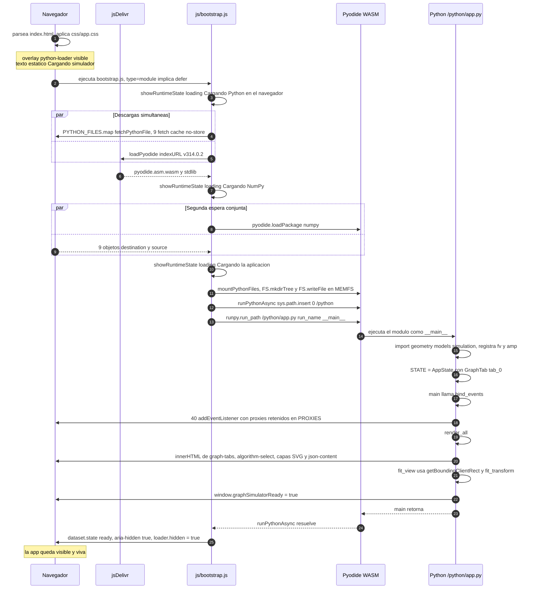
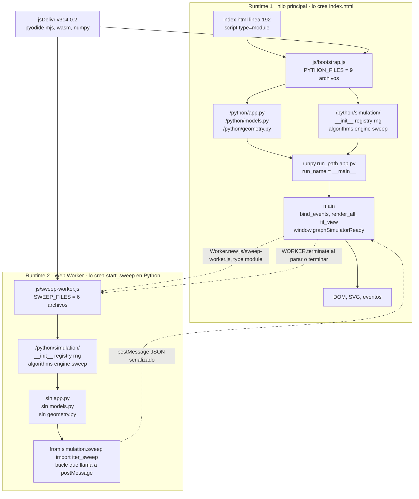
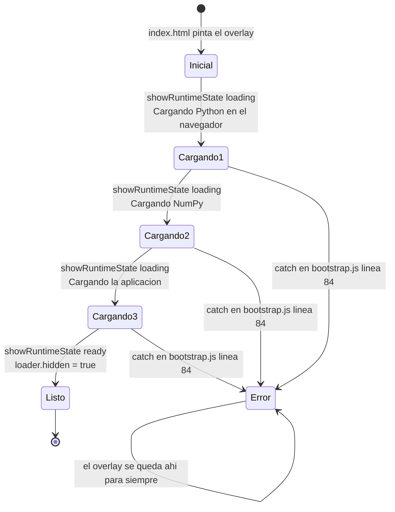
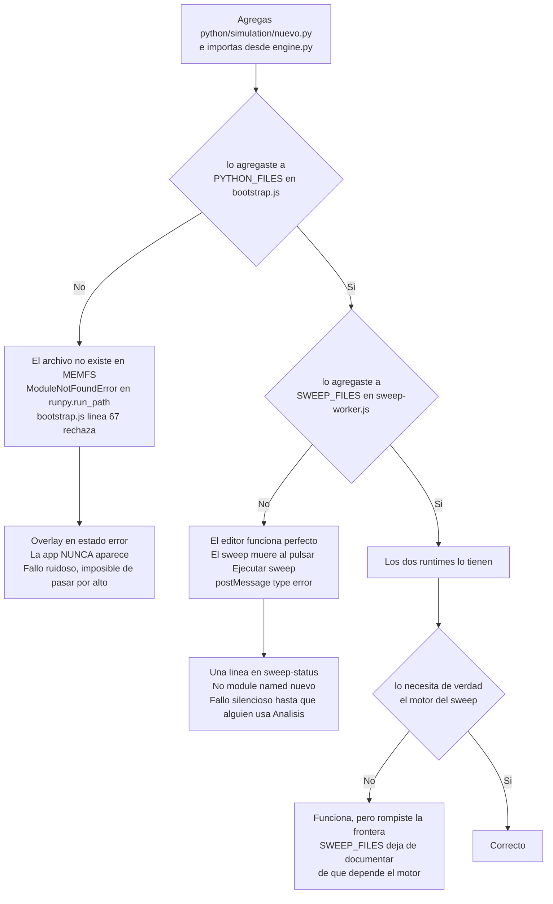

# Arranque del sistema — de abrir la página a la app viva

Esta sección responde una sola pregunta: **qué ocurre, en orden, desde que el
navegador pide `index.html` hasta que la aplicación responde a un clic.** Va
primero en el mapa porque explica por qué el resto del proyecto tiene la forma
que tiene: las dos listas de archivos escritas a mano, `import.meta.url`, el
overlay, `runpy`, `retain()` y la existencia de un segundo runtime de Python.

> Los documentos `DOCUMENTACION.md` y `docs/01-runtime-y-arranque.md` …
> `docs/06-formatos-flujos-y-detalles.md` son **anteriores al registro de
> algoritmos** y sus conteos de líneas ya no cuadran (ninguno contiene la cadena
> `register(`). Si un número de este mapa contradice uno de ellos, gana este mapa.

---

## 1. El modelo mental: sin backend, sin build, dos runtimes

> **Archivos que cubre:** `.github/workflows/pages.yml`, `.nojekyll`, `README.md`, y la vista de conjunto de `index.html`, `js/` y `python/`.
> **Que puedes cambiar aqui:** nada de código; esta sección es el modelo mental. Si algo de aquí te parece falso, el código cambió y hay que reescribir la sección.
> **Que es intocable y por que:** la ausencia de paso de compilación. Todo lo raro del arranque existe *únicamente* porque se publica el repositorio tal cual; si algún día se añade un empaquetador, media sección sobra.
> **Como verificas el cambio:** `python3 scripts/serve.py`, abre <http://localhost:8000> y en la consola del navegador escribe `window.graphSimulatorReady` — debe responder `true`.

Este proyecto **no tiene backend y no tiene paso de compilación**. Lo que se
publica es el repositorio tal cual: `index.html`, un `.css`, dos `.js` y nueve
`.py` servidos como archivos estáticos. El comentario que encabeza el workflow
de publicación lo dice explícitamente (`.github/workflows/pages.yml:3-5`).

Eso tiene una consecuencia que explica casi todas las decisiones raras del
arranque: **el navegador no puede descubrir qué archivos Python existen**. Un
servidor estático no expone un listado del directorio `python/`, y aunque lo
expusiera, no habría forma portátil de leerlo. Alguien tiene que *nombrar* los
archivos uno por uno. Ese "alguien" es una constante en JavaScript, y hay dos
de ellas porque hay **dos runtimes de Python**, no uno.

Todo el JavaScript del proyecto (190 líneas entre `js/bootstrap.js`, 88, y
`js/sweep-worker.js`, 102) existe solo para: bajar Pyodide, bajar los `.py`,
escribirlos en el sistema de archivos virtual y ejecutar el primero. La lógica
de la aplicación —estado, eventos, DOM, SVG, algoritmos— vive completa en Python.

### Los dos entornos que no hay que confundir

"No hay nada que instalar" es cierto **para usar la app**, y falso para
mantenerla. Son dos entornos distintos y solo uno de los dos no pide nada:

| | Entorno del navegador (usar la app) | Entorno de escritorio (verificar cambios) |
|---|---|---|
| Qué corre | Pyodide + NumPy descargados de jsDelivr | CPython local |
| Qué hay que instalar | nada | Python 3.12 y NumPy 2.4.5 exactos (`.github/workflows/pages.yml:31` y `:36`) |
| Por qué esas versiones | — | la línea base del arnés compara flotantes exactos; ver [§7 · Verificación](07-verificacion.md) |
| Necesita red | **sí**, en cada carga en frío | solo para instalar NumPy la primera vez |

**DEUDA CONOCIDA** — el `README.md` dice que el requisito es "Python 3.11 o
posterior, únicamente para servir los archivos estáticos". Eso describe
`scripts/serve.py`, no el arnés. Quien verifique con 3.11 y otra versión de
NumPy obtendrá diferencias numéricas que no son regresiones suyas.

**DECISION DELIBERADA** — la app *no* funciona sin conexión. Pyodide y NumPy se
bajan de `https://cdn.jsdelivr.net/pyodide/v314.0.2/full/` en cada carga en frío
del hilo principal **y de cada Worker de sweep**. Se aceptó a cambio de no tener
que versionar ni servir ~10 MB de WebAssembly desde el repositorio. La caché
HTTP del navegador suaviza el costo, no lo elimina.

---

## 2. `index.html` — el contrato de `id`s

> **Archivos que cubre:** `index.html` (194 líneas) y los selectores del overlay en `css/app.css` (`.python-loader`, `.loader-mark`, `[hidden]`).
> **Que puedes cambiar aqui:** textos, clases, orden visual, contenedores nuevos, atributos ARIA.
> **Que es intocable y por que:** todo `id` que Python busca con `by_id()` (`python/app.py:34`), y que `#python-loader` se **superponga** en vez de ocultar `#app`.
> **Como verificas el cambio:** a ojo en <http://localhost:8000>. `python3 scripts/smoke_ui.py` **no sirve** para esto: su DOM falso crea cualquier `id` que se le pida (`scripts/smoke_ui.py:83-84`), así que un `id` renombrado pasa el smoke y falla en el navegador.

194 líneas de marcado **sin una sola línea de lógica**. Su papel es doble:

1. Definir los contenedores estables a los que Python se engancha una sola vez.
2. Mostrar el overlay de carga mientras Python no existe todavía.

### Orden de carga

| Línea | Qué pasa |
|---|---|
| `index.html:8` | `<link rel="stylesheet" href="./css/app.css">` en el `<head>`. Bloqueante: el overlay ya se pinta con estilos, nunca hay destello sin CSS. |
| `index.html:11-15` | `#python-loader`: el overlay a pantalla completa. Es lo **primero** del `<body>`, así que existe antes que nada. |
| `index.html:17-190` | `<main id="app">`: la aplicación entera, ya presente en el DOM pero tapada por el overlay. |
| `index.html:192` | `<script type="module" src="./js/bootstrap.js">`, al final del `<body>`. |

Detalle no obvio: `type="module"` implica **`defer` automático**. El script se
ejecuta cuando el HTML ya está parseado, así que `document.getElementById` en
`js/bootstrap.js:16-17` —que corre a nivel de módulo, no dentro de una
función— siempre encuentra los elementos.

Dos contrafactuales que conviene tener claros, porque fallan de maneras muy
distintas:

- **Mover el `<script type="module">` al `<head>` no rompe nada.** Sigue siendo
  diferido; se ejecutaría igual después del parseo.
- **Añadirle `async` sí rompe, y en silencio.** Un `<script async type="module">`
  en el `<head>` puede ejecutarse antes de que exista el `<body>`; las líneas
  16-17 devolverían `null` y el overlay dejaría de actualizarse **sin lanzar
  ningún error**, porque todas las escrituras están guardadas con `if (loader)` /
  `if (detail)` (`js/bootstrap.js:20` y `:26`).
- **Convertirlo en un `<script>` clásico rompe ruidosamente.** `js/bootstrap.js:1`
  es `import { loadPyodide } from "…/pyodide.mjs";`: un `import` de nivel superior
  en un script clásico es un **`SyntaxError` de parseo**. El archivo no se ejecuta
  en absoluto —las líneas 16-17 ni se evalúan— y el navegador **sí** registra el
  error en consola.

**INVARIANTE** — el overlay no oculta `#app`. Es `position: fixed; inset: 0`
(selector `.python-loader` en `css/app.css`), se superpone. Eso importa al final
del arranque: cuando Python llama a `fit_view()` el canvas ya tiene ancho y alto
reales, porque nunca estuvo en `display: none`.

### Los contenedores que Python rellena

El canvas SVG (`index.html:91-105`) tiene cuatro capas `<g>` que **nunca se
reemplazan**; lo que se reemplaza es su `innerHTML`:

```
svg#graph-canvas
├── defs
│   ├── pattern#grid-dots      (cuadrícula 12×12, estático)
│   └── marker#arrowhead       (punta de flecha, estático)
├── rect.canvas-grid           (fondo, estático)
├── g#edges-layer              ← render_canvas() reescribe innerHTML
├── g#edge-labels-layer        ← render_canvas() reescribe innerHTML
├── g#nodes-layer              ← render_canvas() reescribe innerHTML
└── g#connection-layer         ← línea provisional al conectar
```

Ese reparto es el motivo por el que `bind_events()` puede enganchar **un solo**
listener por tipo de evento al `<svg>` y no a cada nodo: todo es delegación.
`render_canvas()` (`python/app.py:231`) puede tirar y regenerar 500 círculos sin
que se pierda un solo listener, porque los listeners están en el padre estático.
El mecanismo completo de regeneración y delegación vive en
[§3 · La capa de interfaz](03-interfaz.md).

Hay marcado estático que Python **sustituye** en el primer render, y esto
confunde a quien lee el HTML esperando encontrarlo en el DOM vivo:

- `index.html:27-30` dibuja un `<button id="tab_0">` y un `<button
  id="new-tab-btn">`. `render_tabs()` (`python/app.py:200-216`) reescribe el
  `innerHTML` de `#graph-tabs` entero y emite **`<div class="tab">`**, no
  `<button>`. El botón `+ Nueva` se regenera también (`python/app.py:215`).
  Es decir: el marcado del HTML es una maqueta que dura milisegundos.
- `index.html:63` declara `<select id="algorithm-select">` **vacío a
  propósito**. Las opciones las genera `render_algorithm_options()`
  (`python/app.py:149-158`) desde el registro de algoritmos. Por eso agregar un
  algoritmo no toca ni `index.html` ni JavaScript (lo dice el comentario en
  `index.html:61-62`).
- `index.html:146-158` trae rejilla y etiquetas del eje ya dibujadas; `app.py`
  las regenera según la escala de los datos.

Y hay contenedores que nacen ocultos y Python conmuta: `#sweep-panel`
(`index.html:123`), `#json-panel` (`index.html:167`), `#app-dialog`
(`index.html:179`), `#simulation-results` (`index.html:67`).

**INVARIANTE** — `index.html` es un contrato de `id`s. `by_id()`
(`python/app.py:34`) es `document.getElementById` pelado: si renombras un `id`
aquí, allá obtienes `None` y el fallo aparece como `AttributeError` en la
consola de Pyodide, a veces solo cuando el usuario toca ese control.
`set_hidden` y `set_text` (`python/app.py:48-57`) toleran el `None` en
silencio; el resto del archivo, no. Y ningún script del repositorio comprueba
este contrato: el único verificador es abrir el navegador.

---

## 3. `js/bootstrap.js` — 88 líneas, función por función

> **Archivos que cubre:** `js/bootstrap.js` completo.
> **Que puedes cambiar aqui:** los textos del overlay, y agregar rutas a `PYTHON_FILES` cuando aparezca un `.py` nuevo.
> **Que es intocable y por que:** `import.meta.url` en `fetchPythonFile` (sin él el sitio muere bajo un subdirectorio), el `sys.path.insert` y el `run_name="__main__"` del puente a Python, y el paralelismo de la línea 55.
> **Como verificas el cambio:** `python3 scripts/serve.py` y recarga con la consola abierta; el arranque correcto termina con el overlay oculto y `window.graphSimulatorReady === true`.

### `PYTHON_FILES` (`js/bootstrap.js:4-14`) y `PYODIDE_INDEX_URL` (`:3`)

```js
const PYODIDE_INDEX_URL = "https://cdn.jsdelivr.net/pyodide/v314.0.2/full/";
const PYTHON_FILES = [
  "python/app.py", "python/models.py", "python/geometry.py",
  "python/simulation/__init__.py", "python/simulation/registry.py",
  "python/simulation/rng.py", "python/simulation/algorithms.py",
  "python/simulation/engine.py", "python/simulation/sweep.py",
];
```

Nueve rutas, escritas a mano.

**INVARIANTE** — la versión de Pyodide está fijada y escrita en **cuatro
sitios**: `js/bootstrap.js:1` y `:3`, `js/sweep-worker.js:1` y `:3`. Actualizar
solo dos deja los dos runtimes en versiones distintas, con el motor produciendo
números diferentes según se ejecute una simulación individual o un barrido.

### `showRuntimeState(state, text)` (`:19-29`)

Único punto de escritura del overlay. Hace tres cosas:

```js
loader.hidden = false;
loader.dataset.state = state;                       // → atributo data-state
loader.setAttribute("aria-busy", state === "loading" ? "true" : "false");
detail.textContent = text;                          // → #loader-detail
```

Se llama con exactamente tres estados: `"loading"` (tres veces, con textos
distintos), `"ready"` y `"error"`.

### `fetchPythonFile(sourcePath)` (`:31-42`)

```js
const sourceUrl = new URL(`../${sourcePath}`, import.meta.url);
const response = await fetch(sourceUrl, { cache: "no-store" });
if (!response.ok) throw new Error(`No se pudo descargar ${sourcePath} (${response.status}).`);
return { destination: `/${sourcePath}`, source: await response.text() };
```

Dos decisiones que hay que entender:

- **DECISION DELIBERADA · `import.meta.url` en vez de una ruta absoluta.**
  `import.meta.url` es `…/js/bootstrap.js`; `../python/app.py` resuelve relativo
  a *ese* archivo. Por eso el sitio funciona igual en `http://localhost:8000/`,
  en <https://simulador.ruee.dev/> y en un GitHub Pages de proyecto servido bajo
  `/consenso-simulador/`. Si estuviera escrito `/python/app.py`, en un Pages de
  proyecto daría 404.
- **DECISION DELIBERADA · `cache: "no-store"`.** Los `.py` se vuelven a bajar en
  cada carga, siempre. Editas un `.py`, recargas y ves el cambio, sin
  cache-busting ni versionado en la URL. El costo es que no hay caché de esos
  nueve archivos; son kilobytes, y la descarga pesada (Pyodide) sí se cachea.

La forma que devuelve importa: `{ destination: "/python/app.py", source: "…" }`
— nótese la barra inicial en `destination`. El montaje es en la raíz del FS
virtual, no en un `/home/pyodide`.

### `mountPythonFiles(pyodide, files)` (`:44-50`)

```js
const parentDirectory = destination.slice(0, destination.lastIndexOf("/"));
pyodide.FS.mkdirTree(parentDirectory);
pyodide.FS.writeFile(destination, source, { encoding: "utf8" });
```

`pyodide.FS` es Emscripten MEMFS: un sistema de archivos **en memoria**, dentro
del heap de WebAssembly. No hay disco, no hay persistencia, no sobrevive a un
`F5`. `mkdirTree` es idempotente, así que las nueve llamadas crean `/python` una
vez y `/python/simulation` una vez.

El resultado, dentro del WASM:

```
/python/
├── app.py          models.py       geometry.py     ← módulos de nivel superior
└── simulation/
    ├── __init__.py registry.py     rng.py
    ├── algorithms.py               engine.py       sweep.py
```

No hay `__init__.py` en `/python`: `app`, `models` y `geometry` son módulos
sueltos sobre `sys.path`, y `simulation` es el único paquete.

### `startApplication()` (`:52-82`) — el paralelismo es el punto

```js
showRuntimeState("loading", "Cargando Python en el navegador…");

const pythonFilesPromise = Promise.all(PYTHON_FILES.map(fetchPythonFile));  // :55  NO await
const pyodide = await loadPyodide({ indexURL: PYODIDE_INDEX_URL });         // :56

showRuntimeState("loading", "Cargando NumPy…");
const [, pythonFiles] = await Promise.all([                                 // :59
  pyodide.loadPackage("numpy"),
  pythonFilesPromise,
]);
```

**DECISION DELIBERADA** — la línea 55 crea la promesa y **no la espera**. Los
nueve `fetch` salen disparados y viajan mientras el runtime de Pyodide —de lejos
la descarga más pesada del arranque— se baja e inicializa. Cuando en la línea 59
se espera, normalmente ya terminaron hace rato. Si alguien "limpiara" el código
poniendo `await` en la 55, el arranque se volvería estrictamente secuencial y
más lento sin ganar nada.

La desestructuración `const [, pythonFiles]` descarta el resultado de
`loadPackage("numpy")` (que no devuelve nada útil) y se queda con el arreglo de
nueve `{destination, source}`.

**DEUDA CONOCIDA** — si un `.py` falla (404) mientras `loadPyodide` sigue
pendiente, la promesa de la línea 55 se rechaza sin handler todavía adjunto, y
el navegador puede registrar un `unhandledrejection` antes de que el `await` de
la línea 59 la recoja. El estado final que ve el usuario es correcto —overlay en
error con el mensaje de `js/bootstrap.js:35`—, solo la consola se ensucia.

### El puente a Python (`:67-75`)

```js
await pyodide.runPythonAsync(`
import runpy
import sys

if "/python" not in sys.path:
    sys.path.insert(0, "/python")

runpy.run_path("/python/app.py", run_name="__main__")
`);
```

Cuatro cosas que parecen ceremonia y no lo son:

1. **INVARIANTE · `sys.path.insert(0, "/python")`.** `runpy.run_path` sobre un
   archivo `.py` suelto **no** agrega su directorio a `sys.path`. Sin esa línea,
   el `from geometry import …` de `python/app.py:16` explota con
   `ModuleNotFoundError`.
2. **INVARIANTE · `run_name="__main__"`.** Es lo que hace disparar el guardia
   `if __name__ == "__main__": main()` de `python/app.py:1240-1241`. Con un
   `import app` normal, el módulo se cargaría y `main()` no se llamaría nunca:
   la app quedaría inerte, con el overlay ya oculto y cero listeners — el modo
   de fallo más desconcertante posible, porque la pantalla se ve perfecta.
3. **`runpy` no registra el módulo en `sys.modules`.** No existe un `app`
   importable. `app.py` es un script, no una biblioteca. Nada más en el
   proyecto lo importa: `scripts/smoke_ui.py` lo carga con dobles de `js` y
   `pyodide.ffi`, precisamente porque no puede importarse de otro modo.
4. **`runPythonAsync`, no `runPython`**, porque permite `await` de nivel
   superior en el código Python. Aquí no se usa, pero es el camino habitual.

### El final feliz (`:77-81`) y el infeliz (`:84-88`)

```js
showRuntimeState("ready", "Aplicación lista.");
loader?.setAttribute("aria-hidden", "true");
if (loader) loader.hidden = true;
```

```js
startApplication().catch((error) => {
  console.error("No se pudo iniciar la aplicación Python.", error);
  const detail = error instanceof Error ? error.message : String(error);
  showRuntimeState("error", `No se pudo iniciar la aplicación: ${detail}`);
});
```

**DEUDA CONOCIDA (de legibilidad)** — en `js/bootstrap.js:86` se declara un
`const detail` **local** que sombrea el `detail` de módulo (`:17`). No hay bug:
`showRuntimeState` cierra sobre el binding de módulo, no sobre el del `catch`.
Pero leído rápido parece que se está pisando la referencia al elemento del DOM.

---

## 4. `python/app.py` → `main()`, el lado Python del arranque

> **Archivos que cubre:** `python/app.py` en lo que toca al arranque (`main`, `bind_events`, `render_all`, `fit_view`, `retain`), más `python/models.py:91` y `python/geometry.py:97-99`.
> **Que puedes cambiar aqui:** agregar o quitar listeners dentro de `bind_events()`, y el orden de los cuatro renders siempre que `render_canvas()` siga corriendo antes de `fit_view()`.
> **Que es intocable y por que:** que **toda** función que cruce a JavaScript pase por `retain()`; sin eso el proxy se recolecta y el evento muere sin error visible.
> **Como verificas el cambio:** `python3 scripts/smoke_ui.py` cubre el selector y los parámetros; los listeners solo se comprueban a mano en <http://localhost:8000> (crear un nodo, arrastrarlo, Shift para conectar, Simular).

`python/app.py:1233-1237`, cuatro líneas:

```python
def main() -> None:
    bind_events()
    render_all()
    fit_view()
    window.graphSimulatorReady = True
```

Antes de llegar ahí, la ejecución del módulo ya hizo el trabajo pesado:
`python/app.py:13-19` importa `js` y `pyodide.ffi` (solo existen dentro de
Pyodide), luego `geometry`, `models` y `simulation`; `python/app.py:22` crea el
singleton `STATE = AppState()`, cuyo valor por omisión ya trae una pestaña
`GraphTab("tab_0", "Grafo 1")` vacía (`python/models.py:91`).

**INVARIANTE** — importar `simulation` dispara `from . import algorithms` en
`python/simulation/__init__.py:16`, marcado con `# noqa: F401` porque parece un
import muerto. Es lo que **registra** `fv` y `amp`. Si ese import desapareciera,
el registro quedaría vacío y el `<select>` saldría sin opciones.

### `bind_events()` (`python/app.py:1189-1230`)

**40 llamadas a `listen()`**, una por línea. `listen()`
(`python/app.py:44-45`) es `target.addEventListener(event, retain(callback))`, y
`retain()` (`python/app.py:38-41`) es el corazón del asunto:

```python
def retain(callback: Callable):
    proxy = create_proxy(callback)
    PROXIES.append(proxy)
    return proxy
```

**INVARIANTE — la trampa nº 1 del proyecto.** Un `create_proxy` sin guardar en
`PROXIES` es recolectado por Python; el listener sigue registrado en el DOM pero
apunta a un proxy destruido y **el evento deja de responder sin ningún error
visible**. Hay 6 apariciones de `retain(` en `app.py`:

| Dónde | Línea | Cuántos proxies |
|---|---|---|
| Definición de `retain` | `python/app.py:38` | — |
| Dentro de `listen()` | `python/app.py:45` | 40, uno por llamada de `bind_events()` |
| `setTimeout` de limpieza del blob en `export_json` | `python/app.py:955` | 1 por exportación |
| Callback de `file.text().then(…)` en `on_file_change` | `python/app.py:1001` | 1 por importación |
| Los dos listeners del Worker en `start_sweep` | `python/app.py:1174-1175` | 2 por sweep |

Es decir: 44 proxies como mínimo (40 + 2 del Worker + 2 puntuales), y **crecen
sin tope**, porque los cuatro call sites que no son `bind_events()` añaden uno
nuevo cada vez que el usuario exporta, importa o lanza un barrido. Que `PROXIES`
no se vacíe nunca es una fuga conocida y tolerada; el análisis está en
[§3 · La capa de interfaz](03-interfaz.md).

**INVARIANTE (la razón menos obvia).** `runpy.run_path` ejecuta el módulo en un
diccionario de globals que **se descarta** al terminar. Lo único que mantiene
vivo ese diccionario —y con él `STATE`, `PROXIES`, `WORKER`— es que los
listeners del DOM sostienen los `JsProxy`, que sostienen las funciones Python,
que sostienen su `__globals__`. La aplicación existe porque el navegador tiene
agarrados sus callbacks. `retain()` no es solo para que el evento responda: es
lo que mantiene viva a la aplicación entera.

Los objetivos de los listeners son todos **contenedores estables**: `#graph-tabs`
(delegación resuelta con `closest()` en `python/app.py:568-582`), el `<svg>` del
canvas, `window`, y los controles fijos de la barra lateral. Ninguno se destruye
jamás.

### `render_all()` (`python/app.py:521`)

```python
render_tabs(); render_controls(); render_canvas(); render_json()
```

Este es el momento en que el HTML estático deja de existir:

| Función | Qué reescribe |
|---|---|
| `render_tabs` (`:200`) | `#graph-tabs.innerHTML` completo, botón `+ Nueva` incluido. |
| `render_controls` (`:492`) | Puebla `#algorithm-select` desde el registro (`:149`), genera los campos de parámetros (`:161`), deja `#simulate-btn` y `#sweep-run-btn` **deshabilitados** porque no hay nodos, y oculta `#sweep-panel` porque `STATE.active_view == "editor"`. |
| `render_canvas` (`:231`) | Pone el `transform` de pan/zoom en las cuatro capas y escribe `innerHTML` de aristas, etiquetas y nodos (vacíos en el arranque). Termina llamando a `render_minimap()`. |
| `render_json` (`:486`) | Escribe `#json-content` con `{"directed": true, "nodes": [], "edges": []}`. |

### `fit_view()` (`python/app.py:848-851`)

```python
bounds = by_id("graph-canvas").getBoundingClientRect()
STATE.zoom, STATE.pan_x, STATE.pan_y = fit_transform(STATE.tab.nodes, float(bounds.width), float(bounds.height))
render_canvas()
```

Necesita **layout real**. Funciona porque el overlay se superpone sin ocultar
`#app` (§2). Con cero nodos, `fit_transform` (`python/geometry.py:97-99`)
retorna `(1.0, 0.0, 0.0)` por su guardia inicial `if not nodes or width <= 0 or
height <= 0`. Esa misma guardia es lo que salva el arranque si algún día alguien
decide ocultar `#app` durante la carga: el canvas mediría 0×0 y sin ella habría
una división entre cero.

### `window.graphSimulatorReady = True` (`python/app.py:1237`)

Bandera para comprobaciones externas (consola, pruebas de navegador). **Nadie la
lee dentro del repositorio**: `bootstrap.js` no la consulta, y ocultar el overlay
depende únicamente de que `runPythonAsync` resuelva. Es decir, la bandera se pone
un instante *antes* de que el overlay desaparezca. Es la forma más rápida de
distinguir "Python arrancó" de "Python murió": si en la consola vale `true` y la
pantalla sigue con el overlay, el problema está en `bootstrap.js`, no en Python.

### El arranque completo, en un diagrama



---

## 5. El segundo runtime: `js/sweep-worker.js`

> **Archivos que cubre:** `js/sweep-worker.js` (102 líneas) y el nacimiento del Worker en `python/app.py:1144-1147`.
> **Que puedes cambiar aqui:** `SWEEP_FILES`, pero solo para agregar un `.py` que el motor del barrido **necesite de verdad**.
> **Que es intocable y por que:** que `SWEEP_FILES` tenga 6 archivos y no 9. La lista es un candado arquitectónico ejecutable, no una optimización de tamaño.
> **Como verificas el cambio:** en <http://localhost:8000>, pestaña *Análisis de Convergencia*, con 2 puntos de p y 10 simulaciones; el gráfico debe pintarse y `#sweep-status` no debe mostrar una línea roja.

### Cuándo nace

No lo carga `index.html`. Lo crea **Python**, cuando el usuario pulsa
*Ejecutar sweep*, en `start_sweep()` (`python/app.py:1125`):

```python
WORKER = Worker.new(
    "./js/sweep-worker.js",
    to_js({"type": "module"}, dict_converter=Object.fromEntries),
)   # python/app.py:1144-1147
```

Dos notas: la URL `./js/sweep-worker.js` se resuelve contra la **URL del
documento**, no contra `app.py` (por eso funciona bajo un subdirectorio de
Pages); y `{type: "module"}` es imprescindible porque el worker usa `import` en
su línea 1, lo cual exige un navegador con soporte de *module workers*.

### Qué hace al nacer

```js
const runtimePromise = createRuntime();   // js/sweep-worker.js:53 — nivel de modulo
```

**DECISION DELIBERADA** — `createRuntime()` (`js/sweep-worker.js:34-51`) se
dispara **en cuanto el worker se instancia**, sin esperar al mensaje `run`. Así
la descarga de Pyodide se solapa con el tiempo que el usuario tarda en nada. Hace
lo mismo que `bootstrap.js` menos dos cosas: no toca el DOM (no lo tiene) y **no
ejecuta `runpy`** — solo deja el `sys.path` listo (`js/sweep-worker.js:43-48`).

Del contrato de mensajes entre el Worker y `on_message` (`python/app.py:1149`),
qué hace `iter_sweep` con los parámetros, el estado real del botón *Detener* y
el costo de `WORKER.terminate()`, se ocupa
[§5 · El barrido](05-barrido-sweep.md). Aquí basta con dos hechos de arranque:

- Los parámetros cruzan como **cadena JSON**
  (`js/sweep-worker.js:76`, `JSON.stringify`), no como objeto JS: evita proxies y
  problemas de vida útil de objetos entre los dos mundos.
- `mensajeLegible()` (`js/sweep-worker.js:55-67`) se queda con la última línea del
  traceback de Python y le quita el prefijo de clase, para que `#sweep-status`
  muestre `No module named 'models'` en vez de veinte líneas de traza. Ese
  mensaje corto es, casi siempre, el síntoma de un archivo que falta en
  `SWEEP_FILES`.

### Por qué monta MENOS archivos

```js
const SWEEP_FILES = [                 // js/sweep-worker.js:4-11
  "python/simulation/__init__.py", "python/simulation/registry.py",
  "python/simulation/rng.py",       "python/simulation/algorithms.py",
  "python/simulation/engine.py",    "python/simulation/sweep.py",
];
```

Seis archivos, no nueve. **Faltan `app.py`, `models.py` y `geometry.py`** — es
decir, toda la capa de editor.

**DECISION DELIBERADA** — esto no es una optimización de tamaño (son kilobytes).
Es un **candado arquitectónico ejecutable**: la lista de archivos del worker *es*
la frontera de dependencias del motor, y se verifica en tiempo de ejecución.

Si alguien escribiera en `python/simulation/engine.py` un `from models import
Node`:

- el hilo principal seguiría funcionando perfectamente (allí `models.py` sí está
  montado),
- las pruebas de `scripts/` seguirían pasando (corren con `sys.path` sobre el
  directorio real),
- y el sweep moriría con `ModuleNotFoundError: No module named 'models'`, solo
  dentro del worker, solo al pulsar *Ejecutar sweep*, mostrándose como una línea
  roja en `#sweep-status`.

Es decir: la regla "el motor no depende del editor" no está escrita en un linter,
está codificada en qué archivos se copian al segundo runtime. El grafo de
dependencias real de `python/simulation/` la respeta y es acíclico: `registry.py`
y `rng.py` no importan nada interno, `algorithms.py` usa `registry` y `rng`,
`engine.py` usa `algorithms` y `rng`, `sweep.py` usa `algorithms`, `engine` y
`rng`, y `__init__.py` los reexporta todos.

### Los dos runtimes, lado a lado



**Lectura del diagrama en una frase:** los dos runtimes comparten exactamente los
seis archivos de `python/simulation/`; la diferencia son los tres archivos del
editor, y esa diferencia es la definición operativa de "el motor es
independiente de la interfaz".

El precio se paga en memoria: **dos runtimes de Python completos**, dos heaps de
WebAssembly, dos NumPy. La descarga suele venir de la caché HTTP del navegador,
pero la inicialización y la RAM se pagan íntegras cada vez que nace un Worker.

---

## 6. Estados del overlay y qué se ve cuando algo falla

> **Archivos que cubre:** `js/bootstrap.js:19-29` y `:84-88`, `index.html:11-15`, y los selectores `.python-loader`, `.python-loader.is-ready`, `.loader-mark`, `[hidden]` de `css/app.css`.
> **Que puedes cambiar aqui:** los textos, y añadir una regla CSS para `[data-state="error"]` (hoy no existe y hace falta).
> **Que es intocable y por que:** que `showRuntimeState` sea el **único** punto de escritura del overlay; dos escritores compitiendo dejarían mensajes contradictorios en pantalla.
> **Como verificas el cambio:** renombra temporalmente un `.py` (p. ej. `mv python/geometry.py python/geometry.py.bak`), recarga, comprueba el mensaje del overlay, y devuélvelo a su sitio.



Estado a estado, lo que se ve:

| `data-state` | `#loader-detail` | `aria-busy` | Visible |
|---|---|---|---|
| *(sin atributo)* | `Iniciando Python en el navegador` (estático, `index.html:14`) | — | Sí |
| `loading` | `Cargando Python en el navegador…` → `Cargando NumPy…` → `Cargando la aplicación…` | `true` | Sí |
| `ready` | `Aplicación lista.` | `false` | No: `hidden = true` |
| `error` | `No se pudo iniciar la aplicación: <mensaje>` | `false` | Sí, indefinidamente |

### Qué pasa si algo falla

Todo el arranque cuelga de una sola promesa, y todos los fallos convergen en el
mismo `catch` (`js/bootstrap.js:84-88`). El mensaje que se ve depende de dónde
se rompió:

| Fallo | Mensaje en `#loader-detail` |
|---|---|
| Sin red / CDN caído | El error de `loadPyodide`, típicamente un `TypeError: Failed to fetch`. |
| Un `.py` que da 404 (renombrado, no publicado) | `No se pudo descargar python/xxx.py (404).` — texto propio de `js/bootstrap.js:35`. |
| Un `.py` que falta en `PYTHON_FILES` | El traceback de Pyodide con `ModuleNotFoundError: No module named 'xxx'`. |
| Un `SyntaxError` o cualquier excepción en el import o en `main()` | El traceback completo de Python, concatenado tras `No se pudo iniciar la aplicación: `. |
| `id` inexistente en `index.html` | `AttributeError: 'NoneType' object has no attribute …` desde `bind_events()`. |

Y el detalle importante para depurar: **`console.error` recibe el objeto `Error`
completo** (`js/bootstrap.js:85`), con el traceback de Python íntegro. El overlay
muestra solo `error.message`. Si el mensaje en pantalla se ve truncado o confuso,
la consola tiene la versión buena.

**DEUDA CONOCIDA — el estado de error parece un estado de carga.**

1. `css/app.css` **no tiene ninguna regla para `[data-state="error"]`** (el
   atributo se escribe, pero nada lo estiliza). El overlay no cambia de color,
   ni de icono, ni de nada.
2. El `<p>Cargando simulador…</p>` de `index.html:13` **nunca se actualiza**;
   `showRuntimeState` solo escribe en `#loader-detail`.
3. Los tres puntos animados (selector `.loader-mark span`, con
   `animation: loader-pulse 1s ease-in-out infinite`) **siguen pulsando** en el
   estado de error.

Resultado: una app que falló al arrancar se ve casi igual que una que está
tardando, con un texto pequeño y gris abajo como única señal. Es el primer sitio
donde mirar si alguien reporta "se queda cargando".

**DEUDA CONOCIDA — `.python-loader.is-ready` es CSS muerto.** Ese selector define
`opacity: 0; visibility: hidden; pointer-events: none`, y `.python-loader` trae
una transición de 0.2 s para `opacity` y `visibility`. Pero **nadie añade nunca
esa clase**: `bootstrap.js` usa `dataset.state` y `hidden`. Como el archivo
declara `[hidden] { display: none !important; }`, el overlay desaparece de golpe,
sin el fundido que el CSS insinúa. Si quieres el fundido, hay que añadir
`loader.classList.add("is-ready")` y retrasar el `hidden`.

---

## 7. Por qué los `.py` se enumeran a mano

> **Archivos que cubre:** `js/bootstrap.js:4-14`, `js/sweep-worker.js:4-11`, `.nojekyll`, `scripts/serve.py`.
> **Que puedes cambiar aqui:** el contenido de las dos listas, cuando agregues, renombres o borres un `.py`.
> **Que es intocable y por que:** que las dos listas existan y estén completas, y que `.nojekyll` (0 bytes, en la raíz) siga ahí.
> **Como verificas el cambio:** `python3 scripts/serve.py`, recarga y confirma `window.graphSimulatorReady === true`; después ejecuta un sweep corto para ejercitar la segunda lista.

### La razón

No hay alternativa sin romper una regla del proyecto:

- **No se pueden listar** los archivos de `python/` desde el navegador. Un
  servidor estático no expone un índice de directorio utilizable, y GitHub Pages
  menos.
- **Un manifiesto `.json`** solo mueve la lista de sitio: seguiría escribiéndose
  a mano, y añadiría un fetch al camino crítico.
- **Un `.zip` con `pyodide.unpackArchive()`** —la opción "correcta" en un
  proyecto grande— exige un **paso de compilación**, que es justo lo que este
  proyecto rechaza (`.github/workflows/pages.yml:3-5`: se publica el repositorio
  tal cual).

Así que la lista de archivos *es* el manifiesto, y vive en JavaScript porque es
JavaScript quien hace los `fetch`. **DECISION DELIBERADA**, con un precio
consciente: la estructura de `python/` está declarada dos veces fuera de Python.

### Qué pasa si olvidas uno

Depende de dónde lo olvides, y la diferencia importa mucho:



Casos adicionales que conviene tener presentes:

- **Renombras o mueves un `.py` sin tocar la lista** → no es un
  `ModuleNotFoundError`, es un **404**, y falla *antes* de que Python corra:
  `No se pudo descargar python/viejo.py (404).` (`js/bootstrap.js:35`).
- **Borras un `.py` que sigue en la lista** → mismo 404, aunque nadie lo importe.
  La lista es una promesa de existencia, no solo de importabilidad.
- **Sirves el sitio con un servidor de tipo SPA** que responde `200` con
  `index.html` a rutas inexistentes → el `response.ok` de `js/bootstrap.js:34`
  pasa, se monta HTML como si fuera Python y el error se convierte en un
  `SyntaxError` incomprensible. `scripts/serve.py` usa
  `SimpleHTTPRequestHandler`, que devuelve un 404 honesto; conviene mantenerlo
  así, y exigírselo a cualquier otro hosting.

### La trampa de despliegue que nadie ve venir: `.nojekyll`

**INVARIANTE** — hay un archivo vacío de 0 bytes en la raíz llamado `.nojekyll`.
Sin él, GitHub Pages procesa el sitio con Jekyll, y **Jekyll excluye del sitio
publicado todo archivo o directorio que empiece con guion bajo**.

`python/simulation/__init__.py` empieza con guion bajo.

Es decir: sin `.nojekyll`, el proyecto funciona perfectamente en local con
`scripts/serve.py`, y en producción los dos runtimes fallan con un 404 sobre
`python/simulation/__init__.py`. Ese archivo vacío es infraestructura crítica; no
lo borres al limpiar el repositorio. El sitio publicado es
<https://simulador.ruee.dev/> y ahí es donde hay que comprobarlo después de un
despliegue, no solo en local.

---

## 8. Resumen operativo para quien vaya a mantener esto

> **Archivos que cubre:** todos los anteriores, en una página.
> **Que puedes cambiar aqui:** nada; es un índice de decisiones.
> **Que es intocable y por que:** las cinco líneas marcadas **INVARIANTE** en esta sección; cada una rompe el arranque entero.
> **Como verificas el cambio:** `python3 scripts/serve.py` + recorrido a mano, y `python3 scripts/equivalencia.py` si tocaste `python/simulation/`.

- **El JavaScript es infraestructura, no aplicación.** Si te encuentras
  escribiendo lógica en `js/`, casi seguro va en `python/`.
- **Agregar un `.py` sí toca el arranque. INVARIANTE, dos listas:**
  `PYTHON_FILES` (`js/bootstrap.js:4-14`) **siempre**; `SWEEP_FILES`
  (`js/sweep-worker.js:4-11`) solo si el motor del sweep lo necesita de verdad.
- **INVARIANTE · `retain()`** (`python/app.py:38`): toda función que cruce a
  JavaScript pasa por ahí, o el evento muere en silencio y la app entera se
  vuelve recolectable.
- **INVARIANTE · el contrato de `id`s** entre `index.html` y `by_id()`. Ningún
  script lo comprueba.
- **INVARIANTE · `.nojekyll`.** 0 bytes, y sin él producción da 404 en
  `python/simulation/__init__.py`.
- **INVARIANTE · la versión de Pyodide está en cuatro sitios** (líneas 1 y 3 de
  cada `.js`). Se actualizan las cuatro o ninguna.
- **Agregar un algoritmo casi no toca el arranque, pero no es "un solo archivo".**
  Para que funcione **en la app** basta editar `python/simulation/algorithms.py`:
  el `<select>`, los campos de parámetros, el motor y el sweep se enteran solos
  por el registro. Pero el arnés **no lo cubrirá**: la tupla
  `ALGORITMOS = ("fv", "amp")` de `scripts/equivalencia.py:187` decide qué
  algoritmos se capturan, y hay que agregarlo ahí y regrabar la línea base para
  tener red de seguridad. Detalles en
  [§7 · Verificación](07-verificacion.md).
- **Sirve por HTTP siempre.** `file://` rompe los módulos ES, los `fetch` de los
  `.py` y los Web Workers. `python3 scripts/serve.py` (acepta `--host` y
  `--port`, `scripts/serve.py:38-39`) y <http://localhost:8000>. El servidor manda
  `Cache-Control: no-cache` en cada respuesta (`scripts/serve.py:27-31`), así que
  no hace falta vaciar caché al editar. La misma configuración está en
  la configuración local del entorno.
- **Cuando se "queda cargando", lee la consola.** El overlay en error se parece
  demasiado al overlay cargando; `console.error` (`js/bootstrap.js:85`) tiene el
  traceback completo, y `window.graphSimulatorReady` te dice en un segundo si
  Python llegó a arrancar.
