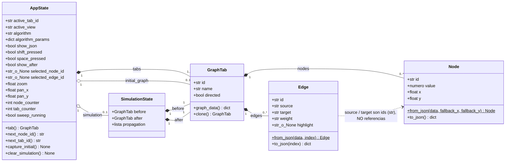
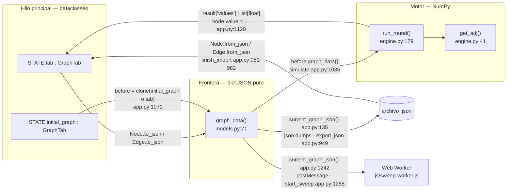
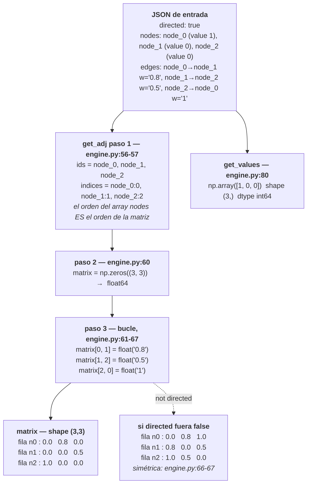
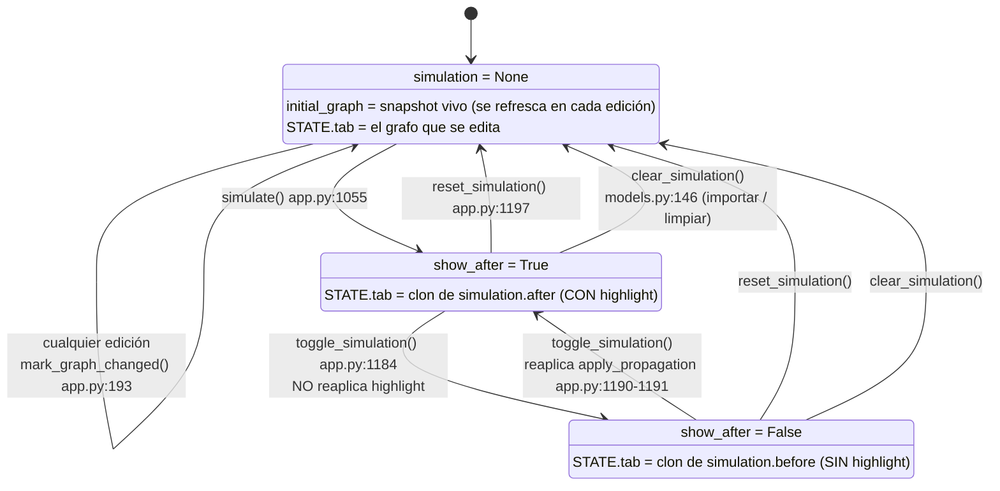

# El modelo de datos: qué es un grafo aquí

> **Archivos que cubre:** `python/models.py` (completo), `python/simulation/engine.py` solo en `get_adj` / `get_values` / `update_graph_data`, y de `python/geometry.py` únicamente `node_center` y `value_color`.
> **Qué puedes cambiar aquí:** agregar campos *visuales* a las dataclasses, cambiar defaults, cambiar cómo el editor muta esos campos.
> **Qué es intocable y por qué:** la forma del JSON que produce `GraphTab.graph_data()` — es el contrato con el proyecto de referencia (`/Users/rou/Desktop/Chamba/Sergio/Simulador`, de solo lectura) y con el arnés de equivalencia.
> **Cómo verificas el cambio:** `python3 scripts/equivalencia.py` (espera `OK`, 1026 casos) y `python3 scripts/smoke_ui.py`.

En este proyecto un grafo **no tiene una sola representación, tiene tres**, y casi
todos los errores de mantenimiento vienen de confundirlas:

| # | Representación | Dónde vive | Para qué |
|---|---|---|---|
| 1 | **Dataclasses** `Node` / `Edge` / `GraphTab` | `python/models.py` | Lo que el editor manipula: arrastrar, seleccionar, dibujar. |
| 2 | **JSON plano** `{directed, nodes, edges}` | lo produce `GraphTab.graph_data()` (`models.py:71-76`) | Lo único que cruza fronteras: al motor, al Worker, al archivo exportado. |
| 3 | **Matriz NumPy** `(n, n)` | la produce `engine.get_adj()` (`engine.py:41-69`) | Lo único con lo que se calcula. |

La conversión es **unidireccional en cada uso**: 1 → 2 → 3 para calcular, y de
vuelta solo por la vía estrecha de copiar valores sueltos a los nodos. Nunca hay
un objeto que sea las tres cosas a la vez.

**DECISION DELIBERADA** — separar las tres representaciones cuesta conversiones
repetidas, pero es lo que permite que el motor (`python/simulation/`) no importe
nada del editor. Esa independencia no es estética: el Web Worker del barrido monta
solo `python/simulation/`, así que un `import models` dentro del motor rompería el
barrido con `ModuleNotFoundError` (ver §3).

---

## 1. Las dataclasses

> **Archivos que cubre:** `python/models.py`.
> **Qué puedes cambiar aquí:** agregar campos con default, cambiar tolerancias de `from_json`, agregar métodos de conveniencia.
> **Qué es intocable y por qué:** `to_json()` de `Node` y `Edge` (define el archivo exportado) y el valor por defecto `algorithm: str = "fv"` (`models.py:94`): la clave `"fv"` está cableada en varios sitios del motor y renombrarla impide arrancar.
> **Cómo verificas el cambio:** `python3 -c "import sys; sys.path.insert(0,'python'); from models import GraphTab, Node, Edge; print(GraphTab('tab_0','x',[Node('a',1,0,0)],[Edge('edge_local_9_3','a','a','0.50')]).graph_data())"`

### Diagrama de clases



La flecha punteada es la decisión más importante del modelo: **`Edge` guarda
strings, no punteros a `Node`.** Por eso el grafo entero se serializa con
`json.dumps` sin ningún encoder personalizado, `deepcopy` no tiene que resolver
ciclos, y `get_adj` puede construir su propio índice `id → posición`.

**DECISION DELIBERADA** — el precio es que nada garantiza la integridad
referencial: una arista puede apuntar a un nodo que no existe. Se aceptó porque
el JSON del proyecto de referencia ya es así; la consecuencia está en §7.

---

### `Node` — `models.py:10-33`

| Campo | Tipo | Para qué | Quién lo muta |
|---|---|---|---|
| `id` | `str` | Identidad. Su posición en `nodes` define el orden de filas/columnas de la matriz. | Se escribe una vez: `AppState.next_node_id()` al crear (`app.py:547`) o `str(data["id"])` al importar (`models.py:22`). **Nunca se muta después.** |
| `value` | `int \| float` | El valor de consenso que se propaga. | `open_node_editor.commit` con `float(value)` (`app.py:777`) y `simulate()` al copiar el resultado (`app.py:1120`). |
| `x`, `y` | `float` | Posición en el lienzo. | Solo `on_canvas_pointer_move` durante el arrastre (`app.py:700-701`). El zoom y el encuadre mueven el *viewport*, no los nodos. |

**INVARIANTE** — **`x`/`y` son la esquina superior izquierda del círculo, no el
centro.** El nodo se dibuja con radio 30 (`geometry.py:11`, `NODE_RADIUS = 30.0`)
y su centro es `(x+30, y+30)`. De ahí salen todos los `±30` del código:
`geometry.node_center` (`geometry.py:34-35`) suma el radio, `add_node` resta 30
para centrar el nodo bajo el cursor (`app.py:547`) y el minimapa vuelve a sumarlo
(`app.py:307-308`). Es herencia de ReactFlow en el proyecto de referencia.
Confundirlos descoloca el minimapa y el encuadre a la vez, sin ningún error.

`from_json` (`models.py:17-26`) tiene dos tolerancias que importan:

- `position` ausente → usa los fallbacks. `finish_import` pasa
  `random.random() * 500` (`app.py:981`), así que un archivo sin posiciones queda
  esparcido al azar en un cuadro de 500×500.
- `value: null` → `0` (`models.py:23`).

**DEUDA CONOCIDA** — lo que **no** hace es coercionar `value` a número. Un JSON con
`"value": "0.5"` deja un string en la dataclass y el fallo aparece mucho después;
detalle y reproducción en §7.

---

### `Edge` — `models.py:36-60`

| Campo | Tipo | Para qué | Quién lo muta |
|---|---|---|---|
| `id` | `str` | Selección y `data-edge-id` en el SVG. | Se escribe una vez: `edge_local_{serial}_{node_counter}` al crear a mano (`app.py:566`) o `edge_{index}` al importar (`models.py:48`). |
| `source`, `target` | `str` | Ids de los nodos extremos. | Se fijan al crear. Nunca mutan: borrar un nodo **elimina la arista entera** (`app.py:878`), no la reapunta. |
| `weight` | **`str`** | Peso / probabilidad de transmisión. | `on_canvas_click.commit` guarda el **texto crudo** del diálogo (`app.py:816`) después de validar `0 < float(texto) <= 1` (`app.py:813`). |
| `highlight` | `str \| None` | Resultado de la última ronda. Valores: `"updated"`, `"delivered"`, `"quiet"`, `None`. | **Solo** `apply_propagation()` (`app.py:1039-1052`). |

**DECISION DELIBERADA — `weight` es un string.** Se conserva el texto tal como se
escribió y solo se convierte con `float()` dentro de `get_adj` (`engine.py:64`).
Motivo: `"0.50"` se muestra como `"0.50"` y no como `0.5`, y sobre todo el JSON
exportado queda byte-compatible con el del proyecto de referencia (§2).

**DECISION DELIBERADA — `highlight` no aparece en `to_json()`.** Que la
serialización lo omita es lo que mantiene limpio el contrato: si alguien lo
agregara "por consistencia", los archivos de este simulador dejarían de entrar sin
adaptar en el proyecto de referencia y el arnés compararía grafos que ya no son
los mismos (ver [07 — Verificación](07-verificacion.md)).

`edge_style()` (`app.py:221-230`) traduce `highlight` a un estilo, y tiene **cinco**
ramas, no cuatro:

| Condición | Significado | Devuelve |
|---|---|---|
| `highlight == "updated"` | Transmitió **y** su valor fue el adoptado por el target. | `#F4B45C`, 4, `edge-animated` |
| `highlight == "delivered"` | Transmitió, pero el target eligió a otro emisor. | `#7A6E9E`, 4, `edge-animated` |
| `highlight == "quiet"` | No disparó en esta ronda. | `#413A5E`, 1, `""` |
| `highlight is None` **y** `edge.id == STATE.selected_edge_id` | Arista seleccionada, sin simulación. | `#6E7CF2`, 4, `""` (`app.py:228-229`) |
| `highlight is None` | Sin simulación. | `#6C6690`, 3, `""` |

La rama de selección es inalcanzable mientras hay una simulación en pantalla:
`apply_propagation` le pone `highlight` a **todas** las aristas, incluidas las
mudas (`"quiet"`), así que ninguna llega al caso `None`.

**DEUDA CONOCIDA — hoy ninguno de esos colores se ve.** `render_canvas` emite el
color como *atributo de presentación* (`stroke="{color}"`, `app.py:253-254`) y en
CSS cualquier regla vence a un atributo de presentación; como existe la regla
`.edge-path { stroke: #6c6690; stroke-width: 3 }` (en `css/app.css`, cítala por
selector: ese archivo tiene reglas comprimidas en líneas gigantes), **todas las
aristas se pintan iguales**. Lo único que sí distingue una arista que transmitió
es la animación de guiones, que llega por la clase `edge-animated` sobre el `<g>`
y sí se emite. Las reglas `.edge-path.is-updated` / `.is-delivered` / `.is-idle` /
`.is-selected` existen en el CSS pero están **muertas**, porque `render_canvas`
nunca emite esas clases. No es una regresión: el respaldo previo al refactor se
comporta igual. En la misma línea, `render_controls` anuncia "aristas verdes =
propagación" (`app.py:519`) y `edge_style` no devuelve ningún verde. El arreglo
está en la capa de interfaz, no en el modelo — ver
[03 — La capa de interfaz](03-interfaz.md).

---

### `GraphTab` — `models.py:63-79`

Una pestaña = un grafo completo e independiente.

| Campo | Para qué | Quién lo muta |
|---|---|---|
| `id`, `name` | Identidad de la pestaña. **No se serializan**: son del editor, no del grafo. | `new_tab` (`app.py:596-599`); `finish_import` deriva `name` del nombre de archivo sin `.json` (`app.py:985`). Se reescriben sobre el clon de reemplazo en `simulate` / `toggle_simulation` / `reset_simulation` (`app.py:1125`, `1077`, `1088`). |
| `nodes`, `edges` | Las listas. **El orden de `nodes` es semántico**: define los índices de la matriz. | In-place con `.append()` (`app.py:548`, `555`); reemplazo por comprensión al borrar (`app.py:877-878`, `870`) y al deduplicar (`app.py:912`); `.clear()` en `clear_graph_confirmed` (`app.py:939-940`). |
| `directed` | Si las aristas tienen dirección. | `on_directed_change` (`app.py:902`), `finish_import` (`app.py:988`). |

Dos métodos, y son toda la frontera del modelo:

- **`graph_data()`** (`models.py:71-76`) — produce el JSON canónico. Es **el único
  punto por el que un grafo sale de las dataclasses.**
- **`clone()`** (`models.py:78-79`) — `deepcopy(self)`, así que copia también nodos
  y aristas. Es la base entera del mecanismo antes/después (§5).

---

### `SimulationState` — `models.py:82-86`

```python
before: GraphTab                  # el grafo antes de la ronda, highlight = None
after: GraphTab                   # el grafo después, con highlight ya aplicado
propagation: list[dict[str, Any]] # registros de engine.propagation_from_round
```

Cada registro de `propagation` tiene exactamente estas claves
(`engine.py:154-161`):

```python
{"source": str, "target": str, "value_sent": float, "updated_value": bool}
```

Se construye entero de una vez en `simulate()` (`app.py:1121-1123`) y **nunca se
muta campo a campo**.

**DECISION DELIBERADA** — se guarda el par completo de grafos, no un diff. Es lo
que permite que `toggle_simulation()` alterne cuantas veces quiera sin recalcular
ni volver a consumir aleatoriedad.

---

### `AppState` — `models.py:89-149`

El objeto global único: `app.py:21` hace `STATE = AppState()` y no hay otro estado.

| Grupo | Campos | Quién los muta |
|---|---|---|
| Documento | `tabs`, `active_tab_id` | `new_tab` (585-588), `close_tab` (596-598), `on_tabs_click` (579), `finish_import` (985-986), `simulate` / `toggle` / `reset` (1064, 1080, 1089) |
| Navegación | `active_view`, `show_json` | `change_view` (1096), `show_json` (907) |
| Simulación | `algorithm`, `algorithm_params`, `initial_graph`, `simulation`, `show_after` | `on_algorithm_change` (1007), `on_param_change` (1025), `mark_graph_changed` (193), `simulate` (1051, 1061, 1065), `reset_simulation` (1090-1091), `clear_simulation` (`models.py:146-149`) |
| Teclado | `shift_pressed`, `space_pressed` | `on_key_down` / `on_key_up` (854-886) |
| Selección | `selected_node_id`, `selected_edge_id` | `add_node` (538-539), `on_canvas_pointer_down` (637-638, 661-662, 664-665), `on_key_down` (868, 871) |
| Viewport | `zoom`, `pan_x`, `pan_y` | `on_wheel` (828-830), `zoom_by` (842-844), `fit_view` (850), `on_canvas_pointer_move` (703-704) |
| Contadores | `node_counter`, `tab_counter` | `next_node_id` / `next_tab_id` (`models.py:132-140`), `finish_import` los adelanta (984) |
| Sweep | `sweep_running` | `start_sweep` (1140), `stop_sweep` (1119), `finish_sweep` (1184) |

**INVARIANTE** — `selected_node_id` y `selected_edge_id` son mutuamente
excluyentes: seleccionar uno pone el otro en `None`. Es lo que decide qué borra la
tecla `Delete` (`app.py:874-882`); si los dos quedaran puestos a la vez, `Delete`
borraría siempre el nodo y la arista seleccionada sería imposible de eliminar.

`algorithm_params` tiene forma `{"amp": {"agreed": 0.5}, ...}` — un sub-dict **por
algoritmo**, no un dict plano (`models.py:95-98`). Es lo que hace que cambiar de
algoritmo y volver conserve lo que la persona había escrito. La función
`algorithm_params()` de `app.py:138-148` lo rellena bajo demanda desde los defaults
del registro y **devuelve una copia** (`dict(guardados)`, `app.py:148`), así que el
motor nunca recibe el dict vivo del estado.

**INVARIANTE** — `AppState.tab` (`models.py:124-130`) es la única forma correcta de
acceder al grafo activo. Si `active_tab_id` apunta a una pestaña que ya no existe,
se repara sola devolviendo la primera en vez de lanzar. Acceder a `STATE.tabs[0]`
a mano se salta esa reparación.

---

## 2. El contrato JSON

> **Archivos que cubre:** `models.py:28-33` (`Node.to_json`), `models.py:44-60` (`Edge`), `models.py:71-76` (`GraphTab.graph_data`), y los ejemplos de `../Simulador/back/examples/`.
> **Qué puedes cambiar aquí:** nada del formato. Puedes cambiar cómo se *valida* al importar (`app.py:973-1001`), que es código nuestro.
> **Qué es intocable y por qué:** las claves y sus tipos. Las reglas de trabajo del proyecto lo declaran: un archivo de `../Simulador/back/examples/` entra sin adaptar, y el arnés compara contra grafos grabados con este formato.
> **Cómo verificas el cambio:** `python3 -c "import json,sys; sys.path.insert(0,'python'); from models import Node,Edge; d=json.load(open('../Simulador/back/examples/k2.json')); print([Node.from_json(n).to_json() for n in d['nodes']]); print([Edge.from_json(e,i).to_json(i) for i,e in enumerate(d['edges'])])"`

```json
{
  "directed": true,
  "nodes": [
    { "id": "node_0", "value": 1, "position": { "x": 100, "y": 100 } }
  ],
  "edges": [
    { "id": "edge_0", "source": "node_0", "target": "node_1", "weight": "0.8" }
  ]
}
```

| Campo | Tipo | Regla |
|---|---|---|
| `directed` | `bool` | Si es `false`, cada arista se refleja en la matriz (`engine.py:66-67`). |
| `nodes[].id` | `str` | **Único.** El orden del array **es** el orden de filas y columnas. |
| `nodes[].value` | **número** | `null` se normaliza a `0` al importar; un string **no** se normaliza (§7). |
| `nodes[].position` | `{x, y}` | Esquina, no centro. Opcional al importar. |
| `edges[].id` | `str` | Se **renumera** a `edge_{índice}` al importar (`models.py:48`) y al exportar (`models.py:56`). |
| `edges[].source` / `.target` | `str` | Deben existir en `nodes` o `get_adj` lanza `KeyError` (§7). |
| `edges[].weight` | **`str`** | String, no número. La UI valida `(0, 1]`; el import no valida nada. |

### Por qué `weight` es string y por qué no se cambia

**DECISION DELIBERADA.** Porque el proyecto de referencia lo emite así:
`../Simulador/back/examples/k2.json:26` tiene literalmente `"weight": "1"`. Y el
`get_adj` de aquí (`engine.py:41-69`) es un port **línea por línea** del de
`../Simulador/back/api.py:72-91`:

```python
# ../Simulador/back/api.py:87        # python/simulation/engine.py:65
adj[s, t] = float(edge['weight'])    matrix[source, target] = weight
```

Ambos hacen `float(...)` sobre el peso, así que ambos aceptan string **o** número
al leer. La asimetría está en la **escritura**: si este proyecto empezara a
exportar `"weight": 0.8`, los archivos seguirían entrando en el backend original,
pero los diffs contra los ejemplos de referencia dejarían de coincidir y el arnés
compararía contra grafos que ya no son los mismos. **El contrato no es "lo que el
motor tolera al leer", es "lo que se escribe".** Por eso `Edge.from_json` fuerza
`str(weight)` (`models.py:51`) incluso cuando el archivo traía un número: el
formato se normaliza al entrar, no al salir.

---

## 3. Dónde se convierte entre dataclasses y JSON

> **Archivos que cubre:** `app.py:134-135` (`current_graph_json`), `app.py:948-967` (`export_json`), `app.py:973-1001` (`finish_import`), `app.py:1055-1130` (`simulate`), `app.py:1237-1289` (`start_sweep`).
> **Qué puedes cambiar aquí:** quién llama a `graph_data()` y cuándo.
> **Qué es intocable y por qué:** que el motor reciba `dict` y no dataclasses. El Worker del barrido no monta `python/models.py`, así que un `import models` dentro de `python/simulation/` rompe el barrido en producción y no en el escritorio.
> **Cómo verificas el cambio:** `python3 scripts/equivalencia.py` y un barrido real en el navegador (`python3 scripts/serve.py`, vista Análisis).



**El motor no recibe el grafo por `current_graph_json()`.** Es una diferencia
semántica, no cosmética. `simulate()` usa
`before = graph_snapshot(STATE.initial_graph or STATE.tab)` (`app.py:1071`) y le
pasa `before.graph_data()` (`app.py:1085`). `current_graph_json()`
(`app.py:134-135`, que sí es `STATE.tab.graph_data()`) alimenta únicamente el panel
JSON (`app.py:491`), la exportación (`app.py:949`) y el barrido (`app.py:1242`).
Consecuencia práctica: como `mark_graph_changed` deja de actualizar
`initial_graph` en cuanto hay simulación (`app.py:194`), una **segunda** simulación
no parte del grafo que se ve en la pestaña, sino del grafo inicial guardado.

### Por qué el motor recibe JSON y no dataclasses

Tres razones, ninguna estilística:

1. **INVARIANTE — el Worker no tiene `models.py`.** `js/sweep-worker.js:4-11` monta
   *solo* los seis archivos de `python/simulation/`. Si `sweep.py` importara
   `models`, el barrido fallaría con `ModuleNotFoundError` dentro del Worker
   mientras el escritorio y el arnés siguen en verde. La restricción es física.
2. **El grafo cruza `postMessage`.** `app.py:1288` lo manda con `to_js`, el Worker
   lo vuelve a serializar con `JSON.stringify` (`sweep-worker.js:97`) y Python lo
   recupera con `json.loads` (`sweep-worker.js:106`). Una dataclass no sobrevive ese
   viaje; un `dict` sí.
3. **Fidelidad con el backend.** `get_adj` recibe exactamente el `dict` que recibía
   FastAPI. Si recibiera un `GraphTab`, el port dejaría de ser línea por línea.

El corolario práctico: **`GraphTab.graph_data()` es un cuello de botella
deliberado.** Todo lo que sale del editor pasa por ahí, así que cualquier cambio
de formato se hace en un solo lugar y es imposible que dos consumidores vean
grafos distintos.

### La vuelta del resultado

La vuelta **no** usa `update_graph_data`. `simulate()` copia los floats a mano
sobre el clon:

```python
after = before.clone()
for index, node in enumerate(after.nodes):
    node.value = values[index]        # app.py:1118-1120
```

`simulate_graph()`, `run_simulation()` y `update_graph_data()` existen en
`engine.py` por fidelidad con el endpoint original, pero la interfaz no los usa:
el editor solo llega a `run_round`, y lo hace dentro del worker
(`js/sweep-worker.js:78`). La consecuencia (la salvaguarda anti-NaN de
`update_graph_data`, `engine.py:300-305`, no está activa en la ruta del editor) se
explica en [04 — Flujo de una simulación individual](04-simulacion-individual.md).

---

## 4. La conversión a matriz

> **Archivos que cubre:** `engine.py:41-69` (`get_adj`) y `engine.py:72-80` (`get_values`).
> **Qué puedes cambiar aquí:** nada sin justificarlo. Son port literal del backend.
> **Qué es intocable y por qué:** la orientación `matrix[source, target]`, la asignación (no acumulación) de pesos repetidos y el no forzar dtype en `get_values`. Los tres reproducen el backend original y el arnés los compara contra flotantes exactos.
> **Cómo verificas el cambio:** `python3 -c "import sys; sys.path.insert(0,'python'); from simulation.engine import get_adj, get_values; d={'directed':False,'nodes':[{'id':'a','value':1},{'id':'b','value':0}],'edges':[{'id':'e','source':'a','target':'b','weight':'0.8'}]}; print(get_adj(d)); print(get_values(d).dtype)"`

### `get_adj` — `engine.py:41-69`

```python
ids = [node["id"] for node in data["nodes"]]                       # 56
indices = {node_id: index for index, node_id in enumerate(ids)}    # 57  id → posición
directed = data["directed"]                                        # 58

matrix = np.zeros((len(ids), len(ids)))                            # 60  shape (n, n), float64
for edge in data["edges"]:                                         # 61
    source = indices[edge["source"]]                               # 62
    target = indices[edge["target"]]                               # 63
    weight = float(edge["weight"])                                 # 64
    matrix[source, target] = weight                                # 65  orientación [source, target]
    if not directed:                                               # 66
        matrix[target, source] = weight                            # 67  el espejo
```

### `get_values` — `engine.py:72-80`

```python
return np.array([node["value"] for node in data["nodes"]])         # 80
```

Shape `(n,)`. **DECISION DELIBERADA — no fuerza dtype**, para reproducir el
comportamiento literal de `np.array` en el backend (así lo dice su propio
docstring, `engine.py:73-78`). Con valores enteros el array sale `int64`;
`run_round` los convierte a `float` recién al armar la salida
(`engine.py:261-262`). El precio de esa fidelidad es la trampa de los strings (§7).

### Ejemplo concreto de 3 nodos



La matriz exacta del caso dirigido:

```
          n0    n1    n2          ← target (columna)
   n0 [  0.0   0.8   0.0 ]
   n1 [  0.0   0.0   0.5 ]
   n2 [  1.0   0.0   0.0 ]
    ↑
  source (fila)
```

Léase: `matrix[i, j]` es *«la probabilidad de que **i** le transmita a **j**»*.

**INVARIANTE — esa orientación no es la única del proyecto.** La matriz de mensajes
va transpuesta (`messages[target, source]`, `engine.py:114`) y la del barrido no.
La explicación canónica de las dos orientaciones y del `.T` está en
[04 — Flujo de una simulación individual](04-simulacion-individual.md); aquí basta
con recordar que **`get_adj` devuelve `[source, target]`** y que asumir una sola
convención al escribir un algoritmo es el error más fácil del proyecto.

### Aristas duplicadas

`matrix[source, target] = weight` (`engine.py:65`) es una **asignación**, no una
acumulación. Si el JSON trae dos aristas entre el mismo par ordenado, **gana la
última del array** y la primera desaparece del cálculo — pero **ambas se siguen
dibujando** en el SVG (superpuestas) y **ambas reciben el mismo `highlight`**,
porque `apply_propagation` empareja por `(source, target)` (`app.py:1041-1048`) y
encuentra el mismo registro las dos veces.

**DECISION DELIBERADA** — el docstring de `get_adj` lo declara: *"Pesos repetidos
entre el mismo par de nodos se sobrescriben en el orden del JSON, igual que al
asignar sobre una matriz en el backend"* (`engine.py:15-17`). El editor previene el
caso más común (`add_edge` rechaza el duplicado en grafos no dirigidos,
`app.py:557-564`, y `on_directed_change` deduplica con `frozenset` al pasar a no
dirigido, `app.py:904-912`), pero **un JSON importado no pasa por ninguno de esos
filtros**.

### Self-loops

Se conservan: `matrix[i, i] = weight`. `geometry.edge_geometry` los detecta por
`distancia < 1e-9` y dibuja un bucle cúbico sobre el nodo
(`geometry.py:44-57`). Semánticamente, un self-loop significa que el nodo se manda
un mensaje a sí mismo, así que puede "elegirse" a sí mismo como emisor.

En grafo **no dirigido** un self-loop dispara con la mitad de su peso, en los dos
motores por igual; no es un bug de paridad sino una propiedad heredada del
backend, explicada en
[04 — Flujo de una simulación individual](04-simulacion-individual.md).

### Grafos no dirigidos

Dos cosas separadas, y conviene no mezclarlas:

1. **En `get_adj`** el peso se copia en ambas celdas (`engine.py:66-67`): la matriz
   sale simétrica. Eso es todo lo que hace esta sección.
2. **En `who_gets_message`** (`engine.py:110-112`) se simetriza además la muestra
   aleatoria, para que una arista no dirigida dispare en ambos sentidos a la vez o
   en ninguno. Eso pertenece a la ronda: ver
   [04 — Flujo de una simulación individual](04-simulacion-individual.md).

Nótese que el barrido **no usa los pesos en absoluto**: solo la topología. Ver
[05 — Flujo del barrido](05-barrido-sweep.md).

---

## 5. El ciclo de vida antes/después

> **Archivos que cubre:** `app.py:189-195` (`graph_snapshot`, `mark_graph_changed`), `app.py:1055-1204` (`simulate`, `toggle_simulation`, `reset_simulation`), `models.py:142-149`.
> **Qué puedes cambiar aquí:** las transiciones y los textos de estado.
> **Qué es intocable y por qué:** que `mark_graph_changed` no toque `initial_graph` mientras hay simulación (`app.py:194`); es lo único que permite volver al grafo de partida.
> **Cómo verificas el cambio:** `python3 scripts/smoke_ui.py` y, en el navegador, Simular → Ver Antes → Ver Después → Reiniciar.



**El estado *Antes* no lleva `highlight`.** `simulation.before` se crea con
`graph_snapshot(...)` (`app.py:1071`) y `apply_propagation` solo se aplica a
`after.edges` (`app.py:1122`). En `toggle_simulation` la guarda es
`if not STATE.show_after:` (`app.py:1190`), así que al pasar de *Después* a *Antes*
—cuando `show_after` todavía es `True`— **no** se llama a `apply_propagation`: el
clon que se instala en la pestaña queda con `highlight = None` en todas sus
aristas. La rama solo dispara en el sentido contrario. Es coherente con lo que
anuncia la interfaz: para `show_after = False`, `render_controls` escribe
"Mostrando estado inicial", sin mención de propagación (`app.py:518-522`).

En pantalla, y por la deuda del CSS descrita en §1, **la única diferencia visible
entre *Antes* y *Después* es que en *Antes* desaparece la animación de guiones.**

Detalle clave: **una vez que hay simulación, `mark_graph_changed()` deja de
actualizar `initial_graph`** (`app.py:194`: `if STATE.simulation is None and ...`).
Eso garantiza que `reset_simulation()` pueda volver al grafo de partida aunque la
persona haya arrastrado nodos mientras miraba el resultado.

**INVARIANTE** — `simulate`, `toggle_simulation` y `reset_simulation` **sustituyen
el objeto `GraphTab` de la lista**, no lo editan:
`STATE.tabs[STATE.tabs.index(STATE.tab)] = replacement` (`app.py:1126`, `1080`,
`1089`). Cualquier referencia a un `GraphTab` guardada fuera de `STATE.tabs` queda
obsoleta al instante. Por eso también se copian `id` y `name` al reemplazo
(`app.py:1125`, `1077`, `1088`): el grafo cambia, la pestaña no.

Todo esto solo se ve si algo vuelve a dibujar: el SVG es una **proyección** de
`STATE` que se regenera entera por `innerHTML`, nunca una fuente de verdad, y una
mutación que no termina en `render_all()` deja el estado correcto y la pantalla
mintiendo. Esa mecánica —junto con `retain()`, sin el cual los manejadores mueren—
está en [03 — La capa de interfaz](03-interfaz.md).

---

## 6. Cómo agregar un campo al modelo (checklist)

> **Archivos que cubre:** `python/models.py` y, si el campo llega al motor, `python/simulation/engine.py`.
> **Qué puedes cambiar aquí:** todo lo que sea puramente visual.
> **Qué es intocable y por qué:** `to_json()`. Tocarlo rompe el contrato con el proyecto de referencia y desalinea la línea base del arnés.
> **Cómo verificas el cambio:** `python3 scripts/equivalencia.py` **antes y después** del cambio, comparando las dos salidas.

Si es **solo visual** (como `highlight`): agrégalo a la dataclass, úsalo en
`render_*`, y **no lo pongas en `to_json`**.

Si tiene que llegar al motor:

1. Campo en la dataclass, con default (`models.py`).
2. Lectura tolerante en `from_json`: los archivos viejos no lo traen.
3. Escritura en `to_json` → **rompe el contrato con el proyecto de referencia**;
   justifícalo por escrito antes de hacerlo.
4. Consumo en `get_adj` / `get_values` (`engine.py`) — recuerda que el Worker del
   barrido también monta esos archivos, así que el campo tiene que viajar en el
   JSON del grafo o no existirá allí.
5. Corre el arnés antes y después. Si cambia un resultado, es un hallazgo, no un
   fallo del arnés: no regrabes la línea base sin leer
   [07 — Verificación](07-verificacion.md).

---

## 7. Trampas del modelo de datos

> **Archivos que cubre:** los mismos de las secciones 1 a 5.
> **Qué puedes cambiar aquí:** solo lo marcado como DEUDA CONOCIDA, y leyendo antes por qué está así.
> **Qué es intocable y por qué:** todo lo marcado INVARIANTE o DECISION DELIBERADA; cada una lleva su motivo.
> **Cómo verificas el cambio:** `python3 scripts/equivalencia.py` y `python3 scripts/smoke_ui.py`.

| Síntoma visible | Causa | Dónde | Marca |
|---|---|---|---|
| "Error al ejecutar la simulación: 'node_7'" y nada más; el grafo se dibujaba perfecto | Arista que apunta a un nodo inexistente. `render_canvas` la salta en silencio; `get_adj` lanza `KeyError` en `indices[edge["source"]]`. **Dibujar nunca falla; simular sí.** | `app.py:245-246`, `engine.py:62` | **DEUDA CONOCIDA** |
| La simulación falla con `DTypePromotionError` (o da números raros) tras importar un JSON ajeno | `Node.from_json` **no** coerciona `value`. Un `"value": "0.5"` queda como string, `get_values` produce un array de strings y el fallo aparece dentro del algoritmo. Con `fv` a veces pasa desapercibido (los strings se copian y se convierten al salir); con `amp` revienta. La UI se ve bien porque `value_color` (`geometry.py:20-31`) es robusta a basura. Reproducción: `python3 -c "import sys; sys.path.insert(0,'python'); from simulation.engine import run_round; print(run_round({'directed':True,'nodes':[{'id':'a','value':'0.5'},{'id':'b','value':0}],'edges':[{'id':'e','source':'a','target':'b','weight':'1'}]}, algorithm='amp', params={'agreed':0.5}))"` | `models.py:20-23`, `engine.py:80` | **DEUDA CONOCIDA** |
| Un id de arista guardado en otro lado deja de encontrarse tras exportar/importar | `Edge.to_json(index)` fabrica `edge_{index}` desde la **posición** en la lista e ignora el `id` en memoria; las aristas creadas a mano llevan `edge_local_{serial}_{node_counter}` y ese id desaparece. Los ids de **nodo** sí se respetan. | `models.py:54-60`, `app.py:566` | **DECISION DELIBERADA** (mantiene el archivo idéntico al de referencia) |
| Dos aristas visibles entre el mismo par, pero la matriz solo conoce una | `matrix[source, target] = weight` es asignación: gana la última del array. Las dos se siguen dibujando y las dos reciben el mismo `highlight`. En grafo no dirigido, además, `A→B` con peso 0.3 y `B→A` con 0.9 hace que la segunda pise **ambas** celdas. El editor lo previene; un JSON importado no. | `engine.py:65-67`, `app.py:1041-1048`, `app.py:557-564`, `app.py:904-912` | **DECISION DELIBERADA** (`engine.py:15-17`) |
| Los cuatro estados de arista no se distinguen en pantalla | `render_canvas` escribe el color como atributo de presentación y la regla CSS `.edge-path` gana siempre; las clases `.is-updated` / `.is-delivered` / `.is-idle` / `.is-selected` nunca se emiten. Solo se ve la animación de guiones, vía `edge-animated`. | `app.py:253-254`, selector `.edge-path` en `css/app.css` | **DEUDA CONOCIDA** (previa al refactor; ver [03](03-interfaz.md)) |
| `simulate()` reemplaza la pestaña equivocada (hipotético) | `STATE.tabs.index(STATE.tab)` usa el `__eq__` **estructural** que genera `@dataclass`, no identidad de objeto. Funciona solo porque `GraphTab.id` es único. `apply_round` ya no lo usa —busca la pestaña por `id` (`app.py:1106-1113`), porque la ronda viaja al worker y puedes cambiar de pestaña mientras vuelve—, pero `toggle_simulation` y `reset_simulation` siguen dependiendo de ese `__eq__`. Efecto colateral: `GraphTab`, `Node` y `Edge` son **inhashables** — no sirven como claves de dict ni elementos de set. | `app.py:1126`, `1080`, `1089` | **INVARIANTE** (ids únicos) |
| Dos versiones divergentes de la misma regla al tocar el snapshot inicial | `AppState.capture_initial()` es código muerto: nadie lo llama. La lógica equivalente vive inline en `mark_graph_changed()`. | `models.py:142-144`, `app.py:193-195` | **DEUDA CONOCIDA** |
| Un archivo importado sin `position` aparece desparramado al azar | `finish_import` pasa `random.random() * 500` como fallback, así que las posiciones no son deterministas entre importaciones del mismo archivo. | `app.py:981`, `models.py:24-25` | **DECISION DELIBERADA** (evita que todos los nodos caigan en `(0,0)`) |
| El minimapa o el encuadre quedan corridos exactamente 30 px | `Node.x`/`Node.y` son la esquina superior izquierda, no el centro; el centro es `(x+30, y+30)`. | `geometry.py:11`, `34-35`, `app.py:307-308`, `536` | **INVARIANTE** |
| Al pulsar "Ver Antes" desaparece la animación y no cambia nada más | Es correcto: `before` no lleva `highlight` y `toggle_simulation` no lo reaplica en ese sentido. | `app.py:1071`, `1060`, `1078-1079` | **DECISION DELIBERADA** |

Trampas emparentadas que **no** viven aquí, para no duplicar la explicación:

- Las dos orientaciones de la matriz y el `.T` de `engine.py:114` →
  [04 — Flujo de una simulación individual](04-simulacion-individual.md).
- El self-loop que dispara con la mitad de su peso en grafos no dirigidos →
  [04 — Flujo de una simulación individual](04-simulacion-individual.md).
- La salvaguarda anti-NaN de `update_graph_data` que no está activa en el editor →
  [04 — Flujo de una simulación individual](04-simulacion-individual.md).
- El barrido tira los pesos y solo conserva la topología →
  [05 — Flujo del barrido](05-barrido-sweep.md).
- `retain()` y la regeneración completa del SVG →
  [03 — La capa de interfaz](03-interfaz.md).
- Qué cubre y qué no cubre el arnés de equivalencia →
  [07 — Verificación](07-verificacion.md).
