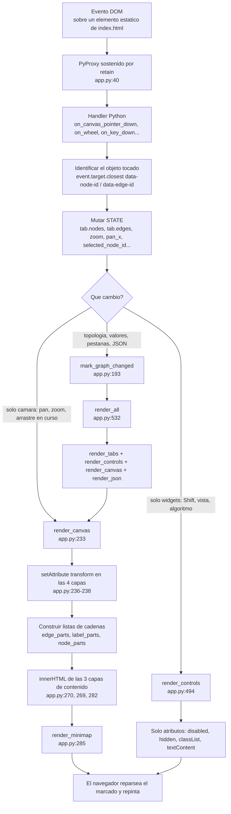
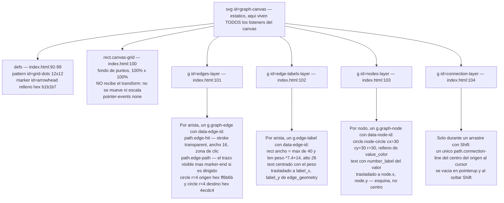
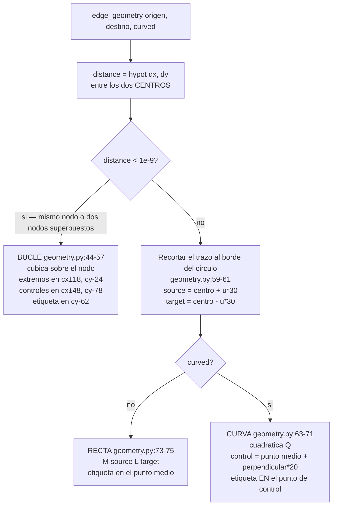
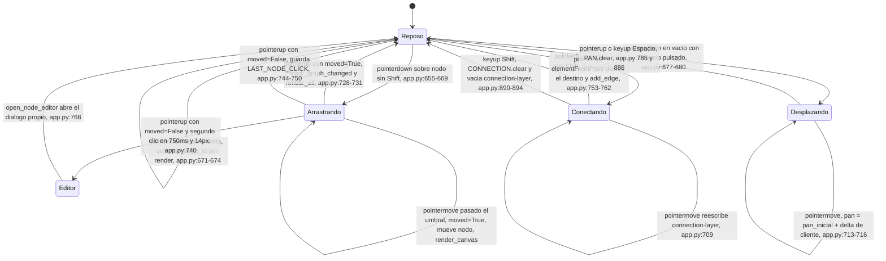
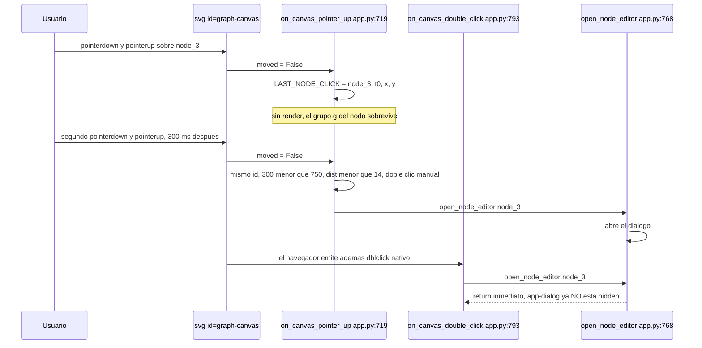
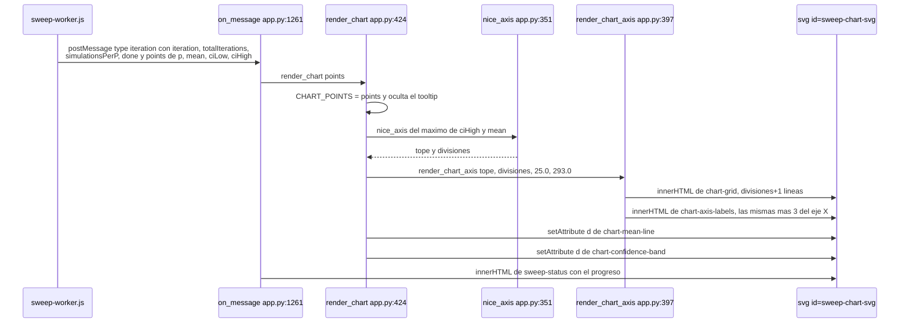

# 03 — La capa de interfaz: `app.py`, el SVG y los eventos

> **Archivos que cubre:** `python/app.py` (1241 líneas), `python/geometry.py` (110), `index.html`, `css/app.css`, y el punto de entrada `js/bootstrap.js:74`.
> **Qué puedes cambiar aquí:** cualquier cosa que decida *qué se dibuja* y *qué pasa al tocarlo*: colores, formas, gestos, diálogos, la gráfica del sweep, controles nuevos en la barra lateral.
> **Qué es intocable y por qué:** `retain()` sobre todo callback que cruce a JavaScript, la delegación de eventos sobre contenedores estáticos, y la regla de no renderizar dentro de `pointerdown`/`pointerup` sobre un nodo. Los tres protegen la misma cosa: el DOM del canvas se destruye y se recrea entero en cada render, y lo que quedó apuntando al DOM viejo muere en silencio.
> **Cómo verificas el cambio:** `python3 scripts/smoke_ui.py` (cubre el selector de algoritmos, los campos de parámetros y el eje Y de la gráfica) **y después** `python3 scripts/serve.py` → <http://localhost:8000>, porque el smoke test no ve estilos, ni eventos reales, ni Pyodide.

---

## 0. La idea de fondo

> **Archivos que cubre:** `python/app.py` (visión general).
> **Qué puedes cambiar aquí:** nada; es el modelo mental que explica el resto del archivo.
> **Qué es intocable y por qué:** la premisa de que el estado vive en Python y el DOM es desechable. Si empiezas a guardar estado en atributos del DOM, todas las garantías de esta sección dejan de valer.
> **Cómo verificas el cambio:** no aplica.

Aquí no hay framework, ni virtual DOM, ni plantillas. Hay **un archivo Python de 1241 líneas** (`python/app.py`) que:

1. se engancha una sola vez a un puñado de elementos que ya existen en `index.html`,
2. guarda todo lo que importa en un único objeto global `STATE` (`app.py:21`),
3. y cuando algo cambia **reconstruye el SVG entero escribiendo cadenas de texto en `innerHTML`**.

**DECISION DELIBERADA** — No hay actualización incremental. No se busca "el nodo que se movió" para moverlo: se tira el dibujo completo y se vuelve a generar. El motivo es que así no existe la clase de bug más cara de una interfaz, la de "el DOM y el estado se desincronizaron", porque el DOM no guarda estado. Lo único que el DOM sabe de sí mismo son los atributos `data-node-id` / `data-edge-id`, y son de solo lectura para los handlers.

Esa decisión explica casi todas las rarezas del archivo — el umbral de 6 píxeles, la captura de puntero, la delegación de eventos, el `elementFromPoint`. Si sales de esta sección con una sola idea, que sea esta: **el DOM del canvas es desechable; el estado vive en Python**.

El precio: en cada `render_canvas()` se regenera el marcado de todos los nodos y todas las aristas, con el coste que se detalla en §4.

---

## 1. El ciclo de vida de una interacción

> **Archivos que cubre:** `python/app.py:193` (`mark_graph_changed`), `:231` (`render_canvas`), `:486` (`render_json`), `:492` (`render_controls`), `:521` (`render_all`).
> **Qué puedes cambiar aquí:** qué nivel de render dispara un handler nuevo.
> **Qué es intocable y por qué:** `mark_graph_changed()` antes de renderizar en todo handler que edite nodos o aristas; sin eso el botón "Resetear" restaura un grafo que no corresponde.
> **Cómo verificas el cambio:** `python3 scripts/serve.py`, crear dos nodos, Simular, mover un nodo, pulsar Resetear y comprobar que vuelve al estado que esperabas.

Todo evento del usuario recorre el mismo camino, pero **no todos pasan por `mark_graph_changed()`**: solo los que editan el grafo.



Las ramas de cámara y de widgets **no llaman a `mark_graph_changed()`**: `on_wheel` (`:818`–`831`), `zoom_by` (`:834`–`845`), `fit_view` (`:848`), la rama `PAN` de `on_canvas_pointer_move` (`:702`–`705`) y el movimiento de nodo durante el arrastre (`:686`–`691`) van directas a `render_canvas()`. Los siete sitios que sí lo llaman están listados abajo.

`connection-layer` tampoco recibe `innerHTML` en `render_canvas()`: solo la escribe `on_canvas_pointer_move` (`:698`) y se vacía en `:745` y `:882`. Lo que reciben las **cuatro** capas es el mismo `transform` (`:234`–`236`).

### Los cuatro niveles de render y cuándo usar cada uno

Elegir mal el nivel es la fuente más común de bugs "no se actualizó" o "se me borró lo que estaba escribiendo".

| Función | Línea | Qué toca | Cuándo se llama |
|---|---|---|---|
| `render_all()` | `app.py:532` | pestañas + controles + canvas + JSON | Cambió el grafo: `add_node`, `add_edge`, borrar, importar, simular, cambiar de pestaña |
| `render_canvas()` | `app.py:233` | `transform` de las 4 capas, contenido de 3 de ellas, minimapa | Cambió solo la cámara o una posición: arrastre, pan, zoom, `resize` |
| `render_controls()` | `app.py:494` | barra lateral, vistas, indicador de Shift | Cambió un estado que no se dibuja: `Shift`, cambio de vista, cambio de algoritmo |
| `render_json()` | `app.py:488` | panel de JSON | Abrir/cerrar el panel |

`render_all()` llama a `render_canvas()` (`:524`), así que **nunca hace falta llamar a los dos**. En cambio `render_canvas()` no llama a `render_controls()`: por eso arrastrar un nodo no actualiza el botón "Simular". No importa, porque arrastrar no cambia si hay nodos o no.

### `mark_graph_changed()`: el guardián del "antes"

```python
def mark_graph_changed() -> None:          # app.py:193
    if STATE.simulation is None and STATE.tab.nodes:
        STATE.initial_graph = graph_snapshot()
```

Son tres líneas y es fácil pasarlas por alto, pero definen el contrato de toda la simulación: **mientras no haya una simulación en curso, cada edición del grafo re-fija el punto de partida**. Ese `STATE.initial_graph` es lo que restaura el botón "Resetear" (`reset_simulation`, `app.py:1197`–`1092`) y lo que `simulate()` usa como "antes" (`app.py:1071`).

**DECISION DELIBERADA** — La condición `STATE.simulation is None` significa que **cuando ya hay un resultado en pantalla, editar el grafo NO actualiza el snapshot**. El motivo: si no fuera así, mover un nodo después de simular destruiría el "antes" al que quieres volver. La consecuencia no obvia, que hay que aceptar: si simulas, arrastras nodos y luego pulsas "Resetear", **las posiciones vuelven a las del snapshot** y tu reacomodo se pierde.

**INVARIANTE** — Todo handler que modifique nodos o aristas llama a `mark_graph_changed()` **antes** de renderizar. Los siete que lo hacen: `add_node` (`:540`), `add_edge` (`:556`), fin de arrastre (`:719`), editar valor de nodo (`:770`), editar peso de arista (`:806`), borrar con Delete (`:874`), cambiar dirigido/no dirigido (`:902`).

---

## 2. `retain()` y `create_proxy`: el detalle que rompe todo en silencio

> **Archivos que cubre:** `python/app.py:22` (`PROXIES`), `:38` (`retain`), `:44` (`listen`), y los cuatro cruces a JS de la tabla.
> **Qué puedes cambiar aquí:** añadir cruces nuevos a JavaScript, siempre a través de `retain()` o de `listen()`.
> **Qué es intocable y por qué:** que *toda* función Python que cruce a JavaScript pase por `retain()`. Sin eso, Pyodide destruye el proxy al terminar la llamada y la interacción muere sin ningún síntoma en pantalla.
> **Cómo verificas el cambio:** `python3 scripts/serve.py` y ejercitar el control a mano; `python3 scripts/smoke_ui.py` **no puede** detectarlo (ver el final de esta sección).

```python
PROXIES: list[Any] = []                    # app.py:22

def retain(callback: Callable):            # app.py:40
    proxy = create_proxy(callback)
    PROXIES.append(proxy)
    return proxy

def listen(target, event_name: str, callback: Callable) -> None:   # app.py:46
    target.addEventListener(event_name, retain(callback))
```

**El problema.** Una función Python no es una función JavaScript. Para que `addEventListener` pueda invocarla, Pyodide tiene que envolverla en un `PyProxy`. Si le pasas la función Python directamente, Pyodide crea ese proxy **automáticamente y lo destruye al terminar la llamada a `addEventListener`**. La llamada no falla: el listener queda registrado, apuntando a un proxy muerto. Además, sin nadie que sostenga la referencia, el recolector de basura de Python puede liberar la función.

**El síntoma.** El botón deja de responder. No hay excepción en el flujo de la aplicación, no hay mensaje al usuario, no hay `try/except` que lo cace — el error (`This borrowed proxy was automatically destroyed at the end of a function call`) ocurre dentro del despacho de eventos del navegador y termina en la consola, no en la interfaz. En una app donde todos los diálogos son propios y el manejo de errores es explícito, esto es especialmente traicionero: **la pantalla se ve perfecta y una parte simplemente no hace nada**.

**INVARIANTE** — *Toda* función Python que cruce a JavaScript pasa por `retain()`. No solo los listeners de `bind_events()`:

| Cruce a JS | Línea | Qué se retiene |
|---|---|---|
| `addEventListener` (40 llamadas) | `app.py:1303`–`1230` vía `listen()` | los handlers |
| `window.setTimeout(retain(cleanup), 750)` | `app.py:966` | la limpieza del `Blob` de exportación (`cleanup`, `:951`) |
| `file.text().then(callback)` | `app.py:1012`–`1002` | el resolutor de la promesa de lectura de archivo (`loaded`, `:998`) |
| `WORKER.addEventListener("message"/"error", ...)` | `app.py:1286`–`1175` | los handlers del Web Worker del sweep |

Los cuatro casos son distintos (listener, temporizador, promesa, worker) y los cuatro necesitan lo mismo. La prueba de que esto se aprendió por las malas: `listen()` existe precisamente para que sea **imposible** registrar un listener sin retenerlo.

**DEUDA CONOCIDA** — `PROXIES` (`app.py:22`) es una lista que solo crece; nunca se llama a `proxy.destroy()`. Para los ~40 listeners iniciales da igual: viven lo que vive la página. Pero los tres casos de la tabla que están *dentro* de handlers añaden un proxy **por cada uso**: exportar JSON cien veces deja cien proxies de `cleanup`, y cada sweep deja dos. Es una fuga real, acotada por la paciencia del usuario, y hoy no molesta. Si algún día hay que arreglarla, el sitio es `retain()`: devolver también un "handle" para poder destruir el proxy en el `cleanup`. **No la "arregles" quitando `retain()`.**

**Al depurar:** `scripts/smoke_ui.py:171` sustituye `create_proxy` por la identidad (`ffi.create_proxy = lambda fn: fn`). Fuera del navegador el problema no existe, así que el smoke test **no puede detectar un `retain()` olvidado**. Eso solo se ve abriendo la página.

---

## 3. Las cuatro capas SVG

> **Archivos que cubre:** `index.html:90`–`105`, y las reglas `.graph-canvas`, `.canvas-grid`, `.edge-path`, `.edge-label`, `.graph-node` de `css/app.css`.
> **Qué puedes cambiar aquí:** el contenido de cada capa, el orden de pintado, los estilos de nodo y arista.
> **Qué es intocable y por qué:** los `id` de los cuatro `<g>` y del `<svg>`. `app.py` los busca por `getElementById` y los usa como ancla de listeners; renombrar uno rompe el arranque sin mensaje útil.
> **Cómo verificas el cambio:** `python3 scripts/serve.py`, crear dos nodos y una arista, y comprobar el orden de tapado (nodos encima de etiquetas, etiquetas encima de aristas).

El `<svg id="graph-canvas">` de `index.html:91`–`105` tiene una estructura fija que Python nunca crea ni destruye: solo **rellena**.



Puntos que hay que tener claros:

- **El orden es el orden de pintado.** Aristas abajo, luego etiquetas, luego nodos (los nodos tapan las etiquetas), y la línea de conexión siempre encima.
- **Las cuatro capas comparten un mismo `transform`.** `render_canvas()` (`app.py:236`–`236`) construye una sola cadena `translate(pan_x pan_y) scale(zoom)` y se la aplica a las cuatro. Ese es *todo* el mecanismo de pan y zoom: las coordenadas dentro del marcado son siempre coordenadas de mundo, jamás de pantalla.
- **DECISION DELIBERADA** — La rejilla (`rect.canvas-grid`) queda fuera del `transform`. Es un fondo fijo, no un papel milimetrado que se mueva con el grafo. Si quisieras que se moviera, tendrías que animar el `patternTransform`, no meter el `<rect>` en una capa.
- **INVARIANTE** — Los contenedores son el ancla estable. Los `id` y las `class` de los `<g>` sobreviven a `innerHTML` porque solo se reemplazan sus *hijos*. Por eso los listeners y las reglas CSS se cuelgan siempre del contenedor, nunca del contenido.
- **DECISION DELIBERADA** — `edge-hit` usa `stroke="transparent"`, no `stroke="none"` (`app.py:252`). La diferencia es funcional, no estética: `none` significa "sin pintar" y no recibe clics; `transparent` es un color con alfa 0, sí se pinta y sí es clicable. Ese trazo invisible de 16 px de ancho es lo que hace que se pueda clicar una arista de 3 px.

---

## 4. `render_canvas()`: reconstruir el `innerHTML` desde cero

> **Archivos que cubre:** `python/app.py:233`–`283`.
> **Qué puedes cambiar aquí:** el marcado que se genera por nodo y por arista.
> **Qué es intocable y por qué:** el `html.escape()` de todo lo que venga del usuario o de un JSON importado, y la escritura en **tres** asignaciones a `innerHTML` en vez de N inserciones.
> **Cómo verificas el cambio:** `python3 scripts/serve.py`, importar un JSON con un id que contenga `"` o `<`, y comprobar que el canvas sigue dibujándose.

`app.py:233`–`283`. El cuerpo completo, en orden:

1. **Transform** (`:234`–`236`) — la misma cadena a las **cuatro** capas, vía `setAttribute`.
2. **Índice de nodos** (`:233`) — `graph_nodes_by_id()` devuelve `{node.id: Node}`; sirve para resolver `edge.source` / `edge.target` en O(1).
3. **Aristas** (`:240`–`267`) — por cada arista: se saltan las huérfanas (`:243`–`244`, un nodo borrado deja aristas colgando en el bucle, aunque el borrado con Delete ya las limpia en `:867`); se pide la geometría (`:245`); se pide el estilo (`:246`); se acumulan dos cadenas, una para la capa de aristas y otra para la de etiquetas.
4. **Escritura de aristas y etiquetas** (`:268`–`269`) — `"".join(...)` y `innerHTML` de golpe. **Dos asignaciones, no N.** Es la diferencia entre un reparse y N reflows.
5. **Nodos** (`:271`–`282`) — misma técnica, tercera asignación (`:282`).
6. **Minimapa** (`:283`).

**INVARIANTE** — Todo el texto que entra al marcado pasa por `html.escape()`: los ids (`:249`, `:263`, `:276`), el peso de la arista (`:259`) y el valor del nodo (`:280`). Es indispensable porque el peso lo escribe el usuario en un diálogo y los ids pueden venir de un JSON importado.

**DECISION DELIBERADA** — El ancho de la etiqueta se calcula a mano (`:260`): `max(40.0, len(raw_label) * 7.4 + 14.0)`. El motivo es que no hay forma de medir texto SVG sin insertarlo primero y llamar a `getBBox()`, lo que costaría un reflow por arista. El 7.4 es el ancho aproximado de un carácter en la fuente monoespaciada de 12 px que fija la regla `.edge-label text` de `css/app.css`. **Si cambias la fuente o el tamaño de esa regla, tienes que cambiar el 7.4**, o los recuadros dejarán de ajustar.

### Coste

**DEUDA CONOCIDA** — Por render: O(N) para nodos y O(E²) para aristas, porque `has_reverse()` (`geometry.py:88`) recorre todas las aristas por cada arista (`app.py:247`). Durante un arrastre esto ocurre **en cada `pointermove`** (`:691`), más un `getBoundingClientRect()` en `render_minimap` (`:324`) que fuerza un cálculo de layout síncrono. Con decenas de aristas es imperceptible; con varios cientos el arrastre empieza a saltar. Si algún día hay que optimizar, el orden es: (1) precalcular el conjunto de pares invertidos una vez por render en lugar de `has_reverse` por arista, (2) durante el arrastre mover solo el `transform` del `<g>` del nodo arrastrado y sus aristas — con el cuidado de §6, porque tocar el DOM del nodo entre dos clics es exactamente lo que rompe el `dblclick`.

---

## 5. `geometry.py`: el módulo puro

> **Archivos que cubre:** `python/geometry.py` (110 líneas).
> **Qué puedes cambiar aquí:** la paleta (`V0`/`V1`), el radio del nodo, la forma de las aristas, el encuadre.
> **Qué es intocable y por qué:** que el módulo **no importe `js` ni toque el DOM**. Es lo que permite probarlo desde Python de escritorio; `scripts/smoke_ui.py` lo importa sin dobles.
> **Cómo verificas el cambio:** `python3 -c "import sys; sys.path.insert(0,'python'); import geometry; print(geometry.value_color(0.5))"` para lo puro, y `python3 scripts/serve.py` para lo visual.

110 líneas sin una sola referencia al DOM ni a `js`. Todo lo que decide *dónde* y *de qué color* va algo está aquí.

### `value_color(value)` — `geometry.py:20`

```python
V0 = (110, 124, 242)   # azul, valor 0      geometry.py:12
V1 = (244, 180, 92)    # naranja, valor 1   geometry.py:13
```

Interpola linealmente componente a componente (`:28`), decide el color del texto por **luminancia percibida** (`0.299 R + 0.587 G + 0.114 B`, umbral 0.6, `:29`–`:30`) y devuelve la tupla `(fondo_css, texto_css)`. El texto nunca queda ilegible sobre el círculo, sea cual sea el valor.

Dos comportamientos que hay que conocer:

- **DEUDA CONOCIDA** — Todo se recorta a [0, 1] (`:27`). Un nodo con valor 5 y otro con valor 1 se dibujan **exactamente igual**. El editor acepta cualquier flotante (`app.py:777`), así que un grafo con valores fuera de [0,1] se ve monocromo aunque los números en los círculos sean distintos.
- **DEUDA CONOCIDA** — `NaN` y lo no numérico caen a 0.0 (`:21`–`:26`), es decir, azul. No hay color de error, así que un valor corrupto es indistinguible de un cero legítimo.

### `node_center(node)` — `geometry.py:34`

Una línea, y conviene entender por qué existe: **`node.x` y `node.y` son la esquina superior izquierda de la caja de 60×60, no el centro.** El centro es `(x + NODE_RADIUS, y + NODE_RADIUS)` = `(x + 30, y + 30)`. Esto viene de que el `<g>` se traslada a `(x, y)` (`app.py:279`) y el círculo dentro está en `cx=30, cy=30` (`app.py:280`). Por eso:

- `add_node()` resta 30 a la posición del cursor (`app.py:547`),
- `fit_transform()` suma `NODE_RADIUS * 2` para el borde derecho/inferior (`geometry.py:102`–`103`),
- el minimapa suma 30 antes de escalar (`app.py:307`–`306`).

Confundir esquina con centro desplaza todo 30 px. Es el error más fácil de cometer al tocar este archivo.

### `edge_geometry(source, target, curved)` — `geometry.py:38`

Devuelve siempre el mismo dict, con siete claves:

```python
{"path": str,            # atributo d del <path>
 "source_x": float, "source_y": float,   # ancla roja
 "target_x": float, "target_y": float,   # ancla turquesa
 "label_x": float, "label_y": float}     # centro del recuadro del peso
```

Tres formas, elegidas en este orden:



- **El recorte a `NODE_RADIUS`** (`:60`–`:61`) es lo que hace que la punta de flecha quede fuera del círculo destino en vez de escondida debajo.
- **INVARIANTE** — En el bucle (`:46`–`:47`), los extremos están en `(±18, −24)` respecto del centro, y `hypot(18, 24) = 30` **exactamente**: caen justo sobre la circunferencia de radio `NODE_RADIUS`. Si tocas el radio del nodo tienes que recalcular ese par o el bucle despegará del borde.
- **DEUDA CONOCIDA** — El bucle se dispara también con dos nodos **distintos** superpuestos, no solo con una arista a sí mismo. La condición es geométrica (`distance < 1e-9`, `:44`), no de identidad.
- **DECISION DELIBERADA** — La curva es cuadrática con desplazamiento perpendicular de 20 px (`:64`–`:66`). El signo de la perpendicular `(-uy, ux)` depende de la dirección, así que las dos aristas de un par opuesto se curvan hacia **lados contrarios** y ambas quedan visibles con su etiqueta.

### `has_reverse(edge, edges)` — `geometry.py:88`

Decide si hay que curvar. `render_canvas` la usa como `tab.directed and has_reverse(edge, tab.edges)` (`app.py:247`): en un grafo **no dirigido** nunca se curva, porque ahí `add_edge` ya impide el par recíproco (`app.py:557`–`553`).

**DEUDA CONOCIDA** — Compara por `other.id != edge.id` (`:90`), así que dos aristas paralelas en el **mismo** sentido no se curvan y quedan **superpuestas e indistinguibles**. Y `apply_propagation` (`app.py:1039`–`1041`) las empareja por `(source, target)`, de modo que además reciben el mismo resaltado.

### `fit_transform(nodes, width, height)` — `geometry.py:97`

Calcula la caja envolvente (`:100`–`105`), reserva 80 px de margen (`:106`), escoge la escala menor de las dos dimensiones y centra. Devuelve `(zoom, pan_x, pan_y)`, que `fit_view()` (`app.py:859`–`851`) vuelca directo en `STATE`.

**DEUDA CONOCIDA** — `fit_transform` recorta el zoom a `[0.2, 2.0]` (`:107`), mientras `on_wheel` (`app.py:833`) y `zoom_by` (`app.py:850`) lo recortan a `[0.2, 3.0]`. Si estás a zoom 2.6 y pulsas "ajustar vista", puedes acabar más lejos de lo que esperabas. Sin nodos devuelve `(1.0, 0.0, 0.0)` (`:98`–`:99`), que es justo lo que necesita `main()` al arrancar con el grafo vacío.

---

## 6. Las interacciones

> **Archivos que cubre:** `python/app.py:643`–`903` (punteros, rueda, teclado) y las reglas `.canvas-container.shift-mode` y `.graph-canvas` de `css/app.css`.
> **Qué puedes cambiar aquí:** gestos nuevos, atajos de teclado, el comportamiento del zoom.
> **Qué es intocable y por qué:** el umbral de 6 px, los `return` sin render de `:659` y `:663`, y `setPointerCapture` sobre el `<svg>`. Los tres existen para que el doble clic siga llegando y para que el arrastre no se corte al primer píxel.
> **Cómo verificas el cambio:** `python3 scripts/serve.py`, y con **ratón físico** (no trackpad): doble clic en un nodo debe abrir el editor de valor, y arrastrar un nodo hasta fuera de la ventana debe seguir moviéndolo.

### La máquina de estados del puntero

Tres diccionarios globales, mutuamente excluyentes, que representan "qué gesto está en curso": `DRAG` (`app.py:27`), `CONNECTION` (`:26`), `PAN` (`:27`). Un dict vacío significa "ningún gesto". Se comprueban con verdad booleana (`if DRAG:`), no con `is None`.



### El umbral de 6 píxeles, y por qué existe

`app.py:686`–`685`, con el comentario original en el código:

```python
if not bool(DRAG["moved"]):
    distance = math.hypot(
        float(event.clientX) - float(DRAG["start_client_x"]),
        float(event.clientY) - float(DRAG["start_client_y"]),
    )
    # Un mouse real suele emitir pequeños movimientos entre los dos
    # clics. No inicies el drag ni reemplaces el SVG hasta superar un
    # umbral claro; de otro modo el navegador pierde el `dblclick`.
    if distance < 6.0:
        return
    DRAG["moved"] = True
```

**INVARIANTE** — La cadena causal completa, que es la razón de no bajar ni quitar ese 6.0:

1. Al hacer doble clic con un ratón físico, la mano tiembla: entre `pointerdown` y `pointerup` llegan `pointermove` de 1–3 px.
2. Sin umbral, ese temblor iniciaría un arrastre y llamaría a `render_canvas()` (`:691`).
3. `render_canvas()` reemplaza el `innerHTML` de `nodes-layer` (`:282`), **destruyendo el `<g>` del nodo**.
4. El navegador solo emite `dblclick` si los dos `click` ocurrieron sobre **el mismo elemento**. El elemento del segundo clic es un `<g>` nuevo.
5. **El `dblclick` nunca se emite y el editor de valor no se abre.** Sin error, sin pista.

El umbral es la mitad barata de la solución. La otra mitad es que **`on_canvas_pointer_down` no renderiza nunca al tocar un nodo o una arista** (`app.py:670`, `:663`): la rama de nodo y la de arista hacen `return` antes del `render_canvas()` de la línea `:670`, que solo se ejecuta al pulsar en vacío.

Y la tercera mitad (sí, son tres) es un **detector de doble clic escrito a mano**, `app.py:733`–`739`, que no depende del navegador:

```python
if previous_id == node_id and elapsed <= 750.0 and distance <= 14.0:   # app.py:740
    LAST_NODE_CLICK.clear()
    open_node_editor(node_id)
```

**DECISION DELIBERADA** — Guarda en `LAST_NODE_CLICK` (`app.py:30`) el id, el instante (`window.performance.now()`) y las coordenadas del último clic sin arrastre. La ventana es de **750 ms y 14 px**, deliberadamente más generosa que la del sistema, porque este detector tiene que funcionar aunque el nativo se pierda.



**INVARIANTE** — Los dos caminos coexisten y **se pisarían** si no fuera por la guarda de reentrada de `open_node_editor` (`app.py:769`–`759`):

```python
if not bool(by_id("app-dialog").hidden):
    return
```

Sin ella, el `dblclick` nativo reabriría el diálogo y **repondría el valor original en el input** (`:778`), borrando lo que el usuario ya hubiera empezado a escribir. `on_canvas_double_click` (`:782`–`787`) además limpia `LAST_NODE_CLICK` para que el clic nativo no arme un falso doble clic con el siguiente.

### Captura de puntero: `setPointerCapture` sobre el `<svg>`, no sobre el nodo

**INVARIANTE** — `app.py:653` y `:658` capturan el puntero en **`graph-canvas`**, el elemento estático. Es obligatorio, por dos razones distintas:

1. Durante un arrastre, el `<g>` del nodo se destruye y se recrea en cada `pointermove`. Si la captura estuviera sobre el nodo, moriría con él y el arrastre se cortaría al primer píxel.
2. La captura garantiza que `pointermove` y `pointerup` siguen llegando aunque el cursor salga del SVG (a la barra lateral, o fuera de la ventana).

El efecto colateral que hay que conocer: **con la captura activa, `event.target` es siempre el `<svg>`**, nunca el elemento bajo el cursor. Por eso, para saber sobre qué nodo se soltó una conexión, `on_canvas_pointer_up` no puede mirar `event.target` y usa (`app.py:753`–`743`):

```python
target_element = document.elementFromPoint(event.clientX, event.clientY)
target_node = target_element.closest("[data-node-id]") if target_element else None
```

**INVARIANTE** — Y el orden importa: `elementFromPoint` se llama **antes** de vaciar `connection-layer` (`:745`). Es frágil por construcción — la línea de previsualización está encima del cursor — y hoy solo funciona porque ese `<path>` no llega a pintarse (ver §11).

### Shift: conectar

- `on_key_down` (`app.py:868`–`859`) pone `STATE.shift_pressed = True` y llama a `render_controls()`, que muestra `#shift-indicator` (`:512`) y añade la clase `shift-mode` al contenedor (`:513`), lo que activa el cursor de cruz de la regla `.canvas-container.shift-mode` en `css/app.css`.
- **DECISION DELIBERADA** — `on_canvas_pointer_down` acepta **tanto `STATE.shift_pressed` como `event.shiftKey`** (`app.py:650`). El segundo es la red de seguridad: si la ventana perdió el foco mientras Shift estaba pulsado, el `keyup` nunca llegó y el estado quedó desfasado; `event.shiftKey` siempre dice la verdad.
- `on_key_up` (`:879`–`883`) cancela una conexión en curso al soltar Shift y vacía `connection-layer`.
- **DEUDA CONOCIDA** — `keydown`/`keyup` están sobre `window` (`:1203`–`1204`), así que escribir una mayúscula dentro del diálogo también enciende el indicador de "Modo: Conectar nodos".

### Espacio: desplazar

**DECISION DELIBERADA** — `on_key_down` (`app.py:871`–`862`) marca `space_pressed` y llama a `event.preventDefault()` **solo si el foco no está en un `input`/`select`/`textarea`** (`:855`–`:856`). Sin esa guarda, no podrías escribir un espacio en el diálogo. Con ella, el efecto secundario aceptado es que **una barra espaciadora sobre un botón enfocado no lo activa** mientras el foco esté fuera de un campo.

El desplazamiento en sí (`:702`–`705`) es aritmética de coordenadas de cliente: `pan = pan_al_pulsar + (cliente_actual − cliente_al_pulsar)`. No divide por el zoom, y es correcto: `pan_x`/`pan_y` están en píxeles de pantalla, dentro del `translate` que precede al `scale` (`:234`).

### Rueda: zoom hacia el cursor

`on_wheel` (`app.py:829`–`831`). Factor 1.12 por muesca (`:821`), recorte a `[0.2, 3.0]` (`:822`). Lo interesante es el anclaje (`:826`–`:830`):

```python
world_x = (local_x - STATE.pan_x) / old_zoom     # punto de mundo bajo el cursor
STATE.zoom = new_zoom
STATE.pan_x = local_x - world_x * new_zoom       # ese punto sigue bajo el cursor
```

Es la inversa de `screen_to_world` (`:528`–`532`) aplicada antes y después del cambio de escala. `zoom_by` (`:834`–`845`, botones + y −) hace lo mismo pero anclando el **centro del canvas** en vez del cursor. `on_wheel` llama a `preventDefault()` (`:819`) para que la página no haga scroll; para que eso funcione en móvil, el CSS pone `touch-action: none` en la regla `.graph-canvas`.

### Doble clic y clic: los dos editores

| Gesto | Handler | Abre | Validación |
|---|---|---|---|
| Doble clic en nodo | `on_canvas_double_click` (`:782`) + detector manual (`:729`) | valor del nodo | `float(value)` (`:766`), cualquier número |
| Clic en arista o en su etiqueta | `on_canvas_click` (`:790`) | peso de la arista | `0 < parsed <= 1` (`:802`), si no `dialog_error` |

Ambos `<g>` (arista y etiqueta) llevan `data-edge-id` (`:249`, `:263`), así que clicar el recuadro del peso también abre el editor.

**DECISION DELIBERADA** — El peso se guarda **como cadena, no como float** (`:805`; `Edge.weight: str` en `models.py`): lo que escribiste es lo que se exporta y lo que se dibuja, sin que `0.1` se convierta en `0.1000000000000000055`.

### Delete / Backspace

`on_key_down` (`:863`–`875`). Borra el nodo seleccionado **y todas sus aristas incidentes** (`:866`–`:867`), o la arista seleccionada (`:870`).

**DEUDA CONOCIDA** — No hay deshacer. Y como la selección de nodo no tiene realimentación visual (§11), es posible borrar un nodo distinto del que crees.

---

## 7. El minimapa

> **Archivos que cubre:** `python/app.py:288`–`339`, `index.html:113`–`118`, reglas `.minimap`, `.minimap-grid`, `.minimap-viewport` de `css/app.css`.
> **Qué puedes cambiar aquí:** escala, radios, márgenes, y si quieres hacerlo interactivo.
> **Qué es intocable y por qué:** el `viewBox="0 0 180 110"` de `index.html:114` está cableado en los recortes de `app.py:333`–`334`; cambiarlo en un solo sitio descuadra el rectángulo del viewport.
> **Cómo verificas el cambio:** `python3 scripts/serve.py`, crear nodos muy separados, hacer zoom y comprobar que el rectángulo blanco no se sale del recuadro.

`render_minimap()` (`app.py:288`–`339`), llamado al final de cada `render_canvas()` (`:283`).

- `viewBox` fijo `0 0 180 110` (`index.html:114`), área útil `158 × 88` con 11 px de margen (`app.py:301`–`301`).
- Los tramos mínimos de 120 × 80 (`:297`–`:298`) evitan que un grafo de dos nodos se dibuje con una escala absurda.
- Usa **centros** de nodo (`:305`–`:306`, el `+30` de §5), radio `max(3, 9 * scale)` (`:320`) para que se vean incluso muy alejado.
- **El rectángulo del viewport** (`:324`–`:339`) es la parte con miga: convierte el pan/zoom a mundo (`world_left = -pan_x / zoom`, `:325`), escala el tamaño del canvas en píxeles (`ancho / zoom * scale`, `:329`) y recorta el resultado a `[1, 179] × [1, 109]` (`:331`–`:334`). El recorte es lo que impide que el rectángulo se salga del recuadro cuando estás mirando una zona vacía lejos del grafo.
- Requiere `getBoundingClientRect()` del canvas real (`:324`), que depende del layout — por eso `resize` está enganchado a `render_canvas()` (`:1205`).
- **DECISION DELIBERADA** — No es interactivo: no se puede clicar para navegar. Se eligió así para no añadir un cuarto gesto de puntero a la máquina de estados de §6.
- **DEUDA CONOCIDA** — Si no hay nodos, sale por `return` en `:292` después de vaciar nodos y aristas, pero **dejando el rectángulo del viewport con el tamaño anterior**.

---

## 8. La gráfica del sweep

> **Archivos que cubre:** `python/app.py:345`–`483` (constantes, ejes, gráfica, tooltip), `index.html:142`–`163`.
> **Qué puedes cambiar aquí:** la escala del eje Y, el formato de las marcas, el contenido del tooltip.
> **Qué es intocable y por qué:** que rejilla y etiquetas se generen en el **mismo** bucle (`:404`–`:410`); el número de divisiones cambia con los datos y separarlos garantiza el desfase.
> **Cómo verificas el cambio:** `python3 scripts/smoke_ui.py` — su bloque 6 comprueba el eje Y con varios máximos y que la rejilla tenga tantas líneas como marcas.

El contrato de mensajes del worker y el estado real de la cancelación se explican en [05 — el barrido](05-barrido-sweep.md); aquí solo está el dibujo.



### El marco

`viewBox="0 0 400 320"` fijo (`index.html:143`). Área de datos: `left=44, right=382, top=25, bottom=293` (`app.py:428`). Las dos proyecciones (`:441`–`:445`):

```
x = 44 + clamp(p, 0, 1) * 338
y = 293 - (valor / max_y) * 268
```

**DEUDA CONOCIDA** — El eje X **asume siempre `p` en [0, 1]**: sus tres etiquetas (`0`, `0.5`, `1`) están escritas a mano en `render_chart_axis` (`:411`–`:417`). Es correcto hoy porque el sweep barre probabilidades, pero graficar otra magnitud en X exige tocar esas tres líneas.

### `nice_axis(value)` — `app.py:351`

Devuelve `(tope, divisiones)`. Busca el paso de la forma `{1, 2, 2.5, 5} × 10^k` (`CHART_STEPS`, `:346`) **y** el número de divisiones dentro de `{4, 5, 6}` (`CHART_DIVISIONS`, `:343`) que cubra el dato desperdiciando el menor alto posible, comparando lexicográficamente `(tope, divisiones)` (`:379`) — menor tope primero, y a igualdad menos marcas.

El docstring (`:350`–`:363`) explica el porqué mejor que cualquier paráfrasis: con divisiones fijas en 4, un máximo de 2.5 obligaba a un tope de 4 y la curva ocupaba media gráfica; y escalar por múltiplos del máximo observado producía etiquetas como 1.08 y 0.81. **El tope siempre cubre el dato, así que la curva nunca se sale del marco.** Valor no finito o ≤ 0 devuelve `(1.0, 4)` (`:365`–`:366`), la escala en reposo.

### `axis_label(value)` — `app.py:387`

Formatea sin ruido de coma flotante: `0` exacto para el cero (`:388`), notación científica con un decimal fuera de `[1e-4, 1e6)` (`:390`–`:391`), y si no `f"{value:.6f}"` con los ceros y el punto sobrantes recortados (`:392`). Es lo que evita ver `0.250000` o `0.30000000000000004`.

### `render_chart_axis(...)` — `app.py:397`

**DECISION DELIBERADA** — Genera la rejilla y las etiquetas en el mismo bucle (`:404`–`:410`):

```python
for index in range(divisions + 1):
    fraction = index / divisions
    y = bottom - fraction * (bottom - top)
    grid.append(f'<line x1="44" y1="{y:.1f}" x2="382" y2="{y:.1f}"></line>')
    labels.append(
        f'<text x="38" y="{y+4:.1f}" text-anchor="end">{axis_label(max_y * fraction)}</text>'
    )
```

Como el número de divisiones **cambia con los datos** (4, 5 o 6), tener dos bucles separados sería garantía de desfase: una etiqueta "0.5" junto a una línea que no está en la mitad. Al salir del mismo `for`, línea y etiqueta comparten la misma `y` por construcción. El `+4` de la etiqueta es el ajuste óptico para centrar el texto sobre la línea.

`index.html:146`–`158` trae cinco líneas y sus etiquetas **escritas a mano**: son solo el estado inicial antes del primer sweep, y se sustituyen íntegras en la primera llamada (`:418`–`:419`). El comentario del HTML (`:144`–`:145`) lo advierte.

### `render_chart(points)` — `app.py:424`

La banda de confianza es un solo `<path>` cerrado: los `ciHigh` en orden y los `ciLow` **en orden inverso**, más `Z` (`:451`–`:453`). Es la forma estándar de rellenar entre dos curvas con una única figura.

**DEUDA CONOCIDA** — `CHART_MAX_Y` (`app.py:33`) se asigna en `:433` y **no se lee en ningún sitio**. Es una global muerta que aparenta ser la fuente de verdad de la escala del eje Y; la verdadera es el `max_y` local que se pasa a `render_chart_axis` y a `y_coord`.

### El tooltip

`on_chart_pointer_move` (`:458`–`:479`) convierte `clientX` al espacio de 400 unidades del `viewBox` usando el ancho real medido (`:465`), invierte la proyección de X para obtener `p` (`:466`), y elige el punto **más cercano en X** con un `min(...)` lineal sobre `CHART_POINTS` (`:467`; hasta 1001 puntos, en cada movimiento del ratón; es barato). La Y del cursor **no interviene**: el tooltip aparece estés donde estés dentro del recuadro. Se posiciona en píxeles relativos a `.sweep-chart` con dos recortes (`:477`–`:478`): no sobresalir por la derecha (`ancho − 176`) ni por arriba (`≥ 4`).

---

## 9. Los diálogos propios en vez de `prompt` / `confirm`

> **Archivos que cubre:** `python/app.py:62`–`119` (diálogo), `:757` y `:790` (los dos editores), `index.html:179`–`189`, reglas `.app-dialog`, `.app-dialog-backdrop`, `.app-dialog p.error` de `css/app.css`.
> **Qué puedes cambiar aquí:** el marcado y el estilo del diálogo, y añadir diálogos nuevos vía `open_dialog`.
> **Qué es intocable y por qué:** el contrato del callback — devuelve `True` para cerrar y `False` para quedarse abierto (`:103`). Es toda la razón de existir del diálogo propio; sin él vuelves a `prompt`.
> **Cómo verificas el cambio:** `python3 scripts/serve.py`, clic en una arista, escribir `5`, Aceptar: debe quedarse abierto, en rojo, con el `5` intacto.

El diálogo es un `<div id="app-dialog">` (el backdrop, `index.html:179`) que envuelve un `<section class="app-dialog">` con `role="dialog"` y `aria-modal="true"` (`index.html:180`), un título, un mensaje, un input y dos botones. Un solo diálogo para toda la aplicación, y un solo callback global (`DIALOG_CALLBACK`, `app.py:31`).

### El contrato

```python
open_dialog(title, message, callback=None, *, initial="", input_mode=True,
            accept_label="Aceptar", show_cancel=True)     # app.py:68
```

`submit_dialog` (`:100`–`104`) define la regla completa:

```python
if callback is None or callback(value):
    close_dialog()
```

**INVARIANTE** — El callback devuelve `True` para cerrar y `False` para dejar el diálogo abierto:

```python
def commit(value: str) -> bool:                    # app.py:808, editor de peso
    try:
        parsed = float(value)
    except ValueError:
        parsed = -1
    if not (0 < parsed <= 1):
        dialog_error("El valor debe ser un número en el intervalo (0, 1]")
        return False                               # se queda abierto, con el texto intacto
    edge.weight = value
    mark_graph_changed()
    render_all()
    return True
```

Con `prompt()` esto no se puede hacer: devuelve una cadena y se acabó. Para validar habría que cerrar, mostrar un `alert`, volver a abrir un `prompt` **con el valor perdido**, y repetir. Aquí `dialog_error` (`:94`–`:97`) pinta el mensaje en rojo (regla `.app-dialog p.error` de `css/app.css`), devuelve el foco al input y **conserva lo que el usuario escribió**.

Las otras razones, en orden de importancia práctica:

1. **`prompt` y `confirm` están bloqueados en iframes de otro origen** y algunos navegadores los suprimen si el usuario marca "no volver a mostrar". Un editor cuya única forma de escribir un valor es `prompt` deja de funcionar del todo.
2. **Congelan el hilo principal.** Con Pyodide dentro, congelar el hilo es congelar el intérprete.
3. **No se pueden estilizar** — romperían el tema oscuro.
4. **El diálogo propio es reutilizable**: el mismo componente sirve de `prompt` (`input_mode=True`) y de `confirm` (`input_mode=False`, `show_cancel` a elección, `accept_label="Limpiar"`).

### La adopción es parcial, y eso es intencional

**DECISION DELIBERADA** — `notify()` (`:115`–`119`) y `clear_graph()` (`:911`–`924`) **siguen usando `window.alert` y `window.confirm`**, envueltos en `try/except`, con el diálogo propio como plan B:

```python
def clear_graph(*_args) -> None:                   # app.py:922
    try:
        if not window.confirm("¿Estás seguro de que quieres limpiar el grafo?"):
            return
    except Exception:
        open_dialog("Limpiar grafo", "...", lambda _value: clear_graph_confirmed(),
                    input_mode=False, accept_label="Limpiar")
        return
    clear_graph_confirmed()
```

Es decir: **`prompt` está eliminado del proyecto; `alert` y `confirm` no.** El `except` cubre exactamente el escenario del punto 1 (entorno que prohíbe diálogos nativos). Si algún día se quiere una interfaz coherente, el cambio es sustituir esos dos `try` por llamadas directas a `open_dialog`; la infraestructura ya está.

### Lo que le falta al diálogo

- **DEUDA CONOCIDA** — `Enter` y `Escape` solo funcionan con input. `on_dialog_keydown` (`:107`–`112`) está enganchado a `#app-dialog-input` (`:1230`). Con `input_mode=False` el input está oculto (`:82`), el foco va al botón Aceptar (`:91`) y **`Escape` no cierra nada**.
- **DEUDA CONOCIDA** — No hay trampa de foco ni cierre por clic en el fondo. No es un `<dialog>` nativo, así que con el tabulador se sale al contenido de detrás, que no está inerte.
- **DEUDA CONOCIDA** — Un solo `DIALOG_CALLBACK` global (`:29`, asignado en `:77`): abrir un diálogo mientras hay otro abierto pisaría el callback anterior. Por eso `open_node_editor` comprueba primero que esté cerrado (`:758`).

---

## 10. `bind_events()` y el arranque

> **Archivos que cubre:** `python/app.py:1301`–`1237`, `js/bootstrap.js:67`–`75`, todos los `id` de `index.html`.
> **Qué puedes cambiar aquí:** añadir listeners a elementos estáticos nuevos.
> **Qué es intocable y por qué:** que los 40 `listen()` apunten a elementos que existen en `index.html` desde el principio y que Python nunca reemplaza. Un listener sobre contenido regenerado se pierde en el siguiente render, sin ninguna señal.
> **Cómo verificas el cambio:** `python3 scripts/smoke_ui.py` para el selector y los campos de parámetros; el resto, a mano en `python3 scripts/serve.py`.

`app.py:1301`–`1230`: **cuarenta llamadas a `listen()`**, una por línea (`:1191`–`:1230`), **todas sobre elementos que existen en `index.html` desde el principio y que Python nunca reemplaza**. Es la contrapartida obligatoria del render por `innerHTML`.

**INVARIANTE** — Tres contenedores son delegación pura, porque su contenido sí se regenera:

| Contenedor | Se regenera en | Handler | Cómo resuelve el objetivo |
|---|---|---|---|
| `#graph-tabs` | `render_tabs()` (`:200`), que reescribe el `innerHTML` en `:216` — **incluye el propio botón "+ Nueva" que se añade en `:215`** | `on_tabs_click` (`:568`) | `closest("[data-close-tab]")`, luego `closest("#new-tab-btn")`, luego `closest("[data-tab-id]")` |
| `#graph-canvas` | tres de las cuatro capas, en cada `render_canvas()` | los nueve `listen()` del canvas (`:1194`–`1202`), ocho handlers distintos porque `pointerup` y `pointercancel` comparten uno | `closest("[data-node-id]")` / `closest("[data-edge-id]")` |
| `#algorithm-params` | `render_algorithm_params()` (`:161`) al cambiar de algoritmo | `on_param_change` (`:1011`) | `getAttribute("data-param")` |

Si mañana añades un botón dentro de uno de esos contenedores, **no le pongas su propio listener**: añádele un `data-*` y una rama en el handler del contenedor. Un listener directo se perdería en el siguiente render sin dar ninguna señal.

**DECISION DELIBERADA** — `render_algorithm_params` (`:161`–`184`) sale por `return` si el atributo `data-algorithm` del contenedor ya coincide con el algoritmo activo (`:170`–`171`, fijado en `:183`). Sin esa guarda, cada `render_all()` regeneraría los `<input>` **mientras el usuario escribe**, borrándole el texto y quitándole el foco. Es el mismo problema que el `dblclick` perdido, en otro rincón: reemplazar DOM debajo de una interacción en curso.

`main()` (`:1233`–`1237`) es corto y su orden importa:

```python
def main() -> None:
    bind_events()
    render_all()
    fit_view()
    window.graphSimulatorReady = True
```

Enganchar, renderizar, encuadrar (con el grafo vacío, `fit_transform` devuelve la identidad) y por último `window.graphSimulatorReady = True`, la bandera que puede usar una prueba externa para saber que la aplicación arrancó. Quien lo llama es `js/bootstrap.js:74`, con `runpy.run_path("/python/app.py", run_name="__main__")` dentro del bloque `pyodide.runPythonAsync` que abre en `:67`.

---

## 11. Invariantes, decisiones y deuda conocida

> **Archivos que cubre:** todos los de esta sección, más las reglas de `css/app.css`.
> **Qué puedes cambiar aquí:** la deuda conocida, si te haces cargo de la cadena causal completa.
> **Qué es intocable y por qué:** los invariantes de la primera lista; cada uno tiene un síntoma que no produce ningún error visible.
> **Cómo verificas el cambio:** `python3 scripts/smoke_ui.py` y después recorrido visual con `python3 scripts/serve.py`. Si además tocaste `python/simulation/`, corre el arnés — ver [07 — verificación](07-verificacion.md).

### 11.1 INVARIANTES — romperlos rompe el sistema

| Invariante | Dónde | Qué pasa si lo rompes |
|---|---|---|
| Todo callback que cruce a JS pasa por `retain()` | `app.py:40`, `:44` | La interacción muere en silencio; el error va a la consola, no a la interfaz (§2) |
| Los listeners van sobre contenedores estáticos, nunca sobre contenido regenerado | `app.py:1303`–`1230` | Funciona hasta el primer render y luego deja de funcionar, sin aviso (§10) |
| `setPointerCapture` sobre `#graph-canvas`, no sobre el `<g>` del nodo | `app.py:653`, `:658` | El capturador se destruye en el primer render del arrastre y el gesto se corta al primer píxel (§6) |
| No renderizar dentro de `pointerdown`/`pointerup` sobre un nodo | `app.py:670`, `:663`, `:683` | El navegador deja de emitir `dblclick` y el editor de valor no se abre con ratón físico (§6) |
| `elementFromPoint` **antes** de vaciar `connection-layer` | `app.py:753` vs `:745` | Con la captura activa `event.target` es el `<svg>`; sin `elementFromPoint` no hay forma de saber el destino (§6) |
| `mark_graph_changed()` antes de renderizar en todo handler que edite el grafo | los 7 sitios de §1 | `STATE.initial_graph` queda obsoleto y "Resetear" restaura un grafo que no corresponde |
| `html.escape()` sobre ids, pesos y valores | `app.py:251`, `:259`, `:263`, `:276`, `:280` | Un JSON importado con `"` o `<` en un id rompe el marcado del canvas |
| La guarda `data-algorithm` de `render_algorithm_params` | `app.py:172`–`171` | Cada `render_all()` borra lo que el usuario está escribiendo y le quita el foco |
| Los `id` de `#graph-canvas` y de las cuatro capas | `index.html:91`–`104` | `by_id()` devuelve `None` y el arranque falla sin mensaje útil |
| El par `(±18, −24)` del self-loop es `hypot = 30 = NODE_RADIUS` | `geometry.py:46`–`47` | El bucle despega del borde del círculo si cambias el radio sin recalcularlo |

### 11.2 DECISIONES DELIBERADAS — se eligieron así, con motivo

| Decisión | Dónde | Motivo |
|---|---|---|
| Regenerar el SVG entero en vez de parchearlo | `app.py:233`–`283` | Elimina la clase de bug "DOM y estado desincronizados"; el DOM no guarda estado |
| `mark_graph_changed()` no actualiza el snapshot si hay simulación | `app.py:194` | Si no, mover un nodo tras simular destruiría el "antes" al que quieres volver |
| Umbral de 6 px + detector manual de doble clic (750 ms / 14 px) | `app.py:694`, `:722`–`739` | El temblor de un ratón físico entre los dos clics dispararía un arrastre y mataría el `dblclick` |
| `stroke="transparent"` en `edge-hit`, no `stroke="none"` | `app.py:252` | `none` no recibe clics; `transparent` sí. Es lo que hace clicable una arista de 3 px |
| La rejilla queda fuera del `transform` | `index.html:100` | Es un fondo fijo, no papel milimetrado que se mueva con el grafo |
| Ancho de etiqueta estimado tipográficamente | `app.py:262` | Medir con `getBBox()` costaría un reflow por arista y por render |
| Rejilla y etiquetas del eje en el mismo bucle | `app.py:406`–`410` | Las divisiones cambian con los datos (4/5/6); dos bucles garantizarían el desfase |
| Diálogo propio con callback booleano | `app.py:68`, `:103` | Permite validar sin perder lo escrito; `prompt` no puede |
| `alert`/`confirm` nativos con `try/except` y diálogo propio de plan B | `app.py:117`, `:911` | Cubre el entorno que prohíbe diálogos nativos sin reescribir los dos avisos |
| `event.shiftKey` aceptado junto a `STATE.shift_pressed` | `app.py:650` | Si la ventana perdió el foco, el `keyup` no llegó y el estado quedó desfasado |
| `preventDefault()` del Espacio solo fuera de campos de formulario | `app.py:866`–`856`, `:860`–`862` | Si no, no se podría escribir un espacio en el diálogo |
| El peso de arista se guarda como cadena | `app.py:816` | Lo que escribió el usuario es lo que se exporta y se dibuja, sin ruido de coma flotante |
| El minimapa no es interactivo | `app.py:288`–`339` | Evita añadir un cuarto gesto a la máquina de estados del puntero |

### 11.3 DEUDA CONOCIDA — está mal, se sabe, no lo "arregles" sin leer

#### Lo que se dibuja y no se ve

Cuatro casos, todos con la misma raíz: **el marcado generado en Python y las reglas de `css/app.css` no están de acuerdo**. Ninguno lanza error; simplemente falta algo en pantalla. **Ninguno es una regresión del refactor: el respaldo previo se comporta igual.**

**1. Los colores de arista de `edge_style()` no llegan nunca.** `render_canvas` escribe el color y el grosor como **atributos de presentación** (`app.py:253`–`252`):

```python
f'<path class="edge-path" d="{geometry["path"]}" fill="none" stroke="{color}" '
f'stroke-width="{width}"{marker}></path>'
```

Pero `css/app.css` contiene la regla `.edge-path { fill: none; stroke: #6c6690; stroke-linecap: round; stroke-width: 3; }`. En CSS, **un atributo de presentación tiene especificidad 0 y pierde contra cualquier regla con selector**. La redacción correcta y única de este hecho:

- Hoy **todas** las aristas se pintan `#6c6690` con grosor 3, sin importar lo que devuelva `edge_style()` (`app.py:221`–`228`).
- Los cuatro estados —`updated` (naranja `#F4B45C`), `delivered` (morado `#7A6E9E`), `quiet` (`#413A5E`), y la arista seleccionada (`#6E7CF2`)— **no se distinguen en pantalla**.
- Lo único que sí se ve tras simular es la **animación de guiones**, porque llega por **clase** (`edge-animated`, `app.py:251`) y la regla `.edge-animated .edge-path` sí gana.
- Las reglas `.edge-path.is-selected`, `.is-updated`, `.is-delivered` y `.is-idle` existen en el CSS con **exactamente esos cuatro colores** y están **muertas**, porque `render_canvas` nunca emite esas clases. El diseño original era por clases; el código emite atributos y las neutralizó.

La corrección correcta es que `edge_style()` devuelva la clase `is-*` en lugar del color, **no** añadir `style=""` en línea.

> Dos textos del repositorio contradicen esto y hay que corregirlos al tocarlo: `docs/06-formatos-flujos-y-detalles.md:200` da por hecho que los atributos en línea son los que mandan (es al revés), y `render_controls` anuncia «aristas verdes = propagación» (`app.py:519`) — un color que `edge_style` no devuelve y que, aunque lo devolviera, tampoco se pintaría.

**2. La línea de previsualización al conectar es invisible.** `on_canvas_pointer_move` inserta `<path class="connection-line" d="M ... L ...">` (`app.py:709`–`700`). **No existe ninguna regla `.connection-line` ni `.connection-layer` en `css/app.css`** (verificado: cero coincidencias). Sin CSS, un `<path>` SVG toma los valores por defecto `fill: black; stroke: none`; un trazo de dos puntos tiene área cero, así que no se pinta nada. El gesto de Shift+arrastrar funciona perfectamente —la arista se crea— pero **no se ve la goma elástica**. La única realimentación es el cursor de cruz y el indicador de la barra lateral. Efecto lateral que hoy nos conviene: como el `<path>` no se pinta, tampoco intercepta el `elementFromPoint` de `:742`. **Si le pones una regla, comprueba que lleve `pointer-events: none`.**

**3. Las aristas del minimapa son invisibles.** `render_minimap` genera `<line>` sin atributo `stroke` (`app.py:317`) y no hay regla para `#minimap-edges line` (cero coincidencias en `css/app.css`). El `stroke` por defecto es `none`. El minimapa muestra los nodos y el rectángulo del viewport; las aristas se calculan y se descartan.

**4. Seleccionar un nodo no cambia nada.** `render_canvas` añade la clase `selected` al `<g>` (`app.py:276`) y **no hay ninguna regla `.graph-node.selected`** en el CSS (cero coincidencias). Combinado con que `on_canvas_pointer_down` no renderiza al tocar un nodo (§6), la selección es completamente invisible — y sin embargo es lo que decide qué borra la tecla `Delete` (`:864`).

#### Estado y ciclo de vida

- **`PROXIES` (`app.py:22`) nunca se vacía.** Los `retain()` dentro de handlers (exportar JSON, importar, cada sweep) acumulan proxies mientras dure la sesión. Fuga pequeña pero real; el arreglo va en `retain()`, no en quitarlo (§2).
- **`CHART_MAX_Y` (`app.py:33`) se asigna en `:433` y no se lee en ninguna parte.** Global muerta que aparenta ser la fuente de verdad de la escala del eje Y.
- **La rama `kind == "loading"` de `on_message` (`app.py:1278`–`1168`) es inalcanzable** y no hay rama para `cancelled`. El mensaje "Cargando motor Python del sweep…" que sí se ve lo escribe `start_sweep` en `:1143`. Qué pasa hoy realmente al pulsar "Detener" se explica en [05 — el barrido](05-barrido-sweep.md).
- **No hay deshacer** en ninguna operación destructiva (`Delete` en `:863`–`875`, "Limpiar Grafo" en `:911`).

#### Coordenadas y geometría

- **`node.x`/`node.y` son la esquina, no el centro** (§5). Sumar o no sumar `NODE_RADIUS` es un desplazamiento de 30 px que se propaga al minimapa, al encuadre y a la geometría de aristas.
- **`value_color` recorta a [0,1]** (`geometry.py:27`): valores fuera del rango se ven todos iguales, y `NaN` cae a azul sin color de error.
- **El zoom se recorta a `[0.2, 3.0]` con la rueda y los botones pero a `[0.2, 2.0]` en `fit_transform`** (`geometry.py:107`): "ajustar vista" puede alejar más de lo esperado.
- **`edge_geometry` dibuja un bucle cuando dos nodos distintos están superpuestos** (`geometry.py:44`), no solo con aristas a sí mismo.
- **Aristas paralelas en el mismo sentido se superponen** (`has_reverse` solo detecta el par inverso, `geometry.py:90`) y `apply_propagation` (`app.py:1039`) las empareja por `(source, target)`, dándoles el mismo resaltado.
- **`render_canvas` es O(N + E²) y corre en cada `pointermove`** del arrastre, más un `getBoundingClientRect()` que fuerza layout síncrono (§4).

#### Interfaz y mensajes

- **`index.html:81` promete «Shift mientras arrastras un nodo: snap a múltiplos de 10».** No existe: el arrastre no redondea, y `Shift` + `pointerdown` sobre un nodo entra en modo conectar (`app.py:650`), así que la combinación ni siquiera es alcanzable. Hay que implementarla o borrar la línea. `docs/06-formatos-flujos-y-detalles.md:179` ya lo señala, pero cita `index.html:85`; la línea real hoy es la **81**.
- **`Escape` no cierra los diálogos sin input**, y no hay trampa de foco (§9).
- **`keydown`/`keyup` están sobre `window`** (`app.py:1315`–`1204`), así que escribir una mayúscula en el diálogo enciende el indicador de "Modo: Conectar nodos".
- **El minimapa deja el rectángulo del viewport con el tamaño anterior** cuando el grafo se queda sin nodos (`app.py:294`).

---

## 12. Dónde tocar para hacer X

> **Archivos que cubre:** índice de las secciones anteriores.
> **Qué puedes cambiar aquí:** nada; es un mapa.
> **Qué es intocable y por qué:** nada.
> **Cómo verificas el cambio:** el comando indicado en cada fila, y siempre `python3 scripts/serve.py` para el recorrido visual.

| Quiero... | Voy a | Verifico con |
|---|---|---|
| Añadir un control a la barra lateral | `index.html` (marcado con un `id` nuevo) + `listen(...)` en `bind_events()` (`app.py:1301`) + una línea en `render_controls()` (`:492`) | recorrido visual |
| Cambiar la paleta de valores | `V0` / `V1` en `geometry.py:12`–`13` | `python3 scripts/smoke_ui.py` + visual |
| Cambiar la forma de las aristas | `edge_geometry` (`geometry.py:38`); si cambias `NODE_RADIUS`, recalcula el par `(18, 24)` del bucle (`:46`–`:47`) | visual con un self-loop |
| Que la selección se vea | Añadir `.graph-node.selected .node-circle { ... }` a `css/app.css` **y** renderizar en `on_canvas_pointer_down` sin romper el `dblclick` (§6) | doble clic con ratón físico |
| Que los colores de simulación se vean | Hacer que `edge_style()` (`app.py:221`) devuelva la clase `is-*` y usarla en el marcado (`:249`, `:251`); las cuatro reglas ya existen en el CSS | simular y comparar con `.is-updated` |
| Cambiar la escala de la gráfica | `CHART_DIVISIONS` / `CHART_STEPS` (`app.py:345`, `:346`); el marco está en `:426` | `python3 scripts/smoke_ui.py` (bloque 6) |
| Añadir un campo al sweep | `index.html:126`–`137` + `positive_int(...)` en `start_sweep` (`app.py:1247`–`1138`) + `set_sweep_inputs_disabled` (`:1107`) | ejecutar un sweep corto |
| Un diálogo nuevo | `open_dialog(...)` (`app.py:68`) con un callback que devuelva `True`/`False`; **nunca** `prompt` | probar el camino de error |
| Un callback que cruce a JS | Envolverlo en `retain()` (`app.py:40`). Siempre. | recorrido visual: el smoke test no lo ve |
| Añadir un algoritmo | Para que funcione en la **app** basta `python/simulation/algorithms.py`: el `<select>` y los campos se generan solos desde el registro (`app.py:151`, `:161`). Pero el **arnés no lo cubrirá**: la tupla `ALGORITMOS = ("fv", "amp")` de `scripts/equivalencia.py:187` decide qué algoritmos se capturan, y hay que añadirlo ahí. Detalle completo en [06 — registro de algoritmos](06-registro-algoritmos.md) y [07 — verificación](07-verificacion.md) | `python3 scripts/smoke_ui.py` y luego `python3 scripts/equivalencia.py` |
