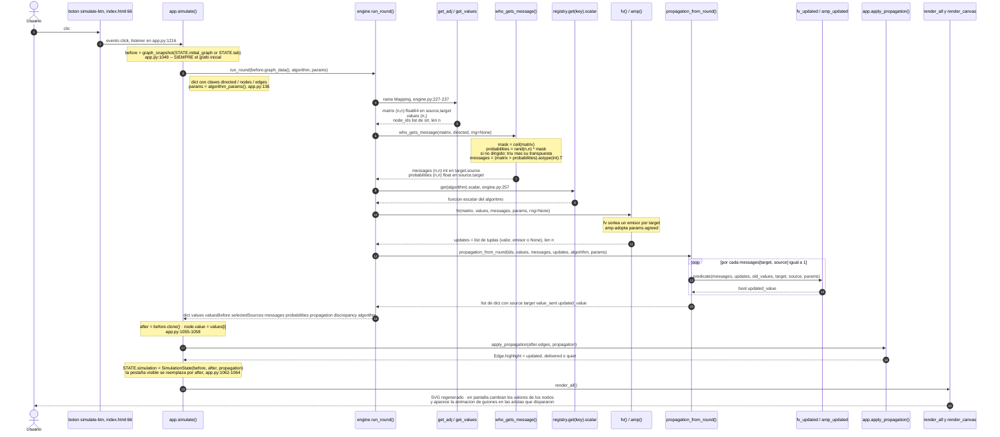
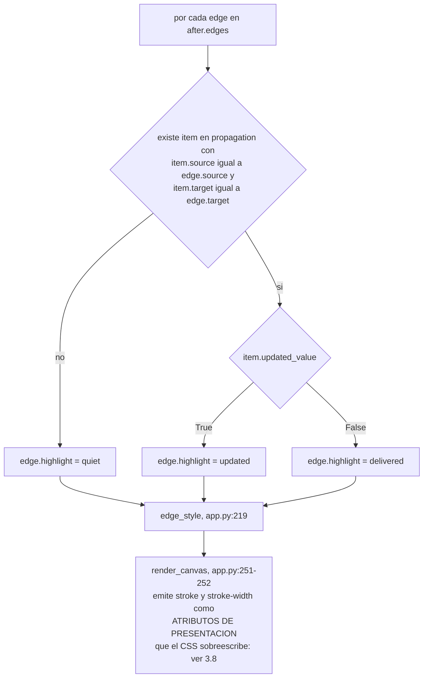
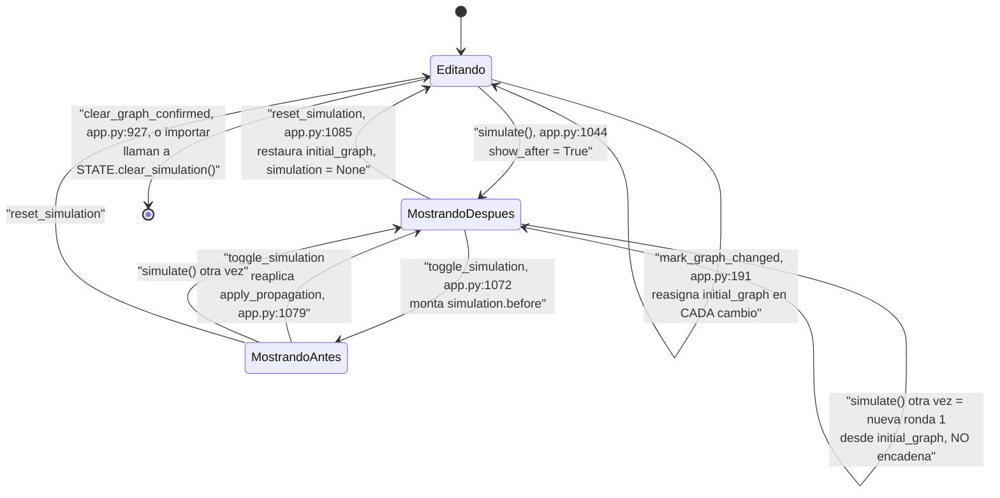

# 04 — Flujo de una simulación individual: del clic en «Simular» al pixel

> **Archivos que cubre:** `python/simulation/engine.py`, `python/simulation/algorithms.py`, `python/simulation/rng.py`, y de `python/app.py` el tramo `apply_propagation` → `simulate` → `toggle_simulation` → `reset_simulation` (líneas 1028-1092) más `edge_style` (`app.py:219`) y `render_canvas` (`app.py:231`).
> **Qué puedes cambiar aquí:** la regla de actualización de un algoritmo y su predicado `updated` dentro de `algorithms.py`; los colores y grosores que devuelve `edge_style`; el orden de las llamadas dentro de `simulate`.
> **Qué es intocable y por qué:** la transposición de `messages` (`engine.py:114`) y la máscara `np.ceil` (`engine.py:107`). Son el port literal del backend de referencia y la línea base de equivalencia compara sus salidas valor por valor: tocarlas rompe los 1026 casos y desalinea el motor escalar del vectorizado.
> **Cómo verificas el cambio:** `PYTHONDONTWRITEBYTECODE=1 python3 scripts/equivalencia.py` — debe imprimir `OK — 1026 casos idénticos a la línea base.`

Esta sección sigue **un solo dato** desde que el usuario aprieta el botón hasta que un
pixel cambia en el SVG. El botón vive en `index.html:66`, el listener se registra en
`app.py:1216`, y el código Python llegó al sistema de archivos virtual de Pyodide por
`mountPythonFiles` (`js/bootstrap.js:44-50`, invocada en `js/bootstrap.js:65`) para
después ser ejecutado con `runpy.run_path("/python/app.py")` dentro de `runPythonAsync`
(`js/bootstrap.js:67-75`). Ver [01 — Arranque del sistema](01-arranque.md).

Una ronda en una frase: **se sortea qué aristas transmiten, y cada nodo que recibió al
menos un mensaje decide qué valor adopta según el algoritmo elegido.** Un sorteo, un
cambio de valores, se acabó.

Todo el recorrido de esta sección ocurre dentro del navegador: no hay backend, no hay
build, no hay petición HTTP en el camino del botón. **Esa frase vale para la ronda
individual con el runtime ya caliente, no para la aplicación completa:** la primera carga
descarga Pyodide y NumPy desde jsDelivr, y cada barrido vuelve a descargarlos porque el
Worker se destruye con `WORKER.terminate()` (`app.py:1117` y `app.py:1182`) — ver
[05 — El barrido](05-barrido-sweep.md).

---

## 1. Mapa del recorrido

| # | Función | Archivo | Rol |
|---|---------|---------|-----|
| 1 | `simulate` | `app.py:1044` | Controlador. Arma la entrada, guarda el resultado, pide el repintado. |
| 2 | `run_round` | `engine.py:179` | Puerta de entrada al motor desde el hilo principal del editor. |
| 3 | `get_adj` / `get_values` | `engine.py:41` / `engine.py:72` | JSON → matriz `(n,n)` y vector `(n,)`. |
| 4 | `who_gets_message` | `engine.py:83` | El sorteo. Devuelve `messages` **ya transpuesta**. |
| 5 | `registry.get(...).scalar` | `registry.py:76` | Despacho al algoritmo por clave, sin ningún `if` por nombre. |
| 6 | `fv` / `amp` | `algorithms.py:51` / `algorithms.py:144` | Regla de actualización de valores. |
| 7 | `propagation_from_round` | `engine.py:118` | Traza: un registro por arista que disparó. |
| 8 | `fv_updated` / `amp_updated` | `algorithms.py:109` / `algorithms.py:188` | Predicado que decide si una entrega cuenta como actualización. |
| 9 | `apply_propagation` | `app.py:1028` | Escribe `Edge.highlight` en el grafo visible. |
| 10 | `render_all` → `render_canvas` | `app.py:521` / `app.py:231` | Regenera el SVG completo por `innerHTML`. |

**DECISIÓN DELIBERADA — `run_round` es la única puerta al motor desde el editor.**
`app.py` importa exactamente una función del motor: `from simulation.engine import run_round`
(`app.py:19`). No hay otra forma de entrar desde el hilo principal. El barrido entra por
otra puerta y en otro runtime: `js/sweep-worker.js:83` ejecuta
`from simulation.sweep import iter_sweep`, y `sweep.py:28` toma de aquí sólo
`get_adj` y `get_values`. Dos motores, dos entradas, un solo módulo compartido.

---

## 2. Diagrama de secuencia con los datos reales



---

## 3. Paso a paso, con formas de datos

### 3.1 `simulate()` — el controlador (`app.py:1044-1069`)

```python
before = graph_snapshot(STATE.initial_graph or STATE.tab)   # app.py:1049
if STATE.initial_graph is None:
    STATE.initial_graph = before.clone()                     # app.py:1050-1051
result = run_round(before.graph_data(), algorithm=STATE.algorithm, params=algorithm_params())
```

Tres decisiones no obvias viven en esas cuatro líneas.

**1. DECISIÓN DELIBERADA — la simulación SIEMPRE parte del grafo inicial, nunca del
resultado anterior.** `STATE.initial_graph` (`models.py:103`) lo mantiene al día
`mark_graph_changed` (`app.py:191-193`), que reasigna la foto **en cada cambio del grafo
con nodos, mientras no haya una simulación en curso**:

```python
def mark_graph_changed() -> None:              # app.py:191
    if STATE.simulation is None and STATE.tab.nodes:
        STATE.initial_graph = graph_snapshot()
```

Apretar «Simular» diez veces produce **diez veces la ronda 1** con diez sorteos distintos,
no diez rondas encadenadas. El motivo: el editor está para explorar la variabilidad de una
ronda, no para iterar. Encadenar rondas es trabajo de `run_simulation` (`engine.py:352`),
que la interfaz del editor no expone.

**2. DECISIÓN DELIBERADA — la UI llama a `run_round`, no a `simulate_graph`.**
`simulate_graph` (`engine.py:310`) y `update_graph_data` (`engine.py:278`) existen para
conservar el contrato observable del backend FastAPI original, y sólo los ejercita
`scripts/equivalencia.py` (ver [07 — Verificación](07-verificacion.md)). Consecuencia
práctica que hay que tener presente: la salvaguarda contra `NaN` de `update_graph_data`
(`engine.py:300-305`, «un valor NaN no sobrescribe el nodo») **no está en el camino de la
UI**; `simulate` asigna `node.value = values[index]` sin filtro (`app.py:1057-1058`).

**3. INVARIANTE — `params` se arma solo, sin conocer ningún algoritmo por nombre.**
`algorithm_params()` (`app.py:136-146`) mezcla los defaults declarados en el
`AlgorithmSpec` (`registry.py:54-57`) con lo que el usuario haya escrito, guardado por
algoritmo en `STATE.algorithm_params` (`models.py:98`). Para FV el dict queda vacío `{}`;
para AMP queda `{"agreed": 0.5}`. Meter aquí un `if algorithm == ...` rompe la promesa
central del registro (ver [06 — El registro de algoritmos](06-registro-algoritmos.md)).

El grafo que se envía es el JSON de `GraphTab.graph_data()` (`models.py:71-76`):

```python
{
  "directed": bool,
  "nodes": [{"id": str, "value": int | float, "position": {"x": float, "y": float}}, ...],
  "edges": [{"id": "edge_0", "source": str, "target": str, "weight": str}, ...],
}
```

`weight` viaja como **string** (`models.py:41`) y `get_adj` lo convierte con
`float(edge["weight"])` (`engine.py:64`); `position` se ignora por completo en el motor.
El detalle de las tres representaciones del grafo vive en
[02 — El modelo de datos](02-modelo-de-datos.md).

### 3.2 `run_round()` — la puerta de entrada (`engine.py:179-275`)

Acepta dos formas de llamada. La UI usa la primera:

* **con un `Mapping`** (`engine.py:227-237`): deriva `matrix`, `values`, `directed` y
  `node_ids` del propio grafo. Pasar además `values` o `directed` es un `ValueError`
  (`engine.py:229-232`).
  **DECISIÓN DELIBERADA:** se prefiere fallar a resolver una llamada ambigua en silencio.
* **con una matriz** (`engine.py:238-241`): `values` y `directed` son obligatorios. Es la
  forma que usa `run_simulation` para no reconstruir la matriz en cada ronda.

Validaciones, en orden: algoritmo desconocido (`engine.py:224-225`), matriz cuadrada que
coincida con `len(values)` (`engine.py:245-248`) y `node_ids` de la misma longitud
(`engine.py:250-252`).

**INVARIANTE — la validación del nombre del algoritmo ocurre ANTES de consumir
aleatoriedad.** El `raise` de `engine.py:224-225` está por encima de la llamada a
`who_gets_message` (`engine.py:254`). Mover esa comprobación hacia abajo haría que una
llamada fallida avanzara el estado global de `np.random`, y con eso dejarían de ser
reproducibles todas las corridas con `np.random.seed()` — incluida la línea base del arnés.

El resultado (`engine.py:260-275`) es 100 % de tipos nativos de Python, sin un solo
escalar ni arreglo NumPy, porque Pyodide tiene que cruzarlo hacia el DOM:

| Clave | Forma | Orientación |
|-------|-------|-------------|
| `values` | `list[float]` len `n` | por nodo |
| `valuesBefore` | `list[float]` len `n` | por nodo |
| `selectedSources` | `list[int \| None]` len `n` | por **target** |
| `messages` | `list[list[int]]` `n×n` | `[target][source]` |
| `probabilities` | `list[list[float]]` `n×n` | `[source][target]` |
| `propagation` | `list[dict]`, len = aristas que dispararon | — |
| `discrepancy` | `float`, o `None` si el grafo está vacío | — |
| `algorithm` | `str` | — |

`discrepancy` es simplemente `max(values) - min(values)` (`engine.py:166`); vale `0`
cuando hay consenso.

### 3.3 `get_adj` (`engine.py:41-69`) y `get_values` (`engine.py:72-80`)

`get_adj` recorre `data["edges"]` y escribe `matrix[source, target] = weight`
(`engine.py:65`); si el grafo no es dirigido escribe también `matrix[target, source]`
(`engine.py:66-67`).

**INVARIANTE — el orden de filas y columnas es exactamente el orden de `data["nodes"]`.**
Ese orden es el contrato implícito que amarra `values`, `node_ids`, `messages`,
`selectedSources` y los ids de `propagation`. Cualquier reordenamiento (ordenar nodos por
id, por ejemplo) desalinea las cinco cosas a la vez y de forma silenciosa: no hay ninguna
aserción que lo detecte.

Aristas repetidas entre el mismo par se **sobrescriben** en el orden del JSON, no se
suman — el porqué está en [02 — El modelo de datos](02-modelo-de-datos.md). Los self-loops se
conservan en la diagonal, y eso sí tiene consecuencias aquí (ver §3.4).

`get_values` no fuerza dtype (`engine.py:80`): un grafo con todos los valores enteros
produce un arreglo `int64`. Aguas abajo no importa, porque `run_round` convierte a `float`
al construir el resultado, pero conviene saberlo al depurar.

### 3.4 `who_gets_message()` — el sorteo (`engine.py:83-115`)

Son cinco líneas y contienen casi toda la sutileza del proyecto.

```python
adjacency_mask = np.ceil(matrix)                                     # engine.py:107
probabilities  = _random_array(rng, matrix.shape) * adjacency_mask   # engine.py:108
if not directed:
    upper = np.triu(probabilities)                                   # engine.py:111
    probabilities = upper + upper.T                                  # engine.py:112
messages = (matrix > probabilities).astype(int).T                    # engine.py:114
```

**a) La máscara `np.ceil(matrix)`.** Sirve para muestrear U(0,1) **sólo donde hay arista**:
donde el peso es 0 la máscara es 0, la probabilidad queda en `0.0`, y `0.0 > 0.0` es
`False`, así que una no-arista nunca dispara. Para un peso `w ∈ (0,1]` la máscara vale 1 y
`P(disparo) = P(w > U) = w`. Con `w = 1` dispara siempre, porque `np.random.rand` devuelve
valores en `[0, 1)` y `1.0 > u` es cierto para todo `u < 1`.

**DECISIÓN DELIBERADA — fuera de `(0,1]` el comportamiento es raro y se conserva a
propósito.** El docstring lo dice explícitamente (`engine.py:96-100`): el comportamiento de
los pesos fuera del intervalo «queda delegado a esa expresión original, en vez de
recortarlos silenciosamente». Para `w > 1`, `P(disparo) = w / ceil(w)`, que **no** es 1: un
peso de 1.5 dispara con probabilidad 0.75, es decir **menos** que un peso de 1.0. La
probabilidad de disparo no es monótona en el peso. Los pesos negativos nunca disparan. Se
mantiene así porque el proyecto de referencia hace exactamente esto y la línea base compara
flotantes exactos; «arreglarlo» con un `clip(0, 1)` rompe la equivalencia.

El editor protege ese flanco por delante: el diálogo de peso exige el intervalo `(0, 1]`
(`app.py:802-804`). **DEUDA CONOCIDA:** «Importar JSON» no valida pesos
(`finish_import`, `app.py:962-971`; las aristas se construyen en `app.py:971` sin
comprobar rango), así que un archivo con `"weight": "1.5"` entra sin protesta y produce
tasas de disparo que nadie espera.

**b) DECISIÓN DELIBERADA — el truco de la simetría en grafos no dirigidos.** `np.triu`
incluye la diagonal, así que `upper + upper.T` deja la matriz simétrica **reutilizando la
misma muestra aleatoria** para las dos direcciones de cada arista. Por eso en un grafo no
dirigido el disparo es simétrico: si A transmite a B, B transmite a A en la misma ronda. Es
modelado, no accidente, y está declarado en las convenciones del módulo
(`engine.py:11-17`).

Efecto lateral heredado, y aquí está la explicación canónica de un hecho que se menciona en
varias secciones: **un self-loop en un grafo no dirigido ve su probabilidad duplicada**
(`2·U`), porque la diagonal se suma consigo misma, y su tasa efectiva de disparo se reduce
a la mitad (`w/2`). Un self-loop de peso 1 dispara ~50 % de las veces. Esto **no es un bug
de paridad entre motores**: el barrido hace el mismo `np.triu` con diagonal incluida
(`sweep.py:109`), de modo que la rareza afecta idénticamente a los dos motores y ambos
deben conservarla. Es una propiedad heredada del backend original, no una divergencia.

**c) INVARIANTE — la transposición.** `messages` sale **ya transpuesta**:
`messages[target, source] == 1` significa que `source` transmitió a `target`. Toda la
cadena posterior asume esa orientación: `fv` itera
`for target_index, received in enumerate(messages)` (`algorithms.py:74`) y
`propagation_from_round` indexa `messages[target_index, source_index]` (`engine.py:147`).

Ésta es la explicación canónica de las dos orientaciones; el resto del mapa la cita y no la
repite. En resumen:

| Arreglo | Orientación | Dónde se fija |
|---|---|---|
| `matrix` | `[source, target]` | `engine.py:65` |
| `probabilities` | `[source, target]` | `engine.py:108` (nunca se transpone) |
| `messages` | `[target, source]` | `engine.py:114`, por el `.T` |
| `fired` (barrido vectorizado) | `[s, source, target]`, **sin transponer** | `algorithms.py:14-18` |

**`messages` y `probabilities` quedan en orientaciones opuestas.** No se pueden comparar
elemento a elemento desde la consola sin transponer una de las dos, y ésta es la confusión
número uno al escribir un algoritmo nuevo: la versión `scalar` y la versión `batch` reciben
la misma información con ejes contrarios. Está avisado en el propio docstring de
`algorithms.py:9-18`.

Detalle de implementación útil al depurar: `messages` es una **vista transpuesta** (no
contigua) de dtype `int64` y forma `(n, n)`.

### 3.5 El algoritmo escalar, resuelto por el registro (`engine.py:255-258`)

```python
algorithm_fn = registry.get(algorithm).scalar
updates = algorithm_fn(matrix, values, messages, params, rng=rng)
```

**INVARIANTE — el motor no menciona ningún algoritmo por nombre.** Pide el `AlgorithmSpec`
al registro (`registry.py:76-82`) y lo llama con la firma uniforme. `ALGORITHMS` y
`PROPAGATION_PREDICATES` (`engine.py:35` y `engine.py:38`) son *vistas vivas* del
diccionario del registro (`registry.py:141-145`), así que un algoritmo recién registrado
aparece solo.

Para que un algoritmo nuevo **funcione en la aplicación** basta editar
`python/simulation/algorithms.py` y llamar a `register`. Pero eso no lo pone bajo la red de
seguridad: la tupla `ALGORITMOS = ("fv", "amp")` de `scripts/equivalencia.py:187` está
escrita a mano y decide qué algoritmos captura el arnés, así que un algoritmo nuevo no
queda cubierto por ninguno de los 1026 casos hasta que se agrega ahí y se regraba la línea
base. Un archivo para el producto, dos para el trabajo completo: el detalle está en
[06 — El registro de algoritmos](06-registro-algoritmos.md) y [07 — Verificación](07-verificacion.md).

Ambos algoritmos devuelven la misma forma:
`updates: list[tuple[valor_nuevo, indice_del_emisor_elegido | None]]`, longitud `n`,
indexada por **target**.

**FV — Flip Value** (`algorithms.py:51-83`). Cada target que recibió al menos un mensaje
elige **un emisor al azar** entre los que le transmitieron y copia su valor:

```python
valid_sources = np.where(received != 0)[0]                                # algorithms.py:75
if len(valid_sources) == 0:
    new_values.append((native_scalar(values[target_index]), None))        # algorithms.py:77
    continue
source_index = int(valid_sources[random_index(rng, len(valid_sources))])  # algorithms.py:80
new_values.append((native_scalar(values[source_index]), source_index))    # algorithms.py:81
```

**INVARIANTE — `random_index` con `rng=None` usa `np.random.randint`** (`rng.py:28-36`),
no un `Generator` propio. Es la rama que preserva `np.random.seed()`, y de eso depende la
reproducibilidad de la línea base. Lo mismo vale para `random_array` (`rng.py:19-25`), que
usa `np.random.rand(*shape)` con un comentario que lo dice en el código.

**AMP — Agreement** (`algorithms.py:144-170`). Todo target que recibió **algo** adopta el
valor de consenso `params["agreed"]` (default `0.5`, declarado en `algorithms.py:44` y
leído en `algorithms.py:161`). No hay elección de emisor, así que el segundo elemento de la
tupla es siempre `None` (`algorithms.py:166`).

**INVARIANTE — el centinela es `None`, no `NaN`.** El backend original marcaba «este target
no eligió emisor» con `NaN`; el port usa `None`, que es JSON-serializable y sobrevive el
cruce a JavaScript (documentado en `algorithms.py:61-64`). `run_round` lo propaga tal cual
a `selectedSources` (`engine.py:263-265`). El detalle elegante que se rompería al
cambiarlo: `fv_updated` compara `selected_source == source_index` y `None == int` es
`False` en Python, así que el caso «sin elección» se resuelve sin un `if` extra
(`algorithms.py:118-125`).

**El motor nunca genera un `NaN` por su cuenta**, pero un `NaN` sí puede entrar al grafo
desde el editor, y por eso las ramas correspondientes siguen vivas:

* `open_node_editor` hace `node.value = float(value)` y sólo atrapa `ValueError`
  (`app.py:764-769`), de modo que escribir `nan` o `inf` en el diálogo se acepta sin error.
* `finish_import` usa `json.loads` (`app.py:962-971`), que por omisión acepta el literal
  `NaN`.

De ahí que `number_label` (`app.py:122-129`, rama `math.isnan` en `app.py:124-125`) y
`value_color` (`geometry.py:20-31`, rama en `geometry.py:23-24`) lo sigan contemplando.
**DEUDA CONOCIDA:** la validación de valores de nodo es más laxa que la de pesos de arista,
sin motivo declarado.

### 3.6 `propagation_from_round()` y el predicado `updated` (`engine.py:118-163`)

Recorre `messages` en orden target-major y luego source-major (`engine.py:145-147`) y emite
**un registro por arista que disparó**:

```python
{"source": <id>, "target": <id>, "value_sent": float, "updated_value": bool}
```

`value_sent` es `old_values[source_index]` (`engine.py:158`), es decir **el valor que el
emisor tenía antes de la ronda**, no el que tiene después. Los ids son los del grafo
(`node_0`, `node_1`, …) pasados por `native_scalar` (`rng.py:39-44`) para que no queden
escalares NumPy.

Que una arista entregada cuente además como *actualización* lo decide el predicado del
algoritmo, buscado en `PROPAGATION_PREDICATES` (`engine.py:142`, vista viva de
`registry.UPDATED`):

* `fv_updated` (`algorithms.py:109-125`): `True` sólo para el emisor que ganó el sorteo.
  Los demás mensajes llegaron pero fueron ignorados.
* `amp_updated` (`algorithms.py:188-205`): `True` si el valor visible del target **cambió**
  (`not np.isclose(new_value, old_values[target_index])`). Un nodo que ya valía `agreed`
  recibe mensajes marcados como entregados pero no como actualización.

**DECISIÓN DELIBERADA — `updated_value` es contrato de visualización, no matemática.** El
docstring de `propagation_from_round` (`engine.py:128-131`) lo separa a propósito: el bucle
sólo recorre aristas y la regla vive en el algoritmo. Cambiar un predicado cambia colores
(hoy: cuáles aristas se animan), nunca valores.

### 3.7 Vuelta a `app.py` — `apply_propagation` y `SimulationState`

```python
values = list(result["values"])                                        # app.py:1055
after = before.clone()                                                 # app.py:1056
for index, node in enumerate(after.nodes):
    node.value = values[index]                                         # app.py:1057-1058
propagation = [dict(item) for item in result.get("propagation", [])]   # app.py:1059
apply_propagation(after.edges, propagation)                            # app.py:1060
STATE.simulation = SimulationState(before, after, propagation)         # app.py:1061
```

`apply_propagation` (`app.py:1028-1041`) busca, para cada `Edge`, el **primer** registro de
propagación cuyo par `(source, target)` coincida (`app.py:1030-1037`), y escribe
`Edge.highlight` (`models.py:42`):



Luego la pestaña visible se **reemplaza** por una copia de `after` conservando id y nombre
(`app.py:1062-1064`), se pone `STATE.show_after = True` (`app.py:1065`) y se llama a
`render_all()` (`app.py:1066`). Cualquier excepción se atrapa y se muestra con `notify`
(`app.py:1067-1069`), que es un `window.alert` con fallback al diálogo propio
(`app.py:115-119`).

`SimulationState` (`models.py:82-86`) guarda las dos fotos completas (`before`, `after`) más
la lista de propagación. Eso es lo que hace posible el botón «Ver Antes / Ver Después»
(`toggle_simulation`, `app.py:1072-1082`) sin volver a simular: sólo intercambia qué
`GraphTab` está montado y, al volver a «después», reaplica la propagación sobre la copia
(`app.py:1079`).

### 3.8 `render_all()` → `render_canvas()`, y qué se ve realmente en pantalla

`render_all` (`app.py:521-525`) corre siempre en el mismo orden: `render_tabs`,
`render_controls`, `render_canvas`, `render_json`. No hay diffing ni framework: cada capa
SVG se reconstruye entera asignando `innerHTML` (`app.py:268-269`, `app.py:282`) —
el porqué y sus consecuencias están en [03 — La capa de interfaz](03-interfaz.md).

* `render_controls` (`app.py:492-518`) deshabilita «Simular» si no hay nodos
  (`app.py:502`) y muestra el bloque de resultados si `STATE.simulation is not None`
  (`app.py:504-511`).
* `render_canvas` (`app.py:231-283`) construye cada arista con `edge_geometry`
  (`geometry.py:38`) —recta, curva si existe la arista inversa en un grafo dirigido
  (`has_reverse`, `geometry.py:88`), o bucle cúbico si es un self-loop
  (`geometry.py:44-57`)— y le pega el color y el grosor que devuelve `edge_style`
  (`app.py:246`).
* Cada nodo se pinta con `value_color` (`geometry.py:20-31`), que interpola linealmente
  entre `V0 = (110,124,242)` azul para el valor 0 y `V1 = (244,180,92)` naranja para el 1,
  recortando fuera de `[0,1]`, y elige texto claro u oscuro según la luminancia. Los
  valores de los nodos **sí** cambian de color visiblemente tras simular.

Lo que `edge_style` (`app.py:219-228`) *pretende* pintar:

| `highlight` | Significado | Color pedido | Grosor pedido | Clase que emite |
|---|---|---|---|---|
| `"updated"` | Disparó **y** el predicado del algoritmo la contó como actualización | `#F4B45C` | 4 | `edge-animated` |
| `"delivered"` | Disparó pero el target no adoptó su valor | `#7A6E9E` | 4 | `edge-animated` |
| `"quiet"` | No disparó en esta ronda | `#413A5E` | 1 | — |
| `None` + seleccionada | Estado de edición | `#6E7CF2` | 4 | — |
| `None` | Reposo | `#6C6690` | 3 | — |

**DEUDA CONOCIDA — ninguno de esos colores ni grosores llega a la pantalla.**
`render_canvas` emite el path así (`app.py:251-252`):

```python
f'<path class="edge-path" d="{geometry["path"]}" fill="none" stroke="{color}" '
f'stroke-width="{width}"{marker}></path>'
```

`stroke` y `stroke-width` escritos de ese modo son **atributos de presentación** de SVG, no
estilo inline. En la cascada CSS un atributo de presentación tiene la prioridad más baja de
todas: **cualquier** regla de hoja de estilo le gana. Y en `css/app.css` existe la regla
base del selector `.edge-path`, que fija `stroke: #6c6690` y `stroke-width: 3`. Resultado:

* **Todas las aristas se dibujan `#6c6690` con grosor 3**, siempre, en los cinco casos de
  la tabla. Los cuatro estados de `edge_style` no se distinguen en pantalla.
* Las reglas `.edge-path.is-updated`, `.edge-path.is-delivered`, `.edge-path.is-idle` y
  `.edge-path.is-selected` existen en el CSS pero también están muertas, por una razón
  distinta: `render_canvas` **nunca emite esas clases**. Son dos formas de código muerto
  que se anulan mutuamente.
* Lo único que sí se ve tras simular es la **animación de guiones**: `edge_style` devuelve
  la clase `edge-animated`, que `render_canvas` sí pone en el `<g>` contenedor
  (`app.py:249`), y el selector `.edge-animated .edge-path` aplica `stroke-dasharray` más
  la animación `edge-flow`. En pantalla, entonces, la única distinción real es
  **disparó (guiones en movimiento) vs. no disparó (línea estática)**; `updated` y
  `delivered` se ven idénticas.

Está verificado también contra el respaldo previo al refactor: es idéntico allí, **no es
una regresión del port**. Antes de «arreglarlo», leer: la corrección es emitir clases
(`is-updated`, etc.) en lugar de atributos, o pasar el color por `style=`, y cambia lo que
se ve sin cambiar ni un número — el arnés de equivalencia no lo notará, así que la
verificación de ese cambio es **visual, en el navegador**.

**DEUDA CONOCIDA — texto obsoleto.** `render_controls` anuncia «aristas verdes =
propagación» (`app.py:508`) cuando ni siquiera los colores que `edge_style` pide son
verdes. Tres textos en conflicto (el mensaje, `edge_style` y el CSS) describen tres cosas
distintas, y la que gana es la tercera.

---

## 4. El interior de una ronda, con un ejemplo de 3 nodos que se puede seguir a mano

Grafo **dirigido**, tres nodos en este orden y estas aristas:

```json
{"directed": true,
 "nodes": [{"id": "node_0", "value": 1.0},
           {"id": "node_1", "value": 0.25},
           {"id": "node_2", "value": 0.0}],
 "edges": [{"id": "edge_0", "source": "node_0", "target": "node_1", "weight": "0.5"},
           {"id": "edge_1", "source": "node_0", "target": "node_2", "weight": "1"},
           {"id": "edge_2", "source": "node_1", "target": "node_2", "weight": "0.6"}]}
```



```mermaid
flowchart TD
    A["get_adj, engine.py:41<br/>matrix 3x3 en source,target<br/>fila0 = 0.0 0.5 1.0<br/>fila1 = 0.0 0.0 0.6<br/>fila2 = 0.0 0.0 0.0"] --> B
    A0["get_values, engine.py:72<br/>values = 1.0 , 0.25 , 0.0  shape (3,)"] --> D

    B["mask = ceil(matrix), engine.py:107<br/>fila0 = 0 1 1<br/>fila1 = 0 0 1<br/>fila2 = 0 0 0"] --> C
    C["rand(3,3) por mask, engine.py:108<br/>rand fila0 = .91 .73 .12<br/>rand fila1 = .44 .65 .28<br/>probabilities fila0 = 0 .73 .12<br/>probabilities fila1 = 0 0 .28<br/>probabilities fila2 = 0 0 0"] --> C2
    C2["dirigido: NO se aplica triu, engine.py:110-112"] --> C3
    C3["matrix mayor que probabilities, en source,target<br/>0.5 mayor que 0.73 es False, node_0 a node_1<br/>1.0 mayor que 0.12 es True, node_0 a node_2<br/>0.6 mayor que 0.28 es True, node_1 a node_2"] --> C4
    C4["transponer, engine.py:114<br/>messages en target,source<br/>fila target node_0 = 0 0 0<br/>fila target node_1 = 0 0 0<br/>fila target node_2 = 1 1 0"] --> D

    D{"algoritmo activo"}
    D -- "fv, algorithms.py:51" --> E1["target node_0 sin mensajes: 1.0 , None<br/>target node_1 sin mensajes: 0.25 , None<br/>target node_2 recibio de 0 y de 1<br/>random_index elige el indice 1<br/>resultado: 0.25 , 1"]
    D -- "amp, algorithms.py:144 con agreed=0.5" --> E2["target node_0: 1.0 , None<br/>target node_1: 0.25 , None<br/>target node_2 recibio: 0.5 , None"]

    E1 --> F1["values = 1.0 , 0.25 , 0.25<br/>selectedSources = None , None , 1<br/>discrepancy = 0.75"]
    E2 --> F2["values = 1.0 , 0.25 , 0.5<br/>selectedSources = None , None , None<br/>discrepancy = 0.75"]

    F1 --> G1["propagation_from_round, engine.py:118, con fv_updated<br/>node_0 a node_2: value_sent 1.0, updated False<br/>node_1 a node_2: value_sent 0.25, updated True"]
    F2 --> G2["propagation_from_round con amp_updated<br/>node_0 a node_2: value_sent 1.0, updated True<br/>node_1 a node_2: value_sent 0.25, updated True"]

    G1 --> H1["apply_propagation, app.py:1028<br/>edge_0 highlight quiet<br/>edge_1 highlight delivered<br/>edge_2 highlight updated"]
    G2 --> H2["apply_propagation<br/>edge_0 highlight quiet<br/>edge_1 highlight updated<br/>edge_2 highlight updated"]

    H1 --> P1["en pantalla, hoy: ver 3.8<br/>edge_0 linea estatica<br/>edge_1 y edge_2 con guiones animados<br/>iguales entre si"]
    H2 --> P2["en pantalla, hoy<br/>edge_0 linea estatica<br/>edge_1 y edge_2 con guiones animados"]
```

En palabras, el caso FV: `node_2` recibió dos mensajes, uno con el valor 1.0 y otro con
0.25. FV sorteó y se quedó con el de `node_1`, así que `node_2` pasa de 0.0 a 0.25.
`edge_1` queda con `highlight = "delivered"` —llegó pero fue ignorada— y `edge_2` con
`highlight = "updated"`. `edge_0` ni siquiera disparó (0.5 no superó el 0.73 sorteado) y
queda `"quiet"`.

Con AMP, en cambio, **ambos** mensajes cuentan como actualización, porque el valor de
`node_2` sí cambió (0.0 → 0.5) y `amp_updated` sólo mira eso. El mismo sorteo, distinta
clasificación: es exactamente la diferencia entre `fv_updated` y `amp_updated`.

**En el modelo de datos esa diferencia existe y es correcta; en el canvas de hoy no se
distingue** (§3.8). Para verla, mirar el JSON del resultado en la consola o el panel de
JSON, no los colores.

---

## 5. El ciclo de estado alrededor del botón



La transición reflexiva `Editando --> Editando` es la clave: mientras
`STATE.simulation is None`, **cada** edición del grafo con nodos vuelve a fotografiar
`initial_graph`. En cuanto hay una simulación en pantalla, esa reasignación se apaga
(`app.py:192`) — y de ahí sale la trampa de la lista de abajo.

---

## 6. Trampas, decisiones e invariantes de esta sección

**INVARIANTE — la transposición de `messages`.** `messages[target, source]`, mientras
`probabilities` y `matrix` siguen en `[source, target]` y el `fired` del barrido usa
`[s, source, target]` sin transponer. Documentado en `engine.py:11-13` y en
`algorithms.py:9-18`. Explicación canónica en §3.4.c.

**DECISIÓN DELIBERADA — `np.ceil` y los pesos fuera de `(0,1]`.**
`P(disparo) = w / ceil(w)`, no `min(w, 1)`. Un peso 1.5 dispara con probabilidad 0.75,
menos que un peso 1.0; los negativos nunca disparan. Se conserva porque es el port literal
del backend (`engine.py:96-100`) y la línea base compara flotantes exactos.

**DEUDA CONOCIDA — la importación de JSON no valida pesos.** El diálogo del editor exige
`(0, 1]` (`app.py:802-804`); `finish_import` (`app.py:962-971`) no comprueba nada. Un
archivo con pesos fuera de rango entra y produce las tasas raras del punto anterior.

**DEUDA CONOCIDA — el diálogo de valor de nodo acepta `nan` e `inf`.**
`node.value = float(value)` con `except ValueError` (`app.py:764-769`) deja pasar `nan`;
`json.loads` acepta el literal `NaN` al importar. El motor nunca genera un `NaN`, pero las
ramas de `number_label` (`app.py:124-125`) y `value_color` (`geometry.py:23-24`) existen
porque el `NaN` sí puede entrar por ahí.

**DECISIÓN DELIBERADA — self-loop en grafo no dirigido.** `np.triu` incluye la diagonal, así
que `upper + upper.T` la duplica y la probabilidad efectiva del self-loop se parte a la
mitad (`engine.py:111-112`). El barrido hace lo mismo (`sweep.py:109`): afecta a los dos
motores por igual, así que **no es un bug de paridad** sino una propiedad heredada que
ambos deben conservar.

**INVARIANTE — el orden de `data["nodes"]` amarra cinco estructuras.** `values`,
`node_ids`, `messages`, `selectedSources` y los ids de `propagation` comparten ese orden y
nada lo comprueba en tiempo de ejecución (§3.3).

**INVARIANTE — validar el algoritmo antes de consumir aleatoriedad** (`engine.py:224-225`).
Mover ese `raise` hacia abajo rompe la reproducibilidad con `np.random.seed()`.

**INVARIANTE — el centinela de emisor no elegido es `None`, no `NaN`**
(`algorithms.py:61-64`). Cambiarlo rompe la serialización JSON hacia el navegador y rompe
`fv_updated`, que se apoya en que `None == int` sea `False` (`algorithms.py:118-125`).

**DECISIÓN DELIBERADA — repetir «Simular» no encadena rondas.** Siempre se parte de
`STATE.initial_graph` (`app.py:1049`). Cada clic es una nueva ronda 1 con un sorteo
distinto. Para encadenar existe `run_simulation` (`engine.py:352`), que la UI del editor no
expone.

**DEUDA CONOCIDA — editar mientras hay un resultado en pantalla pierde la edición.** Con
`STATE.simulation is not None`, `mark_graph_changed` no toca `initial_graph`
(`app.py:192`). Mover un nodo o cambiar un valor actualiza la pestaña visible, pero el
siguiente clic en «Simular» —o en «Resetear»— vuelve al grafo inicial y descarta el cambio,
sin avisar. Hay que presionar «Resetear» **antes** de editar.

**DEUDA CONOCIDA — en grafos no dirigidos sólo se ve una de las dos direcciones.** El
disparo es simétrico, así que `propagation` trae **dos** registros por arista
(`node_0→node_1` y `node_1→node_0`), pero `apply_propagation` busca únicamente el par en el
orden en que la arista fue dibujada (`app.py:1034`): el flag de la dirección inversa queda
invisible.

**DEUDA CONOCIDA — aristas paralelas comparten color.** `apply_propagation` usa `next(...)`
sobre el primer match `(source, target)` (`app.py:1030-1037`), así que dos aristas dibujadas
entre el mismo par reciben el mismo `highlight`. (Que además la matriz sólo conserve el
último peso es asunto de `get_adj`; ver [02 — El modelo de datos](02-modelo-de-datos.md).)

**DEUDA CONOCIDA — el CSS de aristas anula a `edge_style`.** Los cuatro estados no se
distinguen en pantalla y las reglas `.edge-path.is-*` están muertas. Explicación completa
y camino de arreglo en §3.8.

**DEUDA CONOCIDA — texto obsoleto en la UI.** «aristas verdes = propagación»
(`app.py:508`).

**DECISIÓN DELIBERADA — la UI no usa `simulate_graph` ni `update_graph_data`.** Sólo
`run_round` (`app.py:19`). Consecuencia: la salvaguarda contra `NaN` de
`update_graph_data` (`engine.py:300-305`) no protege el camino del editor. Esas dos
funciones existen para conservar el contrato del backend original y las ejercita el arnés.

**INVARIANTE — `updated_value` es contrato de visualización, no matemática.** En FV
significa «ganó el sorteo» (`algorithms.py:125`); en AMP, «el valor del target cambió»
(`algorithms.py:205`). Un algoritmo nuevo debe declarar su propio predicado; el motor no
tiene un default.

**DEUDA CONOCIDA — el consumo del RNG depende de `n`, no de la cantidad de aristas.**
`who_gets_message` muestrea siempre `(n, n)` uniformes (`engine.py:108`), incluso en las
celdas sin arista. Agregar un nodo aislado cambia toda la secuencia aleatoria posterior con
la misma semilla, lo que hace que dos corridas «equivalentes» dejen de coincidir.

**DEUDA CONOCIDA — `apply_propagation` es cuadrático.** Un `next()` lineal sobre
`propagation` por cada arista: `O(E × P)` (`app.py:1030-1037`). Irrelevante para los grafos
de decenas de nodos del editor, y es el primer punto a arreglar si alguien intenta abrir un
grafo grande.
