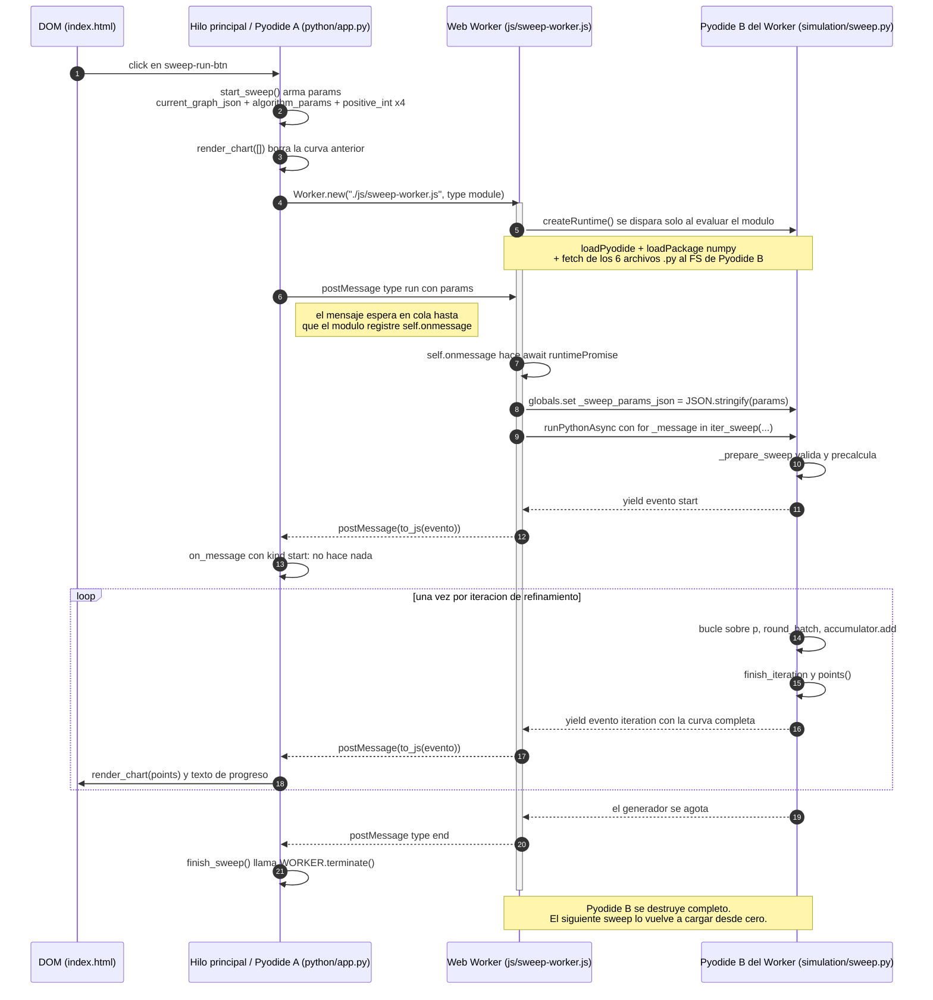
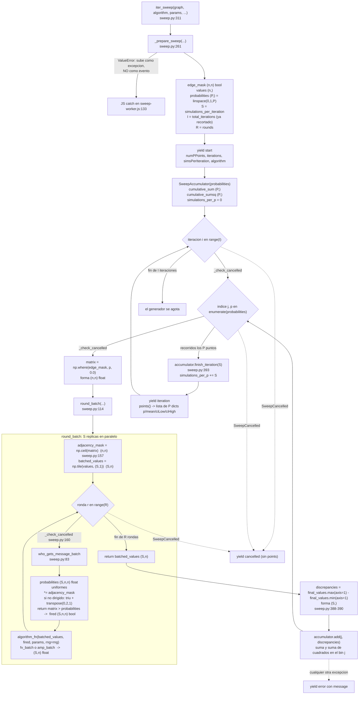
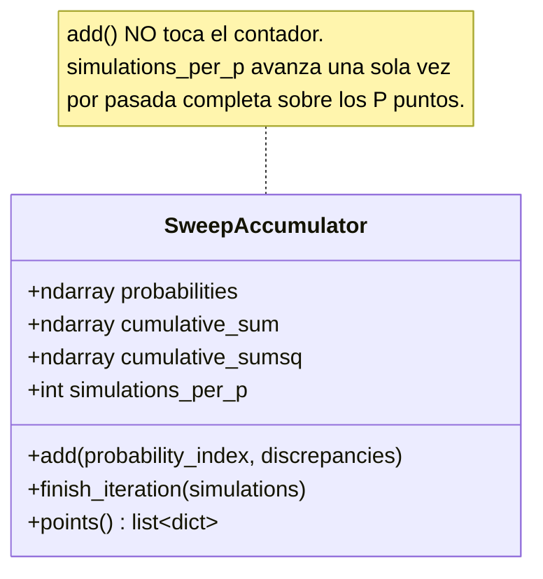
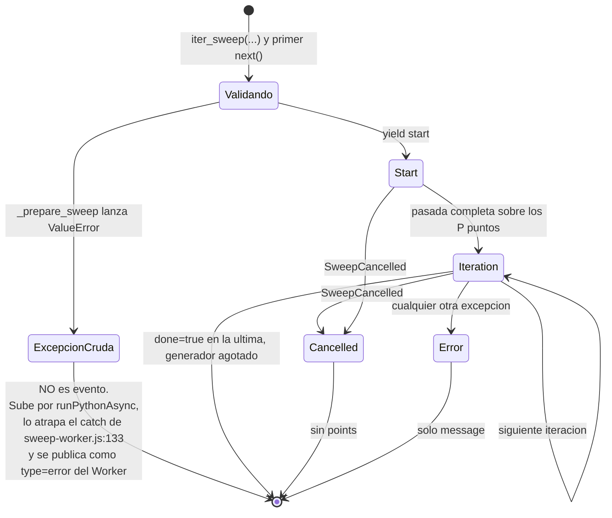

# 05 · El barrido (sweep): el análisis de convergencia

> **Archivos que cubre:** `python/simulation/sweep.py`, `js/sweep-worker.js`, el bloque de sweep de `python/app.py` (`positive_int` … `finish_sweep`, líneas 1100-1183, más `render_chart` y el tooltip, líneas 349-479), el panel `#sweep-panel` de `index.html:123-164`.
> **Qué puedes cambiar aquí:** los rangos de `_validated_int`, el tamaño del batch, el dibujo de la curva (`render_chart`), los textos de `#sweep-status`, y los campos *añadidos* a los eventos del stream.
> **Qué es intocable y por qué:** que `points()` devuelva `float`/`int` nativos (si no, el mensaje muere al cruzar la frontera del Worker); que `finish_iteration()` viva fuera del bucle de `p` (si no, toda la curva se hunde sin lanzar ninguna excepción); las cuatro claves `p`/`mean`/`ciLow`/`ciHigh` que espera `render_chart`; y el recorte de iteraciones de `_prepare_sweep`, que está congelado en la línea base.
> **Cómo verificas el cambio:** `python3 scripts/equivalencia.py` → debe imprimir `OK — 1026 casos idénticos a la línea base.` (el arnés cubre `iter_sweep` y `round_batch`; ver [07 · Verificación](07-verificacion.md)).

El barrido es la única parte del proyecto que **cruza dos runtimes de Python**. La misma
aplicación tiene dos intérpretes Pyodide vivos al mismo tiempo, en dos hilos distintos, que
no comparten memoria y sólo se hablan por `postMessage`. Entender ese cruce es el 80 % de
entender el sweep; el otro 20 % es álgebra de tensores con un eje extra.

---

## 1. Qué pregunta responde

El panel **Análisis de Convergencia** responde:

> Si *todas* las aristas del grafo tuvieran la misma probabilidad de transmisión `p`,
> ¿cuánta discrepancia (`max(values) − min(values)`) queda al final, en promedio,
> para cada `p` entre 0 y 1?

Dos consecuencias que sorprenden a quien llega nuevo:

- **DECISION DELIBERADA — los pesos que el usuario escribió en las aristas se tiran a la
  basura.** Sólo se conserva la *topología*: `edge_mask = base_matrix > 0`
  (`python/simulation/sweep.py:287`) y luego `matrix = np.where(edge_mask, probability, 0.0)`
  (`python/simulation/sweep.py:376`). El motivo es el punto entero del análisis: aislar el
  efecto de `p`, sin que los pesos lo contaminen. Corolario incómodo: una arista con peso
  `"0"` (o negativo) **desaparece del barrido**, porque `> 0` es falso. Ésta es la sección
  dueña de este hecho; las demás sólo lo citan.
- **Los valores iniciales de los nodos sí importan.** `get_values`
  (`python/simulation/engine.py:72`) los lee tal cual y son el punto de partida de las `S`
  réplicas.

---

## 2. Mapa completo: el viaje de ida y vuelta



### Los actores, con su archivo

| Actor | Dónde vive | Qué carga |
|---|---|---|
| Pyodide A | hilo principal, `startApplication()` en `js/bootstrap.js:52` | los 9 archivos de `PYTHON_FILES` (`js/bootstrap.js:4-14`): `app.py`, `models.py`, `geometry.py` **y** el paquete `simulation` completo |
| Worker | `js/sweep-worker.js` | sólo Pyodide + NumPy |
| Pyodide B | dentro del Worker, `createRuntime()` en `js/sweep-worker.js:34` | **sólo** los 6 archivos de `SWEEP_FILES` (`js/sweep-worker.js:4-11`) |

Las dos listas de archivos son manuales y la de arranque se explica en
[01 · Arranque y runtime](01-arranque.md); aquí sólo importa la consecuencia.

**DECISION DELIBERADA — el Worker no carga `app.py` ni ve el DOM.** Montar 6 archivos y no
9 es un candado arquitectónico: el sweep es matemática pura y no *puede* tocar la interfaz
aunque alguien lo intente. Todo lo que necesita saber viaja en un solo mensaje.

---

## 3. Lado hilo principal: `start_sweep`

`python/app.py:1237`. Es corto y hace cinco cosas en orden.

```python
def start_sweep(*_args) -> None:
    global WORKER
    if not STATE.tab.nodes or STATE.sweep_running:   # app.py:1239
        return
    params = {                                        # app.py:1241
        "graph": current_graph_json(),
        "algorithm": STATE.algorithm,
        "algorithmParams": algorithm_params(),        # app.py:1246
        "numPPoints": positive_int("p-points-input", 2),
        "totalSimulationsPerP": positive_int("simulations-input", 1),
        "iterations": positive_int("iterations-input", 1),
        "rounds": positive_int("rounds-input", 1),
    }
```

Detalles que importan:

- **`algorithmParams` está renombrado a propósito** (`python/app.py:1244-1246`). El dict
  exterior ya se llama `params`; anidar otro `params` dentro haría ilegible el JSON del
  mensaje. `algorithm_params()` (`python/app.py:138`) arma el dict leyendo los *defaults*
  del registro y encima lo que el usuario editó, sin conocer ningún algoritmo por nombre
  (ver [06 · Registro de algoritmos](06-registro-algoritmos.md)).
- **`positive_int` sólo aplica el mínimo** (`python/app.py:1212-1216`). Hace
  `max(minimum, int(float(str(value))))` dentro de un `try`: un campo vacío o basura cae al
  mínimo.
  **DECISION DELIBERADA — el máximo del `<input>` (`index.html:127`, `130`, `133`, `136`)
  no se impone ni en JavaScript ni en el Python del hilo principal**: un `numPPoints = 9999`
  viaja íntegro hasta `_prepare_sweep`, que lo rechaza. El motivo es tener **una sola fuente
  de verdad** para los rangos, y está en `sweep.py`. El precio es que los cuatro topes están
  escritos dos veces (HTML y Python) y pueden desincronizarse: ver §14, trampa 3.
- Se llama `render_chart([])` (`python/app.py:1254`) **antes** de arrancar, para que la
  curva del sweep anterior no se quede colgada mientras el nuevo carga.
- El Worker se crea con `{"type": "module"}` (`python/app.py:1258`) porque
  `js/sweep-worker.js` usa `import` de nivel superior.

### El `postMessage` que parece una carrera y no lo es

`python/app.py:1288` publica el mensaje `run` inmediatamente después de crear el Worker,
cuando Pyodide B ni siquiera empezó a descargarse. No es un bug: el navegador **encola**
los mensajes hasta que el módulo del Worker termina de evaluarse y registra
`self.onmessage` (`js/sweep-worker.js:120`). Mientras tanto,
`const runtimePromise = createRuntime()` (`js/sweep-worker.js:53`) ya arrancó en el nivel
superior del módulo, así que la descarga de Pyodide y el `fetch` de los `.py` corren en
paralelo con el encolado. El `await runtimePromise` de `js/sweep-worker.js:96` es el punto
de reunión.

---

## 4. La frontera: qué cruza y en qué formato

El grafo sufre **cuatro conversiones** de ida:

```
dict de Python (Pyodide A)          GraphTab.graph_data(), models.py:71
  --to_js(dict_converter=Object.fromEntries)-->  objeto JS      app.py:1288
  --structured clone del postMessage-->          objeto JS en el Worker
  --JSON.stringify-->                            string         sweep-worker.js:97
  --json.loads-->                                dict de Python (Pyodide B)  sweep-worker.js:106
```

**DECISION DELIBERADA — pasar por un string JSON en vez de convertir el objeto JS a Python
con `to_py()`.** Evita proxies de Pyodide con ciclo de vida propio dentro del worker y
garantiza que `iter_sweep` reciba `dict`/`list` nativos, que es lo único que `get_adj` sabe
indexar. El costo es una serialización extra, irrelevante frente al cómputo.

La forma del `graph` que llega es la de `models.py:28` y `models.py:54` (el modelo completo
está en [02 · Modelo de datos](02-modelo-de-datos.md)):

```python
{"directed": bool,
 "nodes": [{"id": str, "value": Any, "position": {"x": float, "y": float}}, ...],
 "edges": [{"id": str, "source": str, "target": str, "weight": str}, ...]}
```

> **INVARIANTE — `weight` es un `string`** (`models.py:41`), no un número. `get_adj` hace
> `float(edge["weight"])` en `engine.py:64`. Un peso no parseable revienta *dentro* de
> `_prepare_sweep`, antes del primer `yield`, y por eso llega a la UI como
> `{type:"error"}` **del Worker** y no como evento del stream. Ver §10.

De vuelta cruza sólo lo que `points()` produjo: `float` y `int` **nativos de Python**
(`python/simulation/sweep.py:234-242`).

> **INVARIANTE — `points()` devuelve tipos nativos.** Los `float(...)` explícitos de
> `sweep.py:236-239` no son decorativos: si quedara un `np.float64` en el dict, `to_js`
> (`js/sweep-worker.js:116`) no sabría convertirlo y el mensaje fallaría en la frontera,
> lejos de la causa y con un error que no menciona ni a NumPy ni a `points()`.

---

## 5. Dentro de `iter_sweep`: los tres bucles anidados

`python/simulation/sweep.py:311`.



### El costo, en una fórmula

Números aleatorios generados por barrido completo:

```
sorteo de aristas : I × P × R × S × n²
llaves de FV      : I × P × R × S × n²     (fv_batch pide otro tensor del mismo tamaño)
```

Con los valores por omisión (`I=50, P=201, R=1, S=100`) y `n = 10` nodos: **≈ 2 × 10⁸
dobles aleatorios**. No hay BLAS ni paralelismo: es generación masiva de uniformes y
operaciones elemento a elemento (medido en `docs/rendimiento-y-hardware.md`, §2 «Perfil de
cómputo»). Por eso el sweep está en un Worker y no en el hilo principal.

Y por eso importa el pico de memoria: cada tensor `(S, n, n)` de `float64` pesa
`S·n²·8` bytes. Con `S=100, n=50` son 2 MB por tensor, y hay 3 o 4 vivos a la vez.

> **DECISION DELIBERADA — el refinamiento progresivo no es cosmético, es lo que acota el
> pico de memoria.** `S = total // iterations`: poner `iterations = 1` "para ir más rápido"
> hace lo contrario, porque multiplica `S`. Con `total = 5000` e `iterations = 1` sobre el
> mismo grafo de 50 nodos, cada tensor pide **~100 MB** y la pestaña puede morir.

---

## 6. La forma de los tensores y **la asimetría de `fired`**

Ésta es la trampa más fácil de cometer del proyecto entero.

| | motor escalar (`engine.py`) | motor batched (`sweep.py`) |
|---|---|---|
| valores | `(n,)` | `(S, n)` |
| sorteo | `(n, n)` | `(S, n, n)` |
| **orientación** | `messages[target, source]` — **transpuesta** | `fired[s, source, target]` — **sin transponer** |
| decisión | bucle Python sobre nodos | `np.where` / `argmax`, cero bucles |

La explicación canónica de por qué el motor escalar transpone (`engine.py:114`) vive en
[04 · Flujo de una simulación individual](04-simulacion-individual.md); aquí sólo importa
el otro lado del contraste. La diferencia está en una sola línea de cada archivo:

```python
# python/simulation/engine.py:114  — escalar, CON transposición
messages = (matrix > probabilities).astype(int).T

# python/simulation/sweep.py:111   — batched, SIN transposición
return matrix > probabilities
```

### Por qué la asimetría es deliberada

> **DECISION DELIBERADA — `fired` no se transpone.** Los algoritmos batched reducen sobre el
> **eje de emisores**, y con esta orientación ese eje es `axis=1`. Transponer un tensor
> `(S, n, n)` sólo para volver a reducir por el otro eje sería una copia completa de varios
> megabytes por ronda, tirada a la basura. La asimetría compra memoria y tiempo.

```python
received = fired.any(axis=1)      # (S, n) indexado por TARGET: ¿me llegó algo?
chosen   = keys.argmax(axis=1)    # (S, n) indexado por TARGET: valor = índice del SOURCE
```

### Por qué es la trampa más fácil

Están documentadas ambas convenciones (`engine.py:11-13` y `algorithms.py:14-18`), pero
quien escriba un `batch` nuevo copiando mentalmente la firma del `scalar` va a asumir
`[target, source]`. Y entonces:

> **El bug es invisible en grafos no dirigidos.** En el caso no dirigido, `get_adj` copia
> cada peso en las dos direcciones (`engine.py:64-67`) y `who_gets_message_batch` fuerza
> la simetría del sorteo con `upper + np.transpose(upper, (0, 2, 1))` (`sweep.py:109-110`).
> El resultado: **`fired[s]` es una matriz simétrica**, así que `fired.any(axis=1)` y
> `fired.any(axis=2)` dan exactamente lo mismo. Un algoritmo con el eje invertido pasa todas
> las pruebas no dirigidas y produce silenciosamente basura plausible en cuanto alguien
> marca la casilla "dirigido".

Regla práctica al agregar un algoritmo: **probarlo siempre en un grafo dirigido asimétrico**
(por ejemplo `A → B` sin `B → A`) antes de creer que funciona.

### El mismo tensor, dos veces, en tres pasos

```python
# python/simulation/sweep.py:106-111
probabilities = _random_array(rng, (simulations, n_nodes, n_nodes))  # (S,n,n) float
probabilities *= adjacency_mask       # broadcast de (n,n) sobre (S,n,n); in-place
if not directed:
    upper = np.triu(probabilities)    # np.triu opera sobre los DOS ÚLTIMOS ejes
    probabilities = upper + np.transpose(upper, (0, 2, 1))
return matrix > probabilities         # (S,n,n) bool
```

- `adjacency_mask` (= `np.ceil(matrix)`) **se recibe como argumento**, no se recalcula:
  `round_batch` lo calcula una vez (`sweep.py:157`) y lo reusa en las `R` rondas del mismo `p`.
- `np.triu` sobre un array 3-D actúa sobre los dos últimos ejes. Comprobado:
  `python3 -c "import numpy as np; print(np.triu(np.arange(18).reshape(2,3,3))[1])"`.
- En `p = 0` la matriz es toda ceros, la máscara también, y `0 > 0` es `False`: **nada
  dispara**, que es lo correcto.
- Las celdas sin arista tienen `matrix = 0` y `probabilities = 0`, así que tampoco disparan.

> **DECISION DELIBERADA — `upper + transpose(upper)` duplica la diagonal**, así que un
> self-loop en grafo no dirigido dispara con probabilidad `p/2`, no `p`. El motor escalar
> hace exactamente lo mismo (`upper + upper.T`, `engine.py:112`): **no es un fallo de
> paridad, es una propiedad heredada del backend original que los dos motores deben
> conservar**, y está congelada en la línea base. La explicación completa (incluida su
> versión escalar «con peso `w` el disparo requiere `w > 2u`») vive en
> [04 · Flujo de una simulación individual](04-simulacion-individual.md).

---

## 7. `fv_batch`: el truco del argmax sobre llaves uniformes

`python/simulation/algorithms.py:86`.

```python
received = fired.any(axis=1)                       # (S,n) bool
keys     = fired * random_array(rng, fired.shape)  # (S,n,n) float
chosen   = keys.argmax(axis=1)                     # (S,n) int
adopted  = np.take_along_axis(values, chosen, axis=1)
return np.where(received, adopted, values)         # (S,n) float
```

El motor escalar hace `random_index(rng, len(valid_sources))` dentro de un bucle Python
(`algorithms.py:80`). Aquí no hay bucle, y aun así la elección **es uniforme**:

> A cada arista que disparó se le asigna una llave `U(0,1)` **independiente**; las que no
> dispararon quedan en `0` porque `fired` es booleano y multiplica. El máximo de `k`
> uniformes i.i.d. cae con probabilidad `1/k` en cualquiera de las `k` posiciones, así que
> `argmax` selecciona un emisor **uniformemente entre los que transmitieron**.

Comprobación reproducible (3 emisores, 200 000 réplicas, semilla 0 → `[66810 66339 66851]`):

```bash
python3 -c "
import numpy as np
rng = np.random.default_rng(0)
fired = np.ones((200000, 3, 1), dtype=bool)
print(np.bincount((fired * rng.random(fired.shape)).argmax(axis=1)[:, 0]))"
```

El caso "no recibí nada" también está cubierto sin condicionales: `argmax` sobre puros
ceros devuelve `0` (un emisor cualquiera), pero `np.where(received, adopted, values)` tira
ese valor y conserva el previo. Está escrito en el docstring de `algorithms.py:96-97`.

`amp_batch` (`algorithms.py:173`) es el mismo patrón sin la parte aleatoria:
`np.where(fired.any(axis=1), agreed, values)`. Acepta `rng` y lo descarta con `del rng`
(`algorithms.py:182`) sólo para compartir firma con FV, de modo que `round_batch` pueda
llamar a cualquiera de las dos igual (`sweep.py:168-173`).

---

## 8. `SweepAccumulator`: estadística sin guardar muestras

`python/simulation/sweep.py:178` (el `@dataclass` es la 177). Tres arreglos de longitud `P`
y un único contador **compartido por todos los bins**.



Los tres `ndarray` tienen longitud `P` (uno por punto de `p`); `probabilities` es el
`linspace(0, 1, P)`.

| Método | Línea | Qué hace |
|---|---|---|
| `add(j, discrepancies)` | `sweep.py:197` | `cumulative_sum[j] += Σx`, `cumulative_sumsq[j] += Σx²`. **No** avanza el contador. |
| `finish_iteration(S)` | `sweep.py:206` | `simulations_per_p += S`, una vez por pasada. |
| `points()` | `sweep.py:211` | Devuelve la curva en tipos nativos. |

**Por qué un único contador y no uno por bin.** Porque cada iteración agrega *exactamente*
`S` simulaciones a *cada* uno de los `P` puntos. La curva nunca tiene un `p` mejor muestreado
que otro, y eso mantiene la banda de confianza comparable de punta a punta.

> **INVARIANTE — `finish_iteration()` vive fuera del bucle de `p`** (`sweep.py:393`). El
> contador sólo es correcto si la pasada se completó. Moverlo dentro del bucle multiplicaría
> `simulations_per_p` por `P` y hundiría toda la curva **sin lanzar ninguna excepción**.

### El cálculo (`sweep.py:218-232`)

```python
mean = cumulative_sum / n
variance = np.maximum((cumulative_sumsq - n * mean**2) / (n - 1), 0.0)   # varianza MUESTRAL
standard_error = np.sqrt(variance) / n**0.5
ci_low, ci_high = mean - 1.96*standard_error, mean + 1.96*standard_error
```

- Fórmula por **sumas acumuladas**: es lo que permite refinar sin guardar las `I·S` muestras.
- El `np.maximum(..., 0.0)` protege de la **cancelación catastrófica**: cuando la varianza
  real es casi cero, `Σx² − n·μ²` puede salir negativo por punto flotante y `sqrt` daría `nan`.
- Con `n = 1` no hay grados de libertad: la varianza se fuerza a `0` y el intervalo colapsa
  a la media (`sweep.py:228-229`).
- `points()` sin simulaciones acumuladas lanza `ValueError` (`sweep.py:216`).

> **DECISION DELIBERADA — los límites del IC no se recortan** (`sweep.py:231-232`), igual que
> el backend. Cerca de `p ≈ 0` o `p ≈ 1` el `ciLow` puede salir **negativo** aunque una
> discrepancia no pueda serlo. Como el SVG del panel usa `overflow: visible` (regla
> `.sweep-chart svg` en `css/app.css`) y `render_chart` escala el eje sólo con `ciHigh` y
> `mean` (`python/app.py:431-432`), la banda **se dibuja por debajo del eje X**. Es cosmético
> y es el comportamiento esperado, no un bug de dibujo: recortar cambiaría los números que la
> línea base tiene congelados.

Cada punto sale como `{"p": float, "mean": float, "ciLow": float, "ciHigh": float}` — las
cuatro claves exactas que `render_chart` (`python/app.py:424`) y el tooltip
(`python/app.py:471-475`) esperan.

---

## 9. El reparto del trabajo: qué se corrigió y por qué

`python/simulation/sweep.py:289-299`. Son dos líneas efectivas y encierran una corrección de
comportamiento respecto del backend original.

```python
simulations_per_iteration = max(1, total_simulations_per_p // iterations)   # sweep.py:289-291
iterations = min(iterations, total_simulations_per_p // simulations_per_iteration)  # sweep.py:299
```

**Antes (backend original):** sólo existía la primera línea. El `max(1, ...)` es un piso
necesario — sin él, pedir menos simulaciones que iteraciones daría batches de tamaño 0 y
estadísticas indefinidas. Pero elevaba el tamaño del batch **sin ajustar el número de
pasadas**, así que el total realmente ejecutado se disparaba por encima de lo pedido:

| pedido | iteraciones | `S` = `max(1, total//iter)` | pasadas ANTES | total ANTES | pasadas AHORA | total AHORA |
|---|---|---|---|---|---|---|
| 10 | 50 | 1 | 50 | **50** ❌ 5× de más | 10 | **10** ✅ |
| 3 | 5 | 1 | 5 | **5** ❌ | 3 | **3** ✅ |
| 5000 | 50 | 100 | 50 | 5000 ✅ | 50 | 5000 ✅ |
| 5000 | 300 | 16 | 300 | 4800 (trunca) | 300 | 4800 (trunca) |
| 7 | 3 | 2 | 3 | 6 (trunca) | 3 | 6 (trunca) |

(Columnas AHORA reproducibles con `_prepare_sweep`; son las mismas combinaciones que
congela el arnés.)

**Después:** la segunda línea **recorta las iteraciones** con `min(...)`. La garantía es

```
total_iterations × simulations_per_iteration ≤ total_simulations_per_p
```

y se demuestra en una línea: `total_iterations ≤ total // S`, luego
`total_iterations · S ≤ (total // S) · S ≤ total`.

Tres cosas que **no** cambiaron y hay que saber:

1. **DECISION DELIBERADA — sigue truncando hacia abajo** cuando el total no es divisible:
   pedir 5000 con 300 iteraciones corre 4800. Eso era y sigue siendo el comportamiento; el
   `min` sólo evita *excederse*, no rellena el faltante. El comentario que lo justifica está
   en `sweep.py:292-298`.
2. **`total_iterations` nunca puede quedar en 0.** Como `total ≥ 1` (validado en
   `sweep.py:276-278`) y `S ≤ total` siempre, `total // S ≥ 1`. El stream siempre emite al
   menos un evento `iteration`.
3. **El evento `start` reporta el conteo ya recortado** (`sweep.py:364`), así que el
   "Iteración k/N" que ve el usuario (`python/app.py:1270`) es honesto.

Esta invariante está cubierta por el arnés: `scripts/equivalencia.py:327-343` corre diez
combinaciones y registra explícitamente el campo `excedeLoPedido`. Cambiar el reparto
cambia la línea base; ver [07 · Verificación](07-verificacion.md) antes de tocarlo.

---

## 10. El contrato de eventos

`iter_sweep` es un **generador**, y eso decide dónde aparece cada error.



| `type` | Cuándo | Campos | Línea |
|---|---|---|---|
| `start` | siempre, primero | `numPPoints`, `iterations`, `simsPerIteration`, `algorithm` | `sweep.py:361-367` |
| `iteration` | una por pasada completa | `iteration` (0-based), `totalIterations`, `simulationsPerP`, `done`, `points` | `sweep.py:394-401` |
| `cancelled` | terminación cooperativa limpia | `iteration`, `totalIterations`, `simulationsPerP`, `done: True` — **sin `points`** | `sweep.py:403-409` |
| `error` | fallo **posterior** a `start` | `message` | `sweep.py:413` |

> **DECISION DELIBERADA — `cancelled` no trae curva.** Si la cancelación ocurre a la mitad
> del bucle de `p`, el acumulador ya tiene sumas extra en los bins `0..j` pero
> `simulations_per_p` todavía no avanzó (avanza en `sweep.py:393`, fuera del bucle). Llamar
> `points()` en ese estado dividiría sumas de `n+S` muestras entre `n`: la curva saldría
> sesgada hacia arriba en la mitad izquierda y correcta en la derecha. No emitir `points` es
> lo único consistente. (Hoy este evento no se puede producir; ver §11.)

> **DECISION DELIBERADA — los errores de validación no son eventos.** `_prepare_sweep` corre
> en el primer `next()` del generador, antes del `yield start`, y su `ValueError` no está
> dentro del `try` (que empieza en `sweep.py:371`). Se valida así de temprano a propósito
> —el comentario de `sweep.py:271-272` lo dice— para dar el mensaje correcto antes de anunciar
> nada. Sube hasta `runPythonAsync`, y el `catch` de `js/sweep-worker.js:133-135` lo convierte
> en `{type:"error", message}` **del Worker**, no del stream. `mensajeLegible`
> (`js/sweep-worker.js:58-70`) se queda con la última línea del traceback de Python y le
> quita el prefijo `ValueError:`, porque mostrarle un traceback completo de Pyodide a alguien
> que sólo escribió mal un número no ayuda a nadie.

### Cómo consume la UI cada evento (`python/app.py:1261-1284`)

| Evento | Rama | Qué hace |
|---|---|---|
| `iteration` | `app.py:1265-1272` | `render_chart(points)` + texto `Iteración k/N — m sims/p` |
| `end` (lo emite el Worker, `sweep-worker.js:132`) | `app.py:1273-1274` | `finish_sweep()` |
| `error` | `app.py:1275-1277` | pinta el mensaje escapado y `finish_sweep()` |
| `start` | `app.py:1278` | **cae en la rama y no hace nada** |
| `cancelled` | — | **no hay rama**; se ignora (hoy es inalcanzable, §11) |

> **DEUDA CONOCIDA — dos rarezas de `on_message` que no debes "limpiar" sin leer esto:**
>
> 1. **La rama `"loading"` es código muerto.** `app.py:1278-1280` espera un evento
>    `{type:"loading"}` que **ningún emisor produce**: `js/sweep-worker.js` sólo publica los
>    eventos de `iter_sweep`, `end` y `error`. Su mensaje "Cargando Python y NumPy en el
>    worker…" nunca se ve.
> 2. **Como `start` no cambia el texto**, el usuario ve "Cargando motor Python del sweep…"
>    (`app.py:1255`) durante *toda la primera iteración*, no sólo durante la carga. En
>    grafos grandes eso puede ser mucho tiempo aparentando que sigue cargando. Si alguien va
>    a mejorar la UX del sweep, éste es el arreglo de una línea con más impacto: escribir el
>    estado en la rama `start`.

---

## 11. Cancelación: dos mecanismos, sólo uno cableado

**Qué pasa hoy si pulsas «Detener»:** se llama `stop_sweep`, que hace `WORKER.terminate()`.
El `CancellationToken` y el evento `cancelled` son **API preparada y no ejercitada**: no se
usan en la aplicación ni los toca ninguna prueba. Todo lo demás de esta sección explica por
qué está así.

### El que se usa: matar el Worker

```python
def stop_sweep(*_args) -> None:          # python/app.py:1226
    global WORKER
    if WORKER is not None:
        WORKER.terminate()               # python/app.py:1229
        WORKER = None
    ...
```

> **DECISION DELIBERADA — terminar el Worker en vez de mandarle un mensaje.** El Worker está
> ejecutando `await pyodide.runPythonAsync(...)` con un `for` **síncrono** dentro
> (`js/sweep-worker.js:107-116`). Mientras Python corre, el bucle de eventos del Worker está
> bloqueado: un `postMessage({type:"cancel"})` se quedaría en la cola hasta que el barrido
> terminara solo — es decir, la cancelación llegaría justo cuando ya no hace falta.
> `Worker.terminate()` no requiere cooperación: mata el hilo en el acto.

El precio: **se destruye Pyodide B completo**. El siguiente sweep vuelve a descargar
Pyodide, `loadPackage("numpy")` y los seis `.py` (`js/sweep-worker.js:4-11`, con
`cache: "no-store"` en la línea 15). Y ojo: `finish_sweep()` (`python/app.py:1291-1295`)
**también** llama a `terminate()` al terminar normalmente (`app.py:1294`), así que *cada
ejecución del sweep paga el arranque del runtime desde cero* — y depende de la red, no sólo
en la primera carga de la página. Es una decisión consciente a favor de la simplicidad y de
no dejar memoria colgada; si algún día el arranque molesta, el cambio es reusar el Worker
entre ejecuciones, y ahí sí hará falta el mecanismo cooperativo.

### El que existe pero no está cableado: `CancellationToken`

`python/simulation/sweep.py:41`. Una bandera mutable con `cancel()` idempotente.
`is_cancelled` (`sweep.py:59`) es deliberadamente permisivo y acepta cuatro formas:

| Se le pasa | Cómo lo lee |
|---|---|
| `None` | nunca cancela |
| un callable | `bool(cancel())` |
| un `Mapping` | `cancel.get("cancelled", False)` |
| cualquier objeto o proxy de Pyodide | `getattr(cancel, "cancelled", False)` |

y si lo obtenido es a su vez callable, lo invoca (`sweep.py:75`). `_check_cancelled`
(`sweep.py:78`) lanza `SweepCancelled` y se llama en **tres niveles**: antes de cada
iteración (`sweep.py:373`), antes de cada punto de `p` (`sweep.py:375`) y antes de cada
ronda batched (`sweep.py:160`).

**Nada de esto se usa hoy.** `js/sweep-worker.js:107-115` llama a `iter_sweep` **sin** el
argumento `cancel`, así que `cancel is None` y `is_cancelled` siempre devuelve `False`. La
consecuencia práctica: el evento `cancelled` **no puede ocurrir** en la aplicación actual, y
por eso `on_message` no tiene rama para él sin que se note.

> **DEUDA CONOCIDA — el token es código autocontenido, no cableado y sin cobertura de
> pruebas.** `CancellationToken`, `is_cancelled` y el parámetro `cancel=` no aparecen en
> `scripts/equivalencia.py` ni en `scripts/smoke_ui.py`: la ruta `cancelled` de `iter_sweep`
> nunca se ejecuta en el arnés actual. **No lo borres creyendo que es resto muerto** —es la
> pieza que hace falta si algún día el sweep corre en el hilo principal con
> `async_iter_sweep` (`sweep.py:416`, que hace `await asyncio.sleep` entre iteraciones,
> `sweep.py:450-451`) o si se reusa el Worker con un `SharedArrayBuffer`— **y tampoco confíes
> en que funciona**: nadie lo ha ejercitado. Si lo cableas, lo primero es añadirle casos al
> arnés.

---

## 12. Qué pasa si un algoritmo no tiene versión batched

`AlgorithmSpec.batch` es **opcional** (`python/simulation/registry.py:51`). Un algoritmo
puede vivir perfectamente sólo con `scalar` + `updated` y funcionar en el editor.

La cadena completa cuando falta:

1. **DEUDA CONOCIDA — el selector lo ofrece igual.** `render_algorithm_options`
   (`python/app.py:153-156`) recorre `registry.specs()`, que devuelve *todos* los
   registrados, y **no filtra por `batch`**. El usuario puede seleccionar un algoritmo sólo
   escalar y darle a "Ejecutar sweep". Está mitigado —no arreglado— por el mensaje de error
   del paso 3.
2. `_prepare_sweep` llama a `registry.batch_of(algorithm)` **como primera instrucción**
   (`sweep.py:273`), antes de validar los enteros y antes del `yield start`. El comentario de
   `sweep.py:271-272` lo explica: se valida temprano y con el mensaje correcto.
3. `batch_of` (`registry.py:85-103`) distingue **dos casos que antes se confundían**:
   - algoritmo inexistente → `"Algoritmo desconocido: 'xyz'"` (`registry.py:97`)
   - algoritmo registrado sin `batch` (`registry.py:99-101`) →
     `"El algoritmo 'xyz' (Etiqueta) no tiene version vectorizada, asi que no puede usarse en el barrido. Funciona en el editor."`

   Esa segunda frase es la que importa: le dice al usuario que su algoritmo *sí* está bien
   registrado, y que el editor lo va a correr. Los dos textos están congelados en la línea
   base (`scripts/equivalencia.py:363-368`).
4. La excepción sube (es antes del `try`), la atrapa `js/sweep-worker.js:133`,
   `mensajeLegible` le quita el `ValueError:` y llega a `#sweep-status` dentro de un
   `<p class="sweep-error">` (`python/app.py:1276`).

> **DEUDA CONOCIDA — la clase `sweep-error` no tiene ninguna regla CSS.** No existe en
> `css/app.css` ni en `index.html`: el mensaje de error se pinta con el color normal de la
> regla `.sweep-status p` (`var(--text)`), igual que el texto de progreso. Si querías rojo,
> hay que escribir la regla; hoy un error del sweep no se distingue visualmente de un aviso.

`BATCH_ALGORITHMS` (`sweep.py:34`) es un alias de `registry.BATCH`, una **vista viva**
(`registry.py:144`, clase `_AttributeView` en `registry.py:112`) que omite los specs sin
`batch`. No es una copia tomada al importar: si mañana se registra un algoritmo nuevo,
aparece ahí solo.

Para agregar un algoritmo, la app sólo necesita `python/simulation/algorithms.py`; **el
arnés no lo cubrirá** hasta que se añada a la tupla `ALGORITMOS` de
`scripts/equivalencia.py:187`. El procedimiento completo está en
[06 · Registro de algoritmos](06-registro-algoritmos.md) y
[07 · Verificación](07-verificacion.md).

---

## 13. Vuelta al hilo principal: `render_chart`

`python/app.py:424`. Recibe la lista de `P` dicts y dibuja dos `path` de SVG en un
`viewBox` fijo de `400 × 320` (`index.html:143`).

```python
left, right, top, bottom = 44.0, 382.0, 25.0, 293.0    # app.py:428
max_y, divisions = nice_axis(max(ciHigh + mean))       # app.py:431-432
x_coord(p)     = left + clamp(p,0,1) * (right - left)  # app.py:443-444  ← p SÍ se recorta
y_coord(value) = bottom - (value / max_y)*(bottom-top) # app.py:446-447  ← el valor NO
```

- `nice_axis` (`python/app.py:351`) elige un tope de la forma `{1, 2, 2.5, 5} × 10^k` para
  que las marcas caigan en números redondos. El tope siempre cubre el dato, así que la
  **media** nunca se sale; el `ciLow` negativo sí, como se explicó en §8.
- La banda de confianza es **un solo `path` cerrado**: los `ciHigh` de izquierda a derecha
  concatenados con los `ciLow` de derecha a izquierda, más `Z` (`python/app.py:453-455`).
- `CHART_POINTS` se guarda global (`python/app.py:425-426`) para que el tooltip de
  `on_chart_pointer_move` (`python/app.py:460`) pueda buscar el punto más cercano al cursor
  sin volver a pedirle nada al Worker.
- **DECISION DELIBERADA — cada evento `iteration` redibuja la curva entera**, no la parcha.
  Con `P = 201` y 50 iteraciones son 50 reconstrucciones de dos strings de ~200 coordenadas:
  barato comparado con el cómputo, y mucho más simple que un dibujado incremental. Es la
  misma política de "regenerar en vez de parchear" que usa el lienzo; ver
  [03 · La capa de interfaz](03-interfaz.md).

---

## 14. Trampas, en orden de probabilidad de morder

1. **DECISION DELIBERADA · `fired[s, source, target]` NO está transpuesta** y el motor
   escalar SÍ. Un `batch` nuevo con el eje invertido pasa todas las pruebas no dirigidas (el
   tensor es simétrico) y falla sólo en dirigido. Probar siempre con `A → B` sin recíproca.
   §6.
2. **DECISION DELIBERADA · los pesos de las aristas se ignoran** en el sweep. Sólo cuenta
   `peso > 0`. Un usuario que espera ver el efecto de sus pesos no lo va a ver, y no es un
   bug. §1.
3. **DECISION DELIBERADA · los máximos de los `<input>` no se imponen en JavaScript.** Los
   rangos reales de los cuatro parámetros del panel viven en `_validated_int`
   (`sweep.py:245`), invocado desde `_prepare_sweep` en `sweep.py:275-280`: `num_p_points`
   2–1001, `total_simulations_per_p` 1–50 000, `iterations` 1–1000, `rounds` 1–1000. Para
   esos cuatro, cambiar un límite exige tocar **dos** lugares (`sweep.py` e `index.html:127`,
   `130`, `133`, `136`) o quedan desincronizados. **Caso aparte:** `delay_ms` (0–2000) **no**
   se valida ahí; su única llamada está en `sweep.py:436`, dentro de `async_iter_sweep`, y no
   tiene ningún `<input>` en `index.html`.
4. **DECISION DELIBERADA · los errores de validación no son eventos del stream.** Ocurren
   antes de `yield start` y viajan por el `catch` de JavaScript. Quien depure el contrato de
   eventos y no vea el error ahí, está mirando el lado equivocado de la frontera. §10.
5. **INVARIANTE · `points()` debe devolver tipos nativos.** Los `float(...)` de
   `sweep.py:236-239` no son decorativos: un `np.float64` colado rompe `to_js`
   (`sweep-worker.js:116`) en la frontera, con un error que no menciona ni a NumPy ni a
   `points()`.
6. **INVARIANTE · `add()` no avanza el contador; `finish_iteration()` sí.** Meter el
   `finish_iteration` dentro del bucle de `p` multiplicaría `simulations_per_p` por `P` y
   hundiría toda la curva. Es un error de una línea con consecuencias silenciosas. §8.
7. **DECISION DELIBERADA · cada sweep destruye y recrea Pyodide B.** `finish_sweep`
   (`app.py:1294`) llama a `terminate()` igual que `stop_sweep` (`app.py:1229`). Ejecutar el
   sweep diez veces paga diez arranques de Pyodide + NumPy, con red incluida. §11.
8. **DEUDA CONOCIDA · `PROXIES` sólo crece.** `start_sweep` registra dos `create_proxy`
   nuevos por ejecución (`app.py:1286-1287`) en una lista global que nunca se vacía, así que
   cada barrido filtra dos proxies de forma permanente. El mecanismo (`retain`, `app.py:40-43`)
   y por qué la fuga se tolera están en [03 · La capa de interfaz](03-interfaz.md).
9. **DEUDA CONOCIDA · la rama `"loading"` de `on_message` es inalcanzable** y `start` no
   actualiza el texto de estado: el usuario ve "Cargando motor Python del sweep…" durante
   toda la primera iteración. §10.
10. **DECISION DELIBERADA · los self-loops en grafos no dirigidos disparan con `p/2`**, por
    la diagonal duplicada de `upper + transpose(upper)`. Es una propiedad heredada del
    backend, idéntica en ambos motores, y hay que conservarla; ver
    [04 · Flujo de una simulación individual](04-simulacion-individual.md).
11. **DECISION DELIBERADA · el pico de memoria es `S · n² · 8` bytes por tensor, con 3–4
    vivos.** Bajar `iterations` a 1 para "ir más rápido" hace justo lo contrario: multiplica
    `S` (con `total=5000` y `n=50`, ~100 MB por tensor) y puede matar la pestaña. §5.
12. **DEUDA CONOCIDA · `async_iter_sweep` y `run_sweep` existen y no se usan.**
    `sweep.py:416` y `sweep.py:454` son APIs alternativas completas **pero sin cobertura en
    el arnés de equivalencia**: `scripts/equivalencia.py:51` sólo importa `iter_sweep` y
    `round_batch`, y ninguna de las dos se menciona fuera de `sweep.py` y
    `simulation/__init__.py`. No las borres creyendo que son restos —son el camino previsto
    para un controlador en el hilo principal y las únicas consumidoras posibles del
    `CancellationToken`—, pero si empiezas a depender de ellas, agrégalas primero a
    `scripts/equivalencia.py`.
13. **DEUDA CONOCIDA · `sweep-error` no tiene regla CSS**, así que un error del sweep se ve
    igual que el texto normal de `#sweep-status`. §12.
