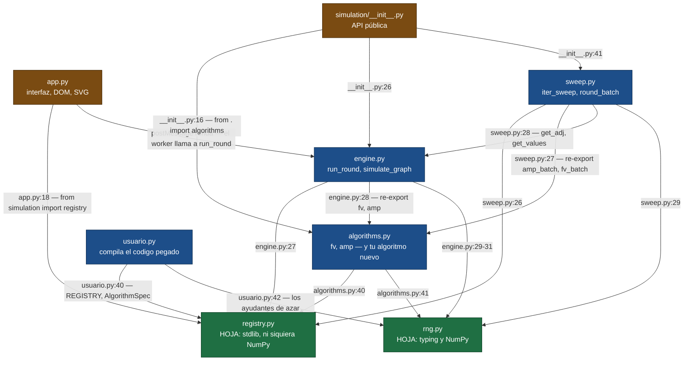
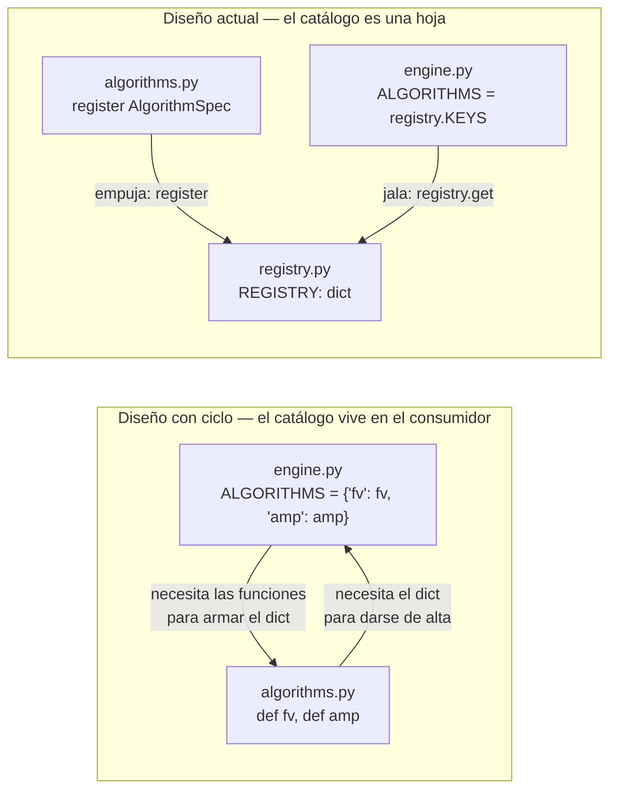
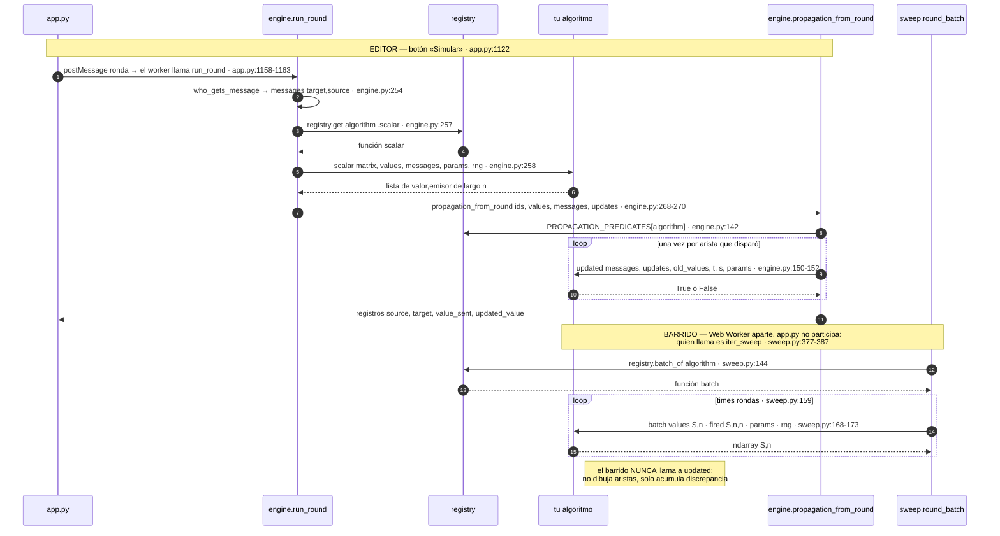
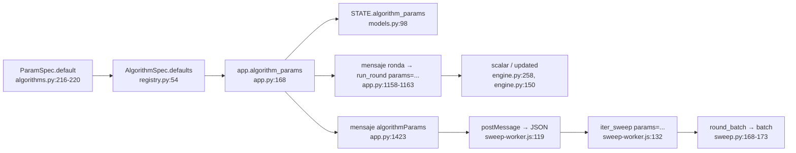
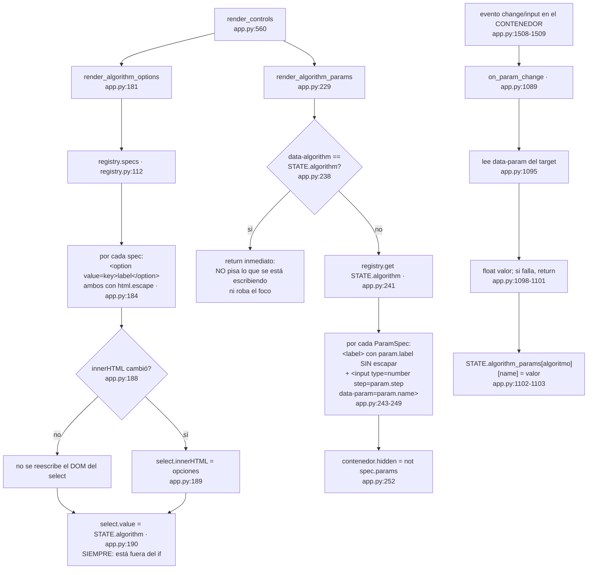
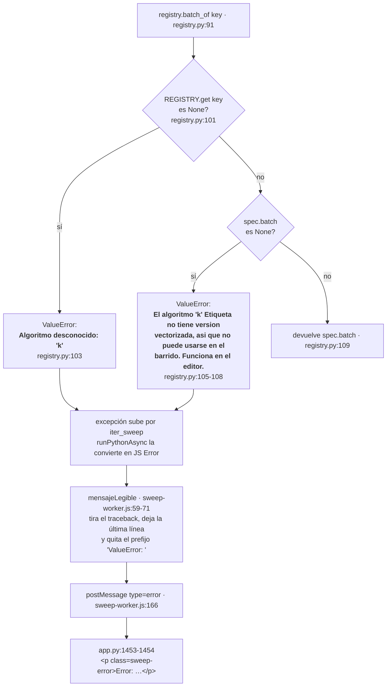
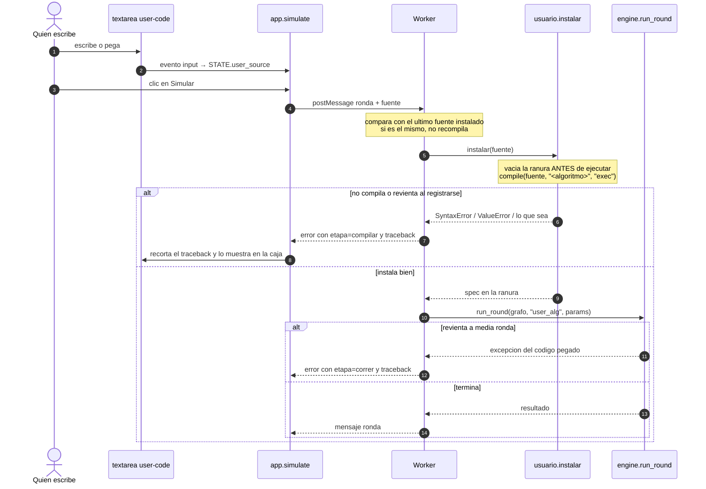

# El registro de algoritmos — cómo se agrega uno nuevo

> **Archivos que cubre:** `python/simulation/registry.py`, `python/simulation/algorithms.py`, `python/simulation/rng.py`, `python/simulation/__init__.py`, y los puntos de `engine.py`, `sweep.py`, `app.py` y `models.py` donde el registro se consulta.
> **Qué puedes cambiar aquí:** agregar algoritmos y parámetros dentro de `algorithms.py`; reordenar los bloques `register(...)` para cambiar el orden del desplegable.
> **Qué es intocable y por qué:** la clave `"fv"` (está cableada como valor por omisión en ocho sitios y su ausencia impide arrancar la app), los textos de error de `registry.batch_of` (congelados en la línea base), y la dirección de las flechas del grafo de dependencias — `registry.py` y `rng.py` no importan nada del paquete, y ese es el único motivo de que no haya ciclo.
> **Cómo verificas el cambio:** `PYTHONDONTWRITEBYTECODE=1 python3 scripts/equivalencia.py && PYTHONDONTWRITEBYTECODE=1 python3 scripts/smoke_ui.py`

---

## 0. La regla central, con su matiz

Para que un algoritmo nuevo **funcione en la aplicación** basta editar un archivo:
`python/simulation/algorithms.py`. El motor de una ronda, el barrido vectorizado,
el `<select>` de la interfaz y los campos de parámetros aparecen solos. Si tu
cambio toca `engine.py`, `sweep.py`, `app.py`, `models.py`, `index.html` o
cualquier `.js`, te saliste del diseño y algo anda mal en la manera de plantear el
algoritmo.

Pero **el arnés de equivalencia no lo va a cubrir.** Los 1026 casos de la línea
base se generan iterando sobre una tupla escrita a mano:

```python
# scripts/equivalencia.py:187
ALGORITMOS = ("fv", "amp")
```

Un algoritmo que no esté en esa tupla no se captura, no se compara y no queda
protegido frente a refactores futuros. El trabajo completo son, entonces, **dos
archivos**: `algorithms.py` para que exista, y `scripts/equivalencia.py:187` +
una regrabación justificada de la línea base para que quede vigilado. El paso 5
de la sección 8 explica cómo; el arnés en sí lo cubre
[07](07-verificacion.md).

> **DEUDA CONOCIDA — la promesa «la interfaz aparece sola» tiene un borde.**
> `render_algorithm_options` ofrece **todos** los algoritmos registrados, sin
> filtrar por si tienen `batch` (`app.py:183-186`). Un algoritmo solo escalar es
> seleccionable en el desplegable, funciona en el editor y muere al pulsar el
> barrido, con el `ValueError` de `registry.py:105-108`. El mensaje está escrito
> para explicar exactamente eso, pero la interfaz no lo previene.

Esta sección explica **por qué** todo lo demás es automático, no solo que lo sea.
La respuesta corta es: un módulo hoja con los datos, vistas vivas en lugar de
copias, y un `dict` de parámetros en lugar de argumentos con nombre.

---

## 1. El grafo de dependencias sin ciclos

### 1.1 El grafo real



La flecha significa **«importa a»**. Léela como «para cargarme necesito que esto
ya esté cargado». No hay ninguna flecha que regrese: el grafo es acíclico.

Los dos módulos hoja no importan nada del paquete:

- `registry.py` importa solo `collections.abc`, `dataclasses` y `typing`
  (`registry.py:28-30`). Ni siquiera NumPy.
- `rng.py` tampoco importa nada del paquete: solo `typing` y NumPy
  (`rng.py:12-16`).

> **INVARIANTE — esas dos hojas se quedan sin importar nada de `simulation/`.**
> Es lo único que sostiene la aciclicidad. Un `from .engine import ...` dentro de
> `registry.py` o de `rng.py` reintroduce el ciclo que el diseño existe para
> evitar.

### 1.2 Por qué ese orden evita el ciclo

El ciclo aparece en cuanto **el consumidor es dueño del catálogo**. Así estaba en
el proyecto de referencia: el diccionario de algoritmos vivía dentro del mismo
archivo que los ejecutaba (`BATCH_ALGORITHMS = {"fv": fv_batch, "amp": amp_batch}`,
`Simulador/back/api.py:193`). En un paquete con módulos separados ese arreglo se
rompe de inmediato:



La regla es una inversión de dependencia clásica: **el productor empuja hacia la
hoja y el consumidor jala desde la hoja; nunca se ven entre sí.**

- `algorithms.py` **empuja**: `register(AlgorithmSpec(...))` en `algorithms.py:128`
  y `algorithms.py:208`.
- `engine.py` **jala**: `registry.get(algorithm).scalar` en `engine.py:257`. El
  comentario de `engine.py:255-256` lo dice literal: *«El despacho no conoce ningun
  algoritmo por nombre: lo pide al registro y lo llama con la firma uniforme.»*
- `sweep.py` **jala**: `registry.batch_of(algorithm)` en `sweep.py:144` y `sweep.py:273`.

Ninguno de los tres consumidores contiene una sola cadena `"fv"` o `"amp"` usada
para **decidir qué función llamar**. Lo que sí queda de esos nombres son valores
por omisión de argumentos, en ocho sitios:

| Sitio | Qué es |
|---|---|
| `models.py:94` | `algorithm: str = "fv"` — el algoritmo activo al arrancar la interfaz |
| `engine.py:183` | valor por omisión de `run_round` |
| `engine.py:312` | valor por omisión de `simulate_graph` |
| `engine.py:354` | valor por omisión de `run_simulation` |
| `sweep.py:313` | valor por omisión de `iter_sweep` |
| `sweep.py:418` | valor por omisión de `async_iter_sweep` |
| `sweep.py:456` | valor por omisión de `run_sweep` |
| `js/sweep-worker.js:131` | `_params.get("algorithm", "fv")` al armar la llamada dentro del Worker |

Aparte de esos ocho, `sweep.py:148` nombra a `'fv'` y `'amp'` **dentro del texto
de un mensaje de error** (`"algorithm debe ser 'fv', 'amp' o una funcion batched"`),
no en un despacho: el código de esa rama acepta cualquier callable.

> **INVARIANTE — la clave `"fv"` no se renombra ni se elimina.** Agregar
> algoritmos es libre. Quitar `"fv"` hace que `algorithm_params()` llame a
> `registry.get("fv")` al primer render (`app.py:174`) y la aplicación no
> levante.

> **DECISION DELIBERADA — `engine.py:28` y `sweep.py:27` importan nombres
> concretos de `algorithms.py`** (`fv`, `amp`, `fv_batch`, `amp_batch`). Eso
> **no** es despacho: son re-exportaciones por compatibilidad, marcadas con
> `# noqa: F401 (re-export)`, para que quien escribía
> `from simulation.engine import fv` siga funcionando. Parecen imports muertos y
> no lo son; quien limpie linters debe saber por qué están ahí. Borrarlas hoy no
> rompe el despacho — ver sección 4.2.

### 1.3 Por qué `rng.py` también es hoja

`random_array` (`rng.py:19`) vivía duplicado en el motor escalar y en el batched.
Al extraerlo a una hoja, `algorithms.py` puede usarlo sin importar `engine` ni
`sweep`, que son precisamente sus consumidores. Si el muestreo hubiera quedado en
`engine.py`, escribir un algoritmo que necesitara azar habría creado el ciclo
`algorithms → engine → algorithms`.

`native_scalar` (`rng.py:39`) convierte un escalar NumPy en escalar Python.
Sirve para **normalizar dentro del propio algoritmo**: lo usan `fv`
(`algorithms.py:77`, `algorithms.py:81`) y `amp` (`algorithms.py:161`,
`algorithms.py:168`) sobre los valores que devuelven. Y sobre todo lo usa
`propagation_from_round` para los **ids de nodo** (`engine.py:156-157`), que son
el único dato que cruza al navegador sin pasar por un `float()`.

No es lo que salva a los *valores*: esos ya están garantizados aguas abajo. Los
convierte explícitamente `run_round` en `engine.py:261` y `engine.py:263-265`, y
`update_graph_data` en `engine.py:305`.

---

## 2. `AlgorithmSpec` y `ParamSpec`, campo por campo

Ambos son `@dataclass(frozen=True)`: una vez registrado, un algoritmo no se
modifica.

> **DECISION DELIBERADA — la inmutabilidad no es decorativa.** Evita que alguien
> mute `REGISTRY["fv"].params` en caliente y deje la interfaz mostrando campos
> que el motor no lee. Por eso `params` es una tupla y no una lista.

### 2.1 `ParamSpec` — `registry.py:33-40`

| Campo | Tipo | Para qué sirve | Detalle no obvio |
|---|---|---|---|
| `name` | `str` | Clave dentro del dict `params` que reciben las tres piezas, y valor del atributo `data-param` del `<input>` | Es lo que lees con `params.get("mi_param")`. Debe ser un identificador seguro en HTML: se usa como `id="param-{name}"` (`app.py:244-245`). |
| `label` | `str` | Texto de la etiqueta visible | **Se inserta como HTML crudo, sin escapar** (`app.py:244`), a propósito, para poder escribir `<code>agreed</code>`. Ver trampa 4. |
| `default` | `Any` | Valor inicial del campo y del dict de parámetros | Lo cosecha `AlgorithmSpec.defaults()` (`registry.py:54-57`) y lo consume `app.algorithm_params()` (`app.py:175-177`). |
| `step` | `str` | Atributo `step` del `<input type="number">` | Por omisión `"any"` (`registry.py:40`). Pon `"0.01"` o `"1"` si quieres granularidad fija en las flechitas del campo. |

### 2.2 `AlgorithmSpec` — `registry.py:43-57`

| Campo | Tipo | Obligatorio | Para qué sirve |
|---|---|---|---|
| `key` | `str` | Sí | Identificador estable. Viaja en el JSON del `<option value>`, en `STATE.algorithm`, en el mensaje al Worker y en el campo `algorithm` de cada resultado. **Cambiarlo rompe grafos y baselines guardados.** |
| `label` | `str` | Sí | Texto del `<option>`. **Sí se escapa** con `html.escape` (`app.py:184`), a diferencia de `ParamSpec.label`. |
| `scalar` | `Callable` | Sí | Una ronda nodo por nodo, para el editor. |
| `updated` | `Callable` | Sí | Predicado de visualización. |
| `batch` | `Callable \| None` | No — default `None` (`registry.py:51`) | Versión vectorizada, para el barrido. |
| `params` | `tuple[ParamSpec, ...]` | No — default `()` (`registry.py:52`) | Declaración de los campos que la interfaz debe generar. |

El método `defaults()` (`registry.py:54-57`) devuelve
`{param.name: param.default for param in self.params}` — es la única fuente de
verdad de los valores iniciales. `app.py` nunca escribe un `0.5` a mano.

### 2.3 Las funciones del registro

| Función | Línea | Qué hace | Cuándo falla |
|---|---|---|---|
| `register(spec)` | `registry.py:69` | Da de alta y devuelve el spec | `ValueError: Algoritmo ya registrado: 'k'` si la clave existe (`registry.py:76-77`) |
| `get(key)` | `registry.py:82` | Devuelve el spec completo | `ValueError: Algoritmo desconocido: 'k'` (`registry.py:88`) |
| `batch_of(key)` | `registry.py:91` | Devuelve solo la función batched | Dos mensajes distintos — ver sección 7 |
| `specs()` | `registry.py:112` | Todos los specs **en orden de registro** | — |

> **DECISION DELIBERADA — `register` rechaza claves duplicadas**
> (`registry.py:76-77`). Un algoritmo que pisara a otro en silencio sería
> indiagnosticable desde la interfaz. Consecuencia práctica en la trampa 3.

> **DECISION DELIBERADA — el orden importa visualmente.** `specs()` devuelve
> `tuple(REGISTRY.values())` (`registry.py:115`) y los `dict` de Python conservan
> el orden de inserción. Es decir: **el lugar donde pongas tu bloque
> `register(...)` dentro de `algorithms.py` es el lugar donde tu algoritmo
> aparece en el desplegable.** No hay campo `orden` porque no hace falta.

---

## 3. Las tres piezas de un algoritmo

Firmas exactas, copiadas del contrato documentado en `algorithms.py:9-23`.

### 3.1 `scalar` — obligatoria

```python
def scalar(matrix, values, messages, params=None, *, rng=None) -> list[tuple[Any, int | None]]
```

| Argumento | Shape / tipo | Significado |
|---|---|---|
| `matrix` | `ndarray (n, n)` float | Adyacencia con pesos. `matrix[source, target]`. Construida por `get_adj` (`engine.py:41`). FV y AMP la descartan; existe por firma uniforme. |
| `values` | `ndarray (n,)` | Valor actual de cada nodo, en el orden de `data["nodes"]`. **Sin dtype forzado** a propósito (`engine.py:72-80`), así que puede ser `int64` si todos los valores del grafo eran enteros. |
| `messages` | `ndarray (n, n)` int | **Transpuesta**: `messages[target, source] == 1` significa que `source` transmitió a `target`. Producida por `who_gets_message` (`engine.py:114`). |
| `params` | `Mapping \| None` | Parámetros propios del algoritmo. **Puede llegar `None`** — usa siempre `(params or {}).get(...)`. |
| `rng` | keyword-only, `None` por defecto | `Generator` de NumPy o `None`. Si es `None`, `rng.py` usa `np.random` y por lo tanto `np.random.seed()` sigue siendo reproducible (`rng.py:22-24`). No lo uses directamente: pásalo a `random_index` / `random_array`. |

**Devuelve** una lista de exactamente `n` tuplas `(valor_nuevo, indice_del_emisor | None)`.
El segundo elemento es el índice de fila/columna del emisor elegido, o `None` si el
algoritmo no eligió a nadie.

> **DECISION DELIBERADA — `None` en vez del `NaN` centinela del backend
> original** (`algorithms.py:61-65`). Preserva la semántica y además es
> serializable a JSON, cosa que `NaN` no es.

Ese índice sale por dos caminos: como `result["selectedSources"]` (`engine.py:263-265`)
y como argumento de `updated` (sección 3.3).

### 3.2 `batch` — opcional

```python
def batch(values, fired, params=None, *, rng=None) -> np.ndarray
```

| Argumento | Shape / tipo | Significado |
|---|---|---|
| `values` | `ndarray (S, n)` **float** | `S` réplicas independientes en paralelo. Ya viene forzada a float por `np.tile(values.astype(float), (simulations, 1))` (`sweep.py:158`). |
| `fired` | `ndarray (S, n, n)` **bool** | `fired[s, source, target]` — **NO está transpuesta**, al revés que `messages`. Producida por `who_gets_message_batch` (`sweep.py:111`). |
| `params` | `Mapping \| None` | El mismo dict que recibe `scalar`. |
| `rng` | keyword-only | Igual que en `scalar`. |

**Devuelve** un `ndarray (S, n)` con los valores finales de cada réplica.

> **DECISION DELIBERADA — las dos matrices tienen orientación opuesta**
> (`engine.py:114` contra `sweep.py:111`). Es herencia literal del backend
> original y se conservó por fidelidad. La explicación completa, con el porqué de
> cada transposición, vive en [04](04-simulacion-individual.md); aquí basta con
> la consecuencia: si tu `batch` da resultados plausibles pero distintos de tu
> `scalar`, empieza por el eje de la reducción.

`batch` es opcional porque el barrido es un lujo estadístico, no el producto. Un
algoritmo sin `batch` funciona en el editor y el barrido lo rechaza con un
mensaje que lo explica (sección 7).

### 3.3 `updated` — obligatoria

```python
def updated(messages, updates, old_values, target_index, source_index, params=None) -> bool
```

| Argumento | Shape / tipo | Significado |
|---|---|---|
| `messages` | `ndarray (n, n)` int | La misma matriz transpuesta que recibió `scalar`. |
| `updates` | `list[tuple]` de largo `n` | **Exactamente lo que devolvió tu `scalar`.** De ahí sacas el valor nuevo y el emisor elegido. |
| `old_values` | `ndarray (n,)` | Valores **antes** de la ronda. |
| `target_index` | `int` | Nodo que recibió esta arista. |
| `source_index` | `int` | Nodo que la emitió. |
| `params` | `Mapping \| None` | El mismo dict. Sin `rng`: debe ser determinista. |

**Devuelve** `bool`. Es **contrato de visualización, no de matemática**
(`registry.py:13-15`): decide el color de una arista, nunca el valor de un nodo.

`propagation_from_round` (`engine.py:118`) llama a este predicado una vez por arista
que disparó (`engine.py:150-152`) y arma el registro
`{"source", "target", "value_sent", "updated_value"}` (`engine.py:154-161`). Después,
`app.apply_propagation` traduce eso a tres estados de arista: `updated`, `delivered`
y `quiet` (`app.py:1106-1120`).

> **DEUDA CONOCIDA — esos tres estados hoy no se distinguen en pantalla.**
> `render_canvas` escribe el color como **atributo de presentación**
> (`stroke="{color}"`, `app.py:319-320`) y en CSS cualquier regla vence a un
> atributo de presentación. Como existe la regla `.edge-path` con
> `stroke: #6c6690; stroke-width: 3`, **todas** las aristas se pintan igual. Las
> reglas `.edge-path.is-updated`, `.is-delivered`, `.is-idle` y `.is-selected`
> existen en el CSS pero están muertas: `render_canvas` nunca emite esas clases.
> Lo único que sí se ve tras simular es la animación punteada, que llega por
> `.edge-animated .edge-path` porque la clase `edge-animated` sí se emite en el
> `<g>` (`app.py:317`). Verificado también contra el respaldo previo al refactor:
> es idéntico, **no es una regresión de este proyecto**. Escribe tu `updated`
> igual: el dato es correcto y sale bien en el JSON, solo que el pixel todavía no
> lo refleja. Detalle completo en [03](03-interfaz.md).

Los dos patrones ya escritos, que puedes copiar:

- **«solo el emisor sorteado cuenta»** — `fv_updated` (`algorithms.py:109`):
  compara `updates[target_index][1] == source_index`. Nota fina documentada en
  `algorithms.py:118-121`: cuando no hubo elección el emisor es `None`, y
  `None == int` es `False`, así que el caso se resuelve solo sin un `if`.
- **«cuenta si el valor visible cambió»** — `amp_updated` (`algorithms.py:188`):
  `not np.isclose(new_value, old_values[target_index])`. Un mensaje que llega a un
  nodo que ya estaba en el consenso cuenta como *entregado* pero no como
  *actualización*.

### 3.4 Quién llama a cada pieza, en tiempo de ejecución



---

## 4. Las vistas VIVAS: `ALGORITHMS`, `BATCH_ALGORITHMS`, `PROPAGATION_PREDICATES`

### 4.1 Qué son

Tres nombres públicos que, en realidad, son ventanas al registro:

```python
# registry.py:148-151
KEYS    = REGISTRY.keys()          # vista nativa de dict
SCALAR  = _AttributeView("scalar")
BATCH   = _AttributeView("batch")
UPDATED = _AttributeView("updated")
```

```python
# engine.py:35 y engine.py:38
ALGORITHMS = registry.KEYS
PROPAGATION_PREDICATES = registry.UPDATED

# sweep.py:34
BATCH_ALGORITHMS = registry.BATCH
```

`_AttributeView` (`registry.py:118-144`) es un `Mapping` de solo lectura que
**no guarda datos**. Guarda un solo string: el nombre del atributo
(`registry.py:121-122`). Cada operación consulta `REGISTRY` en ese instante:

- `__getitem__` (`registry.py:124-129`) hace `getattr(REGISTRY.get(key), self._attribute)`
  y eleva `KeyError` si el spec no existe **o si el atributo es `None`**.
- `__iter__` (`registry.py:131-136`) recorre el registro filtrando los `None`.
- `__len__` (`registry.py:138-141`) cuenta lo mismo.

Ese filtrado de `None` es la clave de `BATCH_ALGORITHMS`: un algoritmo sin versión
vectorizada simplemente **no existe** en esa vista, sin ninguna lógica adicional en
`sweep.py`.

### 4.2 Por qué vistas y no copias

**Razón 1 — el orden de importación deja de ser un riesgo latente.** Si
`engine.py:35` dijera `ALGORITHMS = tuple(registry.REGISTRY)`, esa tupla se
congelaría con lo que hubiera en el registro en ese microsegundo.

Hoy, con una copia congelada, el resultado seguiría siendo `('fv', 'amp')`: quien
garantiza el orden **no es** la re-exportación de `engine.py:28`, sino
`__init__.py:16` (`from . import algorithms`), que corre antes de
`from .engine import ...` (`__init__.py:26`). Como `engine.py` usa imports
relativos, no existe ninguna ruta que lo cargue sin ejecutar antes `__init__.py`.
Es decir: borrar la línea `# noqa: F401` de `engine.py:28` **no** vaciaría el
registro, ni con vistas ni con copias.

Lo que la copia congelada sí volvería frágil es el **orden de las líneas de
`__init__.py`**: bastaría con que alguien reordenara ese archivo poniendo
`from .engine import ...` (línea 26) antes de `from . import algorithms`
(línea 16) para que `ALGORITHMS` quedara vacío y `run_round` rechazara *todos* los
algoritmos con «Algoritmo desconocido». Con vistas vivas, ese reordenamiento es
inofensivo.

**Razón 2 — el registro puede crecer después del arranque.** Esta es la razón de
peso, y no es teórica: el proyecto ya registra algoritmos en caliente en dos
scripts.

- `scripts/smoke_ui.py:278-290` registra un algoritmo `zz` con dos parámetros
  **después** de haber importado `app.py`, y la comprobación de
  `smoke_ui.py:227-230` exige que las opciones del selector sean exactamente
  `list(registry.KEYS)`. Con una `KEYS` congelada al importar, esa aserción
  falla. Es la demostración ejecutable del diseño completo.
- Las guardas `algorithm not in ALGORITHMS` de `engine.py:137`, `engine.py:224`,
  `engine.py:326` y `engine.py:373` rechazarían un algoritmo registrado tarde si
  `ALGORITHMS` fuera una copia. Ese es el punto exacto donde se rompería.

Cuidado con un falso ejemplo tentador: `scripts/equivalencia.py:351-360` también
registra `solo_escalar` en caliente, pero **ese camino no depende de vistas
vivas**. La guarda de la línea 351 (`"solo_escalar" not in registry.KEYS`) solo
evita registrar dos veces y funcionaría igual con una copia; y `registry.batch_of`
consulta `REGISTRY.get(key)` directamente (`registry.py:101`), sin tocar ninguna de
las cuatro vistas.

**Razón 3 — una sola fuente de verdad.** Con copias existirían cuatro estructuras
que pueden divergir. Con vistas hay una: `REGISTRY` (`registry.py:60`).

Costo: cada `x in ALGORITHMS` o `PROPAGATION_PREDICATES[k]` es una consulta a un
dict. Se paga una vez por ronda (`engine.py:137`, `engine.py:142`), no por arista.

---

## 5. `params` como dict: por qué ninguna firma cambia

Cada pieza recibe **el diccionario completo** y toma de ahí lo que necesita
(`algorithms.py:25-28`). Nadie desempaqueta parámetros por nombre en ningún punto de
la cadena.

Compara con el proyecto de referencia, donde `agreed` era un argumento posicional o
con nombre en toda la ruta:

| Proyecto de referencia | Aquí |
|---|---|
| `amp(matrix, values, messages, agreed=request.agreed)` — `Simulador/back/api.py:254` | `algorithm_fn(matrix, values, messages, params, rng=rng)` — `engine.py:258` |
| `vals = algoritmo(vals, fired, agreed)` — `Simulador/back/api.py:189` | `algorithm_fn(batched_values, fired, params, rng=rng)` — `sweep.py:168-173` |
| `runOneSimulationNaive(matrix, values, directed, algorithm, rounds, agreed, rng)` — `Simulador/front/src/simulation/engine/sweepCore.js:48` | `round_batch(algorithm, matrix, values, directed, simulations, times, params, *, rng, cancel)` — `sweep.py:114` |
| `const [agreedValue, setAgreedValue] = useState(0.5)` — `Simulador/front/src/App.jsx:66`, propagado a mano en `:514` y `:841` | `STATE.algorithm_params: dict[str, dict[str, Any]]` — `models.py:98` |

Un algoritmo nuevo con dos parámetros propios, en el diseño de la izquierda, obliga a
tocar la firma de cinco funciones y dos componentes de React. Aquí, el dict ya viaja;
solo se le agregan claves.

**La cadena completa que atraviesa `params`, sin que ningún eslabón lo abra:**



Dos detalles de esa cadena que hay que conocer:

> **DECISION DELIBERADA — `app.py:1418-1423` renombra la clave a
> `algorithmParams`.** El comentario de `app.py:1421-1422` lo explica: el mensaje
> al Worker ya tiene una clave `params` que son los parámetros *del barrido*
> (`numPPoints`, `iterations`, …). Sin el renombrado serían dos cosas distintas
> con el mismo nombre.

> **INVARIANTE — todo valor de `params` debe ser serializable a JSON.** Cruza un
> `JSON.stringify` / `json.loads` en el camino al Worker (`sweep-worker.js:119` y
> `sweep-worker.js:128`). Con `float` no hay problema; con un objeto NumPy o una
> función, el barrido explota y el editor no.

---

## 6. Cómo la interfaz se genera sola desde el registro

`index.html:59-64` contiene el esqueleto vacío y un comentario que lo advierte:

```html
<label class="field-label" for="algorithm-select">Algoritmo</label>
<!-- Opciones y campos de parámetros los genera app.py desde el
     registro de algoritmos. Agregar un algoritmo no toca este archivo. -->
<select id="algorithm-select" class="algorithm-select"></select>
<div id="algorithm-params" class="agreed-input-wrapper" hidden></div>
```

Un `<select>` sin `<option>` y un `<div>` vacío y oculto. Todo lo demás se genera.



Tres decisiones no obvias en ese flujo:

1. **DECISION DELIBERADA — el listener está en el contenedor, no en cada campo**
   (`app.py:1508-1509`). Es delegación de eventos: los `<input>` se destruyen y se
   recrean al cambiar de algoritmo, así que un listener por campo se perdería. El
   docstring de `on_param_change` (`app.py:1092-1093`) lo documenta.
2. **DECISION DELIBERADA — la guarda `data-algorithm`** (`app.py:238`).
   `render_controls` corre en cada render. Sin la guarda, escribir «0.» en un
   campo reconstruiría el HTML, borraría el «0.» a medio escribir y le quitaría el
   foco al cursor.
3. **INVARIANTE — `algorithm_params()` rellena huecos con dos `setdefault`**
   (`app.py:175-177`). El primero crea el dict del algoritmo la primera vez; el
   segundo agrega claves que falten. El segundo importa cuando **agregas un
   `ParamSpec` a un algoritmo que ya existía**: el dict guardado en `STATE` de una
   sesión previa no tiene esa clave y `render_algorithm_params` haría `KeyError`
   en `valores[param.name]` (`app.py:246`).

Y una consecuencia agradable: `STATE.algorithm_params` está indexado **por
algoritmo** (`models.py:95-98`), así que cambiar a otro algoritmo y volver conserva
lo que habías escrito. `smoke_ui.py:265-275` lo verifica.

---

## 7. `registry.batch_of` y los dos mensajes de error



### Por qué dos mensajes y no uno

El comentario de `registry.py:94-98` lo dice sin rodeos: **antes los dos casos daban
el mismo mensaje engañoso.** Son problemas distintos y llevan a acciones distintas:

- **«Algoritmo desconocido»** → escribiste mal la clave, o tu `register(...)` nunca
  se ejecutó. Es un bug.
- **«no tiene version vectorizada … Funciona en el editor»** → tu algoritmo **sí**
  está registrado y **sí** funciona; solo le falta la pieza opcional `batch`. No es
  un bug, es una decisión de diseño tuya. Y el mensaje incluye `spec.label`, la
  etiqueta legible, para que la persona reconozca de cuál se trata.

> **INVARIANTE — el texto de esos dos mensajes es comportamiento observable
> congelado.** El de «no tiene version vectorizada» se captura en
> `batch_algoritmo_sin_version_vectorizada` (`equivalencia.py:366-368`) y el de
> «Algoritmo desconocido» en `batch_algoritmo_desconocido`
> (`equivalencia.py:390-392`), que llama a `round_batch` con la clave `"xx"`.
> Además, `sweep_algoritmo_sin_version_vectorizada` (`equivalencia.py:363-365`)
> congela la misma falla vista desde `iter_sweep`, que es una puerta de entrada
> distinta al mismo mensaje. Cambiar cualquiera de los dos textos hace fallar el
> arnés.

### Dónde se llama, y por qué ahí

`batch_of` se invoca en dos lugares:

- **`sweep.py:273`, dentro de `_prepare_sweep`, como primera línea.** El comentario
  de `sweep.py:271-272` explica el porqué: *«Valida antes de emitir `start`».* Si la
  validación viviera más abajo, la interfaz habría recibido ya el evento `start`,
  habría dibujado «Iteración 0/50…» y solo después mostraría el error. Validar
  primero evita esa transición mentirosa.
- **`sweep.py:144`, dentro de `round_batch`**, para quien lo llama directamente.
  Nota: `round_batch` también acepta una función batched directamente
  (`sweep.py:145-146`), útil en pruebas sin registrar nada.

> **DECISION DELIBERADA — `iter_sweep` es un generador, así que valida de forma
> diferida.** `_prepare_sweep` —y con él `registry.batch_of`— **no corre hasta el
> primer `next()`** (`sweep.py:344-359`). Por eso `equivalencia.py:363-365`
> envuelve la llamada en `list(...)`: sin eso, la excepción nunca se dispararía.
> Al probar desde Python, envuelve siempre.

---

## 8. Guía paso a paso: agregar «Máximo recibido»

Vamos a agregar un algoritmo nuevo, completo y funcional: **cada nodo que recibió
mensajes adopta el mayor de los valores recibidos, siempre que supere al suyo
propio por al menos un `umbral`.** Tiene un parámetro propio, para ejercitar toda
la maquinaria.

### Paso 0 — decidir la matemática antes de escribir

Tres preguntas que hay que responder primero:

1. **¿Necesita azar?** Aquí no: `np.argmax` desempata siempre por el índice menor,
   de forma determinista. Por eso el `rng` se descarta con `del`.
2. **¿Elige un emisor concreto?** Sí — el del valor máximo. Ese índice va en el
   segundo elemento de la tupla y hace que `updated` pueda ser idéntico al de FV.
3. **¿Se puede vectorizar?** Sí, con un `max` sobre el eje de emisores. Escribe
   `batch` solo si la respuesta es sí; si no, deja `batch=None` y ya.

### Paso 1 — escribir las tres piezas

Al final de `python/simulation/algorithms.py`, **antes** del bloque `__all__`
(que empieza en `algorithms.py:226`):

```python
# ==========================================================================
# Maximo recibido (MAX)
# ==========================================================================

UMBRAL_DEFAULT = 0.0


def maximo(
    matrix: np.ndarray,
    values: np.ndarray,
    messages: np.ndarray,
    params: Mapping[str, Any] | None = None,
    *,
    rng: Any | None = None,
) -> list[tuple[Any, int | None]]:
    """Cada target adopta el mayor valor recibido si mejora al propio por ``umbral``.

    Un target sin mensajes conserva su valor y no elige emisor. Cuando el mejor
    valor recibido no supera al propio mas ``umbral``, tampoco cambia nada: no
    basta con recibir, hay que recibir algo mejor.

    ``matrix`` y ``rng`` se aceptan por la firma uniforme y no se usan: el
    desempate de ``argmax`` es por indice menor, asi que la regla es
    determinista dada la matriz de mensajes.
    """

    del matrix, rng
    values = np.asarray(values)
    messages = np.asarray(messages)
    umbral = float((params or {}).get("umbral", UMBRAL_DEFAULT))
    new_values: list[tuple[Any, int | None]] = []

    for target_index, received in enumerate(messages):
        own_value = native_scalar(values[target_index])
        valid_sources = np.where(received != 0)[0]
        if len(valid_sources) == 0:
            new_values.append((own_value, None))
            continue

        # argmax sobre el subconjunto recibido, traducido al indice global.
        best_source = int(valid_sources[int(np.argmax(values[valid_sources]))])
        candidate = native_scalar(values[best_source])
        if candidate > own_value + umbral:
            new_values.append((candidate, best_source))
        else:
            new_values.append((own_value, None))

    return new_values


def maximo_batch(
    values: np.ndarray,
    fired: np.ndarray,
    params: Mapping[str, Any] | None = None,
    *,
    rng: Any | None = None,
) -> np.ndarray:
    """MAX vectorizado sobre ``S`` replicas.

    Ojo con la orientacion: aqui ``fired[s, source, target]`` NO esta
    transpuesta, al reves que ``messages`` en la version escalar. Por eso el
    valor del emisor se difunde con ``values[:, :, None]`` (indice ``source``) y
    la reduccion es sobre ``axis=1``.

    El centinela ``-inf`` marca las casillas donde no hubo mensaje: nunca sale
    del calculo porque ``-inf > values + umbral`` es falso y ``np.where``
    restaura el valor previo.
    """

    del rng
    umbral = float((params or {}).get("umbral", UMBRAL_DEFAULT))
    values = np.asarray(values, dtype=float)      # (S, n)
    fired = np.asarray(fired)                     # (S, n, n)

    candidates = np.where(fired, values[:, :, None], -np.inf)  # (S, n, n)
    best = candidates.max(axis=1)                              # (S, n)
    return np.where(best > values + umbral, best, values)


def maximo_updated(
    messages: np.ndarray,
    updates: Sequence[tuple[Any, int | None]],
    old_values: np.ndarray,
    target_index: int,
    source_index: int,
    params: Mapping[str, Any] | None = None,
) -> bool:
    """Solo la arista del emisor que aporto el maximo cuenta como actualizacion.

    Misma regla que ``fv_updated``: cuando el target no adopto a nadie el emisor
    guardado es ``None``, y ``None == int`` es ``False``, asi que las aristas
    entregadas sin efecto quedan como ``delivered`` y no como ``updated``.
    """

    del messages, old_values, params
    _, selected_source = updates[target_index]
    return selected_source == source_index
```

### Paso 2 — registrarlo

Justo debajo, en el mismo archivo:

```python
register(
    AlgorithmSpec(
        key="max",
        label="Máximo recibido (MAX)",
        scalar=maximo,
        batch=maximo_batch,
        updated=maximo_updated,
        params=(
            ParamSpec(
                name="umbral",
                label="Mejora mínima para adoptar (<code>umbral</code>)",
                default=UMBRAL_DEFAULT,
                step="0.01",
            ),
        ),
    )
)
```

Nota que `register`, `AlgorithmSpec` y `ParamSpec` ya están importados en
`algorithms.py:40`, y `native_scalar` en `algorithms.py:41`. No hace falta agregar
ningún `import`.

### Paso 3 — actualizar `__all__` (cosmético)

En `algorithms.py:226-234`, agrega los tres nombres y la constante en orden
alfabético:

```python
__all__ = [
    "AGREED_DEFAULT",
    "UMBRAL_DEFAULT",
    "amp",
    "amp_batch",
    "amp_updated",
    "fv",
    "fv_batch",
    "fv_updated",
    "maximo",
    "maximo_batch",
    "maximo_updated",
]
```

**Esto no afecta al registro.** El alta ya ocurrió con la llamada a `register(...)`
en tiempo de importación del módulo. `__all__` solo controla `from ... import *`.
Por la misma razón, **no tienes que tocar `simulation/__init__.py`**: la línea
`from . import algorithms` (`__init__.py:16`) —comentada como *«registra fv y amp al
importar el paquete»*— basta para que tu algoritmo quede dado de alta. Agregar
`maximo` a los re-exports de `__init__.py:18-25` es opcional y puramente cosmético.

### Paso 4 — verificar

```bash
PYTHONDONTWRITEBYTECODE=1 python3 scripts/equivalencia.py   # NO debe reportar diferencias
PYTHONDONTWRITEBYTECODE=1 python3 scripts/smoke_ui.py       # el selector debe traer 3 opciones
python3 scripts/serve.py                                     # y abrir http://localhost:8000
```

`equivalencia.py` **no debe cambiar** porque su barrido de casos itera sobre la
tupla fija `ALGORITMOS = ("fv", "amp")` (`equivalencia.py:187`), no sobre el
registro. Si te reporta diferencias después de agregar un algoritmo, es que
tocaste algo que no debías. Y ese es exactamente el punto: **agregar el algoritmo
no lo pone bajo vigilancia**; para eso está el paso 5.

En el navegador, la lista de verificación mínima:

| Qué mirar | Qué debe pasar | De dónde sale |
|---|---|---|
| El desplegable | Aparece «Máximo recibido (MAX)» en tercer lugar | `registry.specs()` en orden de registro |
| Al seleccionarlo | Aparece un campo «Mejora mínima para adoptar `umbral`» con `0.0` y el `<code>` renderizado | `ParamSpec` → `app.py:243-249` |
| «Simular» | Los nodos suben al máximo de sus vecinos, y las aristas que transmitieron arrancan la animación punteada | `maximo` + `maximo_updated` |
| Vista Análisis → barrido | Corre y dibuja la curva | `maximo_batch` |
| Con `batch=None` | El barrido falla con *«no tiene version vectorizada … Funciona en el editor»* y el editor sigue funcionando | `registry.py:105-108` |

> **DEUDA CONOCIDA — no esperes ver colores distintos por arista.** Las aristas
> `updated`, `delivered` y `quiet` se pintan todas igual, por el problema de
> especificidad CSS descrito en la sección 3.3. Lo único que distingue una arista
> que transmitió es la animación de guiones. Si tu `updated` parece «no
> funcionar», comprueba el campo `updated_value` del JSON de propagación antes de
> tocar nada.

### Paso 5 — meterlo en el arnés de equivalencia

**No es opcional si quieres que MAX quede protegido.** Este es el segundo archivo
del que habla la sección 0, y es una decisión aparte de escribir el algoritmo:

```python
# scripts/equivalencia.py:187
ALGORITMOS = ("fv", "amp", "max")
```

Y después, obligatoriamente:

```bash
PYTHONDONTWRITEBYTECODE=1 python3 scripts/equivalencia.py --grabar
```

> **INVARIANTE — `--grabar` sobrescribe `scripts/equivalencia_baseline.json`.**
> Solo se ejecuta cuando el cambio de contenido es intencional y está
> justificado. Aquí lo es, porque estás **añadiendo** casos nuevos sin alterar
> los viejos. El propio script avisa si la línea base previa difiere
> (`equivalencia.py:447-454`). Las reglas completas sobre cuándo regrabar viven
> en [07](07-verificacion.md).

Cuidado adicional: el adaptador de `equivalencia.py` construye `params` con la
clave `agreed` (`equivalencia.py:61-67`, usado en `:71`, `:75`, `:80`). MAX ignora
esa clave y usará su `umbral` por omisión. Si quieres cubrir el parámetro, hay que
tocar también esa sección del adaptador.

### Un rasgo bonito de este ejemplo

MAX es **determinista dada la matriz de disparo**: su versión escalar y su versión
batched producen exactamente el mismo resultado a partir del mismo
`messages` / `fired`. Está comprobado sobre 200 grafos aleatorios de 2 a 6 nodos
con tres valores de `umbral`.

> **DECISION DELIBERADA — con azar eso deja de ser cierto.** FV no tiene esa
> propiedad: escalar y batched consumen números aleatorios en distinto orden, así
> que **nunca coinciden bit a bit** y solo pueden compararse estadísticamente. No
> es un bug ni algo que se pueda arreglar sin renunciar a la vectorización.
> Cuando escribas un algoritmo con azar, no pierdas horas intentando que cuadren:
> el determinismo de MAX puede dar una falsa expectativa.

---

## 8bis. Sin tocar el repositorio: la ranura de código propio

Las secciones anteriores describen cómo se **agrega** un algoritmo al proyecto.
Esta describe cómo se **prueba uno sin agregarlo**: pegándolo en la aplicación.

Es el modo pensado para que un equipo ajeno use el simulador sin bifurcar el
repositorio. Se elige «Algoritmo propio…» en el selector, se escribe en la caja
y se pulsa Simular.

### 8bis.1 Dónde corre, y por qué eso lo vuelve barato

Corre en el Worker, igual que todo lo demás desde §A.12 de
[09](09-invariantes-y-deuda.md). Eso resuelve de un golpe lo que en un backend
sería el problema difícil:

| Riesgo | Cómo queda resuelto |
|---|---|
| Código ajeno tocando la página | Un Worker no tiene `document`. No hay nada que proteger. |
| Un ciclo que no termina | `app.py` arma un plazo al mandar la ronda; al vencer mata el Worker y levanta otro. |
| Consumo de servidor | No hay servidor: corre en la pestaña de quien lo escribió. |
| Tapar `fv` o `amp` | Imposible: la clave se fuerza (§8bis.3). |

**DECISIÓN DELIBERADA — el aislamiento no es una lista de permisos.** No se
recortan los `builtins` ni se filtran los imports. Sería seguridad de mentira:
el código corre en el navegador de quien lo pegó, con el mismo alcance que la
consola de desarrollo. Lo que sí importa es que **nunca se cargue solo**: pegarlo
tiene que ser un acto deliberado, jamás algo que dispare un parámetro de la URL.

### 8bis.2 Qué hay disponible al escribir

`usuario.instalar` (`python/simulation/usuario.py`) ejecuta el fuente en un
espacio de nombres preparado. No hay que importar nada:

| Nombre | Qué es |
|---|---|
| `AlgorithmSpec` | Versión permisiva: `updated` es opcional, `params` se rechaza. |
| `ParamSpec` | El mismo del registro. |
| `register` | Recoge el spec; **no** toca el registro global directamente. |
| `np` / `numpy` | NumPy. |
| `native_scalar`, `random_array`, `random_index` | Los ayudantes de `rng.py`. |

Las firmas son las de §3, sin excepción: `scalar(matrix, values, messages,
params, *, rng)` y `batch(values, fired, params, *, rng)`. **Con la trampa de
§10 intacta**: `messages[target, source]` viene transpuesta y `fired[s, source,
target]` no. Es el error más fácil de cometer y no revienta — da números
plausibles.

### 8bis.3 Tres diferencias con `algorithms.py`

1. **La clave se ignora.** Escribas lo que escribas en `key=`, el algoritmo
   queda en `registry.CLAVE_USUARIO` (`"user_alg"`). La ranura es única: no hay
   colisiones que resolver ni forma de tapar un algoritmo de casa. La etiqueta
   sí se respeta, y es la que aparece en los mensajes de error.
2. **`updated` es opcional.** Sin él se usa «el valor del target cambió»
   (`usuario.actualizado_por_defecto`), que es el criterio de AMP. Es contrato
   de visualización, así que no cambia ningún número.
3. **`params` se rechaza con un error.** La interfaz arma sus campos desde el
   registro del **hilo principal**, que no ve lo que se compila en el Worker.
   Aceptarlos correría el algoritmo con los valores por omisión sin que nadie
   entendiera por qué. Las constantes van en el propio código.

`batch` sigue siendo opcional, como en §7: sin él el algoritmo funciona en el
editor y el barrido lo rechaza diciendo exactamente eso, con la etiqueta que le
pusiste.

### 8bis.4 El ciclo pegar → ver → corregir



**El fuente viaja en cada mensaje.** No hay un paso de «instalar» aparte, y eso
es deliberado: el Worker queda **sin estado que sincronizar**. Cuando el plazo
vence y hay que recrearlo, el Worker nuevo no necesita que se le reinstale nada
— el siguiente clic lo lleva consigo. El precio sería recompilar en cada ronda,
y se evita comparando la cadena con la última instalada
(`js/sweep-worker.js`, `instalarFuente`).

**La ranura se vacía ANTES de ejecutar.** Si el fuente falla, no queda instalado
lo anterior. Es a propósito: vale más un «algoritmo desconocido» ruidoso que
correr en silencio la versión previa haciéndose pasar por la recién pegada.

### 8bis.5 El traceback es la mitad del producto

Un error de Pyodide dentro de un Worker llega con siete marcos de tripas ajenas
antes de la línea que importa. `app.trim_traceback` corta a partir del primer
marco `File "<algoritmo>"` —para eso el fuente se compila con ese nombre— y lo
que se ve es:

```
Tu algoritmo falló al correr:

Traceback (llamada más reciente al final):
  File "<algoritmo>", line 2, in regla
IndexError: index 999999 is out of bounds for axis 0 with size 2
```

Sin ese recorte, «bring your own code» es una caja de texto que a veces dice que
no. Con él, dice qué línea.

### 8bis.6 Lo que todavía no hace

- **No hay parámetros editables** para el código pegado (§8bis.3).
- **No se guarda**: recargar la página devuelve la plantilla. No hay
  `localStorage` ni forma de compartir un algoritmo por enlace, y ese orden es
  intencional: cargar código ajeno desde una URL es otra clase de problema.
- **No compara escalar contra `batch`.** La trampa de las dos orientaciones
  sigue sin red: escribes las dos versiones y nadie comprueba que coincidan
  estadísticamente. Es la mejora con más valor pendiente.

---

## 9. Qué toca un algoritmo nuevo: hoy contra antes

```mermaid
flowchart TB
    subgraph AHORA["AHORA — 1 archivo para la app, 2 para la app + arnés"]
        direction TB
        N1["python/simulation/algorithms.py<br/><br/>· def maximo<br/>· def maximo_batch<br/>· def maximo_updated<br/>· register AlgorithmSpec<br/>· __all__ cosmético"]
        N2["python/simulation/registry.py<br/>SIN CAMBIOS"]
        N3["python/simulation/engine.py<br/>SIN CAMBIOS"]
        N4["python/simulation/sweep.py<br/>SIN CAMBIOS"]
        N5["python/simulation/__init__.py<br/>SIN CAMBIOS"]
        N6["python/app.py<br/>SIN CAMBIOS"]
        N7["python/models.py<br/>SIN CAMBIOS"]
        N8["index.html<br/>SIN CAMBIOS"]
        N9["js/bootstrap.js · js/sweep-worker.js<br/>SIN CAMBIOS"]
        N10["scripts/equivalencia.py:187<br/>1 línea + --grabar<br/>para quedar cubierto por el arnés"]
    end

    subgraph ANTES["ANTES — proyecto de referencia ../Simulador: 8 archivos, 13 puntos"]
        direction TB
        B1["back/api.py:54 y :61<br/>Literal 'fv','amp' en DOS modelos Pydantic"]
        B2["back/api.py:193<br/>BATCH_ALGORITHMS = dict a mano"]
        B3["back/api.py:387<br/>NAIVE_ALGORITHMS = dict a mano"]
        B4["back/api.py:253 y :269<br/>if request.algorithm == 'amp' … else<br/>DOS veces: despacho + predicado inline"]
        B5["front/src/simulation/algoritmos/algoritmos.js<br/>la función nueva"]
        B6["front/src/simulation/algoritmos/prop_algoritmos.js<br/>el predicado nuevo"]
        B7["front/src/simulation/engine/engine.js:38<br/>algorithms[algorithm] ?? algorithms.fv"]
        B8["front/src/simulation/engine/propagation.js:8<br/>propAlgorithms[algorithm] ?? propAlgorithms.fv"]
        B9["front/src/simulation/engine/sweepCore.js:53<br/>algorithm === 'amp' ? amp… : fv…"]
        B10["front/src/App.jsx:723-724<br/>&lt;option&gt; escritos a mano"]
        B11["front/src/App.jsx:727-737<br/>algorithm === 'amp' &amp;&amp; …<br/>el campo agreed condicionado por nombre"]
        B12["front/src/App.jsx:66, :514, :841<br/>agreedValue como estado y argumento explícito"]
        B13["back/api.py:189 y sweepCore.js:48<br/>'agreed' en la FIRMA: un parámetro nuevo<br/>cambia todas las firmas"]
    end
```



Los puntos B4, B11 y B13 son los más caros y los que el registro elimina de raíz:

- **B4** — el predicado de propagación estaba *inline* dentro del bucle del endpoint
  (`Simulador/back/api.py:265-277`). Agregar un tercer algoritmo significaba agregar
  una tercera rama dentro de un doble bucle sobre aristas. Aquí eso es
  `PROPAGATION_PREDICATES[algorithm]` una sola vez, fuera del bucle (`engine.py:142`).
- **B11** — la interfaz decidía por nombre qué campo mostrar
  (`algorithm === 'amp' && ...`). Aquí, `render_algorithm_params` no conoce ningún
  nombre: itera `spec.params` (`app.py:243-249`).
- **B13** — `agreed` era un parámetro con nombre en las firmas del motor batched
  (`vals = algoritmo(vals, fired, agreed)`, `Simulador/back/api.py:189`). Un
  algoritmo con un parámetro distinto forzaba a rediseñar esa firma o a arrastrar
  `agreed` sin usarlo. El `params: dict` lo vuelve un no-problema.

---

## 10. Trampas y decisiones no obvias

1. **DECISION DELIBERADA — las dos orientaciones de la matriz.** Es el error más
   fácil de cometer: `messages[target, source]` en la versión escalar
   (`engine.py:114`) contra `fired[s, source, target]` en la batched
   (`sweep.py:111`). Reducir sobre el eje equivocado da resultados plausibles pero
   incorrectos, sin ningún error. El mecanismo completo está en
   [04](04-simulacion-individual.md).

2. **DECISION DELIBERADA — escalar y batched no coinciden bit a bit si consumen
   azar.** Consumen números aleatorios en distinto orden. Solo se pueden comparar
   estadísticamente. No es un bug.

3. **DECISION DELIBERADA — `register` explota con clave duplicada**
   (`registry.py:76-77`). En el navegador no pasa nunca, porque cada carga de
   página crea un Pyodide nuevo. Sí pasa en un script de escritorio que importe el
   módulo dos veces o que registre en caliente: por eso `equivalencia.py:351`
   protege el alta con `if "solo_escalar" not in registry.KEYS:`. Si escribes un
   script que registre algo, copia esa guarda.

4. **DECISION DELIBERADA — `ParamSpec.label` se inserta SIN escapar;
   `AlgorithmSpec.label` SÍ se escapa.** Compara `app.py:244` (label crudo, para
   poder usar `<code>`) con `app.py:184` (`html.escape` sobre `spec.label`). El
   docstring de `render_algorithm_params` (`app.py:234-235`) justifica la
   asimetría: las etiquetas vienen de `algorithms.py`, que es código del proyecto.
   Consecuencia doble: (a) un `<code>` en el label del **algoritmo** se ve
   literal, no formateado; (b) el label de un **parámetro** es HTML ejecutable —
   nunca pongas ahí texto que no venga del propio código del proyecto.

5. **DEUDA CONOCIDA — todos los parámetros son `<input type="number">` y llegan
   como `float`.** No hay forma declarativa de pedir un booleano, un desplegable,
   un entero o un texto: `render_algorithm_params` genera siempre un campo
   numérico (`app.py:245`) y `on_param_change` hace `float(...)` sin excepción
   (`app.py:1099`). Un parámetro «entero» te llegará como `3.0`; conviértelo tú
   con `int(...)` dentro de tu algoritmo. Y un valor no numérico se descarta **en
   silencio** (`app.py:1100-1101`): el campo muestra basura y el motor sigue con
   el valor previo.

6. **INVARIANTE — no pases `updated=None`.** El dataclass lo acepta —el campo no
   tiene default, pero nada impide pasar `None` explícito— y el algoritmo
   desaparecería de `PROPAGATION_PREDICATES`, porque `_AttributeView` filtra los
   `None` (`registry.py:131-136`). El resultado sería un `KeyError` crudo en
   `engine.py:142` en lugar del `ValueError` explicativo. `batch=None` sí es un
   caso legítimo y soportado; `updated=None` no lo es.

7. **INVARIANTE — `params` puede llegar como `None`.** Todas las firmas lo
   declaran opcional. Usa siempre `(params or {}).get("clave", DEFAULT)`, nunca
   `params["clave"]` ni `params.get(...)` a secas: `engine.run_round` se puede
   llamar sin `params` y varios caminos internos lo hacen.

8. **DECISION DELIBERADA — `values` en la versión escalar no tiene dtype
   forzado** (`engine.py:72-80`; el docstring dice que es para preservar el
   comportamiento de `np.array` del original). Si todos los valores del grafo son
   enteros, `values` es `int64` y tus operaciones pueden truncar. En la versión
   batched sí está garantizado `float` (`sweep.py:158`). La asimetría produce
   algoritmos que funcionan en el barrido y fallan en el editor: si tu regla hace
   aritmética, fuerza `np.asarray(values, dtype=float)`.

9. **INVARIANTE — no crees un módulo `.py` nuevo por costumbre.** Los archivos
   Python no se descubren solos: están enumerados a mano en dos listas distintas,
   `PYTHON_FILES` (`js/bootstrap.js:4-16`, 10 archivos) y `SWEEP_FILES`
   (`js/sweep-worker.js:4-13`, 7 archivos). Un módulo nuevo sin registrar en
   **ambas** falla con `ModuleNotFoundError` dentro de Pyodide, y probablemente
   solo al ejecutar el barrido. Meter el algoritmo dentro de `algorithms.py` es
   precisamente lo que evita ese problema. Las dos listas y su porqué:
   [01](01-arranque.md).

10. **INVARIANTE — la clave `"fv"` está cableada como valor por omisión** en los
    ocho sitios de la tabla de la sección 1.2. Agregar algoritmos es libre;
    **eliminar o renombrar `"fv"` no lo es**: `algorithm_params()` haría
    `registry.get("fv")` al arrancar (`app.py:174`) y la aplicación no
    levantaría.

11. **DECISION DELIBERADA — el orden del desplegable es el orden de los
    `register(...)`.** `specs()` devuelve `tuple(REGISTRY.values())`
    (`registry.py:115`) y los dicts conservan el orden de inserción. Si quieres
    que tu algoritmo salga primero, mueve su bloque `register` arriba de los otros
    dentro de `algorithms.py`.

12. **INVARIANTE — los parámetros cruzan JSON hacia el Worker** (`app.py:1423` →
    `sweep-worker.js:119` → `sweep-worker.js:146,107`). Deben ser serializables. Un
    parámetro no-JSON funcionará en el editor y romperá solo el barrido — un fallo
    asimétrico difícil de diagnosticar.

13. **DECISION DELIBERADA — `iter_sweep` valida de forma diferida.** Es un
    generador y `_prepare_sweep` —con su `registry.batch_of`— no corre hasta el
    primer `next()` (`sweep.py:344-359`). Al probarlo desde Python, envuelve la
    llamada en `list(...)` o el error nunca aparecerá.

14. **DEUDA CONOCIDA — los cuatro estados de arista no se distinguen en
    pantalla.** Ver la nota de la sección 3.3 y, para el mecanismo completo,
    [03](03-interfaz.md). No lo «arregles» quitando el `stroke` de
    `render_canvas` sin leer esa sección primero: hay más de una forma de
    romperlo.
