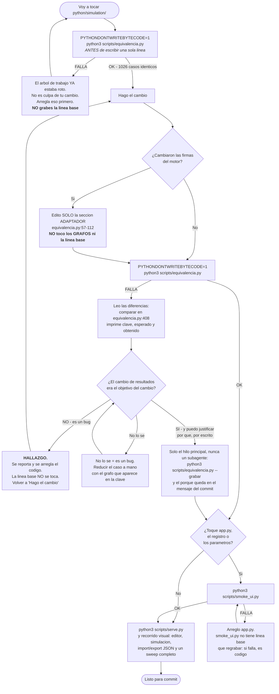
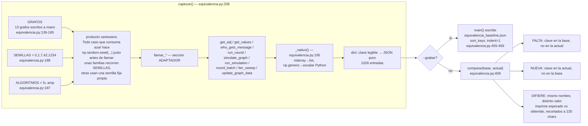
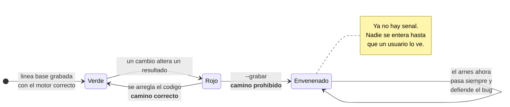
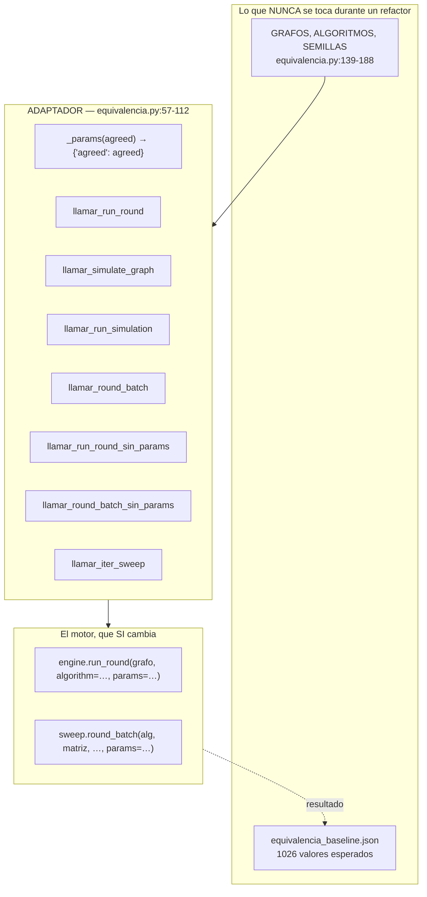
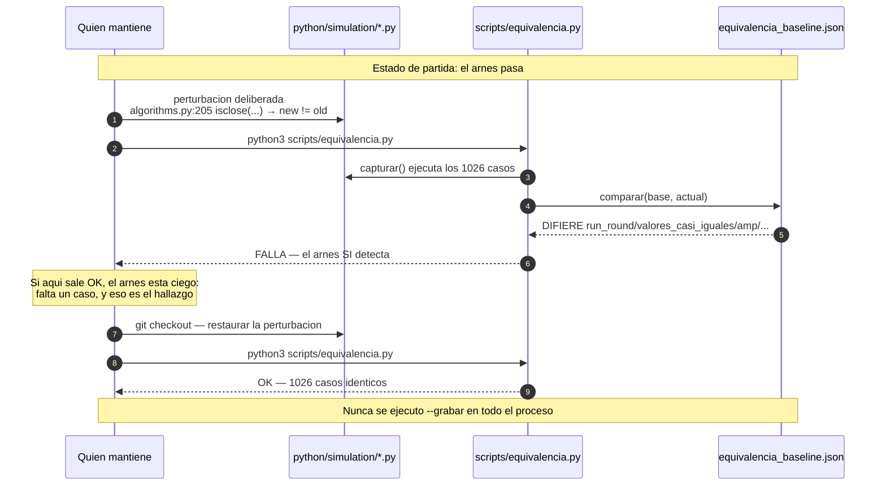
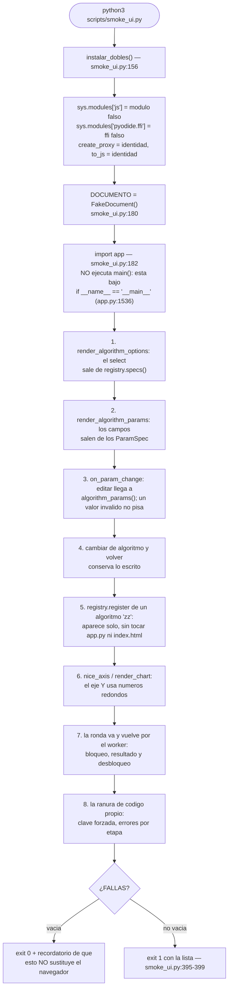
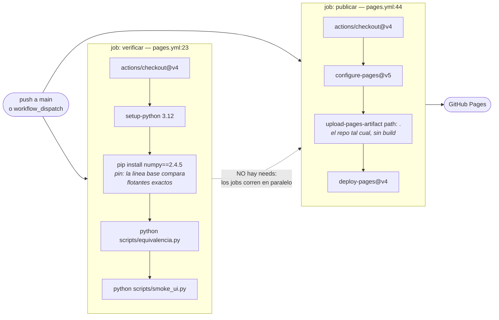

# 07 — Verificación: cómo se comprueba que nada se rompió

> **Archivos que cubre:** `scripts/equivalencia.py`, `scripts/equivalencia_baseline.json`, `scripts/smoke_ui.py` y el job `verificar` de `.github/workflows/pages.yml`.
> **Qué puedes cambiar aquí:** la sección ADAPTADOR de `equivalencia.py` (líneas 57-112), agregar grafos, semillas o algoritmos a las listas de casos, y agregar comprobaciones nuevas a `smoke_ui.py`.
> **Qué es intocable y por qué:** `scripts/equivalencia_baseline.json` — solo se regraba con `--grabar`, y `--grabar` no verifica nada: congela lo que haya, incluido un bug. Y los 13 grafos que ya existen: cada uno defiende una línea concreta del motor.
> **Cómo verificas el cambio:** `PYTHONDONTWRITEBYTECODE=1 python3 scripts/equivalencia.py` (debe imprimir `OK — 1026 casos idénticos a la línea base.`) y `PYTHONDONTWRITEBYTECODE=1 python3 scripts/smoke_ui.py`.

Esta sección es el seguro de vida de quien mantenga el proyecto. No hay suite de
tests: la red de seguridad son **dos scripts y una disciplina**. Si te vas a
saltar algo de esta documentación, que no sea esto.

---

## 1. El panorama en 30 segundos

| Herramienta | Qué protege | Cuándo se corre | Coste |
|---|---|---|---|
| `scripts/equivalencia.py` | El **motor numérico** (`python/simulation/`): que los números y los mensajes de error no cambien | **Antes y después** de tocar cualquier archivo bajo `python/simulation/` | ~segundos |
| `scripts/smoke_ui.py` | La lógica de **interfaz que se genera desde el registro** (`python/app.py`), con un DOM falso | Al tocar el registro, los parámetros de algoritmos o el eje de la gráfica | ~1 segundo |
| Recorrido visual en navegador | Todo lo demás: estilos, eventos reales, arranque de Pyodide, el Web Worker | Antes de dar cualquier etapa por terminada | minutos, manual |
| `.github/workflows/pages.yml` | Corre los dos scripts en cada push a `main`, pero **informa; no bloquea la publicación** (§10) | Automático | — |

```bash
# SIEMPRE con esta variable. La razón está en §7.1.
PYTHONDONTWRITEBYTECODE=1 python3 scripts/equivalencia.py
PYTHONDONTWRITEBYTECODE=1 python3 scripts/smoke_ui.py
```

`equivalencia.py` sale con `0` si todo coincide (`equivalencia.py:473-474`), con
`1` si hay diferencias (`equivalencia.py:481`) y con `2` si no encuentra la línea
base (`equivalencia.py:467`). `smoke_ui.py` sale con `1` cuando alguna
comprobación falla (`smoke_ui.py:395-399`) y termina normalmente —código `0`— si
todas pasan.

### 1.1 El entorno en el que el resultado significa algo

Los comandos de arriba solo son informativos si el entorno coincide con el de la
grabación, porque la línea base compara **flotantes exactos, sin tolerancia**
(`equivalencia.py:419` usa `!=` de Python):

| Requisito | Valor | De dónde sale |
|---|---|---|
| Python | 3.12 | `pages.yml:29-31`; local: 3.12.12 |
| NumPy | 2.4.5 exacto | `pages.yml:36`; local: 2.4.5 |
| Plataforma de grabación | macOS arm64 | comentario de `pages.yml:47-50` |
| `PYTHONDONTWRITEBYTECODE` | `1` | reglas de trabajo del proyecto |

**DEUDA CONOCIDA** — todavía **no** se ha confirmado que Linux x86-64 produzca
los mismos bits que macOS arm64. Por eso la publicación no depende del arnés
(§10.1). Si tu NumPy o tu Python no coinciden con la tabla, un `FALLA` no es
necesariamente un hallazgo: **no regrabes, reporta**.

Detalle que confunde a quien llega: la configuración local del entorno exporta
`PYTHONDONTWRITEBYTECODE=1` como variable de entorno, así que dentro de una
sesión configurada así el comando "funciona" aunque se olvide el prefijo. **Fuera
de esa sesión no.** Escribe siempre el prefijo; te ahorra el diagnóstico falso
de §7.1.

---

## 2. El diagrama que importa: cómo hacer un cambio con seguridad



Las dos ramas que la gente se salta y que son justo el punto del arnés:

1. **Correrlo *antes*.** Si no sabes qué pasaba antes del cambio, un fallo
   después no te dice nada. Es la regla de las reglas de trabajo del proyecto. **INVARIANTE**
2. **La rama `JUICIO -> BUG`.** Cuando el arnés falla, la salida más barata es
   regrabar la línea base y que todo vuelva a estar "verde". Eso destruye la
   herramienta. Ver §4. **INVARIANTE**

---

## 3. `scripts/equivalencia.py`: qué es y cómo funciona

### 3.1 La idea

No comprueba que el motor sea *correcto*. Comprueba que el motor **siga dando
exactamente lo mismo que daba**. Es un test de caracterización (*golden master*),
no un test de unidad.

**DECISION DELIBERADA** — se eligió caracterización y no pruebas unitarias
porque el criterio de éxito del proyecto es la fidelidad a un backend de
referencia que se trata como solo lectura (regla de trabajo del proyecto),
no la elegancia. Un test unitario afirma *"esto debe valer 0.5"* y exige entender
la intención de cada línea; el arnés afirma *"esto debe valer lo mismo que
valía"* y solo exige preservarla. Ver §9 para el desarrollo completo.

El mecanismo cabe en tres funciones:



### 3.2 Cuántos casos y de dónde salen

La línea base es `scripts/equivalencia_baseline.json`: **1026 claves, 1.19 MB**.
Cada clave es una cadena legible tipo
`run_round/valores_casi_iguales/amp/a0.5/s42`, para que un fallo te diga
inmediatamente qué grafo, qué algoritmo, qué `agreed` y qué semilla reproducirlo.

| Familia de claves | Nº | Cómo sale | Semilla | Qué congela |
|---|---:|---|---|---|
| `run_round/` | 390 | 13 grafos × 2 algs × 3 `agreed` (0.5, 0.0, **1.25**) × 5 semillas | `SEMILLAS` (`:232`) | El contrato completo que consume la UI (`equivalencia.py:228-235`) |
| `round_batch/` | 208 | 13 × 2 × 2 rondas × 2 semillas × 2 `agreed` | fija `(0, 42)` (`:283-288`) | El motor vectorizado del sweep (`equivalencia.py:275-296`) |
| `run_round_default/` | 130 | 13 × 2 × 5 semillas | `SEMILLAS` (`:241`) | El camino **sin `params`**: el default del algoritmo (§3.5) |
| `run_simulation/` | 78 | 13 × 2 × {0, 1, 3} rondas | fija `5` (`:270`) | El historial encadenado, incluido `rounds=0` |
| `who_gets_message/` | 65 | 13 × 5 semillas | `SEMILLAS` (`:220`) | El sorteo crudo: `messages` **y** `probabilities` |
| `update_graph_data/` | 39 | 13 × {planos, con NaN, sin mutar} | ninguna | La guarda de NaN y la no-mutación del argumento |
| `simulate_graph/` | 26 | 13 × 2 | fija `99` (`:259`) | El contrato del viejo `POST /simulate` |
| `round_batch_default/` | 26 | 13 × 2 | fija `3` (`:249`) | El default del algoritmo por el camino batched |
| `iter_sweep/` | 16 | 4 grafos × 2 algs × 2 `agreed` | fija `11` (`:303`) | **Todos** los eventos del sweep, incluida la curva con IC95 |
| `get_adj/`, `get_values/` | 13 + 13 | 1 por grafo | ninguna | La construcción de la matriz desde el JSON del editor |
| `error/` | 12 | lista explícita | ninguna | Los **mensajes de error** como comportamiento observable |
| `reparto/` | 10 | 10 pares (total, iteraciones) | fija `0` (`:332`) | Que el sweep nunca corra más simulaciones de las pedidas |
| **Total** | **1026** | | | |

La columna "Semilla" importa: **el producto cartesiano con `SEMILLAS` solo aplica
a `who_gets_message/`, `run_round/` y `run_round_default/`.** Las demás familias
usan una semilla fija propia, y `get_adj/`, `get_values/` y `update_graph_data/`
(65 claves) no fijan ninguna porque no consumen azar. Esto explica por qué
ninguna perturbación del RNG puede romper las 1026 claves (§7).

### 3.3 Formas de datos que se congelan

Saber la forma ayuda a leer un `DIFIERE`:

```
get_adj(grafo)              -> ndarray (n, n) float   [source, target]
get_values(grafo)           -> ndarray (n,)           orden de data["nodes"]
who_gets_message(...)       -> (messages (n,n) int  [target, source],
                                probabilities (n,n) float  [source, target])
run_round(...)              -> {
      "values":          [float] * n
      "valuesBefore":    [float] * n
      "selectedSources": [int|None] * n        # None en AMP siempre
      "messages":        [[int]] (n x n)       # [target][source]
      "probabilities":   [[float]] (n x n)     # [source][target]
      "propagation":     [{source, target, value_sent, updated_value}]
      "discrepancy":     float | None          # None si el grafo esta vacio
      "algorithm":       str
   }
round_batch(...)            -> ndarray (S, n) float
iter_sweep(...)             -> eventos:
      {"type":"start",  numPPoints, iterations, simsPerIteration, algorithm}
      {"type":"iteration", iteration, totalIterations, simulationsPerP, done,
       "points":[{p, mean, ciLow, ciHigh}] * numPPoints}
```

`messages` viene transpuesta y `probabilities` no: la explicación canónica de las
dos orientaciones está en [04](04-simulacion-individual.md); aquí solo hay que
saber que el arnés congela **ambas** tal cual salen.

`probabilities` es la clave más sensible del arnés: es el ruido crudo antes de
cualquier decisión. Cualquier cambio en el **orden o la cantidad** de números
aleatorios consumidos aparece ahí antes que en ningún otro lado.

### 3.4 Por qué el determinismo aguanta

Todo caso que consume azar hace `np.random.seed(...)` justo antes de llamar
(`equivalencia.py:220`, `232`, `288`, y las semillas fijas de la tabla de §3.2), y
el motor usa `np.random` cuando no recibe un `rng` explícito. Eso es una
**DECISION DELIBERADA** de `rng.py`, documentada en el propio código:

```python
# python/simulation/rng.py:22-24
if rng is None:
    # rand(*shape), en vez de default_rng(), preserva np.random.seed().
    return np.random.rand(*shape)
```

`np.random.seed` alimenta el generador heredado de NumPy (MT19937 vía
`RandomState`), que tiene **garantía de estabilidad entre versiones**. Por eso la
línea base grabada con Python de escritorio sigue valiendo dentro de Pyodide.

**INVARIANTE** — si alguien "moderniza" `rng.py` a `np.random.default_rng()`, esa
garantía se pierde y el arnés falla en la gran mayoría de los casos: **719 de
1026, medido**. No en los 1026, y la excepción es informativa: las familias
`get_adj/`, `get_values/`, `update_graph_data/`, `reparto/` y `error/` no
dependen del RNG y siguen pasando (87 claves como mínimo; en la medición real
quedaron idénticas 307).

### 3.5 El caso `..._default`: el que casi nadie escribiría

```python
# scripts/equivalencia.py:90-96
def llamar_run_round_sin_params(grafo, algoritmo):
    """Camino en que el llamador omite los parámetros y manda el default.

    Sin este caso, cambiar el valor por omisión de un algoritmo pasaría
    desapercibido: el resto del arnés siempre pasa `params` explícito.
    """
    return run_round(grafo, algorithm=algoritmo)
```

156 de los 1026 casos (`run_round_default/` + `round_batch_default/`) existen solo
para vigilar `AGREED_DEFAULT` (`algorithms.py:44`) y los `ParamSpec(default=...)`.

**INVARIANTE** — no borres esas dos familias por parecer redundantes. Sin ellas,
cambiar el consenso por omisión de 0.5 a 0.6 pasa el arnés entero sin una sola
diferencia.

---

## 4. LA REGLA CRÍTICA: `--grabar` congela lo que haya, incluido un error

```
python3 scripts/equivalencia.py --grabar
```

**INVARIANTE.** Esto **no verifica nada**. Ejecuta el motor tal como esté ahora
mismo y declara que su salida es la verdad. Si el motor está roto, `--grabar`
graba la rotura y a partir de ese momento el arnés defiende el bug.



Las reglas que rodean esto, tal como están escritas en el proyecto:

- Regla de trabajo: *«`--grabar` regraba la línea base y congela lo que haya,
  incluido un error. Solo se usa cuando el cambio de resultados es intencional y
  ya se justificó. **Nunca para "arreglar" un fallo.**»*
- Regla de trabajo: *«**Ningún subagente ejecuta `scripts/equivalencia.py
  --grabar`.** [...] Esa decisión es del hilo principal y solo tras justificar
  por qué el cambio de resultados es intencional.»*
- Regla de trabajo: decidir si un cambio de resultados numéricos es aceptable
  **no se delega**.

El script coopera con la regla, pero no la impone: si ya existe una línea base y
difiere, imprime un aviso antes de sobrescribir (`equivalencia.py:446-454`) — y
sobrescribe igual. **La única defensa real es la disciplina.** El aviso está para
que un `--grabar` accidental deje rastro en la consola, no para detenerlo.

Prueba práctica: si te descubres escribiendo `--grabar` y **no puedes redactar en
una frase por qué el número nuevo es el correcto**, es un bug.

**La excepción legítima:** agregar casos nuevos (un grafo, una semilla, un
algoritmo en la tupla `ALGORITMOS`) produce claves `NUEVA` sin alterar las
viejas. Ahí regrabar es correcto, y se comprueba leyendo la salida: si además de
`NUEVA` aparece algún `DIFIERE`, ya no es un caso nuevo, es un cambio de
comportamiento y aplica todo lo de arriba.

---

## 5. La sección ADAPTADOR y por qué existe



El problema que resuelve: en un refactor por fases, las **firmas** del motor
cambian aunque los **resultados** no. La fase 1 de este proyecto movió
`agreed: float` a `params: dict`. Sin adaptador habría dos opciones, y las dos
son malas:

- reescribir los 1026 casos → un error de transcripción se confunde con un
  cambio de comportamiento;
- regrabar la línea base → §4, se pierde la señal.

Con adaptador se edita **una sola función** (`_params`, `equivalencia.py:61-67`)
y la línea base sigue intacta detectando cualquier cambio de resultado. El
docstring del propio archivo lo dice (`equivalencia.py:20-25`):

> *«La sección ADAPTADOR es el único lugar que conoce cómo se llama al motor. Si
> una fase del refactor cambia las firmas [...] se edita **solo** esa sección: la
> línea base no se vuelve a grabar y sigue detectando cualquier cambio de
> resultado.»*

**Regla operativa (INVARIANTE):** si para hacer pasar el arnés necesitas tocar
algo fuera de las líneas 57-112, párate. O estás cambiando el comportamiento (y
entonces §4 aplica), o estás debilitando el arnés.

---

## 6. Los grafos de prueba: cada uno defiende un bug concreto

Los 13 grafos de `equivalencia.py:139-185` están escritos a mano, con `_grafo()`
(`equivalencia.py:119-136`) armando el JSON del editor.

**INVARIANTE** — no son aleatorios ni "representativos": cada uno existe porque
distingue dos implementaciones que un grafo normal no distinguiría. Borrar uno
porque "parece redundante" abre un agujero exacto.

| Grafo | Línea | Qué defiende |
|---|---:|---|
| `k2` | 141 | El caso mínimo, equivalente a `examples/k2.json` del proyecto de referencia |
| `triangulo_dirigido` | 142 | Ciclo dirigido con pesos distintos, y matriz de mensajes **asimétrica** (§7) |
| `camino_no_dirigido` | 145 | La simetrización `upper + upper.T` (`engine.py:110-112`) |
| `un_nodo` | 148 | `n = 1`: `discrepancy` = 0, sin aristas que sortear |
| `sin_aristas` | 149 | Matriz de ceros: `ceil(0) = 0`, nadie transmite, nadie cambia |
| `self_loop` | 150 | La diagonal: un self-loop que se conserva en la matriz |
| `aristas_duplicadas` | 152 | Dos aristas entre el mismo par: **la última gana** al escribir la matriz (`engine.py:65`). Un `+=` en vez de `=` rompería aquí y solo aquí |
| `valores_fraccionarios` | 153 | Que no haya redondeos escondidos |
| **`valores_casi_iguales`** | 160 | **`np.isclose` vs `!=`** — ver §6.1 |
| **`pesos_fuera_de_rango`** | 169 | **`np.ceil(w)` vs `(w > 0)`** — ver §6.2 |
| `pesos_fuera_de_rango_no_dirigido` | 172 | Lo mismo, pero cruzado con la simetrización |
| `denso_8` (dirigido) | 175 | Volumen: 8 nodos, suficientes aristas para que un cambio de orden en el consumo de aleatoriedad se note |
| `denso_6_no_dirigido` | 180 | Ídem, no dirigido |

**DEUDA CONOCIDA — un hueco de cobertura:** `self_loop` está declarado
**dirigido** (`equivalencia.py:150`:
`_grafo(True, [1, 0], [(0, 0, 0.5), (0, 1, 1)])`), así que la rama
`if not directed: matrix[target, source] = weight` (`engine.py:66-67`) —la que
reescribiría la misma celda en la diagonal— **nunca se ejecuta para él**. Ningún
grafo del arnés cubre hoy un self-loop en grafo no dirigido. Si tocas esa rama,
el arnés no te protege: hazlo a mano o agrega el grafo (y entonces sí, regraba;
es una adición de claves, §4).

### 6.1 `valores_casi_iguales`: la tolerancia de `np.isclose`

```python
# scripts/equivalencia.py:156-164
# Valores a distancia menor que la tolerancia de np.isclose respecto de los
# `agreed` que se prueban (0.5 y 0.0). Sin este caso, cambiar `isclose` por
# `!=` en el flag updated_value de AMP pasaría desapercibido. Pesos en 1
# para que todas las aristas disparen y siempre haya propagación que medir.
"valores_casi_iguales": _grafo(
    True,
    [0.5, 0.5 + 1e-9, 1e-9, 0.75],
    [(i, j, 1) for i in range(4) for j in range(4) if i != j],
),
```

El código bajo vigilancia es una sola línea:

```python
# python/simulation/algorithms.py:205
return not bool(np.isclose(new_value, old_values[target_index]))
```

`amp_updated` decide si una arista entregada cuenta como actualización. Con
`agreed = 0.5`, el nodo 1 vale `0.500000001`. `np.isclose` (rtol 1e-5, atol
1e-8) dice que son iguales → `updated_value = False`. Un `!=` diría distinto →
`True`. Verificado en la línea base (`equivalencia_baseline.json:94404`, entrada
`run_round/valores_casi_iguales/amp/a0.5/s0`):

```
{"source":"node_0", "target":"node_1", "updated_value": false,  "value_sent": 0.5}   ← isclose
{"source":"node_0", "target":"node_2", "updated_value": true,   "value_sent": 0.5}   ← lejano
```

El nodo 2 (`1e-9`) hace el trabajo simétrico para `agreed = 0.0`. Los pesos están
todos en `1` para que **todas** las aristas disparen siempre: si el grafo
dependiera del azar para propagar, el caso a veces no mediría nada.

**DEUDA CONOCIDA que hay que conocer al leer esto:** `updated_value` decide un
color que hoy **no se ve**. Las aristas se pintan todas iguales por un choque
entre un atributo de presentación y el selector `.edge-path`; el detalle está en
[03](03-interfaz.md). El arnés sigue defendiendo el campo porque viaja en el
contrato JSON y porque el día que el CSS se arregle, el color tiene que salir
bien.

### 6.2 `pesos_fuera_de_rango`: `np.ceil` no es `> 0`

```python
# scripts/equivalencia.py:165-171
# La UI limita los pesos a (0, 1], pero la importación de JSON no valida, así
# que el motor puede recibirlos fuera de rango. `np.ceil(w)` y `(w > 0)` solo
# difieren con pesos no enteros > 1 (con w=1.5 la arista dispara con
# probabilidad 0.75, no 1.0). El motor conserva `ceil` deliberadamente.
"pesos_fuera_de_rango": _grafo(
    True, [1, 0, 0.5], [(0, 1, 1.5), (1, 2, 2.5), (2, 0, 0.5)]
),
```

**DECISION DELIBERADA** — la máscara `ceil` se conserva literal del backend
original en vez de recortar los pesos en silencio; el motivo está escrito en
`engine.py:96-100`. La expresión vive **duplicada** en `engine.py:107` y
`sweep.py:157`:

```python
adjacency_mask = np.ceil(matrix)
probabilities = _random_array(rng, matrix.shape) * adjacency_mask
messages = (matrix > probabilities).astype(int).T
```

Con `w = 1.5`: `ceil = 2`, la muestra es `U(0,1) × 2 = U(0,2)`, y `1.5 > U(0,2)`
dispara con probabilidad **0.75**. Con la máscara "limpia" `(w > 0)` la muestra
sería `U(0,1)` y dispararía **siempre**. Un mantenedor que vea `np.ceil` pensará
que es una forma retorcida de escribir "hay arista" y lo simplificará. El grafo
está para que ese día el arnés se ponga rojo. La huella queda literalmente en la
línea base (`equivalencia_baseline.json:122980`):

```json
"who_gets_message/pesos_fuera_de_rango/s0": {
  "probabilities": [[0.0, 1.430378732744839, 0.0],
                    [0.0, 0.0, 1.9376823391999682],
                    [0.4375872112626925, 0.0, 0.0]]
}
```

Esos `1.43` y `1.94` **son imposibles** si la máscara fuera booleana.

### 6.3 Casos que no son grafos

- **`reparto/`** (`equivalencia.py:327-343`) — 10 combinaciones (total,
  iteraciones) que congelan el invariante *"el acumulado nunca excede lo
  pedido"*, con `excedeLoPedido` como campo explícito. **DECISION DELIBERADA**:
  es una divergencia del backend original, documentada en `sweep.py:292-299`;
  allí pedir 10 simulaciones con 50 iteraciones corría 50. Aquí `iterations` se
  recorta (`sweep.py:299`) y el resultado es 10. El caso `total7/iter3` congela
  el truncamiento hacia abajo: se piden 7, se corren **6**, no 7 ni 21. Quien
  "arregle" eso por parecer un bug romperá los 10 casos `reparto/` y estará
  deshaciendo una decisión documentada.
- **`error/`** (`equivalencia.py:345-399`) — 12 casos donde se captura
  `f"{type(exc).__name__}: {exc}"`. **Los mensajes de error son comportamiento
  observable**: el usuario los ve. El más interesante registra a propósito un
  algoritmo `solo_escalar` sin versión vectorizada (`equivalencia.py:351-360`)
  para congelar que el barrido **distinga** "no existe" de "existe pero no tiene
  `batch`" (`registry.batch_of`, `registry.py:91-109`). Antes daban el mismo
  mensaje engañoso.

  **Trampa de mantenimiento:** ese registro va protegido por
  `if "solo_escalar" not in registry.KEYS` (`equivalencia.py:351`) porque
  `registry.register` rechaza claves repetidas (`registry.py:76-77`). Si mueves
  el bloque más arriba dentro de `capturar()` o llamas a `capturar()` dos veces
  en el mismo proceso sin esa guarda, el script revienta.

---

## 7. El control negativo: comprobar que el arnés detecta

Un arnés que siempre pasa es peor que no tener arnés: da confianza falsa. La
regla es:

> *«Al cambiar el arnés, comprobar que detecta algo: perturbar el motor a
> propósito, ver que falla, y restaurar. Un arnés que siempre pasa no sirve.»*



Perturbaciones útiles. **Las cifras están medidas ejecutando cada perturbación
por separado**, no estimadas: sirven como criterio de aceptación del control
negativo.

| Perturbación | Archivo | Qué rompe, medido |
|---|---|---|
| `np.isclose(...)` → `new_value != old_values[...]` | `algorithms.py:205` | `run_round/valores_casi_iguales/amp/...` |
| `np.ceil(matrix)` → `(matrix > 0)` | `engine.py:107` | **98 claves**, y todas de `pesos_fuera_de_rango` y `pesos_fuera_de_rango_no_dirigido`. Nada más cambia. Para que rompa también el camino batched hay que perturbar además `sweep.py:157` (entre las dos: 134 claves) |
| `AGREED_DEFAULT = 0.5` → `0.6` | `algorithms.py:44` | solo las familias `*_default/` (§3.5) |
| quitar el `.T` de `messages` | `engine.py:114` | **275 de 1026 claves**, p. ej. `run_round/triangulo_dirigido/...` y `who_gets_message/denso_8/*`. Solo los grafos con matriz de mensajes asimétrica: `aristas_duplicadas`, `denso_8`, `pesos_fuera_de_rango`, `self_loop`, `triangulo_dirigido` y `valores_fraccionarios` |
| `matrix[source, target] = w` → `+=` | `engine.py:65` | `get_adj/aristas_duplicadas` |
| `np.random.rand` → `default_rng()` | `rng.py:24` | **719 de 1026 claves** (§3.4) |

Dos lecturas que ahorran una tarde de depuración:

- **Quitar el `.T` no rompe `k2`.** La matriz de `k2` es `[[0,1],[1,0]]` con pesos
  1, así que `messages` sale simétrica y transponerla no la altera (se ve en
  `who_gets_message/k2/s0` de la línea base). Tampoco rompe `round_batch/`,
  `round_batch_default/` ni `iter_sweep/`: el camino batched no pasa por
  `engine.py:114`. Si diseñas un control negativo con `k2`, concluirás que el
  arnés está ciego cuando no lo está.
- **Ninguna perturbación puede romper las 1026.** Las familias sin azar
  (`get_adj/`, `get_values/`, `update_graph_data/`, `reparto/`, `error/`) suman 87
  claves que sobreviven a cualquier cosa que le hagas al RNG.

**Trampa a la hora de leer el resultado:** una perturbación que cambie el **orden
o la cantidad** de números aleatorios consumidos rompe cientos de casos a la vez,
no solo el que la motiva. El script imprime **solo las primeras 40** diferencias
(`equivalencia.py:477-480`); el resto se resume con un contador. Eso está bien
para el diagnóstico —el primer `DIFIERE` ya te dice qué grafo mirar—, pero no
confundas "40 diferencias impresas" con "40 diferencias".

### 7.1 Y por qué SIEMPRE `PYTHONDONTWRITEBYTECODE=1`

**INVARIANTE.** las reglas de trabajo del proyecto lo dicen con una anécdota
real del proyecto: *«Un `.pyc` con el mismo mtime que el fuente ya provocó un
diagnóstico falso en este proyecto: el código estaba bien y la caché servía
bytecode viejo.»* En un control negativo, donde perturbas y restauras un archivo
en segundos, la resolución de mtime de la caché de Python es exactamente el
enemigo. `.gitignore` ignora `__pycache__/`, así que el problema es **invisible
en `git status`**.

En CI no hace falta —y por eso `pages.yml:39` corre `python scripts/equivalencia.py`
a secas— porque cada job parte de un `checkout` limpio: no hay `__pycache__`
previo que pueda estar desfasado.

---

## 8. `scripts/smoke_ui.py`: el DOM simulado

### 8.1 Por qué hace falta un DOM falso

`python/app.py` hace `from js import Blob, Object, URL, Worker, document, window`
(`app.py:13-14`). Fuera de Pyodide ese import explota. `smoke_ui.py` instala
dobles mínimos **antes** de importar `app`:



Los dobles son deliberadamente tontos: `FakeElement` (`smoke_ui.py:56-78`) es un
saco de atributos, `FakeClassList` (`smoke_ui.py:39-53`) un `set`. Las
comprobaciones leen el `innerHTML` generado con expresiones regulares
(`smoke_ui.py:201-208`), que es todo lo que se necesita para verificar *qué* HTML
produce Python.

### 8.2 Qué cubre de verdad

Las ocho secciones no son "tests del render": son **los invariantes del diseño de
registro** más el protocolo de la ronda, la propiedad que las reglas de trabajo del proyecto marcan como no negociable —
*«Si un cambio para agregar un algoritmo toca `engine.py`, `sweep.py`, `app.py` o
`index.html`, se salió del diseño»*.

- **Secciones 1-2** — el `<select>` es exactamente `registry.KEYS` y la etiqueta
  visible sale del `AlgorithmSpec`, no de `index.html` (`smoke_ui.py:227-238`).
  Los campos de parámetros salen de los `ParamSpec` (`smoke_ui.py:249`), y el
  contenedor se oculta cuando el algoritmo no declara ninguno
  (`smoke_ui.py:242-245`).
- **Sección 3** — un valor no numérico en el campo **no pisa** el anterior
  (`smoke_ui.py:259-263`), que es el `except ValueError: return` de
  `app.py:1098-1101`.
- **Sección 4** — cambiar de algoritmo y volver conserva lo escrito, porque el
  estado vive en `STATE.algorithm_params` por algoritmo (`app.py:174-175`).
- **Sección 5** — la prueba más valiosa: registra un algoritmo `zz` inventado con
  dos parámetros y comprueba que aparece en el selector, genera sus dos campos y
  expone sus defaults **sin tocar `app.py` ni `index.html`**
  (`smoke_ui.py:277-297`). Si alguien mete un `if algorithm == "amp"` en la
  interfaz, esto se pone rojo.
- **Sección 6** — `nice_axis` (`app.py:417`) y `render_chart` (`app.py:490`).
  Además de casos concretos, hace dos comprobaciones de propiedad sobre 4000
  valores (`smoke_ui.py:340-353`): que **el tope siempre cubre el dato** (la curva
  nunca se sale de la gráfica) y que el aire desperdiciado tiene mediana < 20 %.
  Es la única comprobación cuantitativa de la UI en todo el proyecto.
- **Sección 7** — el corte de `simulate` en dos mitades. `FakeWorker` recibe el
  mensaje y contesta **cuando se le pide**, y eso es lo que permite mirar el
  estado **intermedio**, imposible de observar cuando la ronda era síncrona:
  ronda en vuelo, botón bloqueado, un segundo clic que no manda otro mensaje, y
  la distinción entre *«Cargando motor…»* y *«Simulando…»* según haya llegado o
  no el aviso `listo`. Después comprueba que el valor llegó al nodo y que el
  botón se desbloqueó — y repite por la **ruta de error**, donde nada se repinta
  y el botón tiene que soltarse igual. Ese embudo (`finish_round`) es lo único
  que separa un fallo del motor de una interfaz trabada para siempre.
- **Sección 8** — la ranura de código propio, sus dos mitades. La del motor
  instala código que pide la clave `fv` y comprueba que acabe en `user_alg` con
  `fv` intacto, que `updated` caiga en su valor por omisión y que los cuatro
  modos de fallo —no compila, no registra nada, revienta, declara `params`—
  eleven cada uno lo suyo. La de interfaz comprueba que el fuente viaje en el
  mensaje sólo cuando la ranura está activa, y que el traceback llegue recortado
  a las líneas de quien lo escribió.

  El bloque del instalador corre sobre una **copia** del registro y la restaura
  al terminar. No es limpieza cosmética: en producción hay dos registros —el del
  hilo principal, que es el catálogo de la interfaz, y el del Worker, donde se
  compila— y aquí comparten proceso. Sin la copia, vaciar la ranura al probar un
  fallo dejaría al selector sin una entrada que espera, un choque que la
  aplicación real no puede tener.

### 8.3 Qué NO cubre — y el script te lo recuerda al salir

El propio docstring lo dice (`smoke_ui.py:16-17`) y la última línea del programa
lo repite (`smoke_ui.py:401`): *«Recordatorio: esto NO sustituye el recorrido
visual en navegador.»*

Fuera de alcance, por construcción:

- **Estilos y layout.** `css/app.css` no se carga nunca. Todo el CSS muerto o
  invisible que hay hoy —incluido el color de las aristas— es invisible también
  para este script: ver [03](03-interfaz.md).
- **Eventos reales.** `editar_campo` (`smoke_ui.py:217-221`) llama a
  `app.on_param_change` a mano con un objeto falso. El `addEventListener` real
  nunca se ejercita, ni la delegación en el contenedor.
- **`retain()` y el ciclo de vida de los proxies.** `create_proxy` es la identidad
  en los dobles (`smoke_ui.py:172`), así que la trampa nº 1 del proyecto es
  **completamente invisible** aquí: un `retain()` olvidado deja el evento muerto
  sin ningún error en pantalla. El mecanismo está explicado en
  [03](03-interfaz.md).
- **El arranque de Pyodide y las dos listas manuales de `.py`.** Un módulo nuevo
  que se olvide en `PYTHON_FILES` o `SWEEP_FILES` falla con `ModuleNotFoundError`
  **solo dentro del navegador**; ningún script lo detecta. Ver
  [01](01-arranque.md).
- **El Worker de verdad y el sweep.** `smoke_ui.py` sustituye `js.Worker` por
  `FakeWorker` (`smoke_ui.py:170`), un doble que corre el motor **real** pero en
  la misma llamada. Eso sí cubre el protocolo de la ronda —mensaje, respuesta,
  bloqueo y desbloqueo del botón, sección 7— y **no** cubre nada del Pyodide
  aparte: ni el arranque del Worker, ni la latencia real, ni el sweep, que aquí
  no se ejecuta. Ver [05](05-barrido-sweep.md).
- **`geometry.py` y `models.py`.** Nadie los verifica automáticamente. El
  arrastre de nodos, el zoom, el minimapa y el trazado de aristas se comprueban
  **solo mirando**.

**DEUDA CONOCIDA — trampa concreta y fácil de pisar:**
`FakeDocument.getElementById` usa `setdefault` (`smoke_ui.py:93-94`), así que
**siempre** devuelve un elemento, aunque el `id` no exista en `index.html`. Si
borras `<div id="algorithm-params">` del HTML, `smoke_ui.py` sigue pasando en
verde y la aplicación real se rompe. El script verifica el HTML que Python
*genera*, no que exista el nodo donde va a colgarlo.

---

## 9. Dos límites del arnés que hay que tener presentes

### 9.1 Compara valores, no tipos

`comparar()` usa el `!=` de Python sobre estructuras JSON ya parseadas
(`equivalencia.py:419`). En Python `1 == 1.0` y `True == 1`, así que **un cambio
de tipo que no cambie el valor no se detecta**: un `int` que pasa a `float`, un
`bool` que pasa a `int`. Pyodide sí es sensible al tipo cuando el valor cruza la
frontera hacia JavaScript, de modo que existe una clase de regresión que el arnés
deja pasar y que solo se ve en el navegador.

### 9.2 No cubre los algoritmos que no están en la tupla

**INVARIANTE.** `ALGORITMOS = ("fv", "amp")` está escrito a mano en
`equivalencia.py:187`. Para que un algoritmo nuevo **funcione en la aplicación**
basta con declararlo en `python/simulation/algorithms.py` —esa es la promesa del
registro y sigue siendo cierta, ver [06](06-registro-algoritmos.md)—, pero
para que **quede cubierto por el arnés** hay que agregarlo también a esa tupla y
regrabar la línea base.

Dicho sin rodeos: un algoritmo nuevo no aparece en ninguno de los 1026 casos, y
el arnés seguirá imprimiendo `OK` aunque el algoritmo esté mal. La regrabación
que hace falta aquí es de las legítimas (§4): agrega claves `NUEVA` sin alterar
ninguna vieja.

### 9.3 Escalar y batched nunca se comparan entre sí

Las versiones escalar y batched de un mismo algoritmo **nunca coinciden bit a
bit** —consumen aleatoriedad en distinto orden y en distinta cantidad, y usan
orientaciones opuestas del tensor—; el mecanismo está en
[06](06-registro-algoritmos.md). Lo que importa aquí es la consecuencia para
la verificación:

- El arnés las trata como **familias de claves separadas** (`run_round/...` y
  `round_batch/...`), cada una comparada solo contra su propio histórico. Nunca
  las cruza.
- **Si tu `batch` implementa mal la regla de tu `scalar`, el arnés no te lo va a
  decir.** Congelará fielmente el resultado incorrecto.
- La comprobación correcta es **estadística**: correr muchas réplicas de cada uno
  sobre el mismo grafo y comparar medias y varianzas dentro de un intervalo de
  confianza. **DEUDA CONOCIDA:** eso hoy no está automatizado; es trabajo manual
  y consciente.

---

## 10. `.github/workflows/pages.yml`: informa, no bloquea



**Lo primero que hay que entender: un arnés en rojo publica igual.** El job
`publicar` no declara `needs: verificar`, así que los dos jobs arrancan en
paralelo y el despliegue no espera al resultado del arnés. El CI es una señal
informativa, no un candado.

### 10.1 Por qué publicar NO depende de verificar (todavía)

**DECISION DELIBERADA**, explicada en el comentario de `pages.yml:47-50`:

> *«No depende de `verificar` a propósito: el arnés compara flotantes exactos y
> todavía no se ha comprobado que dé idéntico en Linux x86-64 que en el macOS
> arm64 donde se grabó la línea base. En cuanto se confirme que pasa, agregar
> aquí `needs: verificar` lo convierte en un candado de publicación.»*

El problema real: la línea base guarda flotantes con toda su precisión y
`comparar` (`equivalencia.py:419`) los compara **sin tolerancia**. La secuencia de
MT19937 sí está garantizada entre plataformas —por eso `rng.py:23-24` insiste en
`np.random.rand`—, pero la **aritmética posterior** no lo está de la misma forma:
las reducciones vectorizadas de NumPy pueden asociar sumas en distinto orden
según el ancho SIMD del CPU, y ahí caen `cumulative_sumsq`, la varianza y los
límites del IC95 de `SweepAccumulator.points` (`sweep.py:211-242`), que viajan en
los 16 casos `iter_sweep/`. Un ULP de diferencia y el job falla.

El motivo de la decisión: **no bloquear la publicación con una señal que todavía
no se sabe si es fiable**. Un job que falla por ruido de plataforma se aprende a
ignorar en dos semanas, y entonces deja de servir para lo que sí importa.

**Qué hacer con esto (la tarea pendiente que hereda quien mantenga):**

1. Dejar correr el job `verificar` unos cuantos push y ver si pasa en verde de
   forma consistente en `ubuntu-latest`.
2. Si pasa: añadir `needs: verificar` al job `publicar` (`pages.yml:44-50`),
   borrar el comentario y quedarte con un candado real.
3. Si falla por diferencias de ULP: **no** aflojar la comparación a
   `math.isclose` de forma global —eso ciega el arnés justo para la clase de bug
   que §6.1 defiende—. La salida honesta es fijar la plataforma de grabación
   (grabar la línea base *en* CI) o segregar las claves sensibles a la aritmética,
   dejando el resto en comparación exacta.

Dato que hace esto tratable: las versiones ya están controladas. El
`pip install numpy==2.4.5` de `pages.yml:36` y el `python-version: "3.12"` de
`pages.yml:31` coinciden con el entorno donde se grabó la línea base
(verificado: 3.12.12 / NumPy 2.4.5). Lo único abierto es la arquitectura.

### 10.2 Lo demás del workflow

- **`concurrency: group: pages` con `cancel-in-progress: false`**
  (`pages.yml:18-20`): una publicación a la vez, y no se cancela la que ya está
  corriendo. Cancelar un deploy de Pages a medias deja el sitio en un estado raro.
- **`upload-pages-artifact` con `path: .`** (`pages.yml:59-62`): se publica el
  repositorio tal cual, sin bundler ni transpilación. Eso tiene consecuencias
  —qué queda descargable desde el sitio, por qué `.nojekyll` es infraestructura
  crítica— que pertenecen a la sección de despliegue, no a esta. Aquí solo
  interesa una: un archivo que no esté commiteado no existe en producción, y
  ningún script de esta sección lo detecta.

---

## 11. Por qué no hay suite de tests

**DECISION DELIBERADA**, no deuda. Las reglas de trabajo del proyecto:

> *«No copiar ni portar la suite de tests del original. Usar solamente smoke
> checks y recorridos funcionales para comprobar los casos principales.»*

Y además: *«No hay suite de tests, y es deliberado [...]. La
verificación son esos dos scripts más el recorrido visual en navegador.»*

El razonamiento, para que no lo "arregles" sin querer:

1. **El objetivo del proyecto es la fidelidad, no la corrección.** El motor es un
   port literal de un backend de referencia que se trata como solo lectura
   (regla de trabajo del proyecto). Un test unitario afirma *"esto debe valer 0.5"*; el arnés
   afirma *"esto debe valer lo mismo que valía"*. Para portar, la segunda
   afirmación es la útil: no exige entender la intención de cada línea, solo
   preservarla.
2. **Una suite portada mentiría.** Los tests del original prueban FastAPI,
   Pydantic y React, capas que aquí **no existen**. Portarlos obligaría a
   reescribirlos, y una reescritura no verifica fidelidad: verifica lo que quien
   reescribió creyó entender.
3. **Cobertura por producto cartesiano.** 1026 casos generados de 13 grafos × 2
   algoritmos × varias semillas cuestan menos de mantener que 1026 tests escritos
   a mano, y no se olvida ninguna combinación.
4. **No hay paso de compilación ni dependencias de desarrollo.** Meter `pytest`
   introduciría la primera. Los dos scripts corren con Python de escritorio +
   NumPy, que es lo único que ya hacía falta.

**Consecuencia que hay que asumir:** hay zonas sin red. `app.py` (1241 líneas)
está cubierto solo en la parte generada por el registro; `geometry.py` y
`models.py` no están cubiertos en absoluto. Por eso el paso 5 de la forma de
trabajo (regla de trabajo del proyecto) —*«Ejecutar la aplicación en navegador y revisar
visualmente cada flujo»*— **no es opcional**: es parte de la verificación, no un
extra.

---

## 12. Referencia rápida: la checklist

```bash
# 0. Antes de tocar nada
PYTHONDONTWRITEBYTECODE=1 python3 scripts/equivalencia.py   # OK — 1026 casos idénticos

# 1. Cambio en python/simulation/
PYTHONDONTWRITEBYTECODE=1 python3 scripts/equivalencia.py   # ¿sigue OK?
#    FALLA -> es un hallazgo. NUNCA --grabar para taparlo.
#    ¿Cambiaron firmas? Editar SOLO equivalencia.py:57-112.

# 2. Cambio en app.py / registro / parámetros
PYTHONDONTWRITEBYTECODE=1 python3 scripts/smoke_ui.py

# 3. Algoritmo nuevo: además de algorithms.py, agregarlo a
#    ALGORITMOS en equivalencia.py:187 y regrabar (§9.2).

# 4. Cambio en el arnés mismo
#    Control negativo: perturbar el motor, ver que FALLA, restaurar, ver que pasa.
#    Usa las cifras medidas de §7 como criterio: si rompe menos de lo esperado,
#    la perturbación no era la que creías.

# 5. Siempre, antes de dar algo por terminado
python3 scripts/serve.py   # http://localhost:8000
#    Editor, simulación paso a paso, import/export JSON y un sweep completo.
```

**Las seis frases que resumen la sección:**

1. `--grabar` no verifica: **declara**. Si no puedes justificar el número nuevo
   en una frase, es un bug.
2. Corre el arnés **antes** del cambio o su resultado después no significa nada.
3. Los grafos raros no son ruido: **cada uno defiende una línea concreta** del
   motor.
4. Un arnés que nunca falla está ciego: **perturba el motor a propósito** de vez
   en cuando, y comprueba que rompe *lo que debía* romper.
5. El CI **informa, no bloquea**: un push con el arnés en rojo se publica igual.
6. Ningún script sustituye abrir la aplicación en el navegador.
