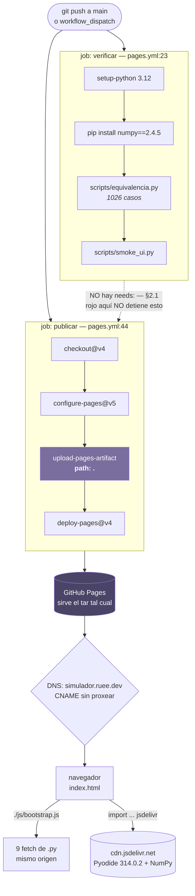
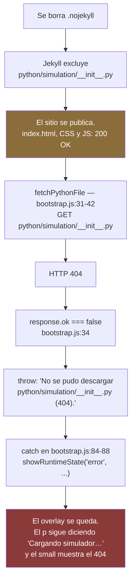

# 08 — Despliegue y publicación: del `push` al sitio en vivo

> **Archivos que cubre:** `.github/workflows/pages.yml`, `.nojekyll`, y la configuración que **no** vive en el repositorio (Settings → Pages de GitHub, y la zona `ruee.dev` en Cloudflare).
> **Qué puedes cambiar aquí:** los disparadores del workflow (`on:`), las versiones fijadas del job `verificar`, y —cuando se cumpla la condición de §2.2— agregar `needs: verificar` al job `publicar`.
> **Qué es intocable y por qué:** `.nojekyll` (§3) y el hecho de que **todas** las rutas del proyecto sean relativas (§6). Borrar el primero o escribir una ruta absoluta no rompe nada en tu máquina: rompe únicamente en producción, y sin síntoma legible.
> **Cómo verificas el cambio:** `curl -sI https://simulador.ruee.dev/python/simulation/__init__.py` debe responder `200`, y después el recorrido de §8.

No hay paso de compilación. No hay bundler, ni transpilación, ni un directorio
`dist/`. Lo que se publica es **el repositorio tal cual**, y esa frase —que en
otros proyectos sería una simplificación— aquí es literal: el navegador descarga
los nueve `.py` con `fetch()` y los monta en el sistema de archivos de Pyodide
(§1 de `docs/01-arranque.md`). El servidor solo tiene que ser capaz de entregar
archivos.

Esa simplicidad tiene un precio, y es el tema de esta sección: cuando no hay
build, **no hay ningún paso que valide lo que se publica**. Lo que esté en `main`
está en producción, incluido lo que no querías publicar y excluido lo que no
commiteaste.

---

## 1. El panorama en 30 segundos

| Pieza | Dónde vive | Qué pasa si falta |
|---|---|---|
| Workflow de publicación | `.github/workflows/pages.yml` | No se publica nada; el sitio se queda en la versión anterior |
| `.nojekyll` | raíz del repo, 0 bytes | El sitio se publica y **muere al arrancar** (§3) |
| Origen de Pages | Settings → Pages → *GitHub Actions* | El workflow corre y `deploy-pages` falla |
| Dominio propio | Settings → Pages → *Custom domain*, **no** hay archivo `CNAME` (§5.4) | El sitio sigue vivo en `rou-uu.github.io/consenso-simulador/` |
| Registro DNS | Cloudflare, zona `ruee.dev`, `CNAME` **sin proxear** | Sin certificado, o sin resolución (§5) |



Lo que hay que retener del diagrama: **la flecha punteada no es una dependencia**.
Los dos jobs arrancan a la vez y el despliegue no mira el resultado del arnés.

---

## 2. Los dos jobs

`pages.yml` declara dos jobs y ninguna arista entre ellos.

### `verificar` (`pages.yml:23-42`)

Reproduce en CI exactamente los dos comandos de `docs/07-verificacion.md`:

```yaml
- run: pip install numpy==2.4.5      # pages.yml:36
- run: python scripts/equivalencia.py # pages.yml:39
- run: python scripts/smoke_ui.py     # pages.yml:42
```

Las versiones están fijadas porque la línea base compara **flotantes exactos, sin
tolerancia**: Python `3.12` (`pages.yml:31`) y NumPy `2.4.5` clavado
(`pages.yml:36`). El razonamiento completo está en `docs/07-verificacion.md` §1.1;
aquí solo interesa que ese pin es parte del contrato de despliegue, no un detalle
de CI.

Detalle menor que confunde: el CI **no** exporta `PYTHONDONTWRITEBYTECODE=1`,
la variable que `docs/07-verificacion.md` §7.1 declara obligatoria. No hace falta
en CI porque el `checkout` es limpio: no hay `__pycache__` heredado de otra
versión del código que pueda envenenar el import.

### `publicar` (`pages.yml:44-66`)

Cuatro pasos, ninguno de los cuales compila nada:

1. `actions/checkout@v4` — trae el repositorio.
2. `actions/configure-pages@v5` — obtiene la configuración de Pages del repo
   (incluido el dominio propio y el `base_url`).
3. `actions/upload-pages-artifact@v3` con `path: .` — empaqueta **todo** (§4).
4. `actions/deploy-pages@v4` — publica y expone la URL en
   `steps.deployment.outputs.page_url`, que el bloque `environment`
   (`pages.yml:51-53`) muestra en la pestaña Environments de GitHub.

Además, fuera de los jobs:

- `permissions:` (`pages.yml:12-15`) da `contents: read`, `pages: write` e
  `id-token: write`. Los tres son el mínimo que exige `deploy-pages@v4`: sin
  `id-token: write` no puede pedir el token OIDC y falla con un error de
  autenticación que no menciona los permisos.
- `concurrency: group: pages` con `cancel-in-progress: false`
  (`pages.yml:18-20`) — **DECISION DELIBERADA**: una publicación a la vez y la
  que ya está corriendo **no** se cancela. Cancelar un `deploy-pages` a medias
  deja el sitio en un estado intermedio; es preferible que dos pushes seguidos
  se encolen y tarden el doble.

### 2.1 Por qué `publicar` NO depende de `verificar`

**DECISION DELIBERADA.** El motivo está escrito en el propio archivo
(`pages.yml:47-50`):

> *«No depende de `verificar` a propósito: el arnés compara flotantes exactos y
> todavía no se ha comprobado que dé idéntico en Linux x86-64 que en el macOS
> arm64 donde se grabó la línea base. En cuanto se confirme que pasa, agregar
> aquí `needs: verificar` lo convierte en un candado de publicación.»*

Desarrollado: la línea base (`scripts/equivalencia_baseline.json`) se grabó en
**macOS arm64**, y `equivalencia.py` compara con `!=` de Python, sin tolerancia.
La secuencia de MT19937 sí es idéntica entre plataformas, pero la aritmética
posterior no lo es necesariamente: las reducciones vectorizadas de NumPy pueden
asociar las sumas en distinto orden según el ancho SIMD del CPU. Un ULP de
diferencia en la varianza o en el IC95 del sweep y el job sale en rojo. El
análisis completo está en `docs/07-verificacion.md` §10.1.

La consecuencia operativa, dicha sin rodeos:

> **Un arnés en rojo se publica igual.** El CI es una señal informativa, no un
> candado. Si te fías del check verde de GitHub como si fuera una puerta, te
> vas a llevar una sorpresa.

El motivo de fondo de la decisión no es pereza: **un job que falla por ruido de
plataforma se aprende a ignorar en dos semanas**, y a partir de ahí deja de servir
para lo que sí importa. Antes que un candado en el que nadie confía, se prefirió
una señal honesta y una tarea pendiente escrita.

### 2.2 Cómo convertirlo en candado, y cuándo

El cambio en sí es una línea. En `pages.yml`, dentro del job `publicar`:

```yaml
  publicar:
    name: Publicar
    runs-on: ubuntu-latest
    needs: verificar          # <- esto lo convierte en candado
    environment:
      name: github-pages
```

y borrar el comentario de `pages.yml:47-50`, que deja de ser cierto.

**Cuándo hacerlo** — no ahora, y no por decreto. La condición es empírica:

1. Deja correr el job `verificar` unos cuantos pushes reales a `main` y mira si
   pasa en verde de forma **consistente** en `ubuntu-latest`. Un verde suelto no
   basta: lo que se está midiendo es si la aritmética de x86-64 coincide bit a
   bit con la de arm64, y eso solo se ve con repetición.
2. Si pasa consistentemente: agrega `needs: verificar`, borra el comentario y
   quédate con un candado real. A partir de ahí, un `FALLA` del arnés detiene la
   publicación, que es lo que uno quiere de verdad.
3. Si falla por diferencias de ULP: **no aflojes la comparación** a un
   `math.isclose` global. Eso ciega el arnés justo para la clase de bug que está
   ahí para atrapar. Las dos salidas honestas son (a) grabar la línea base *desde
   el propio CI*, fijando así la plataforma de grabación, o (b) segregar las
   claves sensibles a la aritmética y dejar el resto en comparación exacta.

Mientras la decisión siga abierta, hay una compensación barata: `verificar` se
ejecuta igual en cada push, así que el rojo **se ve** aunque no bloquee. La
disciplina que sustituye al candado está en `docs/07-verificacion.md` §12: correr
los dos scripts en local **antes** de hacer push.

---

## 3. `.nojekyll`: 0 bytes de infraestructura crítica

**INVARIANTE.** El archivo `.nojekyll` está en la raíz del repositorio, pesa
**cero bytes**, está commiteado, y no se borra jamás.

### El mecanismo

GitHub Pages puede procesar el sitio con Jekyll antes de servirlo. Jekyll
**excluye del sitio generado** todo archivo o directorio cuyo nombre empiece por
guion bajo (`_`), porque en su convención esos son sus propios directorios
internos (`_posts`, `_layouts`, `_site`…). En este proyecto hay exactamente un
archivo que cae en esa regla:

```
python/simulation/__init__.py
```

Y ese archivo no es opcional. Está en las **dos** listas manuales de archivos que
monta Pyodide:

- `PYTHON_FILES` — `js/bootstrap.js:8`
- `SWEEP_FILES` — `js/sweep-worker.js:5`

### Qué se ve exactamente si desaparece

La cadena completa, verificada contra el código:



Lo importante del diagrama es el nodo naranja: **el sitio se publica sin error**.
El workflow sale en verde, la URL responde `200`, la página pinta el editor
completo… y la aplicación no arranca nunca. Y el síntoma es especialmente cruel
porque el `<p>` de `index.html:13` nunca cambia de texto: el usuario ve
«Cargando simulador…» para siempre, y el mensaje real solo aparece en el
`<small id="loader-detail">` (`index.html:14`) y en la consola.

Una precisión sobre el mensaje de error, porque circula la versión equivocada: el
fallo **no** llega como `ModuleNotFoundError`. La guarda `response.ok` de
`bootstrap.js:34` corta antes, en el `fetch`. `ModuleNotFoundError` sería el
síntoma solo si el archivo llegara a montarse vacío o corrupto — que es
exactamente lo que pasa con un hosting que hace *fallback* tipo SPA (§7.2).

### Por qué es INVARIANTE aunque hoy no esté actuando

Con el flujo actual —`upload-pages-artifact` + `deploy-pages`— el artefacto se
sirve tal cual y Jekyll **no interviene**. Es decir: hoy, en este momento,
`.nojekyll` no está haciendo trabajo.

Se conserva de todas formas, y es un invariante, por tres razones:

1. Basta un cambio de dos clics en **Settings → Pages → Source**, de *GitHub
   Actions* a *Deploy from a branch*, para que Jekyll entre en escena. Ese cambio
   no toca el repositorio, no deja rastro en `git log` y nadie lo revisa.
2. El fallo no tiene síntoma local. `python3 scripts/serve.py` sirve el archivo
   perfectamente; `scripts/equivalencia.py` y `scripts/smoke_ui.py` leen del
   disco y ni se enteran. **Ninguna de las verificaciones del proyecto detecta
   esto.** Solo se ve en producción.
3. Cuesta cero bytes. Borrarlo no gana absolutamente nada y arriesga un sitio
   publicado, verde y muerto.

---

## 4. `path: .` — se publica el repositorio entero

**DECISION DELIBERADA**, con una consecuencia que hay que decir en voz alta.

```yaml
- name: Empaquetar el sitio
  uses: actions/upload-pages-artifact@v3
  with:
    path: .                    # pages.yml:62
```

`path: .` significa la raíz del repositorio, sin filtro. Todo lo que esté
commiteado queda **descargable desde el sitio público**:

| Ruta pública | Qué es | Tamaño |
|---|---|---|
| `/scripts/equivalencia.py` | El arnés de equivalencia | 18 KB |
| `/scripts/equivalencia_baseline.json` | La línea base completa, 1026 casos | **1.14 MB** |
| `/scripts/smoke_ui.py`, `/scripts/serve.py` | Herramientas de desarrollo | 11 KB |
| `/docs/*.md` | Toda esta documentación, en crudo | ~600 KB |
| `/README.md`, `/DOCUMENTACION.md` | — | 17 KB |
| `/.nojekyll` | El archivo de §3 | 0 B |

### Qué NO queda publicado, y por qué

Conviene saber qué **no** viaja en el artefacto:

- **`.git/` y `.github/`**: `upload-pages-artifact` los excluye al armar el tar.
  Por eso `https://simulador.ruee.dev/.github/workflows/pages.yml` responde 404
  aunque el archivo esté versionado.
- **Lo que no está versionado**: el artefacto se arma desde el checkout que hace
  `actions/checkout`, que solo contiene archivos bajo control de versiones. Todo
  lo que esté fuera de git —configuración local de cada quien, artefactos
  generados— nunca llega al sitio.

> **INVARIANTE** — si un archivo no debe ser público, la garantía es que no esté
> versionado. Comprobarlo es un `curl` al sitio publicado, no una suposición: la
> sección «Cómo comprobar un despliegue» de más abajo trae el comando.

### Por qué no se filtra

La tentación obvia es cambiar `path: .` por una lista blanca (`index.html`,
`css/`, `js/`, `python/`). No se hizo, y el motivo es concreto:

**los archivos que el navegador necesita están enumerados a mano, en dos listas
distintas y desincronizables** (`PYTHON_FILES` en `js/bootstrap.js:4-14`, nueve
archivos; `SWEEP_FILES` en `js/sweep-worker.js:4-11`, seis). Una lista blanca en
el workflow sería una **tercera** lista manual de los mismos archivos. Olvidar
una entrada en ella produce exactamente el fallo de §3 —sitio verde, aplicación
muerta— y de nuevo sin ningún síntoma local. Publicar de más es un problema de
higiene; publicar de menos es un sitio roto. Se eligió el primero
conscientemente.

Si algún día la superficie publicada sí importa (por ejemplo, porque el
`equivalencia_baseline.json` de 1.14 MB no debería estar en un CDN público), la
salida limpia no es filtrar en el workflow: es mover lo que no se publica fuera
de la raíz del sitio, o publicar desde un directorio dedicado. Pero eso es un
cambio de estructura, no un ajuste de YAML.

---

## 5. El dominio propio: `simulador.ruee.dev`

El sitio vive en **https://simulador.ruee.dev/**, sobre GitHub Pages, con el DNS
gestionado en Cloudflare.

### 5.1 El `CNAME` va **sin proxear** (nube gris) — INVARIANTE

En el panel DNS de Cloudflare, el registro de `simulador` es un `CNAME` a
`rou-uu.github.io` con la nube en **gris** (*DNS only*), no en naranja
(*Proxied*).

**El motivo es el certificado.** GitHub emite un certificado TLS gratuito para el
dominio propio, y para emitirlo tiene que resolver un desafío ACME: pide
`http://simulador.ruee.dev/.well-known/acme-challenge/<token>` y espera que
responda su propia infraestructura. Con la nube naranja, quien responde a esa
petición es Cloudflare —que termina el TLS y actúa de intermediario—, no GitHub.
El desafío nunca llega a su destino, el certificado nunca se emite, y la casilla
**Enforce HTTPS** de Settings → Pages se queda gris con el mensaje de que el
certificado está en proceso, indefinidamente.

Con la nube gris, Cloudflare se limita a responder el DNS, el tráfico va directo
a GitHub, el desafío llega y el certificado se emite en minutos.

### 5.2 Si algún día se proxea de todas formas

Puede haber motivos legítimos (caché, WAF, analytics). Si se hace, hay tres
ajustes que dejan de ser opcionales:

1. **SSL/TLS mode: Full** (o *Full (strict)*), nunca *Flexible*. En *Flexible*
   Cloudflare habla HTTP con el origen; GitHub Pages responde a HTTP con un
   redirect 301 a HTTPS; Cloudflare vuelve a pedir por HTTP… y el navegador ve un
   **bucle de redirecciones** (`ERR_TOO_MANY_REDIRECTS`). Es el fallo clásico y
   se diagnostica mal porque el sitio "funcionaba ayer".
2. **Rocket Loader: desactivado.** Rocket Loader reescribe las etiquetas
   `<script>` para diferir su ejecución. `index.html` carga
   `<script type="module" src="./js/bootstrap.js">`, y `bootstrap.js` depende de
   `import.meta.url` para resolver las rutas de los `.py`
   (`js/bootstrap.js:32`). Un módulo ES reinyectado por Rocket Loader pierde esa
   semántica: o no ejecuta, o resuelve las rutas contra la base equivocada.
3. **Auto Minify (JS): desactivado.** El minificador de Cloudflare es anterior a
   la sintaxis de módulos y puede corromper tanto `bootstrap.js` como
   `js/sweep-worker.js`. Este último es especialmente sensible: se instancia con
   `Worker.new("./js/sweep-worker.js", {"type": "module"})`
   (`python/app.py:1144-1146`), y un Worker que falla al parsear **no** produce
   un error legible en la página: el sweep simplemente no arranca.

En resumen: proxear el dominio convierte un despliegue de cero configuración en
uno con cuatro casillas que hay que recordar. Por eso la nube está gris.

### 5.3 `.dev` está en la lista HSTS precargada

El TLD `.dev` completo forma parte de la **lista HSTS precargada** que los
navegadores traen compilada de fábrica. Consecuencias prácticas:

- **HTTPS es obligatorio.** No hay forma de servir este sitio por HTTP plano:
  el navegador reescribe la URL a `https://` antes de emitir la petición, sin
  consultar la red.
- Si el certificado falla, el usuario **no** ve un aviso que pueda saltarse. Ve
  una pantalla de error sin botón de «continuar de todos modos». Un dominio `.dev`
  sin certificado válido es un dominio inaccesible, no un dominio inseguro.
- Por eso §5.1 no es una preferencia estética: sin certificado emitido, el sitio
  no existe para nadie.

### 5.4 No hay archivo `CNAME` en el repositorio

Comprobado: `find . -name CNAME` no devuelve nada, y `git ls-files` tampoco lo
lista. El dominio propio está configurado **únicamente** en
**Settings → Pages → Custom domain** del repositorio.

Eso es correcto y es lo normal con despliegue por Actions: la configuración es
del sitio, no del artefacto. Pero conviene saberlo por dos motivos:

- **Clonar el repositorio no lleva el dominio consigo.** Un fork publica en
  `<usuario>.github.io/consenso-simulador/` y ahí funciona igual (§6).
- **No mezcles los dos mecanismos.** Si alguien añade un archivo `CNAME` a la
  raíz, `path: .` lo publicará y GitHub lo interpretará como configuración de
  dominio. A partir de ahí hay dos fuentes de verdad para el mismo dato, y la que
  gana no es evidente. O todo en Settings (como está hoy), o todo en el archivo.

---

## 6. Todas las rutas son relativas — y por eso el sitio es portátil

**INVARIANTE.** No hay una sola ruta absoluta a un recurso propio en todo el
proyecto. Verificado archivo por archivo:

| Origen | Referencia | Cómo resuelve |
|---|---|---|
| `index.html:8` | `./css/app.css` | relativa al documento |
| `index.html` (último `<script>`) | `./js/bootstrap.js` | relativa al documento |
| `js/bootstrap.js:32` | `new URL('../' + sourcePath, import.meta.url)` | relativa **al módulo**, no al documento |
| `js/sweep-worker.js:14` | `new URL('../' + sourcePath, import.meta.url)` | relativa al módulo del Worker |
| `python/app.py:1144-1145` | `Worker.new("./js/sweep-worker.js", …)` | relativa al documento |

Las únicas URL absolutas del proyecto son las cuatro de jsDelivr
(`js/bootstrap.js:1` y `:3`, `js/sweep-worker.js:1` y `:3`), que apuntan a un
CDN externo y por definición no pueden ser relativas.

La consecuencia es que el sitio funciona **idéntico** en cualquier prefijo:

```
http://localhost:8000/                                  ← scripts/serve.py
https://rou-uu.github.io/consenso-simulador/            ← Pages sin dominio propio
https://simulador.ruee.dev/                             ← producción
https://cualquier-cosa.example/lo/que/sea/              ← también
```

El truco que lo hace funcionar y que es fácil romper sin querer: `bootstrap.js`
usa `import.meta.url`, **no** `location.href`. Si alguien lo "simplifica" a
`fetch("/python/app.py")`, el proyecto seguirá funcionando en producción —donde
el sitio está en la raíz del dominio— y se romperá en `rou-uu.github.io/consenso-simulador/`
y en cualquier despliegue en subdirectorio. Es un fallo que no aparece hasta que
alguien hace un fork.

> **INVARIANTE** — no introduzcas rutas que empiecen por `/` para recursos del
> proyecto. Ni en HTML, ni en JS, ni en el `Worker.new` de `app.py`.

---

## 7. Publicar en cualquier otro hosting estático

El proyecto no está atado a GitHub Pages. La lista completa de requisitos —y es
completa, no un resumen— es esta.

### 7.1 Lo que el servidor tiene que hacer

1. **Servir `.js` con un `Content-Type` de JavaScript** (`text/javascript` o
   `application/javascript`). Esto **no** es cosmético: `index.html` carga
   `bootstrap.js` como `<script type="module">`, y la especificación obliga al
   navegador a **rechazar** un módulo cuyo MIME no sea de JavaScript. Con un
   `text/plain` el módulo no ejecuta y en consola aparece un error de tipo MIME
   estricto, no un 404. (Los scripts clásicos son tolerantes; los módulos no. De
   ahí que `scripts/serve.py:20-21` fije explícitamente `.js` y `.mjs`.)
2. **Devolver 404 reales** para lo que no existe. Ver §7.2.
3. **Permitir salida HTTPS a `cdn.jsdelivr.net`.** Es el único origen externo:
   de ahí salen `pyodide.mjs`, el runtime WASM y la rueda de NumPy. Sin ese
   acceso la aplicación no arranca en ninguna parte.
4. **Servir `.wasm` como `application/wasm`** — con un matiz importante: *hoy
   este proyecto no sirve ningún `.wasm` desde su propio origen*. Todo el WASM
   viene de jsDelivr, que ya lo hace bien. El requisito solo empieza a aplicar el
   día que alguien decida **vendorizar Pyodide** dentro del repositorio para
   quitar la dependencia del CDN. Lo dice también `README.md:110-113`; queda
   apuntado aquí para que nadie pierda una tarde configurando MIME types que no
   se están usando.

### 7.2 Lo que el servidor NO debe hacer

**Nada de *fallback* tipo SPA.** Muchos hostings estáticos (Netlify, Vercel,
Firebase Hosting y compañía) ofrecen, y a veces activan por defecto, una regla
del tipo «si la ruta no existe, devuelve `index.html` con 200». Aquí eso es
veneno:

```
GET /python/simulation/engine.py
  → 200 OK, cuerpo = <!doctype html>…

fetchPythonFile: response.ok === true      ← la guarda de bootstrap.js:34 pasa
mountPythonFiles: escribe HTML en /python/simulation/engine.py
Pyodide: import simulation.engine
  → SyntaxError incomprensible dentro del traceback de Python
```

El fallo de §3 (404 honesto) da un mensaje que dice exactamente qué archivo
falta. El fallback SPA da un `SyntaxError` en una línea de HTML, y el
diagnóstico cuesta una hora. **Configura 404 reales.**

### 7.3 Lo que NO hace falta

Y esta lista es tan importante como la anterior, porque ahorra trabajo inútil:

- **Ningún proceso residente.** No hay servidor de aplicación, ni Node, ni
  Python en el servidor. `scripts/serve.py` es solo comodidad de desarrollo (fija
  MIME types y desactiva la caché), no un requisito de producción.
- **Ninguna ruta de API, ningún CORS de backend.** La aplicación no habla con
  ningún servicio propio. La única petición cruzada es a jsDelivr, que sirve con
  `Access-Control-Allow-Origin: *`.
- **Ninguna variable de entorno, ningún secreto, ninguna base de datos.**
- **Ningún `COOP`/`COEP`.** Esta versión de Pyodide no usa
  `SharedArrayBuffer`, así que no hacen falta las cabeceras de aislamiento
  cruzado que sí exigen otros runtimes WASM.
- **Ningún paso de build.** Repítelo antes de configurar un pipeline: `git push`
  es el build.

Una sola cosa está prohibida de verdad: **abrir `index.html` con `file://`**. Los
módulos ES, el `fetch()` de los `.py` y el Web Worker exigen un origen HTTP. Con
`file://` la página pinta y no arranca. Usa `python3 scripts/serve.py`.

---

## 8. Comprobar un despliegue

Un workflow en verde **no** significa que el sitio funcione (§3 es la prueba).
Esto es lo que sí lo comprueba.

### 8.1 Desde la terminal: los seis `curl` que importan

```bash
SITIO=https://simulador.ruee.dev

# 1. ¿Responde, y responde GitHub? El header `server:` delata un proxy.
curl -sI $SITIO | grep -iE '^(HTTP|server|content-type|cache-control)'
#    esperado: HTTP/2 200 · server: GitHub.com · content-type: text/html

# 2. EL CANARIO DE .nojekyll. Si esto da 404, el sitio está muerto (§3).
curl -s -o /dev/null -w '%{http_code}\n' $SITIO/python/simulation/__init__.py
#    esperado: 200

# 3. MIME de los módulos ES (§7.1). Un text/plain aquí = página en blanco.
curl -sI $SITIO/js/bootstrap.js | grep -i content-type
#    esperado: text/javascript o application/javascript — cualquier otra cosa
#              (text/plain, application/octet-stream) rompe el modulo ES

# 4. ¿Se desplegó lo que crees? Compara el contenido, no la fecha.
curl -s $SITIO/js/bootstrap.js | grep -c 'v314.0.2'
#    esperado: 2   (la línea del import y la de PYODIDE_INDEX_URL)

# 5. Confirma el efecto de `path: .` (§4): esto SÍ es público.
curl -sI $SITIO/scripts/equivalencia_baseline.json | grep -i content-length
#    esperado: ~1194676 bytes

# 6. Confirma lo que NO es público. Los dos deben dar 404.
curl -s -o /dev/null -w '%{http_code} .github\n' $SITIO/.github/workflows/pages.yml
```

Y el DNS, cuando lo que se sospecha es el dominio (§5):

```bash
dig +short simulador.ruee.dev
#    esperado: rou-uu.github.io.  seguido de IPs 185.199.10x.153
#    ALARMA:   IPs 104.21.x.x o 172.67.x.x  ->  la nube está NARANJA,
#              alguien proxeó el registro. Ver §5.1 y §5.2.

curl -sI http://simulador.ruee.dev | head -1
#    esperado: 301 hacia https (aunque con .dev el navegador ni lo intenta, §5.3)
```

### 8.2 En el navegador: el recorrido mínimo

Con la consola y la pestaña Network abiertas, en una ventana privada (para no
comer caché):

1. Cargar `https://simulador.ruee.dev/`. El overlay `.python-loader` debe pasar
   por «Cargando Python en el navegador…» → «Cargando NumPy…» → «Cargando la
   aplicación…» y **desaparecer**. Si se queda en el primero, mira el
   `<small>`: ahí está el mensaje real.
2. En Network deben verse, todas en `200`:
   - `pyodide.mjs` y el runtime WASM desde `cdn.jsdelivr.net`,
   - la rueda de NumPy desde el mismo CDN,
   - **nueve** peticiones a `python/*.py` desde el propio origen.
3. El `<select id="algorithm-select">` debe estar poblado. Vacío = el registro no
   se cargó.
4. Crear dos nodos, conectarlos con Shift, pulsar **Simular**. Debe aparecer el
   panel de resultados.
5. Ir a **Análisis de Convergencia** y lanzar un sweep corto (por ejemplo 20
   puntos de `p`, 200 simulaciones, 2 iteraciones). Esto es lo único que ejercita
   el Web Worker: en Network verás una **segunda** descarga completa de Pyodide y
   NumPy más **seis** `.py`. Si el sweep no arranca y no hay error en pantalla,
   revisa la consola del Worker (§5.2, punto 3).
6. Consola sin errores.

El paso 5 no es opcional: es el único que prueba el segundo runtime, el
`Worker.new` de `python/app.py:1144-1145`, y la lista `SWEEP_FILES`.

### 8.3 Síntoma → causa

| Lo que ves | Causa probable | Dónde mirar |
|---|---|---|
| Overlay eterno; el `<small>` dice `No se pudo descargar python/simulation/__init__.py (404)` | Falta `.nojekyll`, o el archivo no está commiteado | §3 |
| Overlay eterno; el `<small>` nombra otro `.py` | Ese archivo no se commiteó, o se renombró sin actualizar `PYTHON_FILES` | `js/bootstrap.js:4-14` |
| Página en blanco; consola con error de MIME estricto | El servidor no manda `.js` como JavaScript | §7.1 |
| `SyntaxError` de Python en un `<!doctype html>` | El hosting hace fallback SPA en vez de 404 | §7.2 |
| `ERR_TOO_MANY_REDIRECTS` | Cloudflare proxeado en modo *Flexible* | §5.2, punto 1 |
| Error de certificado sin botón de continuar | Nube naranja: GitHub no pudo emitir el certificado. Y `.dev` no perdona | §5.1, §5.3 |
| El editor va, el sweep no arranca y no hay error visible | El Worker falla al parsear (Auto Minify / Rocket Loader) | §5.2, puntos 2-3 |
| El sitio muestra código viejo tras un deploy | Caché de Pages (`cache-control: max-age=600`) sobre HTML/CSS/JS | §8.4 |
| El workflow salió verde y el sitio no cambió | Mira si `publicar` corrió: `verificar` en rojo no lo impide, pero un fallo de `deploy-pages` sí | Actions → Environments |

### 8.4 Una rareza de caché que conviene conocer

`fetchPythonFile` pide los `.py` con `{ cache: "no-store" }`
(`js/bootstrap.js:33` y `js/sweep-worker.js:15`). Los `.py` esquivan la caché
HTTP; `index.html`, `css/app.css` y los propios `.js` **no**.

Consecuencia práctica tras un despliegue: durante la ventana de caché de Pages
puedes estar ejecutando **Python nuevo contra JavaScript viejo**. Si acabas de
cambiar a la vez un `.py` y algo de `js/` o `index.html` y el comportamiento no
cuadra, no busques el bug: recarga con caché desactivada (o ventana privada) y
vuelve a mirar.

---

## 9. Las seis frases que resumen la sección

1. **El CI informa; no bloquea.** Un arnés en rojo se publica igual, y es a
   propósito (§2.1). El candado es una línea —`needs: verificar`— que se pone
   cuando se confirme que Linux x86-64 da los mismos bits que macOS arm64.
2. **`.nojekyll` no se toca.** Cero bytes, ningún síntoma local, y sin él el
   sitio se publica verde y muere al arrancar.
3. **`path: .` publica el repositorio entero**, a sabiendas: filtrar exigiría una
   tercera lista manual de `.py`, y equivocarse ahí rompe el sitio.
4. **La nube de Cloudflare va gris.** Naranja significa que GitHub no puede
   emitir el certificado, y en un dominio `.dev` eso equivale a un sitio
   inaccesible.
5. **Ninguna ruta absoluta.** Es lo que hace que el mismo repositorio funcione en
   `localhost:8000`, en `/consenso-simulador/` y en la raíz de un dominio propio.
6. **Un workflow verde no es un sitio vivo.** Lo que lo comprueba es
   `curl … /python/simulation/__init__.py` y un sweep corto en el navegador.
