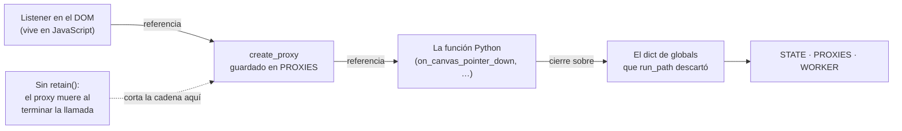
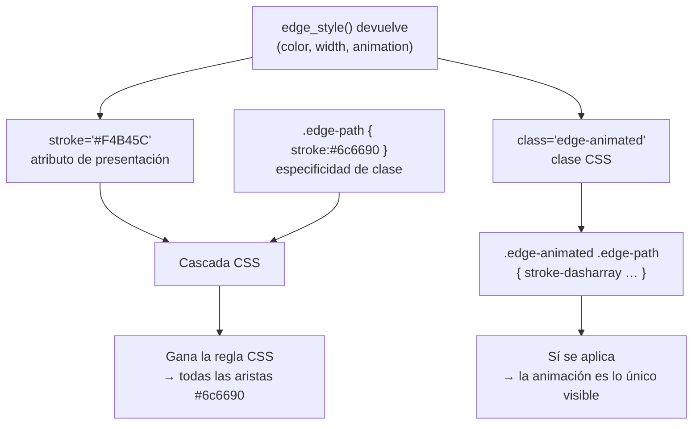
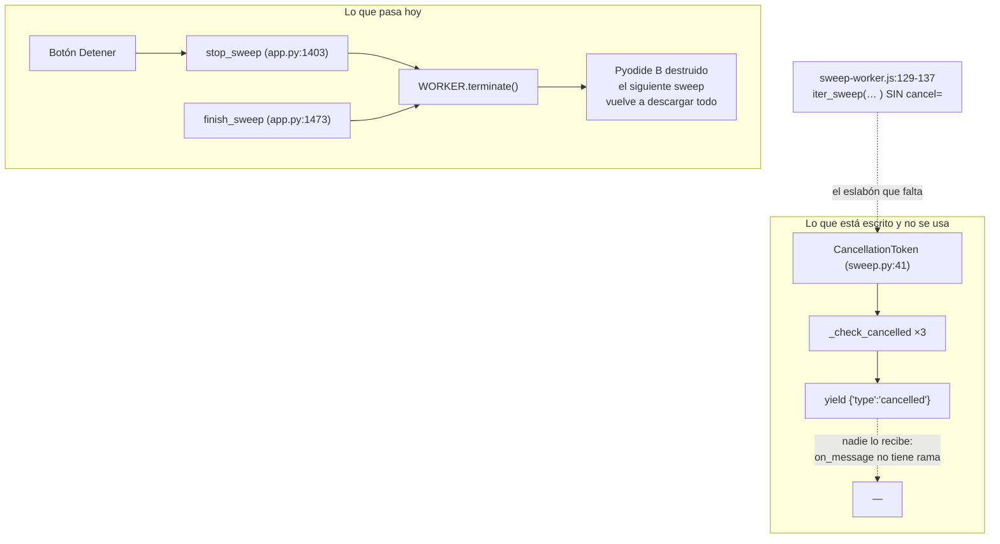
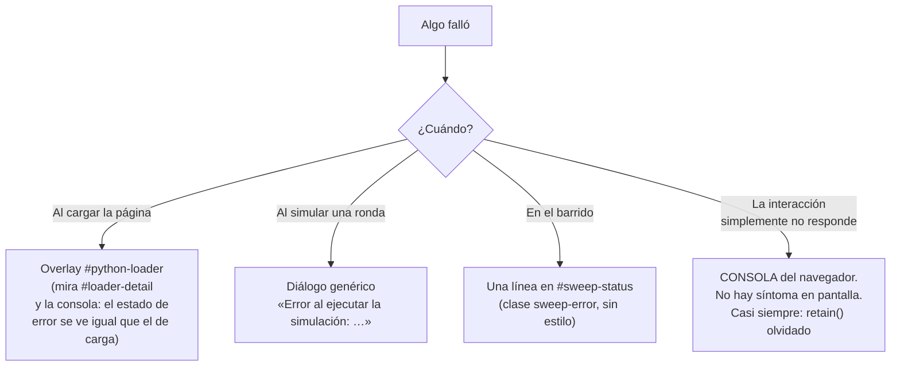

# 09 — Invariantes y deuda conocida: la página a la que se vuelve

> **Archivos que cubre:** todos. Esta sección no explica ningún módulo: recoge, en una sola lista, lo que no se toca (`js/bootstrap.js`, `js/sweep-worker.js`, `.nojekyll`, `scripts/equivalencia_baseline.json`, `python/models.py`, `python/simulation/sweep.py`, `python/app.py`), lo que se decidió a propósito y lo que está roto y se sabe.
> **Qué puedes cambiar aquí:** nada de código. Este archivo es el índice del riesgo. Lo que cambia aquí es el documento: cuando arregles una deuda de §C, bórrala de §C; cuando tomes una decisión nueva, añádela a §B.
> **Qué es intocable y por qué:** las once entradas de §A. Cada una tiene un mecanismo concreto detrás y una forma concreta de fallar; ninguna es una preferencia de estilo.
> **Cómo verificas el cambio:** `python3 scripts/equivalencia.py` (debe imprimir `OK — 1026 casos idénticos a la línea base.`) y `python3 scripts/smoke_ui.py`. Y para todo lo de §C, que es visual: `python3 scripts/serve.py` y mirar `http://localhost:8000` en un navegador real.

Las otras ocho secciones te enseñan cómo funciona el sistema. Esta te dice qué
pasa si lo cambias. Está escrita para el día en que ya no estés leyendo el mapa
de principio a fin, sino buscando una respuesta concreta con la página abierta y
algo roto.

**Las tres marcas.** Toda la documentación de este proyecto etiqueta sus
advertencias con una de estas tres, y la diferencia importa más que el contenido:

| Marca | Qué significa | Qué haces con ella |
|---|---|---|
| **INVARIANTE** | Romperlo rompe el sistema. No hay debate. | Lo respetas. Si crees que debe cambiar, cambias el diseño alrededor primero. |
| **DECISIÓN DELIBERADA** | Se eligió así por un motivo, y el motivo está escrito. | Lees el motivo. Si la condición de revisión se cumple, lo revisas. Si no, lo dejas. |
| **DEUDA CONOCIDA** | Está mal y se sabe. | Lo puedes arreglar. Lee antes cuál es el efecto de arreglarlo: algunas deudas tienen un arnés detrás. |

Sin la marca, el lector no distingue lo sagrado de lo simplemente roto, y acaba
haciendo las dos cosas equivocadas a la vez: «arreglar» una decisión y respetar
un bug creyéndolo contrato.

---

## A. Lista negra: qué no debo tocar

> **Archivos que cubre:** `scripts/equivalencia_baseline.json`, `python/models.py`, `js/bootstrap.js`, `js/sweep-worker.js`, `.nojekyll`, `python/app.py`, `python/simulation/engine.py`, `python/simulation/sweep.py`, `python/simulation/registry.py`.
> **Qué puedes cambiar aquí:** nada de esta lista sin un plan explícito y una verificación antes y después.
> **Qué es intocable y por qué:** las trece entradas de abajo; cada una lleva su mecanismo de fallo.
> **Cómo verificas el cambio:** `python3 scripts/equivalencia.py` antes de tocar y otra vez después. Los números deben coincidir: `OK — 1026 casos idénticos a la línea base.`

### A.1 · `scripts/equivalencia_baseline.json` y la regla de `--grabar`

**INVARIANTE.** La línea base contiene **1026 casos** y es el único registro que
existe de cómo se comportaba el motor numérico antes de tu cambio. No hay suite
de tests (ver §B.3): esto es toda la red.

El peligro no es el archivo, es el flag. `--grabar` **no verifica nada**: ejecuta
el motor tal como esté en ese momento y declara que su salida es la verdad. Si el
motor está roto, `--grabar` congela la rotura, y a partir de ahí el arnés
*defiende* el bug — dirá OK para siempre sobre un resultado incorrecto. El script
imprime un `AVISO` cuando el archivo ya existe y difiere de la captura
(`equivalencia.py:446-454`) y **sobrescribe igual**. La única defensa es la
disciplina.

Las reglas de trabajo del proyecto lo elevan a regla de trabajo: **ningún subagente ejecuta
`scripts/equivalencia.py --grabar`.** Regrabar la línea base es una decisión de
quien mantiene el proyecto, no un paso de una tarea delegada.

Hay **una** regrabación legítima y conviene saber reconocerla: cuando el cambio
**agrega claves nuevas sin alterar las viejas**. El caso típico es añadir un
algoritmo a la tupla `ALGORITMOS` de `scripts/equivalencia.py:187` (ver §A.10):
la captura nueva contiene los 1026 casos anteriores idénticos más los del
algoritmo nuevo. Si al regrabar cambia aunque sea un caso viejo, no estabas
extendiendo la línea base: estabas tapando una regresión.

### A.2 · El contrato JSON del grafo

**INVARIANTE.** El JSON que entra y sale de este proyecto es **idéntico** al del
proyecto de referencia (FastAPI + React). Un archivo de `back/examples/` de aquel
proyecto se importa aquí sin adaptar, y el arnés `scripts/equivalencia.py`
compara grafos asumiendo esa forma. Cambiar el contrato desconecta las dos cosas
a la vez.

La forma exacta vive en `python/models.py`:

```python
Node.to_json()          # models.py:28   -> {"id", "value", "position": {"x", "y"}}
Edge.to_json(index)     # models.py:54   -> {"id", "source", "target", "weight"}
```

Cuatro detalles del contrato que parecen errores y no lo son:

- **`weight` es string y `value` es número.** `Edge.from_json` fuerza
  `str(weight)` (`models.py:51`); `Node.from_json` (`models.py:18-27`) deja
  `value` como venga. La asimetría es del formato original.
- **El `id` de arista se fabrica desde la posición en la lista**, no desde el `id`
  en memoria: `f"edge_{index}"`. Las aristas creadas en el editor llevan
  `edge_local_{...}` y ese id **desaparece al exportar**. Nunca guardes nada
  indexado por id de arista fuera de la sesión.
- **`Edge.highlight` no está en `to_json`, y eso es carga útil del contrato.**
  Está declarado en la dataclass (`models.py:42`) y se queda fuera del JSON a
  propósito: es estado de visualización de una ronda, no parte del grafo. Si
  alguien lo agrega «para ser consistente», el JSON exportado deja de ser
  idéntico al de referencia.
- **`position` es un objeto anidado**, no dos campos sueltos, y `x`/`y` son la
  **esquina superior izquierda** del círculo de 60×60, no su centro (§C, tabla).

### A.3 · Las dos listas manuales de `.py` en los `.js`

**INVARIANTE.** No hay build, no hay empaquetador y un servidor estático no
publica un índice de directorio. La única forma que tienen los dos runtimes de
saber qué archivos Python existen es una **lista escrita a mano**, y hay dos:

| Lista | Archivo | Cuántos | Para qué runtime |
|---|---|---|---|
| `PYTHON_FILES` | `js/bootstrap.js:4-16` | **10** archivos | El hilo principal: la aplicación completa |
| `SWEEP_FILES` | `js/sweep-worker.js:4-13` | **7** archivos | El Web Worker: sólo `python/simulation/` |

Un `.py` nuevo hay que agregarlo **a las dos**. Y los dos olvidos fallan de forma
opuesta:

- Olvidarlo en `PYTHON_FILES` falla **ruidosamente**: la app no arranca, se queda
  en el overlay.
- Olvidarlo en `SWEEP_FILES` falla **en silencio**: el editor funciona perfecto y
  el error sólo aparece como una línea en `#sweep-status` el día que alguien
  pulsa «Ejecutar sweep».

Que `SWEEP_FILES` tenga 6 y no 9 es además un candado arquitectónico
deliberado — ver §B.8.

### A.4 · La versión fijada de Pyodide, en los cuatro sitios

**INVARIANTE.** `v314.0.2` está escrita **cuatro veces**:

```
js/bootstrap.js:1      import { loadPyodide } from ".../pyodide/v314.0.2/full/pyodide.mjs";
js/bootstrap.js:3      const PYODIDE_INDEX_URL = ".../pyodide/v314.0.2/full/";
js/sweep-worker.js:1   import { loadPyodide } from ".../pyodide/v314.0.2/full/pyodide.mjs";
js/sweep-worker.js:3   const PYODIDE_INDEX_URL = ".../pyodide/v314.0.2/full/";
```

Dentro de cada archivo, el `import` y el `indexURL` tienen que coincidir o el
módulo carga una versión y descarga los `.wasm` de otra. Entre archivos, si
actualizas sólo dos, los dos runtimes de la aplicación quedan en versiones
distintas de Python y de NumPy — y el síntoma aparece únicamente en el sweep,
donde vive el segundo. Actualizar Pyodide es cambiar **cuatro literales**, no dos.

### A.5 · `.nojekyll`

**INVARIANTE.** Es un archivo de **0 bytes en la raíz** y es infraestructura
crítica.

GitHub Pages, sin él, procesa el sitio con Jekyll, y **Jekyll excluye del sitio
publicado todo archivo o directorio que empiece con guion bajo**. En este
proyecto eso significa `python/simulation/__init__.py`. El fallo es de los peores
que existen: **local funciona perfecto** (`scripts/serve.py` sirve el
sistema de archivos tal cual) y **producción da 404** en un solo archivo, con la
página congelada en el overlay de carga. Si borras `.nojekyll` no te enteras
hasta el despliegue, y una vez en el despliegue el síntoma no apunta a él.

### A.6 · `retain()` en todo callback que cruce a JavaScript

**INVARIANTE**, y probablemente el más importante del proyecto.

```python
# python/app.py:70
def retain(callback: Callable): ...

# python/app.py:76-77
def listen(target, event_name: str, callback: Callable) -> None:
    target.addEventListener(event_name, retain(callback))
```

Pyodide crea un proxy automático cuando pasas una función Python a JavaScript, y
lo **destruye al terminar la llamada**. Si el callback se guarda para más tarde —
un listener, un `setTimeout`, un `.then()`— el proxy ya no existe cuando se
dispara. `retain()` guarda el `create_proxy` en la lista global `PROXIES`
(`app.py:22`) para que sobreviva.

El fallo es el peor posible para depurar: **la interacción deja de responder sin
ningún síntoma en pantalla**. No hay diálogo, no hay mensaje, no hay cambio de
color. El error va a la consola del navegador y a ningún otro sitio.

Y va más lejos que los eventos. `js/bootstrap.js` arranca la app con
`runpy.run_path(..., run_name="__main__")`, que **descarta el diccionario de
globals al terminar**. Todo el estado de la aplicación —`STATE`, `PROXIES`,
`WORKER`— sobrevive únicamente porque los listeners del DOM sostienen los
proxies, que sostienen las funciones Python, que sostienen ese diccionario.
`retain()` no es sólo para que el botón responda: **es lo que mantiene viva a la
aplicación entera**.



Aplica a **todo** lo que cruza la frontera: `addEventListener` (`app.py:76-77` y
las 40 llamadas a `listen()` de `bind_events`, `app.py:1483-1525`), `setTimeout`
(`app.py:1033`), el `.then()` de una promesa (`app.py:1079`) y los handlers del Web
Worker (`app.py:1468-1469`).

Y un aviso sobre la verificación: **`scripts/smoke_ui.py` no puede detectar un
`retain()` olvidado**, porque su doble sustituye `create_proxy` por la función
identidad (`smoke_ui.py:172`). El único detector es abrir la página en un
navegador real y probar la interacción.

### A.7 · Las dos orientaciones de la matriz

**INVARIANTE.** Este proyecto usa tres arreglos con **dos convenciones de índices
distintas**, y la asimetría es intencional y heredada del backend original:

| Arreglo | Orientación | Dónde |
|---|---|---|
| Adyacencia / probabilidades | `matrix[source, target]` | `engine.py:65` |
| Mensajes, versión escalar | `messages[target, source]` | `engine.py:114` — hay un `.T` explícito |
| Mensajes, versión batched | `fired[s, source, target]` | `sweep.py:111` — **sin** transponer |

```python
# python/simulation/engine.py:114  (escalar: transpone)
messages = (matrix > probabilities).astype(int).T

# python/simulation/sweep.py:111   (batched: NO transpone)
return matrix > probabilities
```

Por qué es un invariante y no una curiosidad: un algoritmo batched nuevo escrito
con el eje invertido **pasa todas las pruebas en grafos no dirigidos**, porque
ahí `fired[s]` es simétrica (`get_adj` espeja los pesos en `engine.py:65` y
`who_gets_message_batch` fuerza la simetría en `sweep.py:109-110`). Produce
resultados silenciosamente incorrectos **sólo en grafos dirigidos**, que es
exactamente donde nadie mira primero. Es el error más fácil de cometer y el más
difícil de encontrar en todo el proyecto. La explicación canónica está en
**§04**; aquí sólo se conserva la regla.

### A.8 · La clave `"fv"`

**INVARIANTE.** Agregar algoritmos es libre. **Renombrar o eliminar la clave
`"fv"` impide que la aplicación arranque.** Está cableada como valor por omisión
en ocho sitios:

```
python/models.py:94             algorithm: str = "fv"
python/simulation/engine.py:183, 312, 354, 432
python/simulation/sweep.py:313, 418, 456
```

`algorithm_params()` (la llamada real está en `app.py:174`) llama a `registry.get("fv")` durante el primer
`render_all()`. Si la clave no existe, la excepción sube antes de que se dibuje
nada y la página se queda en el overlay.

### A.9 · Los textos de error de `registry.batch_of`

**INVARIANTE.** Los dos mensajes de `registry.batch_of` (`registry.py:102-107`) no
son texto: son **comportamiento observable congelado** en la línea base, en los
casos `sweep_algoritmo_sin_version_vectorizada` y
`batch_algoritmo_sin_version_vectorizada` (`equivalencia.py:363-368`). Cambiar
una coma rompe el arnés.

Distinguen dos situaciones que antes se confundían: que el algoritmo **no exista**
y que exista pero **no tenga versión vectorizada**. La segunda es normal —`batch`
es opcional— y el mensaje se molesta en aclarar que el algoritmo sí funciona en el
editor. Ese matiz es la razón de que los mensajes estén congelados.

### A.10 · `ALGORITMOS` en `scripts/equivalencia.py:187`

**INVARIANTE.** Contiene qué algoritmos captura el arnés:

```python
# scripts/equivalencia.py:187
ALGORITMOS = ("fv", "amp")
```

Es la excepción exacta a la regla de **§06** («para agregar un algoritmo editas un
solo archivo, `python/simulation/algorithms.py`»). Esa regla es cierta **para el
producto**: con editar `algorithms.py` el algoritmo aparece en el selector,
recibe sus campos de parámetros y corre en el editor y en el sweep, sin tocar
`engine.py`, `sweep.py`, `app.py`, `index.html` ni ningún `.js`.

Pero **el arnés no lo cubrirá**. Ninguno de los 1026 casos lo ejercita, y
`equivalencia.py` seguirá imprimiendo `OK` aunque el algoritmo nuevo esté mal. El
trabajo completo son **dos archivos**:

1. `python/simulation/algorithms.py` — el algoritmo.
2. `scripts/equivalencia.py:187` — agregar su clave a `ALGORITMOS`, y regrabar la
   línea base (regrabación legítima según §A.1: agrega claves nuevas sin alterar
   las viejas).

Quien siga la regla al pie de la letra entregará un algoritmo sin red de
seguridad **creyendo que la tiene**.

### A.11 · El `# noqa: F401` de `engine.py:28`

**INVARIANTE** por precaución, no por mecanismo actual.

```python
# python/simulation/engine.py:28
from .algorithms import amp, amp_updated, fv, fv_updated  # noqa: F401 (re-export)
```

Parece un import muerto y un linter te invitará a borrarlo. Es una
**re-exportación por compatibilidad**: código que hace `from simulation.engine
import fv` sigue funcionando. Hoy borrarlo no rompe el despacho —`ALGORITHMS` es
una vista viva sobre el registro, no una copia—, pero el `noqa` está ahí para que
quien refactorice sepa que la línea tiene una razón, y la razón no es el registro.

---

### A.12 · El motor no se ejecuta en el hilo principal

**INVARIANTE.** `python/app.py` no importa nada de `simulation.engine` ni de
`simulation.sweep`. Las dos entradas al motor viven dentro del Worker:

```python
# js/sweep-worker.js:100  — la ronda del editor
from simulation.engine import run_round

# js/sweep-worker.js:126 — el barrido
from simulation.sweep import iter_sweep
```

**Motivo.** Tres cosas que el hilo principal no puede dar:

1. **Se puede matar.** Un algoritmo que no termina congelaba la pestaña sin
   remedio. Desde el Worker se le pone un plazo y se llama a `terminate()`.
2. **No hay `document`.** Un Worker no tiene DOM, así que el día que el editor
   acepte código escrito por quien lo use, ese código no tendrá la página al
   alcance. El aislamiento lo da el entorno, no una lista de permisos.
3. **Un solo camino.** Editor y barrido despachan por `registry.get(clave)`
   dentro del mismo runtime. Dos rutas para lo mismo divergen tarde o temprano.

**Consecuencia que sorprende.** `simulate` (`app.py:1122`) termina **antes** de
que exista el resultado: manda el mensaje y devuelve. Lo que antes seguía en la
misma función vive en `apply_round` (`app.py:1168`), y `before` —que era una
variable local sostenida por la pila— tuvo que mudarse a `STATE.round_before`
(`models.py:121`). Toda espera convierte una local en estado.

**El precio, y cómo se paga.** El Worker carga **su propio** Pyodide y NumPy, y
eso tarda. `start_engine_worker` lo arranca al cargar la página, no al primer
clic, para adelantar la espera; aun así, quien pulsa «Simular» en los primeros
segundos espera ~15 s. No hace falta encolar nada a mano: el manejador del Worker
hace `await runtimePromise` antes de atender el mensaje, así que la petición
espera ahí dentro. Lo que sí hace falta es **decirlo**: el Worker avisa con un
mensaje `listo` (`js/sweep-worker.js:57`), y hasta que llega el botón dice
*«Cargando motor…»* en vez de *«Simulando…»* (`app.py:574-579`). Sin ese aviso,
una espera larga pero normal se ve idéntica a una aplicación colgada.

**Cuándo revisarlo.** Nunca por comodidad. Si algo parece necesitar el motor en
el hilo principal, lo que falta es un mensaje nuevo en el Worker.

**Cómo lo compruebas.** `PYTHONDONTWRITEBYTECODE=1 python3 scripts/smoke_ui.py`
—sección 7— manda una ronda, la contesta con un Worker de mentira y verifica que
el botón se bloquee y se desbloquee, incluso por la ruta de error.

### A.13 · La clave `user_alg` es única y se fuerza

**INVARIANTE.** El código que alguien pega en la aplicación queda **siempre** en
`registry.CLAVE_USUARIO` (`"user_alg"`), pase lo que pase con el `key=` que haya
escrito. Lo fuerza `usuario.instalar`, en un solo sitio:

```python
# python/simulation/usuario.py — al final de instalar()
instalado = AlgorithmSpec(key=CLAVE, label=spec.label, ...)
registry.REGISTRY[CLAVE] = instalado
```

**Motivo.** Con una ranura única no hay colisiones que resolver, ni claves de
usuario que limpiar, ni forma de que un algoritmo pegado tape a `fv` o a `amp`.
Un `register(AlgorithmSpec(key="fv", ...))` en el código pegado no hace nada
peligroso: acaba en la ranura, y `fv` sigue siendo el de casa.

Y resuelve algo que de otro modo sería un estorbo diario: `register` rechaza
claves repetidas a propósito (§A.6 del registro), y el ciclo natural del código
pegado es **pegar, ver, corregir y volver a pegar**. Esa severidad se conserva
para los algoritmos del proyecto; la ranura se reemplaza, y sólo ella.

**Consecuencia que sorprende.** La ranura se vacía **antes** de ejecutar el
fuente, no después. Si el código falla, no queda instalado lo anterior: vale más
un «algoritmo desconocido» ruidoso que correr en silencio la versión previa
haciéndose pasar por la recién pegada.

**La etiqueta sí se respeta.** Es lo que aparece en los mensajes de error del
barrido —«El algoritmo 'user_alg' (tu etiqueta) no tiene version vectorizada»—,
así que forzarla también habría empeorado el diagnóstico sin ganar nada.

**Cómo lo compruebas.** `PYTHONDONTWRITEBYTECODE=1 python3 scripts/smoke_ui.py`
—sección 8— instala código que pide la clave `fv` y verifica que acabe en la
ranura y que `fv` conserve su algoritmo.

## B. Decisiones deliberadas

> **Archivos que cubre:** `js/bootstrap.js`, `js/sweep-worker.js`, `python/app.py`, `python/simulation/sweep.py`, `.github/workflows/pages.yml`, las reglas de trabajo del proyecto.
> **Qué puedes cambiar aquí:** cualquiera de estas decisiones, si se cumple su condición de revisión. Ninguna es un invariante.
> **Qué es intocable y por qué:** el motivo. Si vas a revertir una decisión, revierte también el problema que resolvía, o volverá.
> **Cómo verificas el cambio:** depende de la decisión; cada entrada dice cuál. Para B.5 y B.8: `python3 scripts/equivalencia.py`.

Formato: **decisión → motivo → cuándo convendría revisarla.**

### B.1 · Pyodide directo, no PyScript

**DECISIÓN DELIBERADA.** `js/bootstrap.js` llama a `loadPyodide()` y monta los
archivos a mano en el sistema de archivos virtual (`pyodide.FS.writeFile`), en
lugar de usar PyScript.

**Motivo.** El proyecto necesita tres cosas que PyScript no expone o expone
peor: (a) **dos runtimes independientes** —uno en el hilo principal y otro dentro
de un Web Worker (`js/sweep-worker.js`), con listas de archivos distintas y ciclos
de vida distintos, incluido destruir el del Worker con `terminate()`; (b) control
explícito de **cuándo** arranca Python y de **cómo** se ejecuta la app
(`runpy.run_path(..., run_name="__main__")`, más la inserción manual de `/python`
en `sys.path` en `bootstrap.js:72-73`); (c) manejo directo del ciclo de vida de
los proxies (`create_proxy` / `retain()`, §A.6), que es el mecanismo del que
depende que la aplicación siga viva. PyScript es una capa sobre Pyodide con su
propio ciclo de vida encima; aquí esa capa se interpondría justo en los tres
puntos que hay que controlar.

**Cuándo revisarla.** Si PyScript llega a ofrecer control de primera clase sobre
Workers con runtimes separados, o si el proyecto deja de necesitar el segundo
runtime. Mientras la arquitectura sea «dos Pyodide con listas de archivos
distintas», la capa extra sólo añade superficie.

### B.2 · SVG escrito a mano, no ReactFlow ni Recharts

**DECISIÓN DELIBERADA.** El canvas del grafo, el minimapa y la gráfica del sweep
se generan como cadenas de SVG desde Python (`render_canvas`, `app.py:299`;
`render_minimap`, `app.py:354`; `render_chart`, `app.py:490`).

**Motivo.** El proyecto **no tiene build**: se publica el repositorio tal cual y
Pyodide descarga los `.py` con `fetch()`. Meter ReactFlow o Recharts significa
meter npm, un empaquetador, un paso de compilación y un artefacto que ya no es
el código fuente — y con ello desaparece la propiedad que hace que este proyecto
sea mantenible por una persona: **lo que se publica es lo que se lee**. Además
las tres vistas son deliberadamente modestas (círculos, curvas de Bézier, una
línea con banda de confianza); el coste de escribirlas a mano es bajo y el
control sobre el marcado es total.

**Cuándo revisarla.** Si la interfaz necesita layout automático de grafos,
virtualización para miles de nodos o interacciones que hoy no existen (selección
por lazo, edición en línea). El primer síntoma real de que ese momento llegó está
documentado como deuda: `render_canvas` es O(N + E²) y el arrastre empieza a
saltar con varios cientos de aristas (§C.13).

### B.3 · No portar la suite de tests del original

**DECISIÓN DELIBERADA**, y además una regla escrita del proyecto la prohíben
expresamente. En su lugar hay **dos scripts**: `scripts/equivalencia.py` (1026
casos contra una línea base grabada) y `scripts/smoke_ui.py`.

**Motivo.** La suite del original prueba un backend FastAPI: endpoints, request
models de Pydantic, serialización HTTP. Aquí no hay ninguna de esas tres cosas.
Portarla habría significado traducir pruebas de una arquitectura que ya no existe
y quedarse con la ilusión de cobertura. El arnés de equivalencia ataca el
problema real de este proyecto —**que el motor numérico dé exactamente lo mismo
que antes del cambio**— sin necesitar dependencias de test ni describir la forma
interna del código.

**Cuándo revisarla.** Cuando el proyecto tenga lógica propia que no sea un port
del original y que no se pueda expresar como «la salida no cambió»: por ejemplo,
un algoritmo nuevo cuya corrección haya que argumentar en vez de congelar. Ahí
unos tests unitarios de verdad valdrían más que ampliar la línea base.

### B.4 · Regenerar el SVG entero en vez de parchearlo

**DECISIÓN DELIBERADA.** `render_canvas` reemplaza el `innerHTML` **completo** de
las capas en cada dibujado (`app.py:336-337`, `:282`). No se actualizan atributos
de nodos existentes: se tira todo y se vuelve a escribir.

**Motivo.** Un renderizador que parchea necesita saber qué cambió, y eso es un
diff, y un diff es un reconciliador — es decir, reimplementar el trabajo que hace
React, en Python, dentro de Pyodide. Con regeneración total el estado tiene una
sola fuente de verdad (`STATE`) y el DOM es desechable: **es imposible que la
pantalla y el estado se desincronicen por un caso que el diff no cubrió**.

**Consecuencia que hay que conocer.** Cualquier atributo, clase o nodo añadido al
DOM a mano desaparece en el siguiente `render_all()`. Y al revés: un handler que
muta `STATE` sin llamar a `render_all()` / `render_canvas()` deja el estado
correcto y **la pantalla mintiendo**, sin ningún error. De aquí salen tres cosas
que parecen arbitrarias y no lo son: la delegación de eventos en contenedores
estáticos, la captura de puntero sobre el `<svg>` y no sobre el `<g>` del nodo, y
el umbral de 6 px de `app.py:761` (regenerar entre los dos clics de un doble clic
destruye el elemento y el navegador deja de emitir `dblclick`). También la guarda
`data-algorithm` de `app.py:238`, que evita regenerar `#algorithm-params` y
quitarle el foco a quien está escribiendo.

**Cuándo revisarla.** Cuando el perfil diga que el cuello de botella es el
`innerHTML` y no `has_reverse`. Hoy no lo es (§C.13).

### B.5 · El truncamiento del reparto en el sweep

**DECISIÓN DELIBERADA**, y es una **divergencia consciente del backend original**.

```python
# python/simulation/sweep.py:289-299
simulations_per_iteration = max(1, total_simulations_per_p // iterations)
# ...
iterations = min(iterations, total_simulations_per_p // simulations_per_iteration)
```

**Motivo.** El `max(1, ...)` redondea el tamaño del lote hacia arriba cuando se
piden menos simulaciones que iteraciones. En el backend original eso hacía que se
corrieran **más** simulaciones de las pedidas: pedir 10 con 50 iteraciones corría
50. La segunda línea recorta las iteraciones para que **el total solicitado nunca
se exceda**. Pedir 7 con 3 iteraciones corre **6**: no 7 y desde luego no 21.

**Está congelado en el arnés.** Los 10 casos `reparto/` de la línea base lo
defienden, y el caso `reparto/total7/iter3` congela exactamente ese 6. Quien
«arregle» el truncamiento por parecer un bug romperá los diez y estará
deshaciendo esta decisión sin saberlo.

**Cuándo revisarla.** Si alguien argumenta que el comportamiento correcto es
redondear hacia arriba el total en vez de recortar las iteraciones. Es una
discusión legítima; sólo hay que tenerla a propósito, regrabar la línea base con
justificación y actualizar este párrafo.

### B.6 · Publicar el repositorio completo

**DECISIÓN DELIBERADA.** `.github/workflows/pages.yml` empaqueta con
`upload-pages-artifact` y `path: .` — es decir, **el repositorio entero** se
publica en `https://simulador.ruee.dev/`.

**Motivo.** No hay build. El sitio *es* el repositorio: los `.py` se sirven como
archivos estáticos y Pyodide los descarga con `fetch()`. Empaquetar
selectivamente exigiría una lista de exclusión, y una lista de exclusión es
exactamente el tipo de configuración que se desincroniza en silencio (ya hay dos
listas manuales de archivos en §A.3; una tercera no mejora nada).

**Lo que eso implica, dicho explícitamente.** Quedan públicamente descargables:
`scripts/` (incluido `equivalencia_baseline.json`), `docs/` y `README.md`.
Lo que no está versionado no llega al sitio: el artefacto se arma desde el
checkout de git.
credenciales ni datos— así que la superficie se acepta.

**Cuándo revisarla.** El día que el repositorio contenga algo que no deba ser
descargable: una clave, un dato de una persona, material con licencia
restringida. En ese momento, lista de exclusión o repositorio separado para el
sitio.

### B.7 · El job `publicar` no depende de `verificar`

**DECISIÓN DELIBERADA**, con la condición de revisión escrita en el propio
archivo (`pages.yml`, comentario sobre `publicar`). El CI corre los dos scripts
en cada push a `main`, pero **informa; no bloquea la publicación**: un arnés en
rojo publica igual.

**Motivo.** La línea base compara **flotantes exactos**, se grabó en **macOS
arm64**, y el CI corre en **Linux x86-64**. Las reducciones vectorizadas de NumPy
pueden asociar las sumas en distinto orden según el SIMD disponible, y ahí caen
justo la varianza y el IC95 de `SweepAccumulator.points` que van en los casos
`iter_sweep/`. Hasta que no se confirme que las dos plataformas dan idéntico,
poner `needs: verificar` convertiría un falso positivo de plataforma en un bloqueo
de despliegue.

**Cuándo revisarla.** En cuanto alguien confirme que un checkout limpio en Linux
x86-64 con Python 3.12 y NumPy 2.4.5 da `OK — 1026 casos`. Ese día se agrega
`needs: verificar` y el CI pasa de informar a bloquear. Es la mejora pendiente de
mayor valor por menor esfuerzo en todo el proyecto.

### B.8 · `SWEEP_FILES` con 7 archivos y no 10

**DECISIÓN DELIBERADA.** El Worker monta sólo `python/simulation/` (7 archivos);
`app.py`, `models.py` y `geometry.py` se quedan fuera.

**Motivo.** No es una optimización de tamaño: es un **candado arquitectónico**.
`python/simulation/` debe ser un motor numérico puro, sin dependencias de la capa
de interfaz. Si algún día alguien importara `models` o `geometry` desde ahí, el
Worker no arrancaría: `ModuleNotFoundError`. La lista corta convierte una
violación de capas en un fallo detectable.

El candado se apretó cuando la ronda del editor se mudó al Worker (§A.12): antes,
una violación así mataba **sólo el sweep** y el editor seguía andando con sus 9
archivos. Hoy se lleva las dos cosas, así que aparece al primer clic en «Simular»
en vez de esconderse hasta que alguien abra el análisis de convergencia.

**Cuándo revisarla.** Nunca por comodidad. Si el sweep necesita algo de
`models.py`, la respuesta correcta es mover ese algo a `simulation/`, no ampliar
la lista.

### B.9 · El evento `cancelled` no lleva `points`

**DECISIÓN DELIBERADA**, sobre una ruta que hoy no se ejecuta (§C.4).

**Motivo.** Si la cancelación ocurre a mitad del bucle de `p`, los bins ya
procesados tienen sumas extra pero `simulations_per_p` todavía no avanzó
(`add()` no incrementa el contador; `finish_iteration()` sí). Emitir `points()`
en ese estado dibujaría una curva **sesgada en la mitad izquierda**, que es peor
que no dibujar nada: parece un resultado.

**Cuándo revisarla.** Cuando se cablee la cancelación de verdad (§C.4). Ahí habrá
que decidir si se emite la última curva *consistente* en vez de ninguna.

### B.10 · `np.ceil` sobre la matriz de pesos

**DECISIÓN DELIBERADA** por fidelidad al original (`engine.py:107`).

**Motivo.** Es el comportamiento del backend de referencia y el arnés lo congela.
Tiene una consecuencia contraintuitiva que hay que conocer: `P(disparo) =
w / ceil(w)`, así que un peso **1.5 dispara con probabilidad 0.75**, *menos* que
un peso 1.0. La probabilidad **no es monótona en el peso**, y los pesos negativos
nunca disparan. El editor valida el rango (0, 1] (`app.py:880`), donde la rareza
no se manifiesta; la **importación de JSON no valida** (`app.py:1049`), así que un
archivo externo sí puede meter un peso fuera de rango.

**Cuándo revisarla.** Sólo junto con el proyecto de referencia, o el arnés deja de
significar «equivalente al original». El grafo de prueba `pesos_fuera_de_rango`
existe precisamente para defender esta línea: `np.ceil(matrix)` parece
simplificable a `matrix > 0` y no lo es.

### B.11 · `ParamSpec.label` se inserta sin escapar

**DECISIÓN DELIBERADA**, y conviene saberlo porque parece exactamente un bug de
inyección HTML.

Hay una asimetría real en `render_algorithm_params`:

```python
# python/app.py:184  — AlgorithmSpec.label SÍ se escapa
f'<option value="{html.escape(spec.key)}">{html.escape(spec.label)}</option>'

# python/app.py:244  — ParamSpec.label NO se escapa
f'<label class="field-label" for="param-{html.escape(param.name)}">{param.label}</label>'
```

**Motivo**, escrito en el docstring de la propia función (`app.py:229-236`): las
etiquetas de parámetro se insertan como HTML **a propósito** para poder usar
`<code>` en ellas. La fuente de ese texto es `python/simulation/algorithms.py`,
que es **código del proyecto**, no entrada de usuario: no cruza ninguna frontera
de confianza. La etiqueta del algoritmo, en cambio, va dentro de un `<option>`,
donde el marcado no se renderiza de todas formas.

**Consecuencia práctica.** Un `<code>` funciona en el `label` de un `ParamSpec` y
se ve **literal** en el de un `AlgorithmSpec`. No es un descuido: son dos
contextos distintos.

**Cuándo revisarla.** El día que un `label` pueda venir de fuera del repositorio
—un algoritmo cargado en caliente, un plugin, un parámetro definido por el
usuario—. Ahí deja de ser código del proyecto y hay que escaparlo.

---

## C. Deuda conocida

> **Archivos que cubre:** `css/app.css` (citado **por selector**, nunca por línea), `python/app.py`, `python/simulation/sweep.py`, `python/models.py`, `index.html`.
> **Qué puedes cambiar aquí:** todo. Nada de esta sección es sagrado; está mal y se sabe.
> **Qué es intocable y por qué:** nada, pero lee la columna «¿seguro arreglarlo?» antes: cuatro de estas deudas están enredadas con el arnés o con una decisión de §B.
> **Cómo verificas el cambio:** casi toda esta sección es visual — `python3 scripts/serve.py`, abrir `http://localhost:8000` y mirar. Si el cambio toca `python/simulation/`, además `python3 scripts/equivalencia.py`.

> **Nota sobre `css/app.css`:** ese archivo tiene las reglas comprimidas en líneas
> gigantes —una sola línea contiene todas las reglas de aristas, nodos, minimapa y
> etiquetas—, así que aquí se cita **siempre por selector**. Buscar `.edge-path`
> funciona; buscar «la línea 69» no dice nada.

### C.1 · El color de las aristas no se ve (y nunca se vio)

**DEUDA CONOCIDA.** Es la deuda más visible del proyecto y la que más tiempo hace
perder, porque el código *parece* correcto en los dos lados.

**Síntoma visible.** Después de pulsar «Simular», **todas las aristas siguen
pintadas igual**: `#6c6690`, grosor 3. Los cuatro estados que `edge_style()`
calcula —`updated` (naranja `#F4B45C`), `delivered` (morado `#7A6E9E`), `quiet`
(`#413A5E` fino) y `selected` (`#6E7CF2`)— **no se distinguen en pantalla**. Lo
único que sí cambia es la **animación de guiones** en las aristas que
transmitieron.

**Causa.** `render_canvas` escribe el color y el grosor como **atributos de
presentación** en el `<path>`:

```python
# python/app.py:319-320
f'<path class="edge-path" d="{geometry["path"]}" fill="none" stroke="{color}" '
f'stroke-width="{width}"{marker}></path>'
```

Los atributos de presentación de SVG tienen **especificidad 0** en la cascada CSS:
cualquier regla del hoja de estilos les gana. Y existe
`.edge-path { fill: none; stroke: #6c6690; stroke-linecap: round; stroke-width: 3 }`.
Resultado: la regla gana **siempre**, para las cuatro ramas de `edge_style()`.

La animación sí funciona porque llega por **clase** (`edge-animated`, tercer
elemento de la tupla que devuelve `edge_style`), y la regla
`.edge-animated .edge-path` sí compite en la cascada.



**Archivo.** `python/app.py:319-320` (emisión) y el selector `.edge-path` de
`css/app.css` (regla que gana).

**¿Es seguro arreglarlo?** **Sí, y es la deuda con mejor relación
esfuerzo/beneficio del proyecto.** No es una regresión del refactor: se verificó
también contra el respaldo previo y estaba idéntico. Sólo afecta a la
presentación —ningún resultado numérico depende de esto— así que el arnés no
tiene nada que decir. El arreglo correcto es **emitir clases en vez de atributos**
(ver C.2, que es la otra mitad exacta del mismo problema).

### C.2 · Las reglas `.is-updated` / `.is-delivered` / `.is-idle` / `.is-selected` están muertas

**DEUDA CONOCIDA.** Es el complemento de C.1 y hay que arreglar las dos a la vez.

**Síntoma visible.** Ninguno — ese es el problema. En `css/app.css` existen, ya
escritas y con los colores correctos:

```
.edge-path.is-selected  { stroke: var(--v0);  stroke-width: 4; }
.edge-path.is-updated   { stroke: var(--v1);  stroke-width: 4; }
.edge-path.is-delivered { stroke: #7a6e9e;    stroke-width: 4; }
.edge-path.is-idle      { stroke: #413a5e;    stroke-width: 1; }
```

**Causa.** `render_canvas` **nunca emite esas clases**. La única clase que emite
en la ruta de aristas es `edge-animated`, en el `<g>` contenedor. Las cuatro
reglas son código muerto: el CSS está preparado para una solución que el Python
no implementa.

**Archivo.** `python/app.py:299-328` (`render_canvas`, no emite) y los selectores
`.edge-path.is-*` de `css/app.css` (existen, nadie los activa).

**¿Es seguro arreglarlo?** **Sí.** El arreglo de C.1 y C.2 es el mismo cambio:
que `edge_style()` devuelva un **nombre de clase** (`is-updated`, `is-delivered`,
`is-idle`, `is-selected`) en vez de un color, que `render_canvas` lo ponga en el
`class` del `<path>` y que desaparezcan los atributos `stroke` y `stroke-width`.
Con eso las cuatro reglas que ya están escritas se activan solas. Nada fuera de
la presentación cambia; `scripts/smoke_ui.py` compara marcado generado, así que
conviene correrlo después.

Aviso de bonus: `render_controls` anuncia en la leyenda **«aristas verdes =
propagación»** (`app.py:586`) y los colores reales son naranja y morado. El texto
está obsoleto además de invisible. Arréglalo en el mismo commit.

### C.3 · La selección no se distingue visualmente

**DEUDA CONOCIDA**, y es la más peligrosa de las visuales porque afecta a una
tecla destructiva.

**Síntoma visible.** Haces clic en un nodo o en una arista y **no pasa nada
visible**. Pero el estado sí cambió, y **la tecla `Delete` borra lo que esté
seleccionado** (`app.py:942-949`). Es decir: el usuario borra a ciegas.

**Causa.** Dos huecos distintos que producen el mismo resultado:

- **Nodos:** `render_canvas` sí añade la clase (`app.py:342-344` genera
  `class="graph-node selected"`), pero **no existe ninguna regla
  `.graph-node.selected`** en `css/app.css`. Las únicas reglas de nodo son
  `.graph-node`, `.graph-node text`, `.shift-mode .graph-node` y
  `.graph-node:hover .node-circle`.
- **Aristas:** `edge_style` sí tiene su rama `selected` (`app.py:294-295`,
  `#6E7CF2` grosor 4), pero la pinta como atributo de presentación y **la pierde
  por la cascada**, exactamente igual que C.1.

**Archivo.** `python/app.py:342-344`, `python/app.py:294-295`, y la ausencia del
selector `.graph-node.selected` en `css/app.css`.

**¿Es seguro arreglarlo?** **Sí, y es prioritario por seguridad de uso.** Para
nodos basta **añadir la regla CSS** que falta (la clase ya se emite): un contorno,
un `filter: drop-shadow`, lo que encaje con el resto. Para aristas, sale gratis con
el arreglo de C.1/C.2, porque `.edge-path.is-selected` ya existe.

### C.4 · El `CancellationToken` existe y no está cableado

**DEUDA CONOCIDA**, aunque de un tipo distinto: no es código muerto, es **API
preparada y no ejercitada**.

**Síntoma visible.** Ninguno inmediato. Pulsar «Detener» **sí detiene el sweep**.
El síntoma real es indirecto: **el siguiente barrido tarda muchísimo en empezar**,
porque vuelve a descargar Pyodide y NumPy desde cero.

**Causa.** Existe una infraestructura de cancelación completa y probada en
`python/simulation/sweep.py`: la clase `CancellationToken` (`sweep.py:41`), la
función `is_cancelled` (`:59`), `_check_cancelled` (`:78`) y sus tres llamadas
(`:160`, `:373`, `:375`), más el evento `cancelled` que `iter_sweep` puede emitir.
Pero **el Worker llama a `iter_sweep` sin el argumento `cancel`**
(`js/sweep-worker.js:129-137`): pasa el grafo, `algorithm`, `params`,
`num_p_points`, `total_simulations_per_p`, `iterations` y `rounds`, y nada más.

En consecuencia, **hoy la cancelación real es matar el Worker**: `stop_sweep`
llama a `WORKER.terminate()` (`app.py:1403-1407`). Y `finish_sweep`
(`app.py:1473-1477`) hace lo mismo al terminar normalmente — así que **cada
ejecución del sweep destruye el runtime Pyodide caliente**, no sólo las
canceladas. Como corolario: **el evento `cancelled` es inalcanzable**, y
`on_message` (`app.py:1439-1462`) tampoco tiene rama para él.



También hay dos APIs completas y probadas que la aplicación no usa,
`async_iter_sweep` (`sweep.py:416`) y `run_sweep` (`sweep.py:454`): son el camino
previsto para un controlador en el hilo principal y las **únicas consumidoras
posibles** del token. No las borres creyéndolas restos.

**Archivo.** `js/sweep-worker.js:129-137`, `python/simulation/sweep.py:41-80`,
`python/app.py:1403-1407` y `:1179-1183`.

**¿Es seguro arreglarlo?** **Con cuidado.** Cablearlo es más que pasar
`cancel=`: el Worker tendría que recibir un mensaje de cancelación y consultarlo
desde Python en medio de un `runPythonAsync` síncrono —lo que en la práctica pide
un `SharedArrayBuffer` o repartir el bucle en trozos—, y `on_message` necesitaría
su rama `cancelled` respetando §B.9 (sin `points`). El beneficio real es
**conservar el runtime caliente entre barridos**, que es una mejora grande de
experiencia. La parte fácil y segura de hacer ya: dejar de llamar `terminate()`
en `finish_sweep` cuando el sweep terminó bien.

### C.5 · La clase `sweep-error` no tiene regla en el CSS

**DEUDA CONOCIDA.** Pequeña, trivial de arreglar, y muy molesta cuando la sufres.

**Síntoma visible.** Cuando el sweep falla, el mensaje aparece en
`#sweep-status` con el **mismo aspecto que un mensaje normal de progreso**. No hay
rojo, no hay icono, no hay nada que diga «esto es un error». Un `Error: …` puede
pasar por una línea de estado más.

**Causa.** `app.py` emite la clase en dos sitios —`on_message` cuando llega un
evento `{type:'error'}` (`app.py:1454`) y `on_error` cuando el Worker falla
(`app.py:1465`)—:

```python
by_id("sweep-status").innerHTML = f'<p class="sweep-error">Error: {…}</p>'
```

y **el selector `.sweep-error` no aparece en `css/app.css`** (cero coincidencias).

**Archivo.** `python/app.py:1454` y `:1171` (emiten), `css/app.css` (no la define).

**¿Es seguro arreglarlo?** **Sí, completamente.** Añadir una regla
`.sweep-error { color: … }` es puramente aditivo: ningún selector existente
cambia de comportamiento y nada numérico está implicado.

### C.6 · `apply_propagation` no distingue aristas paralelas

**Síntoma visible.** Con dos aristas entre el mismo par de nodos (solo posible en
grafo dirigido: `add_edge` deduplica en no dirigido), tras simular ambas quedan
marcadas igual, aunque el motor solo haya reportado una transmisión.

**Causa.** `apply_propagation` (`python/app.py:1106`) empareja cada arista con el
**primer** registro de propagación que coincida en `source` y `target`:

```python
match = next(
    (item for item in propagation
     if str(item.get("source")) == edge.source
     and str(item.get("target")) == edge.target),
    None,
)
```

El registro de propagación identifica el mensaje por par de nodos, no por arista,
porque el motor trabaja sobre una **matriz**: `get_adj` colapsa las aristas
paralelas en una sola celda —la última del JSON gana— y a partir de ahí la
identidad de la arista se pierde. Ver [02 · El modelo de datos](02-modelo-de-datos.md).

**¿Es seguro arreglarlo?** No en la capa de la interfaz. El coloreado correcto
exigiría que el motor devolviera identidad de arista, y eso cambia el contrato de
`propagation`, que es idéntico al del proyecto de referencia. Es deuda que se
tolera porque el caso —aristas paralelas dirigidas entre el mismo par— es raro en
el uso real y porque arreglarla rompería la fidelidad.

### C.7 · El resto de la deuda

Todas verificadas en el código. Misma estructura: síntoma, causa, archivo, y si
tocarlo es seguro.

#### Presentación que no se ve

| Síntoma visible | Causa | Archivo | ¿Seguro arreglarlo? |
|---|---|---|---|
| Al conectar con Shift no se ve la «goma elástica»; el gesto funciona pero a ciegas | El selector `.connection-line` **no existe** en `css/app.css`. Un `<path>` SVG sin estilo usa `fill` negro y `stroke: none`, y un trazo de dos puntos tiene área cero | `css/app.css` (falta la regla) | **Sí.** Añadir la regla, puramente aditivo |
| El minimapa dibuja los nodos pero **nunca las aristas** | Se generan como `<line>` **sin atributo `stroke`** y no hay regla `#minimap-edges line`. El `stroke` por defecto es `none`: se calculan y no se ven | `python/app.py:383` + `css/app.css` | **Sí.** Añadir la regla (mejor que el atributo, ver C.1) |
| Una app que **falló al arrancar** parece una que está tardando | No hay regla para `[data-state="error"]`, el `<p>Cargando simulador…</p>` de `index.html:13` nunca se actualiza (sólo cambia `#loader-detail`) y los puntos animados siguen pulsando | `index.html:13`, `js/bootstrap.js`, `css/app.css` | **Sí**, y es de alto valor: hoy el arranque fallido es indistinguible del lento |
| El overlay desaparece de golpe, sin el fundido que el CSS define | `.python-loader.is-ready` define una transición de 0.2 s y **nadie aplica nunca esa clase**: `bootstrap.js` usa `dataset.state` y `hidden`, y `[hidden] { display: none !important }` gana | `js/bootstrap.js` + selector `.python-loader.is-ready` | **Sí.** Aplicar la clase o borrar la regla |
| Durante toda la primera iteración se lee «Cargando motor Python del sweep…» aunque ya esté calculando | El evento `start` **no actualiza el texto de estado**; y la rama `loading` de `on_message` es código muerto: ningún emisor produce ese tipo | `python/app.py:1460-1462` | **Sí.** Cambiar el texto en `start` y borrar la rama `loading` |
| La ayuda promete «Shift mientras arrastras un nodo: snap a múltiplos de 10» y **no existe** | Nunca se implementó, y además es inalcanzable: `Shift + pointerdown` sobre un nodo entra en modo conectar | `index.html:115` | **Sí**: implementarlo, o borrar la línea. Lo segundo es honesto y cuesta 10 segundos |
| La banda de confianza se dibuja **por debajo del eje X** cerca de p=0 | Los límites del IC no se recortan (`sweep.py:231`), el SVG usa `overflow: visible` y la escala se calcula sólo sobre `ciHigh` y `mean` | `python/simulation/sweep.py:231`, `python/app.py:497-499` | **Es esperado, no un bug de dibujo.** Recortar el IC a ≥0 cambiaría números; si molesta, recorta sólo en el dibujado |

#### Código muerto y desincronizaciones

| Síntoma visible | Causa | Archivo | ¿Seguro arreglarlo? |
|---|---|---|---|
| Ninguno. La memoria de la pestaña crece durante toda la sesión | `PROXIES` **nunca se vacía**. Cada `retain()` dentro de un handler (exportar, importar, cada barrido) acumula un proxy para siempre; `start_sweep` suma **dos por ejecución** | `python/app.py:22`, `:1174-1175` | **Con cuidado.** Es una fuga pequeña pero real; liberar un proxy que todavía está enganchado reproduce exactamente el fallo de §A.6 |
| Ninguno. Parece la fuente de verdad de la escala del eje Y y no lo es | `CHART_MAX_Y` se inicializa en `app.py:40`, se asigna en `:433` y **no se lee en ningún sitio** | `python/app.py:40`, `:433` | **Sí.** Borrarla, o usarla de verdad en `on_chart_pointer_move` |
| Ninguno, hasta que alguien corrige una de las dos copias | `AppState.capture_initial()` **no lo llama nadie**; la lógica equivalente vive **inline** en `mark_graph_changed` (`app.py:259-261`). Dos versiones de la misma regla, listas para divergir | `python/models.py:146-148`, `python/app.py:259-261` | **Sí.** Unificar: o `mark_graph_changed` llama al método, o el método desaparece |
| Cambiar un límite del sweep en el HTML no cambia el límite real | Los `max` de los `<input>` (`index.html:161-170`) no se imponen en JavaScript ni en `positive_int` (`app.py:1389-1393`, que sólo aplica el **mínimo**). Los rangos reales viven sólo en `_validated_int` (`sweep.py:275-280`) | `index.html:161-170` + `python/simulation/sweep.py:275-280` | **Sí**, pero hay que tocar **los dos** o quedan desincronizados |
| Un JSON con `"value": "0.5"` (string) rompe *dentro* del algoritmo, mucho después de importarlo | `Node.from_json` **no coerciona `value`** (`models.py:18-27`), mientras que `Edge.from_json` sí fuerza `str(weight)`. `get_values` produce un array de dtype `<U3`. La UI se ve bien porque `value_color` es robusta a basura | `python/models.py:18-27` | **Con cuidado.** Coercionar cambia comportamiento observable del motor: corre `equivalencia.py` antes y después |
| «Ajustar vista» aleja más de lo esperado | El zoom se recorta a **[0.2, 3.0]** con la rueda y los botones pero a **[0.2, 2.0]** en `fit_transform` | `python/geometry.py:107` | **Sí.** Puramente visual |
| Escape no cierra los diálogos de **confirmación** | `Enter`/`Escape` están enganchados al `<input>` (`app.py:1525`), así que con `input_mode=False` el `<input>` no tiene el foco. Además hay un único `DIALOG_CALLBACK` global: abrir un diálogo sobre otro pisa el anterior | `python/app.py:1525`, `:107-112` | **Sí.** Mover el listener al `document` o al contenedor del diálogo |

#### Rendimiento

| Síntoma visible | Causa | Archivo | ¿Seguro arreglarlo? |
|---|---|---|---|
| **El arrastre de nodos salta** con varios cientos de aristas | `render_canvas` es **O(N + E²)**: `has_reverse` recorre todas las aristas por cada arista, y se ejecuta en **cada `pointermove`**. Encima, `render_minimap` llama a `getBoundingClientRect()`, que fuerza layout síncrono | `python/app.py:299-352`, `:286` | **Sí.** Precalcular un `set` de pares `(source, target)` una vez por dibujado convierte E² en E |
| Soltar un nodo se siente más pesado que arrastrarlo | `on_canvas_pointer_up` llama a `render_all()`, no a `render_canvas()`; y `render_all` incluye `render_json()`, que reconstruye el JSON completo con `graph_data()` + `json.dumps` **aunque el panel esté oculto** (no hay guarda por `show_json`) | `python/app.py:554-557`, `:708` | **Sí.** Añadir la guarda por `show_json` es aditivo y seguro |
| Los grafos grandes tardan en aplicar el resultado de una ronda | `apply_propagation` es **O(E × P)** por el `next()` lineal sobre `propagation` para cada arista | `python/app.py:1106-1120` | **Sí.** Indexar `propagation` por `(source, target)` en un dict |
| En grafos **no dirigidos**, sólo se resalta una de las dos direcciones | `propagation` trae dos registros por arista (ida y vuelta) pero `apply_propagation` busca el par **en el orden en que la arista fue dibujada**, así que el flag de la dirección inversa queda invisible | `python/app.py:1112` | **Sí**, pero decide primero qué debe significar visualmente «transmitió en la otra dirección» |
| La pestaña se queda sin memoria a media curva | El pico es `S · n · n · 8` bytes **por tensor**, con 3 o 4 vivos a la vez. Con S=5000 y n=50, cada tensor pide ~100 MB. Bajar `iterations` a 1 «para ir más rápido» **multiplica S** | `python/simulation/sweep.py` (`round_batch`) | **No es un bug**: es el coste del método. Documentado aquí para que no se busque en otro sitio |

---

## D. Tabla única de síntomas

> **Archivos que cubre:** el proyecto entero, indexado por lo que ves y no por el módulo.
> **Qué puedes cambiar aquí:** añade una fila cada vez que pierdas más de veinte minutos con un síntoma que no estaba.
> **Qué es intocable y por qué:** la columna «Dónde mirar» tiene que ser accionable. Si una fila no dice qué archivo abrir ni qué consola mirar, no sirve.
> **Cómo verificas el cambio:** `python3 scripts/serve.py` y reproducir el síntoma en `http://localhost:8000`.

Un mantenedor nunca llega por el módulo: llega por el síntoma. Esta es la puerta.

**Antes de la tabla, la regla de oro de este proyecto: los cuatro canales de error
son distintos y no se sustituyen.**



| Síntoma visible | Causa probable | Dónde mirar | Sección |
|---|---|---|---|
| **La página se queda en el overlay** de carga | Un `.py` falta en `PYTHON_FILES` → 404 en `fetchPythonFile`. En producción: falta `.nojekyll` y `simulation/__init__.py` da 404 aunque local funcione. También: `SyntaxError` en un `.py`, la clave `"fv"` renombrada (`algorithm_params` revienta antes del primer dibujado), la página abierta con `file://`, o un hosting con fallback tipo SPA que devuelve `index.html` con 200 en vez de un 404 honesto (Pyodide monta HTML como si fuera Python) | **Consola** y pestaña **Red** del navegador. `#loader-detail` da el último paso alcanzado. Recuerda: el estado de error **se ve igual** que el de carga (§C.6) | §01, §A.3, §A.5, §A.8 |
| **Un botón dejó de responder** — sin error, sin diálogo, sin nada | (1) `retain()` / `create_proxy` olvidado en ese callback: el proxy murió y el listener apunta a la nada. (2) El listener se puso **directamente sobre contenido que se regenera** (hijos de `#graph-tabs`, de las capas del canvas, de `#algorithm-params`) y se perdió en el primer `render_all()` | **La consola del navegador**, y sólo ahí. `scripts/smoke_ui.py` **no puede detectarlo** (sustituye `create_proxy` por la identidad, `smoke_ui.py:172`) | §A.6, §03, §B.4 |
| **El sweep no arranca** | (1) Un `.py` falta en `SWEEP_FILES` → `ModuleNotFoundError` dentro del Worker. (2) Validación de rangos: `_validated_int` rechaza el parámetro y la excepción **sube antes del evento `start`**, así que llega como `{type:'error'}` del Worker, no como evento del stream. (3) El algoritmo no tiene versión `batch`. (4) El grafo no tiene nodos: el botón está `disabled` | `#sweep-status` primero; luego la **consola** (los errores del Worker aparecen ahí). Para (2), `sweep.py:275-280`, no el contrato de eventos | §A.3, §05, §D fila siguiente |
| **El sweep muere a media curva** | Memoria: `S · n · n · 8` bytes por tensor con 3-4 vivos. Bajar `iterations` a 1 multiplica S. También: un `np.float64` colado en `points()` rompe `to_js` (`sweep-worker.js:138`) con un error que no menciona ni a NumPy ni a `points()`. Y un valor no serializable en `params` cruza `JSON.stringify` y **sólo rompe el barrido**, nunca el editor | Consola + el medidor de memoria de la pestaña. `sweep.py:236-239` (`points()` debe devolver `float`/`int` **nativos**) | §05, §C.6 |
| **El arnés falla tras un cambio** (y falla en 40 casos, o en casi 1026) | (1) Cambiaste el **orden o la cantidad** de aleatoriedad consumida: eso rompe casi los 1026, no sólo el caso que lo motivó. (2) Un `.pyc` obsoleto con el mismo mtime que el fuente — letal durante un control negativo, e invisible en `git status` porque `.gitignore` ignora `__pycache__/`. (3) Tu NumPy no es 2.4.5 o tu Python no es 3.12: la línea base compara **flotantes exactos**. (4) Cambiaste un mensaje de error congelado (§A.9) | Ejecuta **siempre** con `PYTHONDONTWRITEBYTECODE=1`. Y ojo: el script imprime **sólo las primeras 40 diferencias** (`equivalencia.py:477-480`) y resume el resto con un contador. «40 diferencias impresas» ≠ «40 diferencias». Si tu NumPy no coincide: **no regrabes, reporta** | §07, §A.1 |
| **El algoritmo nuevo no sale en el selector** | La llamada a `register(...)` no se ejecutó: o el módulo no se importa (todo `algorithms.py` entra vía `simulation/__init__.py` y el re-export de `engine.py:28`), o el `.py` nuevo no está en `PYTHON_FILES`, o hay un error de import y la app ni arrancó. Recuerda también que **el orden del desplegable es el orden de las llamadas a `register`** (`specs()` devuelve `tuple(REGISTRY.values())`, `registry.py:112-115`) | Consola. Y `python3 scripts/smoke_ui.py`, que sí ejercita el marcado generado desde el registro | §06, §A.3 |
| **El algoritmo nuevo sale en el selector pero el sweep lo rechaza** | Tiene `batch=None`. El `<select>` ofrece **todos** los registrados **sin filtrar por `batch`** (`render_algorithm_options`, `app.py:181-186`), así que un algoritmo sólo escalar es seleccionable y muere en `registry.batch_of` (`registry.py:105`) — con un mensaje que **aclara que sí funciona en el editor**. La promesa «la interfaz aparece sola» de §06 viene con este borde | `#sweep-status`. El mensaje es explícito; está congelado en la línea base, no lo reescribas (§A.9) | §06, §A.9 |
| **El arrastre de nodos salta** | `render_canvas` es O(N + E²) por `has_reverse` y corre en **cada `pointermove`**; más el `getBoundingClientRect()` de `render_minimap`, que fuerza layout síncrono. Al soltar, `on_canvas_pointer_up` llama a `render_all()`, que reconstruye el JSON completo aunque el panel esté oculto | Perfilador del navegador. `app.py:299-352` y `:486-489`. Si el salto es **entre dos clics** y no durante el arrastre, es otra cosa: el umbral de 6 px de `app.py:761` | §C.6, §03 |
| **El gráfico del sweep sale plano** | (1) **El sweep tira los pesos**: `edge_mask = base_matrix > 0` y `np.where(edge_mask, p, 0.0)` ponen el mismo `p` en todas las aristas. Si esperabas ver el efecto de los pesos que escribiste, no lo verás nunca — y un peso `0` o negativo **borra la arista del barrido** aunque se siga viendo en el editor. (2) Todos los nodos con el mismo valor inicial: discrepancia 0 para todo `p`. (3) Un `batch` nuevo que reduce sobre **el eje equivocado** (§A.7): resultados plausibles y falsos, sin ningún error. (4) `finish_iteration()` movido dentro del bucle de `p` multiplicaría `simulations_per_p` por `num_p_points` y hundiría toda la curva **sin lanzar ninguna excepción** | `sweep.py:287` y `:376` para (1); `sweep.py:197` vs `:206` para (4). Para (3): prueba el algoritmo en un grafo **dirigido y asimétrico** — en los no dirigidos el eje invertido pasa desapercibido | §05, §A.7 |
| **«Error al ejecutar la simulación: 'node_7'»** (diálogo genérico con un id dentro) | Una **arista huérfana**: apunta a un nodo que no existe. `render_canvas` la salta en silencio y el grafo se dibuja perfecto; `get_adj` lanza `KeyError` en `indices[edge["source"]]`. **Dibujar nunca falla; simular sí.** El editor previene el caso, un JSON importado no | `python/simulation/engine.py:62`, `python/app.py:311-312`. El id del diálogo **es** el nodo que falta | §02, §04 |
| **«Resetear» devuelve un grafo que no es el que yo tenía** | Con una simulación en pantalla, `mark_graph_changed` **no actualiza** `initial_graph` (`app.py:259-261`). Reacomodar nodos después de simular y pulsar Resetear pierde las posiciones nuevas. Y al revés: omitir `mark_graph_changed()` en un handler que modifica el grafo deja el snapshot obsoleto | `python/app.py:255-262` y todos los handlers que mutan `STATE.tab` | §03 |
| **El doble clic no abre el editor de valor del nodo** (con ratón físico) | El umbral de 6 px de `app.py:761` está bajado o quitado. El temblor natural del ratón entre los dos clics dispara un arrastre, se reemplaza el SVG, y el navegador **deja de emitir `dblclick`** porque el elemento desapareció | `python/app.py:751-768`. No lo bajes; existe exactamente por esto | §B.4, §03 |
| **Cada barrido tarda una eternidad en empezar** | `finish_sweep` llama a `WORKER.terminate()` **también cuando el sweep terminó bien**, así que cada ejecución destruye el runtime Pyodide caliente y la siguiente vuelve a descargar Pyodide, NumPy y los seis `.py` desde jsDelivr | `python/app.py:1473-1477`. Y sí: **la app depende de la red** en la primera carga y potencialmente en **cada** barrido | §C.4, §05 |

---

## Cómo se mantiene esta página

Esta sección se pudre si nadie la toca. Tres reglas para que siga sirviendo:

1. **Cuando arregles una deuda de §C, bórrala de §C.** Una lista de deuda con
   entradas ya resueltas deja de creerse entera.
2. **Cuando tomes una decisión que sorprenda al siguiente, escríbela en §B** con
   su motivo **y su condición de revisión**. Una decisión sin condición de
   revisión es indistinguible de un invariante, y en dos años nadie se atreverá a
   tocarla.
3. **Cuando pierdas más de veinte minutos con un síntoma que no está en §D,
   añádele una fila.** Esa tabla es el único artefacto del proyecto que se escribe
   desde el punto de vista de quien no sabe todavía qué pasó.

Y una regla sobre las citas `archivo:línea`: se pudren rápido. Cuando muevas
código, ancla el texto al **nombre del símbolo** (`render_canvas`, `edge_style`,
`_prepare_sweep`) y deja la línea como cortesía, no como contrato. Para
`css/app.css`, **siempre por selector** — nunca por línea.
