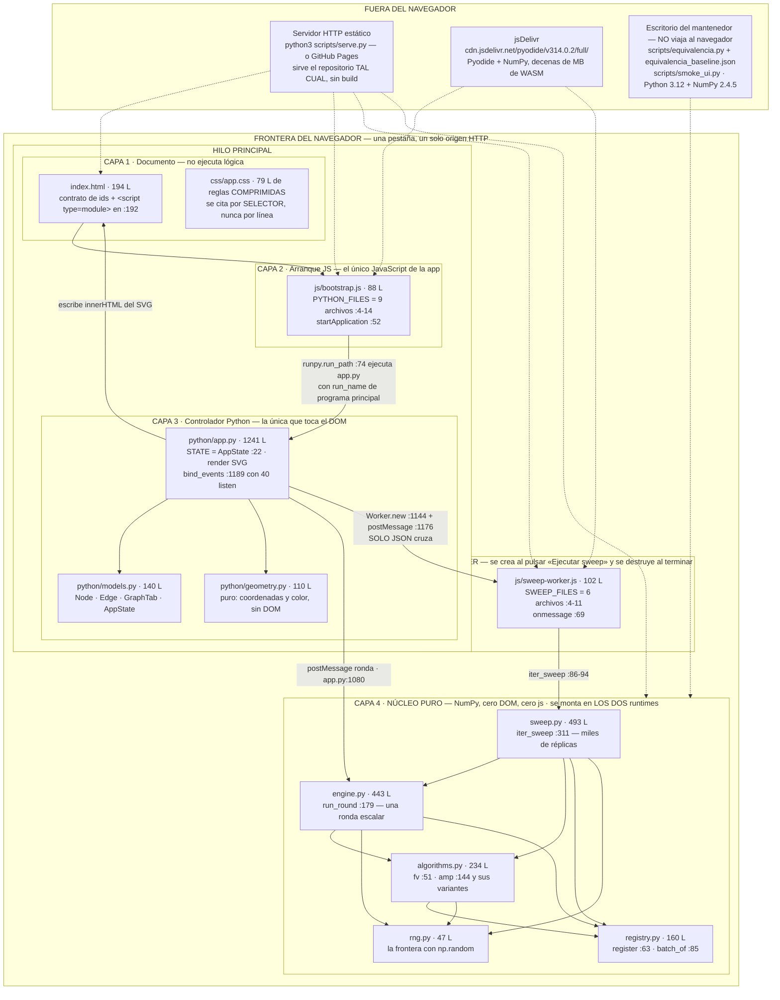
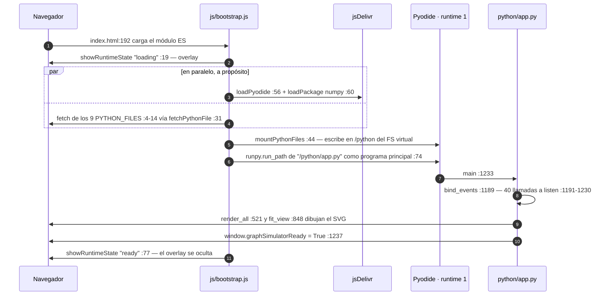
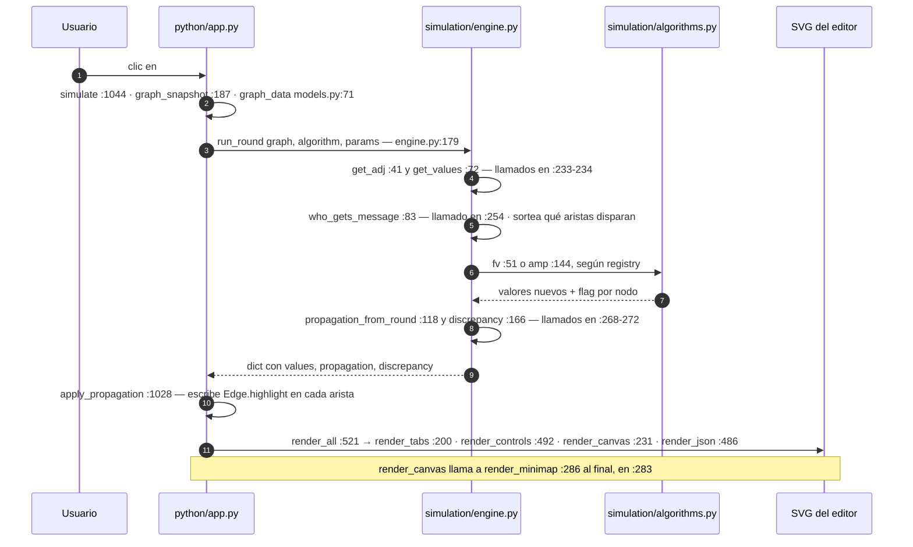
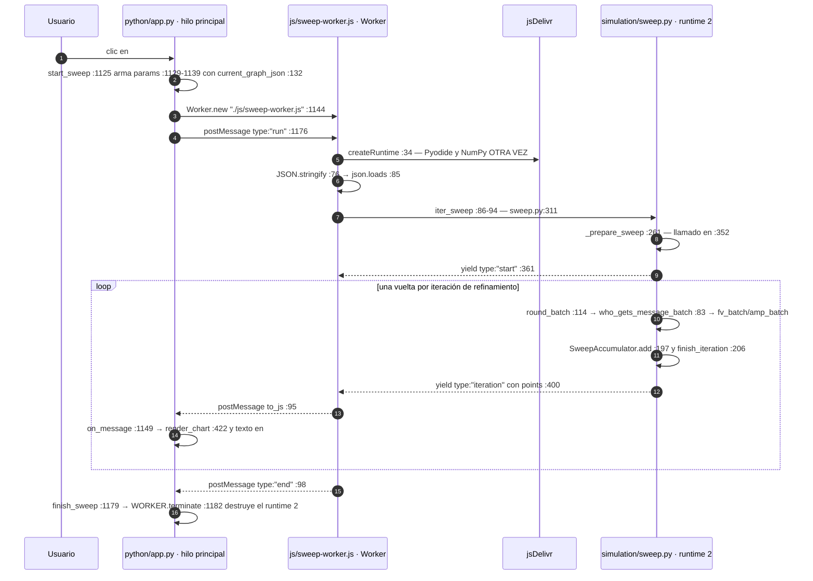

# MAPA — el plano de `consenso-simulador`

**Qué es:** un simulador de propagación de consenso en redes que corre entero
dentro del navegador, con Python real ejecutado por Pyodide sobre WebAssembly —
sin backend, sin build, sin `npm install`.

**Si es tu primer día, no empieces aquí:** empieza por
[**00 — Empezar aquí**](00-empezar-aqui.md), que se lee en cinco minutos y te
deja el proyecto corriendo. Este mapa es lo que abres **después**, y al que
vuelves cada vez que no sepas dónde vive algo.

Este documento **no explica nada por dentro**. Orienta: te dice qué piezas hay,
cómo se llaman entre sí, en qué archivo vive cada una y qué sección abrir. Todo
número de línea que aparece aquí está verificado contra el fuente.

---

## Arranque rápido — los tres comandos

> **Archivos que cubre:** `scripts/serve.py`, `scripts/equivalencia.py`, `scripts/smoke_ui.py`.
> **Qué puedes cambiar aquí:** los valores por defecto de `--host` / `--port` de `serve.py`.
> **Qué es intocable y por qué:** los MIME de `.wasm` (`application/wasm`) y `.mjs` (`text/javascript`) que fija `serve.py` — **INVARIANTE**: sin ellos el navegador rechaza el módulo ES y el WebAssembly de Pyodide, y la app no arranca en absoluto.
> **Cómo verificas el cambio:** `python3 scripts/serve.py` y abrir `http://localhost:8000`; el overlay `#python-loader` debe desaparecer solo.

Los tres se corren desde la raíz del proyecto
(`/Users/rou/Desktop/Chamba/Sergio/consenso-simulador`) y no necesitan instalar
nada más que Python y NumPy de escritorio.

```bash
# 1. LEVANTAR LA APP  ->  abre http://localhost:8000
#    Abrir index.html con doble clic NO funciona (módulos ES, fetch y Worker
#    exigen origen HTTP). Detalle en 00 §3.
python3 scripts/serve.py

# 2. VERIFICAR EL MOTOR  ->  "OK — 1026 casos idénticos a la línea base."
#    La variable evita que se escriban .pyc dentro del árbol del proyecto.
PYTHONDONTWRITEBYTECODE=1 python3 scripts/equivalencia.py

# 3. VERIFICAR LA INTERFAZ SIN NAVEGADOR
#    -> "OK — todas las comprobaciones de la interfaz pasaron."
python3 scripts/smoke_ui.py
```

Ninguno de los tres sustituye el recorrido visual en el navegador: el propio
`smoke_ui.py` lo dice en su última línea.

### Las tres marcas que verás en toda la documentación

| Marca | Significa | Qué haces con ella |
|---|---|---|
| **INVARIANTE** | Romperlo rompe el sistema. | No lo toques. Si tienes que tocarlo, lee la sección entera antes. |
| **DECISIÓN DELIBERADA** | Se eligió así por un motivo, y el motivo va escrito al lado. | Puedes cambiarlo, pero refuta el motivo primero. |
| **DEUDA CONOCIDA** | Está mal, se sabe que está mal, y sigue ahí. | No lo "arregles" sin leer: hay código y documentación que dependen del estado actual. |

Sin la marca no se distingue lo sagrado de lo simplemente roto. La lista
completa vive en [09 — Invariantes y deuda](09-invariantes-y-deuda.md).

---

## 1. El sistema en una vista

> **Archivos que cubre:** `index.html`, `css/app.css`, `js/bootstrap.js`, `js/sweep-worker.js`, `python/app.py`, `python/models.py`, `python/geometry.py`, `python/simulation/*.py`, `scripts/*.py`.
> **Qué puedes cambiar aquí:** nada — este diagrama es un índice, no código. Actualízalo cuando agregues o borres un archivo del árbol.
> **Qué es intocable y por qué:** la dirección de las flechas de la capa 4 — **INVARIANTE**: el núcleo `python/simulation/` no importa nada de las capas de arriba, y por eso el mismo código corre en el hilo principal y dentro del Worker sin cambiar una línea.
> **Cómo verificas el cambio:** `grep -rn "^from \|^import " python/simulation/` — no debe aparecer ni `app`, ni `models`, ni `geometry`, ni `js`, ni `pyodide`.

Cuatro capas, dos intérpretes de Python, una frontera. Lo que hay que retener es
que **todo el estado vive en un solo sitio** (`STATE`, en el hilo principal) y
que **la única cosa que cruza al Worker es JSON**.



Cuatro lecturas que ahorran horas:

1. **Las capas sólo miran hacia abajo.** La capa 4 no sabe que existe un
   navegador; la capa 3 es la única que importa `js` y `pyodide.ffi`
   (`python/app.py:13-14`). Por eso el sweep puede correr en un Worker sin DOM.
   **INVARIANTE.**
2. **El Worker monta 6 archivos y no 9** (`js/sweep-worker.js:4-11` contra
   `js/bootstrap.js:4-14`): sin `app.py`, `models.py` ni `geometry.py`.
   **DECISIÓN DELIBERADA** — es un candado arquitectónico: si algún día
   `sweep.py` importara `models.py`, el Worker fallaría al instante, y eso es
   exactamente lo que se busca.
3. **Las dos listas de `.py` están escritas a mano.** No hay descubrimiento
   automático de archivos. Agregar un `.py` sin agregarlo a la lista que
   corresponde produce un `ModuleNotFoundError` dentro de Pyodide. **INVARIANTE**
   — el detalle está en [01 §7](01-arranque.md).
4. **El grafo de dependencias del núcleo es acíclico y lo será siempre.**
   `registry.py` y `rng.py` no importan nada interno; `algorithms.py` importa
   esos dos; `engine.py` importa `algorithms`, `registry` y `rng`; `sweep.py`
   importa `engine`, `algorithms`, `registry` y `rng`. Ese orden es el que hace
   que un algoritmo nuevo se enchufe sin tocar los motores
   ([06 §1](06-registro-algoritmos.md)).

---

## 2. Los tres flujos

> **Archivos que cubre:** `index.html`, `js/bootstrap.js`, `js/sweep-worker.js`, `python/app.py`, `python/simulation/engine.py`, `python/simulation/sweep.py`.
> **Qué puedes cambiar aquí:** nada — son siluetas. El detalle de cada paso vive en las secciones 01, 04 y 05, enlazadas en cada flujo.
> **Qué es intocable y por qué:** el orden `bind_events() → render_all() → fit_view()` de `main()` (`app.py:1345-1350`) — **INVARIANTE**: `fit_view` mide el SVG ya dibujado; invertirlo deja el encuadre calculado sobre un lienzo vacío.
> **Cómo verificas el cambio:** `python3 scripts/serve.py`, abrir `http://localhost:8000`, y comprobar en la consola que `window.graphSimulatorReady === true` (`app.py:1350`).

### 2.1 Arranque — de abrir la página a la app viva

Detalle completo: [**01 — Arranque**](01-arranque.md).



**INVARIANTE** — cada callback que se pasa al DOM tiene que ir envuelto en
`retain()` (`app.py:40`, usado desde `listen()` en `app.py:46`). Un proxy no
retenido lo recolecta Python y el listener muere **sin ningún error visible**:
el botón simplemente deja de responder. Es el fallo más caro de diagnosticar del
proyecto ([03 §2](03-interfaz.md)).

### 2.2 Simular una ronda — del clic al píxel

Detalle completo: [**04 — Simulación individual**](04-simulacion-individual.md).



**DEUDA CONOCIDA (previa al refactor, verificada también en el respaldo
anterior)** — el **color** que decide `apply_propagation` no llega a la pantalla.
`render_canvas` escribe el color de arista como **atributo de presentación**
(`stroke="…"` en `app.py:253-254`), y en CSS cualquier regla vence a un atributo
de presentación. Como existe la regla `.edge-path { stroke:#6c6690;
stroke-width:3 }`, **todas** las aristas se pintan igual y los cuatro estados de
`edge_style()` (`app.py:221`: `updated` / `delivered` / `quiet` / seleccionada)
no se distinguen en pantalla. Las reglas `.edge-path.is-updated`,
`.is-delivered`, `.is-idle` y `.is-selected` existen en el CSS pero están
**muertas**, porque `render_canvas` nunca emite esas clases. Lo único que sí se
ve tras simular es la animación punteada, vía `.edge-animated .edge-path`,
porque esa clase sí se emite (`app.py:251`). No lo "arregles" a ciegas: el
diagnóstico completo y las dos formas de repararlo están en
[09 §C](09-invariantes-y-deuda.md).

### 2.3 Barrido (sweep) — el segundo runtime

Detalle completo: [**05 — Barrido**](05-barrido-sweep.md).



Tres cosas que sorprenden la primera vez:

- **Cada barrido vuelve a descargar Pyodide y NumPy.** `finish_sweep`
  (`app.py:1291`) y `stop_sweep` (`app.py:1226`) llaman a `WORKER.terminate()`,
  así que el runtime 2 se destruye entero. Con caché caliente es rápido; sin red,
  el segundo sweep falla. La frase "todo corre en el navegador" es cierta para el
  **cálculo**, no para la **carga**.
- **«Detener» hoy es exactamente `terminate()`.** `CancellationToken`
  (`sweep.py:41`), `is_cancelled` (`:59`) y los `_check_cancelled` (`:78`)
  existen y están probados, pero el Worker llama a `iter_sweep`
  **sin** el argumento `cancel` (`js/sweep-worker.js:107-115`), de modo que el
  evento `cancelled` es inalcanzable. Es API preparada y no cableada, no un bug.
- **El evento `type:"end"` lo emite el JS del Worker** (`js/sweep-worker.js:132`),
  no `iter_sweep`. Buscarlo en el Python es perder media hora.

---

## 3. Mapa de archivos

> **Archivos que cubre:** todos los del repositorio.
> **Qué puedes cambiar aquí:** agrega una fila cuando agregues un archivo. Si el archivo es un `.py`, agregarlo a esta tabla **no** basta: hay que meterlo también en `PYTHON_FILES` y, si vive en `python/simulation/`, en `SWEEP_FILES`.
> **Qué es intocable y por qué:** `.nojekyll` (0 bytes, en la raíz) — **INVARIANTE**: sin él, GitHub Pages pasa el sitio por Jekyll, que excluye todo archivo que empiece con guion bajo, y `python/simulation/__init__.py` desaparece del sitio publicado.
> **Cómo verificas el cambio:** `python3 scripts/serve.py` y recargar; si un `.py` falta en las listas, la consola muestra `ModuleNotFoundError` y el overlay se queda cargando.

| Archivo | Qué hace | Sección |
|---|---|---|
| `index.html` (194 L) | Esqueleto y **contrato de `id`s**: cada `by_id("…")` de `app.py` espera un `id` que existe aquí. Carga `js/bootstrap.js` como módulo ES en `:192`. | [01](01-arranque.md) |
| `css/app.css` (79 L) | Todo el estilo. **Reglas comprimidas en líneas gigantes: se cita por selector** (`.edge-path`, `.python-loader`, `.edge-animated .edge-path`), nunca por número de línea. | [03](03-interfaz.md) |
| `js/bootstrap.js` (88 L) | Descarga Pyodide, monta los **9** `.py` en el FS virtual y ejecuta `app.py` como `__main__`. Controla el overlay de carga. | [01](01-arranque.md) |
| `js/sweep-worker.js` (102 L) | Segundo runtime Pyodide dentro de un Web Worker. Monta **6** `.py` (solo `simulation/`), corre `iter_sweep` y reenvía cada evento con `postMessage`. | [05](05-barrido-sweep.md) |
| `python/app.py` (1241 L) | El controlador. Único archivo que importa `js` y `pyodide.ffi`. Estado (`STATE`), render del SVG por `innerHTML`, 40 listeners, diálogos, gráfica del sweep. | [03](03-interfaz.md) |
| `python/models.py` (140 L) | Las dataclasses: `Node` `:11`, `Edge` `:37`, `GraphTab` `:64`, `SimulationState` `:83`, `AppState` `:90`. Y `graph_data()` `:71`, el puente al JSON del motor. | [02](02-modelo-de-datos.md) |
| `python/geometry.py` (110 L) | Matemática de dibujo sin DOM: `node_center` `:34`, `edge_geometry` `:38`, `fit_transform` `:97`, `value_color` `:20`. | [03](03-interfaz.md) |
| `python/simulation/__init__.py` (88 L) | Re-exporta la API pública del núcleo. **Empieza con guion bajo: es el archivo que `.nojekyll` protege.** | [01](01-arranque.md) |
| `python/simulation/registry.py` (160 L) | El registro: `AlgorithmSpec` `:44`, `ParamSpec` `:34`, `register` `:63`, `batch_of` `:85`, y las vistas vivas que consumen motores e interfaz. | [06](06-registro-algoritmos.md) |
| `python/simulation/rng.py` (47 L) | La **única** frontera con `np.random`: `random_array` `:19`, `random_index` `:28`, `native_scalar` `:39`. Que sea única es lo que hace reproducible el arnés. | [07](07-verificacion.md) |
| `python/simulation/algorithms.py` (234 L) | Los algoritmos y su registro: `fv` `:51`, `fv_batch` `:86`, `fv_updated` `:109`, `amp` `:144`, `amp_batch` `:173`, `amp_updated` `:188`. **Es el archivo que editas para agregar uno nuevo.** | [06](06-registro-algoritmos.md) |
| `python/simulation/engine.py` (443 L) | Motor escalar: `get_adj` `:41`, `who_gets_message` `:83`, `propagation_from_round` `:118`, `discrepancy` `:166`, `run_round` `:179`, `simulate_graph` `:310`, `run_simulation` `:352`. | [04](04-simulacion-individual.md) |
| `python/simulation/sweep.py` (493 L) | Motor vectorizado: `who_gets_message_batch` `:83`, `round_batch` `:114`, `SweepAccumulator` `:178`, `_prepare_sweep` `:261`, `iter_sweep` `:311`, `run_sweep` `:454`. | [05](05-barrido-sweep.md) |
| `scripts/serve.py` (62 L) | Servidor estático de desarrollo, solo biblioteca estándar. Fija los MIME de `.wasm` y `.mjs`, sin los cuales el navegador rechaza el módulo y el WASM. | [00 §3](00-empezar-aqui.md) |
| `scripts/equivalencia.py` (485 L) | El arnés: **1026 casos** comparados contra la línea base. La tupla `ALGORITMOS = ("fv", "amp")` de `:187` decide qué algoritmos se capturan. | [07](07-verificacion.md) |
| `scripts/equivalencia_baseline.json` | La línea base grabada (macOS arm64, Python 3.12, NumPy 2.4.5). **INVARIANTE**: nunca se regraba con `--grabar` sin justificarlo por escrito. | [07 §4](07-verificacion.md) |
| `scripts/smoke_ui.py` (296 L) | DOM simulado en Python puro: comprueba que el `<select>` se puebla desde el registro, que los campos de parámetros llegan al motor y que el eje Y usa números redondos. | [07 §8](07-verificacion.md) |
| `.github/workflows/pages.yml` | Dos jobs: `verificar` y `publicar`. **DECISIÓN DELIBERADA**: `publicar` **no** tiene `needs: verificar`, así que un arnés en rojo publica igual — informa, no bloquea. El motivo está escrito en el propio YAML. | [08 §2](08-despliegue.md) |
| `.nojekyll` (0 bytes, raíz) | Infraestructura crítica: desactiva Jekyll en GitHub Pages. **INVARIANTE.** | [08 §3](08-despliegue.md) |
| `README.md` | Instalación y uso, orientado a quien solo quiere correrlo. | — |
| `DOCUMENTACION.md` y `docs/01-runtime-y-arranque.md` … `docs/06-formatos-flujos-y-detalles.md` | **DEUDA CONOCIDA — HISTÓRICO, anterior al registro de algoritmos.** Contradicen a este mapa en números y arquitectura: `DOCUMENTACION.md` dice «app.py 1169 L» y `docs/05-controlador-app.md` dice «1103 líneas» cuando el archivo tiene **1241**; ninguno de esos seis archivos contiene la cadena `register(`, es decir todos son previos al registro. **No los uses como fuente.** Están pendientes de borrado o de marcado como histórico. | — |
| `docs/00-…` a `docs/09-…` y `docs/rendimiento-y-hardware.md` | La documentación vigente. Índice en la sección 4 de este mapa. | — |

**DEUDA CONOCIDA** — `docs/rendimiento-y-hardware.html` y `.pdf` existen en
disco pero están en `.gitignore`: se generan con pandoc y **no viajan con el
repositorio**. La fuente `.md` sí.

**DECISIÓN DELIBERADA (con consecuencia que conviene conocer)** — el workflow
publica con `upload-pages-artifact` y `path: .`, o sea **el repositorio entero**.
Eso significa que `scripts/`, `docs/`, `README.md` y `equivalencia_baseline.json`
quedan públicamente descargables desde el sitio. Comprobado: las reglas de trabajo del proyecto,
Las reglas de trabajo del proyecto y la configuración local del entorno **no** lo están (dan 404). Detalle y comandos de
comprobación en [08 §4](08-despliegue.md).

---

## 4. Índice de secciones

> **Archivos que cubre:** `docs/00-empezar-aqui.md` … `docs/09-invariantes-y-deuda.md` y `docs/rendimiento-y-hardware.md`.
> **Qué puedes cambiar aquí:** agrega una fila cuando escribas una sección nueva, y añade su enlace a la tabla de la sección 5.
> **Qué es intocable y por qué:** el orden 00→09 — **DECISIÓN DELIBERADA**: cada sección usa solo vocabulario ya introducido por las anteriores; leer 04 antes de 02 no funciona porque 04 da por sabidas las tres representaciones del grafo.
> **Cómo verificas el cambio:** que cada enlace abra, y que la sección citada cubra de verdad los archivos que su recuadro de cabecera promete.

| Sección | Para qué sirve |
|---|---|
| [**00 — Empezar aquí**](00-empezar-aqui.md) | La puerta de entrada: qué modela el proyecto, glosario mínimo, cómo se corre, checklist del primer día, el proyecto de referencia y la tabla de constantes. Cinco minutos. |
| [**01 — Arranque**](01-arranque.md) | Por qué el proyecto tiene esta forma: sin backend ni build, las dos listas manuales de `.py`, los dos runtimes, el contrato de `id`s de `index.html`, `runpy` y `sys.path`, y `retain()` como lo que mantiene viva la aplicación. |
| [**02 — Modelo de datos**](02-modelo-de-datos.md) | Qué es exactamente un grafo aquí: las tres representaciones (dataclasses → JSON plano → matriz NumPy), la conversión unidireccional y cómo se agrega un campo al modelo. |
| [**03 — Interfaz**](03-interfaz.md) | El editor por dentro: `STATE`, las cuatro capas SVG, la regeneración completa por `innerHTML`, la delegación de eventos, el umbral de 6 px, la captura de puntero, el minimapa y la gráfica. |
| [**04 — Simulación individual**](04-simulacion-individual.md) | El recorrido de un dato desde el clic hasta el píxel, con formas de datos reales. Aquí vive la explicación **canónica** de las dos orientaciones de la matriz (`messages[target, source]`). |
| [**05 — Barrido (sweep)**](05-barrido-sweep.md) | El cruce de runtimes, el eje extra de los tensores, por qué el barrido tira los pesos, el contrato de eventos, el reparto del trabajo y el estado real de la cancelación. |
| [**06 — Registro de algoritmos**](06-registro-algoritmos.md) | Cómo se agrega un algoritmo: `AlgorithmSpec`, `ParamSpec`, `register()`, las tres funciones de firma uniforme y cómo la interfaz genera sus campos sola. La sección-recompensa; léela después de 04 y 05. |
| [**07 — Verificación**](07-verificacion.md) | Los dos scripts, qué cubren y qué **no**, `--grabar` y su peligro, el control negativo, el CI que informa pero no bloquea, y el entorno exacto en el que el resultado significa algo. |
| [**08 — Despliegue**](08-despliegue.md) | Del `push` al sitio en vivo: los dos jobs, `path: .`, `.nojekyll`, el dominio `simulador.ruee.dev` en Cloudflare con la nube **gris**, publicar en otro hosting, y cómo comprobar un despliegue. |
| [**09 — Invariantes y deuda**](09-invariantes-y-deuda.md) | La página a la que se vuelve: lista negra de lo intocable, decisiones deliberadas con su motivo, deuda conocida y tolerada, y la tabla única de síntomas visibles → causa. |
| [**Rendimiento y hardware**](rendimiento-y-hardware.md) | Perfil de cómputo, mediciones, límite de memoria del sweep y criterios para cotizar equipo. |

---

## 5. Quiero cambiar X

> **Archivos que cubre:** es un índice de acciones; los archivos son los de la columna «Toco».
> **Qué puedes cambiar aquí:** agrega una fila cada vez que descubras un cambio cuyo alcance real no fuera obvio. Esta tabla es el sitio donde se paga esa lección una sola vez.
> **Qué es intocable y por qué:** la columna «Verifico con» — **INVARIANTE de proceso**: las reglas de trabajo del proyecto obligan a verificar antes y después de todo cambio bajo `python/simulation/`, y a hacer el recorrido visual en navegador antes de dar una etapa por terminada.
> **Cómo verificas el cambio:** corriendo el comando de la fila que acabas de editar, tal cual está escrito.

| Quiero… | Leo… | Toco… | Verifico con… |
|---|---|---|---|
| **Agregar un algoritmo** | [06](06-registro-algoritmos.md), después [07 §9](07-verificacion.md) | **Dos archivos.** Para que funcione **en la app** basta `python/simulation/algorithms.py`: escribes las funciones, llamas a `register(AlgorithmSpec(...))` y el `<select>`, el motor individual y el sweep lo recogen solos. **Pero el arnés no lo cubrirá**: los 1026 casos recorren la tupla `ALGORITMOS = ("fv", "amp")` de `scripts/equivalencia.py:187`, así que hay que agregar ahí su clave y **después** regrabar la línea base. | `PYTHONDONTWRITEBYTECODE=1 python3 scripts/equivalencia.py` → debe seguir diciendo `OK`; luego `--grabar` (esta regrabación **sí** es legítima: agrega claves nuevas sin alterar las viejas) y comprobar que los 1026 casos previos conservan su valor. Después `python3 scripts/smoke_ui.py`. |
| **Cambiar la matemática de una ronda** | [04](04-simulacion-individual.md), después [07 §4](07-verificacion.md) | `python/simulation/engine.py` (`run_round` `:179`, `who_gets_message` `:83`) o `python/simulation/algorithms.py`. | `PYTHONDONTWRITEBYTECODE=1 python3 scripts/equivalencia.py` **antes y después**. Si falla, eso **es** el hallazgo: nunca `--grabar` para taparlo. |
| **Cambiar el barrido** | [05](05-barrido-sweep.md) | `python/simulation/sweep.py`. Si cambias el contrato de eventos, también `on_message` en `python/app.py:1261`; si cambias los argumentos, también `js/sweep-worker.js:107-115`. | `PYTHONDONTWRITEBYTECODE=1 python3 scripts/equivalencia.py` (el arnés cubre `iter_sweep`), y un sweep corto en el navegador: 21 puntos, 200 sims, 5 iteraciones, viendo `#sweep-status` avanzar de `Iteración 1/5` a `5/5`. |
| **Cambiar cómo se dibuja algo** | [03 §4-§5](03-interfaz.md), y [09 §C](09-invariantes-y-deuda.md) antes de tocar aristas | `render_canvas` `python/app.py:233`, `render_minimap` `:286`, `render_chart` `:422`, o `python/geometry.py`. Ojo: **el color de arista hoy no llega a la pantalla** (ver flujo 2.2). | `python3 scripts/smoke_ui.py` y recorrido visual en `http://localhost:8000`: crear dos nodos, conectarlos con Shift, simular, y mirar el resultado con las herramientas de desarrollo. |
| **Cambiar el tema visual** | [03](03-interfaz.md) | `css/app.css`, **por selector**: `.edge-path`, `.edge-animated .edge-path`, `.python-loader`, `.python-loader.is-ready`, `.graph-node`. El archivo tiene las reglas comprimidas en líneas enormes: no lo edites por número de línea. | Recorrido visual en `http://localhost:8000`, en editor y en la vista de análisis. Comprueba también el overlay de carga: **DEUDA CONOCIDA** — no hay regla para `[data-state="error"]`, así que un arranque fallido se ve igual que uno cargando. |
| **Agregar un control a la interfaz** | [01 §2](01-arranque.md) y [03 §10](03-interfaz.md) | `index.html` (el `id` nuevo) **y** `python/app.py`: la función manejadora más una línea `listen(by_id("…"), "evento", manejador)` dentro de `bind_events()` (`:1189`, hoy 40 llamadas entre `:1191` y `:1230`). **INVARIANTE**: pasa siempre por `listen`/`retain`; un callback sin retener muere en silencio. | `python3 scripts/smoke_ui.py` y clic real en el navegador. Si el control no responde y **no** hay error en consola, sospecha del proxy no retenido antes que de tu lógica. |
| **Agregar un archivo `.py`** | [01 §7](01-arranque.md) | El archivo nuevo **y** la lista que corresponda: `PYTHON_FILES` en `js/bootstrap.js:4-14` siempre; además `SWEEP_FILES` en `js/sweep-worker.js:4-11` **solo** si vive en `python/simulation/` y el sweep lo necesita. No hay descubrimiento automático. | Recargar `http://localhost:8000`: si falta en la lista, el overlay se queda cargando y la consola muestra `ModuleNotFoundError`. Para el Worker, correr un sweep corto. |
| **Cambiar la versión de Pyodide** | [00 §7](00-empezar-aqui.md) y [07](07-verificacion.md) | **Cuatro sitios escritos a mano:** `js/bootstrap.js:1` y `:3`, `js/sweep-worker.js:1` y `:3`. Cambiar tres de cuatro deja la app en una versión y el sweep en otra. | `grep -rn "314.0.2" js/ index.html python/ scripts/ .github/` debe devolver exactamente 4 líneas. **INVARIANTE**: un cambio de Pyodide arrastra un cambio de NumPy y la línea base compara flotantes **exactos**, así que hay que revalidar la simulación completa antes de publicar. |
| **Cambiar los límites del sweep** (puntos de p, simulaciones, iteraciones, rondas) | [05 §3](05-barrido-sweep.md) y [00 §7](00-empezar-aqui.md) | **Dos sitios sin nada que los sincronice**: los atributos de los `<input>` en `index.html:127-136` y las cuatro llamadas a `_validated_int` (definido en `python/simulation/sweep.py:245`) dentro de `_prepare_sweep`, en `sweep.py:275-280`. **DEUDA CONOCIDA** — además `positive_int` (`app.py:1212`) solo aplica el mínimo, no el máximo: el techo real lo impone el Worker y el exceso llega como texto de error en `#sweep-status`. | Poner un valor fuera de rango en el formulario y comprobar qué mensaje aparece en `#sweep-status`. |
| **Publicar el sitio** | [08](08-despliegue.md) | Nada de código: `git push` a `main` dispara `.github/workflows/pages.yml`. Recuerda que `publicar` **no** depende de `verificar`, así que el arnés en rojo **no** te detiene. | `curl -sI https://simulador.ruee.dev/.nojekyll` → debe dar **200**; si da 404, el sitio está muerto. Después abrir el sitio y comprobar que el overlay desaparece solo. |
| **Cambiar el dominio** | [08 §5](08-despliegue.md) | **Nada en el repositorio**: no existe archivo `CNAME` y no debe crearse uno. El dominio se configura en **Settings → Pages → Custom domain** y en el DNS de Cloudflare, donde el `CNAME` a `rou-uu.github.io` va con la **nube gris** (*DNS only*). **INVARIANTE**: con la nube naranja el desafío ACME no llega a GitHub, el certificado nunca se emite y, al ser un TLD `.dev` precargado en HSTS, el sitio queda inaccesible sin opción de continuar. | `dig +short simulador.ruee.dev` → debe devolver `rou-uu.github.io.` seguido de IPs `185.199.10x.153`. Si ves `104.21.x.x` o `172.67.x.x`, alguien proxeó el registro. |
| **Agregar un campo al modelo de datos** | [02 §6](02-modelo-de-datos.md) | `python/models.py` (`from_json` / `to_json` de `Node` `:18`-`:28` y de `Edge` `:45`-`:54`). **DECISIÓN DELIBERADA**: `Edge.highlight` está deliberadamente **fuera** de `to_json` — es estado de presentación, no del grafo, y meterlo cambiaría el contrato JSON que comparte con el proyecto de referencia. | `PYTHONDONTWRITEBYTECODE=1 python3 scripts/equivalencia.py`, y en el navegador: exportar un JSON, limpiar el grafo, reimportarlo y comprobar que el grafo vuelve igual. |
| **Entender por qué algo se ve raro o no responde** | [09 §D](09-invariantes-y-deuda.md), la tabla única de síntomas | Nada todavía: primero identifica el canal. El overlay `#python-loader` para fallos de arranque, un diálogo del editor para errores de simulación, `#sweep-status` para el barrido, y **la consola** para lo único sin síntoma visible: un `retain()` olvidado. | Abrir la consola del navegador **antes** de reproducir el fallo. Un listener muerto no imprime nada: se diagnostica por descarte. |

---

## Antes del primer commit

> **Archivos que cubre:** `scripts/equivalencia_baseline.json`, y el proyecto de referencia `/Users/rou/Desktop/Chamba/Sergio/Simulador`.
> **Qué puedes cambiar aquí:** nada desde este mapa — las reglas de trabajo viven fuera de este mapa, y este bloque solo las hace visibles.
> **Qué es intocable y por qué:** el proyecto de referencia entero — **INVARIANTE**: es de solo lectura por contrato del proyecto, y además es el origen literal de `engine.py` y del contrato JSON; modificarlo destruye la única referencia contra la que se puede comparar.
> **Cómo verificas el cambio:** `git status` en el proyecto de referencia debe salir limpio, sin `__pycache__` ni archivos nuevos.

Tres reglas que están en las reglas de trabajo del proyecto y no en el código, y que
ningún archivo de `docs/` puede hacer cumplir por ti:

1. **El proyecto de referencia** (`/Users/rou/Desktop/Chamba/Sergio/Simulador`,
   FastAPI + React) es **de solo lectura**, incluida la prohibición de generar
   `__pycache__` dentro. Es el origen literal de `engine.py` y la fuente del
   contrato JSON. Se lee, no se toca.
2. **Nunca `--grabar` sin justificación escrita**, y nunca desde un subagente.
   Regrabar la línea base convierte un bug en el nuevo comportamiento correcto.
3. **Verificación visual en navegador antes de dar cualquier etapa por
   terminada.** Los dos scripts no ven la pantalla, y este proyecto tiene deuda
   conocida que **solo** se manifiesta en la pantalla.
