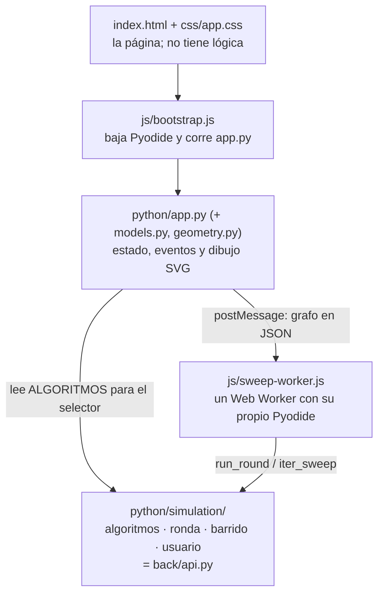

# MAPA — dónde está cada cosa

Simulador de propagación de consenso en redes. Corre entero en el navegador:
Python real (Pyodide sobre WebAssembly), sin backend ni paso de compilación.

Si es tu primer día, empieza por [00 — Empezar aquí](00-empezar-aqui.md).

## Las capas

- **Solo `app.py` toca la página.** El motor no importa `js` ni `pyodide` y corre
  igual en Python de escritorio.
- **El motor corre en el Worker.** Lo único que cruza es JSON. Hay dos Workers:
  uno permanente para las rondas del editor y otro que nace y muere con cada sweep.
- **El motor es `back/api.py`**, con los mismos nombres. Ver [MOTOR.md](MOTOR.md).

## Archivos

| Archivo | Qué hace | Doc |
|---|---|---|
| `index.html` | los `id` que `app.py` busca; la plantilla del algoritmo propio | [01](01-arranque.md) |
| `css/app.css` | todo el estilo | [03](03-interfaz.md) |
| `js/bootstrap.js` | arranque: baja Pyodide y NumPy, monta los `.py`, corre `app.py` | [01](01-arranque.md) |
| `js/sweep-worker.js` | el Worker: rondas, sweep y algoritmo propio | [01](01-arranque.md) |
| `python/app.py` | estado (`STATE`), eventos, dibujo, mensajes al Worker | [03](03-interfaz.md) |
| `python/models.py` | `Node`, `Edge`, `GraphTab`, `AppState` | [02](02-modelo-de-datos.md) |
| `python/geometry.py` | coordenadas, curvas de aristas, color por valor | [03](03-interfaz.md) |
| `python/simulation/` | el motor | [MOTOR](MOTOR.md) |
| `scripts/serve.py` | servidor local con los MIME correctos | [00](00-empezar-aqui.md) |
| `scripts/equivalencia.py` | arnés: el motor no cambió de resultados | [07](07-verificacion.md) |
| `scripts/smoke_ui.py` | la interfaz con un DOM falso | [07](07-verificacion.md) |
| `.github/workflows/pages.yml` | verificar y publicar en GitHub Pages | [08](08-despliegue.md) |

## Quiero cambiar…

| Quiero… | Toco | Verifico con |
|---|---|---|
| agregar un algoritmo | solo `python/simulation/algoritmos.py` ([MOTOR](MOTOR.md#agregar-un-algoritmo)) | `smoke_ui.py`; para cubrirlo en el arnés, agregarlo a su tupla `ALGORITMOS` y regrabar |
| probar un algoritmo sin tocar el repo | nada: «Algoritmo propio…» en el selector | la caja muestra el error con su línea |
| la matemática de una ronda o del sweep | `ronda.py` / `barrido.py`, marcando `# Cambio respecto a api.py` y anotándolo en [MOTOR](MOTOR.md) | `equivalencia.py` antes y después; si falla, es un hallazgo, no se regraba |
| cómo se dibuja algo | `render_canvas`, `render_minimap`, `render_chart` en `app.py`, o `geometry.py` | `smoke_ui.py` y el navegador |
| un control de la interfaz | el `id` en `index.html` + el manejador y su `listen(...)` en `bind_events()` | clic real en el navegador |
| un archivo `.py` nuevo | el archivo + `PYTHON_FILES` (`bootstrap.js`) y/o `SWEEP_FILES` (`sweep-worker.js`) | recargar: si falta, `ModuleNotFoundError` |
| la versión de Pyodide | los 4 sitios de `314.0.2` en los dos `.js` | `grep -rn "314.0.2" js/` da 4 líneas, y revalidar todo |
| publicar | `git push` a `main` | ver [08](08-despliegue.md) |
| entender algo raro | — | [09 — síntomas](09-invariantes-y-deuda.md#síntomas) |

## Documentos

[00](00-empezar-aqui.md) empezar · [01](01-arranque.md) arranque ·
[02](02-modelo-de-datos.md) modelo de datos · [03](03-interfaz.md) interfaz ·
[MOTOR](MOTOR.md) el motor · [07](07-verificacion.md) verificación ·
[08](08-despliegue.md) despliegue · [09](09-invariantes-y-deuda.md) invariantes y
deuda · [rendimiento](rendimiento-y-hardware.md)
